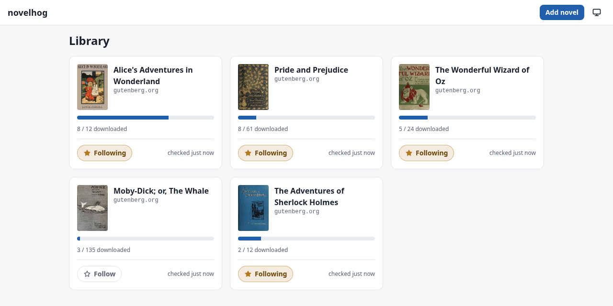
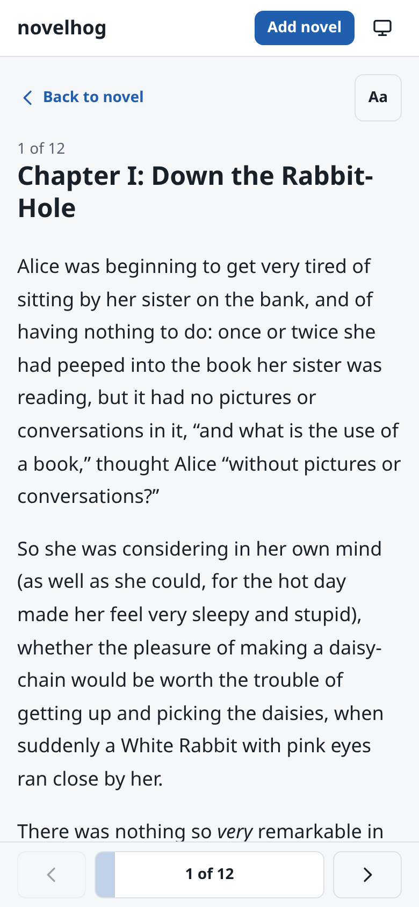
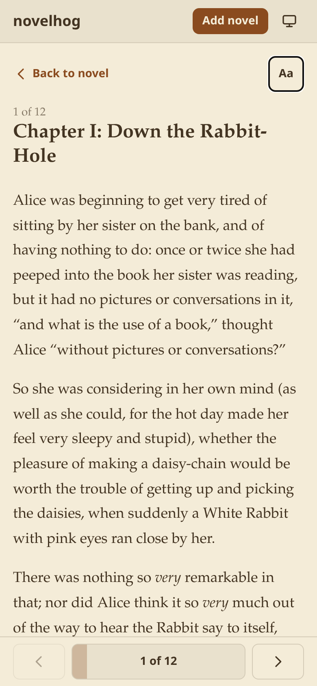
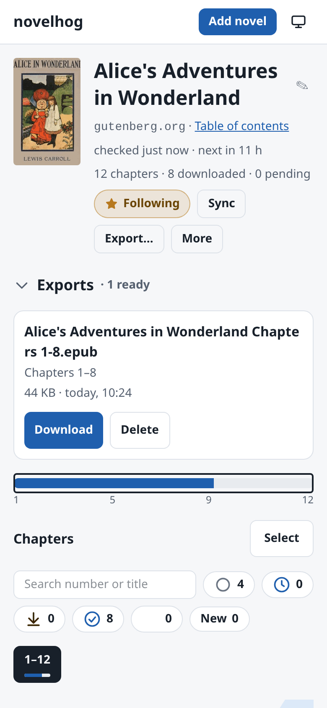

<p align="center">
  
</p>

<h1 align="center">novelhog</h1>

<p align="center">
  <strong>Your web novels, on your server, in your pocket.</strong><br>
  Download, follow and read the novels you love, in a library you fully own.
</p>

<p align="center">
  <a href="https://t3hk0d3.github.io/novelhog/">Documentation</a> ·
  <a href="https://t3hk0d3.github.io/novelhog/install/">Install</a> ·
  <a href="https://t3hk0d3.github.io/novelhog/reader/">The reader</a>
</p>

<p align="center">
  <picture>
    <source media="(prefers-color-scheme: dark)" srcset="docs/assets/screenshots/library-desktop-dark.png">
    
  </picture>
</p>

Paste a novel's table-of-contents link. novelhog fetches the chapters, keeps checking for new ones, lets you read
them in a reader made for phones, and packs them into EPUBs for your e-reader. It runs on your own hardware as a
single Docker image, so your library is yours: no accounts, no ads, nothing to lose when a site goes down.

## Why you will like it

- 📚 **Import by URL.** One link, and the novel, its cover and all its chapters are in your library.
- 🔔 **Follow and forget.** New chapters are downloaded as they appear, and you get a push notification.
- 📖 **A reader that is a joy on a phone.** Swipe between chapters, pick a theme and a font (your own too), and
  every chapter reopens where you left off.
- 📦 **EPUB export.** Split a long novel into books and send them to any e-reader.
- 🛡️ **Cloudflare-protected sites.** A FlareSolverr comes paired with the worker out of the box.
- 🥧 **Runs anywhere.** Images for `amd64` and `arm64`: a Raspberry Pi, a NAS or a Mac mini is plenty. SQLite out
  of the box, PostgreSQL if you want it.
- 📲 **Installable.** Add it to your home screen like an app; it updates live as downloads progress.

<table>
  <tr>
    <td align="center"><picture>
      <source media="(prefers-color-scheme: dark)" srcset="docs/assets/screenshots/reader-mobile-dark.png">
      
    </picture></td>
    <td align="center"></td>
    <td align="center"><picture>
      <source media="(prefers-color-scheme: dark)" srcset="docs/assets/screenshots/novel-mobile-dark.png">
      
    </picture></td>
  </tr>
</table>

## Try it in a minute

You need Docker. Then:

```sh
curl -fsSLO https://raw.githubusercontent.com/t3hk0d3/novelhog/main/compose.yaml
docker compose up -d
```

Open <http://localhost:8080> and add your first novel. To put it online behind HTTPS, with push notifications,
see the [install guide](https://t3hk0d3.github.io/novelhog/install/).

**On Home Assistant?** novelhog is an add-on too:

[](https://my.home-assistant.io/redirect/supervisor_add_addon_repository/?repository_url=https%3A%2F%2Fgithub.com%2Ft3hk0d3%2Fnovelhog)

> [!NOTE]
> novelhog has no login. Run it on a trusted network, or behind a reverse proxy that authenticates.

## Learn more

Everything else lives in the [documentation](https://t3hk0d3.github.io/novelhog/): configuration, reverse-proxy
recipes, backups and upgrades, and how to hack on novelhog itself.

## License

novelhog is free software under the [GNU AGPL v3](LICENSE).
