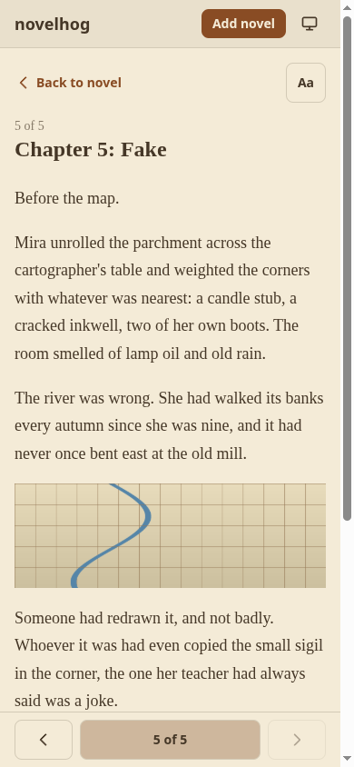
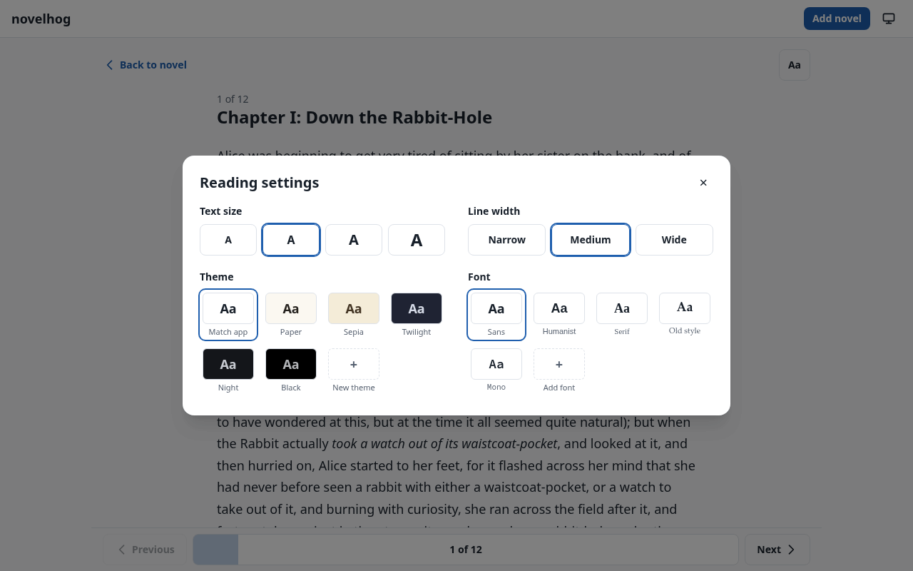
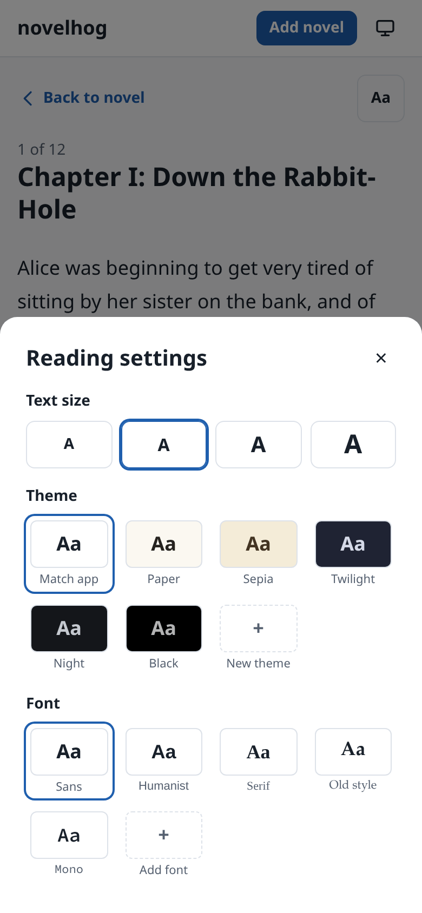
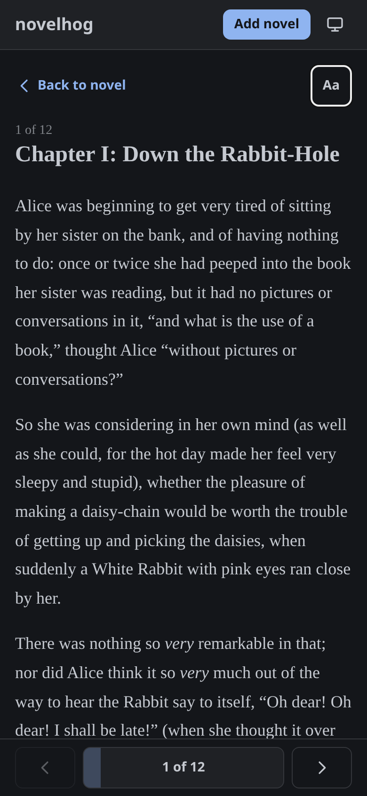
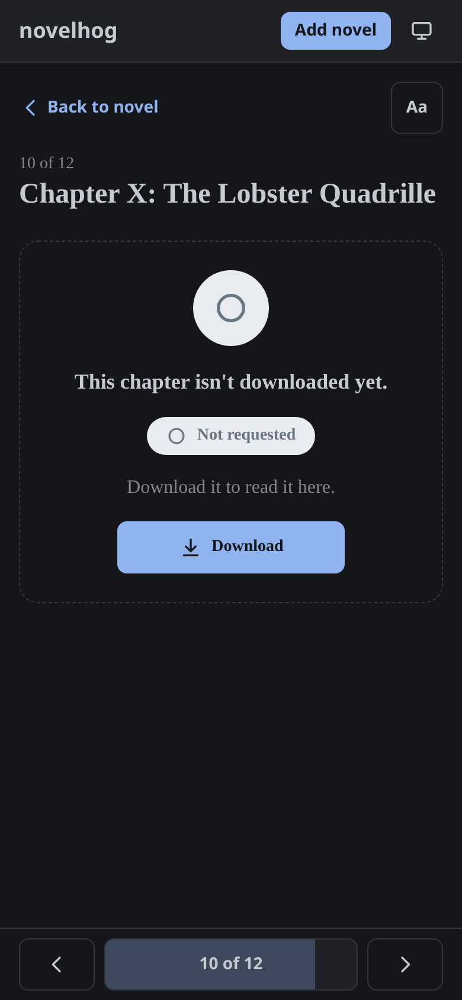

# Reading in novelhog

novelhog has a reading page for downloaded chapters, built for a phone first and fine on a desktop. This page
describes every feature of it. (The design reasoning is in section 10 of
[the design spec](https://github.com/t3hk0d3/novelhog/blob/main/docs/superpowers/specs/2026-10-18-novelhog-design.md).)

## Opening a chapter

- **Preview**: tap a chapter on the novel page to open its details, then **Preview** (under *Content*). The whole
  chapter opens in a dialog of its own; **Back** returns to the details.
- **Read**: the last button in the chapter details. It opens the reading page at `/novels/<id>/chapters/<id>`.
  Every chapter has such an address, so a link, a bookmark or a new tab works, and the browser's Back button
  returns to the novel.

Only a downloaded chapter has text. For any other chapter the reader shows its [status](#a-chapter-that-is-not-downloaded-yet).

## The page

From top to bottom: **Back to novel** and the settings button (**Aa**), the position (`3 of 500`), the chapter
title, the text, and the [bottom bar](#the-bottom-bar). The top row and the text are one page: they move together
when you swipe, and a swipe may start anywhere on it.

The text shows what the scraper kept: paragraphs, bold and italic, lists and images. Images are stored inside the
chapter, so they appear without any further download. An image that could not be fetched shows
`[image unavailable]`. Long words wrap instead of widening the page, and images shrink to fit but are never
enlarged.

## The bottom bar

| Part | What it does |
|---|---|
| **‹** (wide button) | Previous chapter. Greyed out and disabled on the first chapter. |
| Progress bar with `3 of 500` | Where you are in the novel: the bar is filled (in a tint of the accent colour) up to the end of the open chapter. Read-only. |
| **›** (wide button) | Next chapter. Greyed out and disabled on the last chapter. |

On a desktop-width window the buttons also say *Previous* and *Next*.

**On a phone the bar gets out of the way**: it slides off the bottom edge when you scroll down (after about 24 px)
and comes back as soon as you scroll up a little (about 12 px). It is always there at the very top and the very
end of a chapter, while a button in it has focus, and when a new chapter opens. On a desktop-width window it
never hides.

## Turning chapters

### By touch

- **Swipe sideways**: swipe left for the next chapter, right for the previous one. The page follows your finger
  but resists, moving ever less the further you drag (never past 40% of the width). It is deliberately heavy so
  that chapters do not change by accident:
  - the drag must be clearly sideways (a diagonal movement is left to scrolling);
  - release after dragging **60% of the width**, or flick hard (at least 100 px, fast);
  - otherwise the page springs back.
- **While you drag**, the strip the page moves away from gets darker as you get closer to a turn, and a small
  vertical **bubble** at the screen edge says *Previous chapter* or *Next chapter*. When a release would turn the
  chapter, the bubble fills with the accent colour.
- **At the first or last chapter** the page stretches a little and the bubble turns amber with a raised-hand icon:
  *First chapter* or *Last chapter*. Nothing happens on release.
- **Pull at the end of the text**: when you are at the very bottom, pulling up shows *Pull for next chapter*, which
  becomes *Release for next chapter* after about 96 px. The same at the very top for the previous chapter.
- A swipe that starts within 24 px of the screen edge is left to the system's back gesture, and a second finger
  (pinch) cancels the swipe.
- With *reduce motion* switched on in the system settings, nothing slides; the gestures still work.

While the reader is open, the browser's pull-to-refresh is switched off so that pulling at the ends turns chapters
instead of reloading the page.

### By keyboard and mouse

- **←** and **→** go to the previous and next chapter. They are ignored while you type in a field, with Ctrl, Alt,
  Meta or Shift held, and while a dialog (the settings) is open.
- The bar's buttons work with the mouse or a tap on any device.

Mouse drags and trackpad swipes do not turn chapters; the gestures are for touch screens.

## Reading settings (**Aa**)

The settings open in a dialog (a bottom sheet on a phone). Every choice applies at once and is remembered in this
browser.

On a phone the same settings open as a bottom sheet, stacked, without the line width:

| Setting | Choices |
|---|---|
| **Text size** | Four steps, from small to extra large (the default is 18 px). |
| **Line width** | Narrow, medium or wide. Only shown on desktop-width windows; on a phone the text always uses the full width. |
| **Theme** | *Match app* (the default: the app's own light or dark theme), Paper, Sepia, Twilight, Night, Black, and your own. |
| **Font** | Sans, Humanist, Serif, Old style, Mono, and your own. |

A theme recolours the **whole page** while you read: the page, the header, the bars and the buttons, not only the
text. It goes back to normal when you leave the reader.

| Sepia with *Old style* | Night with *Serif* |
|---|---|
|  |  |

### Your own themes

Press the dashed **+ New theme** tile. In the dialog that opens, give it a name (up to 30 characters) and choose a
background colour and a text colour. You see a sample line and the **contrast ratio**; below 4.5 : 1 a warning says
the text may be hard to read (you can still save it). The other colours (muted text, lines, buttons) are derived
from the two you chose. You can keep up to 20 themes. To delete one, select it and press *Delete theme …* under the
themes.

### Your own fonts

Press **+ Add font** and type a font-family name, for example `Literata`, with a fallback (serif, sans-serif or
monospace). novelhog does not download fonts: it uses fonts **installed on the device you read on**, so until the
font is installed the fallback is shown. Names may contain letters, digits, spaces, `-`, `.` and `_` (up to 60
characters). You can keep up to 20. To delete one, select it and press *Delete font …*.

The built-in fonts are system font stacks too, so nothing is ever downloaded for them either.

## Where you left off

The reader remembers how far you got in each chapter and reopens it there.

- The position is saved a moment after you stop scrolling, and when you leave the page or switch away from the
  browser.
- It is stored as a fraction of the chapter, so it still fits after you change the text size or the window width.
- When the text appears, the page jumps to the saved spot and **holds it for about three seconds** while images
  load and push the text down, until you scroll yourself.
- A chapter you read to the end (97% or more) or left at the very top is forgotten and opens at the top again.
- The 300 most recently read chapters are kept.

## A chapter that is not downloaded yet

For a chapter without text the reader shows a status card: a large icon of its state, *This chapter isn't
downloaded yet.*, its status as a pill, and what happens next.

| Status | What the card says | Button |
|---|---|---|
| Not requested | *Download it to read it here.* | **Download** queues the chapter. |
| Pending | It is in the download queue. | none |
| Downloading | It is being downloaded right now (the icon pulses). | none |
| Error | *The last download failed*, with the error message. | **Retry download** queues it again. |

Pending and downloading chapters open by themselves as soon as the download finishes; there is no need to reload.
If the text itself cannot be loaded, the reader shows the error with **Try again**.

An address that does not belong to a chapter of this novel (for example one that was removed from the table of
contents) says *This chapter no longer exists* and links back to the novel and the library.

## What is stored in your browser

Everything above is kept in the browser's `localStorage`, per browser and per device; nothing is sent to the
server and nothing follows you to another device.

| Key | Content |
|---|---|
| `novelhog.reader` | Text size, line width, the chosen theme and font, your own themes and fonts. |
| `novelhog.reader.positions` | Where you left each chapter (a fraction and a time). |

Clearing the site's data resets them. If the browser blocks storage (some private modes), the reader still works
and simply forgets everything when you close it.

## Browser support

The reader uses `color-mix()`, dynamic viewport units (`dvh`) and `overflow: clip`, which every current Safari,
Chrome, Edge and Firefox has (Safari 16.2 or later).
