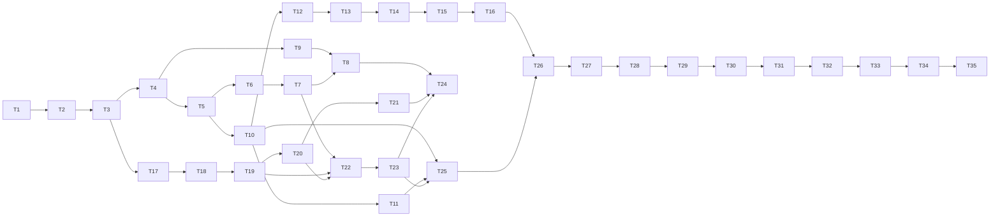

# novelhog Implementation Plan

> **For agentic workers:** REQUIRED SUB-SKILL: Use superpowers:subagent-driven-development (recommended) or superpowers:executing-plans to implement this plan task-by-task. Steps use checkbox (`- [ ]`) syntax for tracking.

**Goal:** Build novelhog v1, a self-hosted web UI around `web-novel-scraper`
(library, background chapter downloads, adaptive TOC refresh, Web Push release
notifications, asynchronous EPUB exports) as specified in the design spec.

**Architecture:** Two containers from one image. `novelhog-web` runs Caddy (SPA,
`/static`, reverse proxy) and a stateless FastAPI app that only talks to the database
through `novelhog.repo`. `novelhog-worker` owns everything about novels (scraper,
FlareSolverr, syncs, downloads, export builds) and delivers notifications by
consuming the `events` log through pluggable channels. The React PWA talks REST +
SSE to `/api/v1`.

**Tech Stack:** Python 3.14, uv, FastAPI, uvicorn, SQLAlchemy Core 2.x + Alembic over
SQLite (default) or PostgreSQL 16 (`psycopg`), `web-novel-scraper==2.13.1`, Pillow, `markdown-it-py`,
`ebooklib`, `pywebpush`, `py-vapid`, `structlog`, `import-linter`; pytest,
`httpx`; React 19, TypeScript, Vite, TanStack Query, React Router, Tailwind CSS,
`openapi-typescript`, Vitest, Testing Library, Playwright; Caddy 2, Docker
Compose, `tini`.

**Spec:** `docs/superpowers/specs/2026-10-18-novelhog-design.md`. Every task
cites the spec sections it implements (`§N`); executors read the cited sections
before starting. The spec wins over this plan if they ever disagree; report the
disagreement instead of guessing.

**How this plan is written (from the user's planning rules):**
- Task 1 creates `STYLEGUIDE.md`; every later task follows it.
- Each task has a **BDD skeleton** (`Class/Module → method → scenario →
  effect`). Tests come straight from it: **one test per effect, grouped by
  scenario**, named per the styleguide (`test_<unit>__<behaviour>`).
- The plan contains **no implementation code**. Signatures, data shapes,
  schemas and shell commands are given; behaviour is defined by the skeleton
  and the cited spec sections. The few tricky algorithms (claiming, pruning,
  dispatch) already have pseudocode in the spec; tasks point to it.

## Global Constraints

- Python **3.14**, managed with **uv**; `ruff format`, `ruff check`,
  `mypy --strict`, `pytest`; no bare `except:`.
- TypeScript strict; `eslint` + `prettier`; Vitest; components
  `PascalCase.tsx`, hooks `useX.ts`, tests colocated `*.test.tsx`.
- Package `novelhog` under `src/novelhog/`; tests under
  `tests/{unit,integration,api,fixtures}`; web app under `web/`.
- `web-novel-scraper` pinned **`==2.13.1`**; imported **only** by
  `novelhog.scraper_adapter`.
- Database access only through **SQLAlchemy Core 2.x** in `novelhog.repo` (no
  ORM, no raw SQL strings); schema in `repo/schema.py` per spec §4 and its
  portability mapping; migrations are **Alembic** revisions in `migrations/`.
  Code and tests must pass on **SQLite ≥ 3.45** and **PostgreSQL 16**.
  Timestamps are timezone-aware UTC `datetime`s. Claims and leases go through
  `repo/locking.py`.
- IDs: two-letter prefix + 12 chars `[a-z0-9]` from `secrets`: `NV` novel,
  `CH` chapter, `EX` export, `SB` subscription. Malformed or wrong-prefix IDs
  → `404`.
- API base path **`/api/v1`**; error body
  `{"error": {"code", "message", "details"?}}`; the API never calls external
  services (no `502`).
- The API package must not import `scraper_adapter`, `exporter`, `images`,
  `image_fetcher`, `html_to_markdown` or `notifications.channels`; `repo`
  imports only the standard library, `sqlalchemy`, `alembic`, `ids` and `domain` (import-linter
  contracts, Task 1).
- Env vars are prefixed **`NOVELHOG_`** (spec §9 lists names and defaults).
- Chapter states: `not_requested | pending | downloading | downloaded | error`.
  Export states: `waiting | building | ready | failed`.
- UI copy, sizes and colours follow the spec §10 text and the sketches in
  `docs/superpowers/specs/sketches/`; text wins over sketches.

## Review Focus

Five inputs the spec implies but does not test directly, most likely first.
Each has a pinned test in the owning task (marked **[RF-n]**).

1. **[RF-1] Novel titles with characters that are illegal or awkward in file
   names** (`/`, `\`, `:`, `"`, `?`, `*`, `<`, `>`, `|`, control characters,
   200+ characters, emoji): export `filename` and storage key must be valid on
   Linux, Windows and e-readers. Expected: such characters become `_`, runs of
   whitespace collapse, the title part is cut to 120 characters, and the
   `Chapters <from>-<to>.<ext>` suffix is always intact. Owner: Task 9.
2. **[RF-2] Scraped text containing characters that are invalid in XML 1.0**
   (U+0000–U+0008, U+000B, U+000C, U+000E–U+001F, lone surrogates): EPUB
   readers reject the whole book. Expected: they are removed during HTML →
   Markdown conversion. Owner: Task 17.
3. **[RF-3] API and worker writing at the same time** ("database is locked").
   Expected: SQLite connections set `busy_timeout = 5000` and writes use
   `BEGIN IMMEDIATE`, so a concurrent writer waits instead of failing
   (Postgres handles this natively). Owner:
   Task 4.
4. **[RF-4] A site's table of contents shrinks** (chapters removed or renumbered
   upstream). Expected: existing chapter rows and downloaded content are never
   deleted; numbers no longer in the TOC keep their state; the sync logs a
   warning. Owner: Task 6.
5. **[RF-5] A novel with zero chapters** (import still running or failed):
   overview bar, range chips, counters and the export dialog must render without
   division by zero or empty-range errors. Expected: an empty bar, no chips, a
   "No chapters yet" table state, and the export action disabled. Owner:
   Task 30.

---

## File Structure

```
STYLEGUIDE.md                      Task 1
pyproject.toml, uv.lock            Task 1
.importlinter (in pyproject)       Task 1
scripts/check.sh                   Task 1   (ruff, mypy, import-linter, pytest)
scripts/smoke_live.sh              Task 35
alembic.ini, migrations/           Task 4   (Alembic env + versions/0001_initial.py)
scripts/test_pg.sh                 Task 4   (integration suite on Postgres via Docker)
docker/Dockerfile                  Task 26
docker/Caddyfile                   Task 26
compose.yaml                       Task 26
src/novelhog/
  __init__.py
  ids.py                           Task 2
  config.py                        Task 2
  log.py                           Task 2
  domain/
    __init__.py
    errors.py                      Task 3   NotFound, Conflict, ValidationFailed
    chapters.py                    Task 3   state rules, selector
    refresh.py                     Task 3   interval rule
    exports.py                     Task 3   formats, filenames (RF-1 helper lives in Task 9)
    payloads.py                    Task 3   typed snapshots: NovelView, ChapterView, ExportView, SubscriptionView
  repo/
    __init__.py                    Task 4   Repo facade
    db.py                          Task 4   engine, migrate, transactions
    schema.py                      Task 4   SQLAlchemy tables (the contract)
    locking.py                     Task 4   claim_rows (BEGIN IMMEDIATE / SKIP LOCKED)
    novels.py                      Task 5
    hosts.py                       Task 5
    settings.py                    Task 5
    chapters.py                    Task 6
    leases.py                      Task 7
    exports.py                     Task 8
    events.py                      Task 10
    consumers.py                   Task 10
    subscriptions.py               Task 11
  vapid.py                         Task 12
  api/
    __init__.py
    app.py                         Task 12  create_app(), error handlers
    deps.py                        Task 12
    routes_settings.py             Task 12
    routes_novels.py               Task 13
    routes_chapters.py             Task 14
    routes_exports.py              Task 15
    routes_subscriptions.py        Task 15
    routes_events.py               Task 16
    schemas.py                     Task 12+ (Pydantic request/response models)
  html_to_markdown.py              Task 17
  images.py                        Task 18
  image_fetcher.py                 Task 18
  scraper_adapter/
    __init__.py                    Task 19
    cover.py                       Task 19  find_cover_url
    overrides/__init__.py          Task 19
    overrides/fanmtl_com.py        Task 19
  storage.py                       Task 9   StaticStorage, LocalStaticStorage, key builders
  chapter_store.py                 Task 20
  exporter/
    __init__.py                    Task 21  registry
    epub.py                        Task 21
  notifications/
    __init__.py
    rules.py                       Task 25
    channels.py                    Task 25
    dispatcher.py                  Task 25
  worker/
    __init__.py
    refresh.py                     Task 22
    downloads.py                   Task 23
    builds.py                      Task 24
    loop.py                        Task 23 (extended in 24, 25)
  cli.py                           Task 26
tests/
  unit/…  integration/…  api/…  fixtures/{html,images}/…
web/
  package.json, vite.config.ts, tsconfig.json, eslint/prettier configs   Task 27
  index.html (theme pre-paint script)                                    Task 27
  public/sw.js, public/manifest.webmanifest, public/icons/*               Task 34
  src/api/{client.ts, schema.d.ts (generated), events.ts}                Task 27, 28
  src/theme/{tokens.css, useTheme.ts}                                    Task 27
  src/components/…   src/routes/…   src/hooks/…                          Tasks 29–34
  e2e/smoke.spec.ts                                                      Task 35
```

---

## Phase A — Foundation

### Task 1: Styleguide, project scaffold and quality gates

**Files:**
- Create: `STYLEGUIDE.md`, `pyproject.toml`, `scripts/check.sh`,
  `src/novelhog/__init__.py`, `tests/__init__.py`,
  `tests/unit/test_boundaries.py`, `.gitignore`

**Interfaces:**
- Produces: `scripts/check.sh` (exit 0 = all gates pass); import-linter
  contracts named `api-is-pure`, `repo-is-standalone`, `scraper-is-isolated`.

**BDD skeleton:**
```
Project boundaries (import-linter, run from tests/unit/test_boundaries.py)
    api-is-pure contract
        When novelhog.api imports a worker-only module
            - lint-imports exits non-zero naming the forbidden import
    repo-is-standalone contract
        When novelhog.repo imports anything but stdlib, sqlalchemy, alembic, ids, domain
            - lint-imports exits non-zero
    scraper-is-isolated contract
        When any module except novelhog.scraper_adapter imports web_novel_scraper
            - lint-imports exits non-zero
scripts/check.sh
    On a clean tree
        - runs ruff format --check, ruff check, mypy --strict src tests, lint-imports, pytest
        - exits 0
    On any gate failing
        - exits non-zero and prints the failing gate
```

- [ ] **Step 1: Write `STYLEGUIDE.md`** with exactly the rules in spec §14 plus:
  module docstring on every module; public functions fully typed; domain errors
  raised in `domain`/`repo` and mapped to HTTP only in `api`; one test per BDD
  effect, grouped in classes named after the scenario
  (`class TestClaimBatch__OnLeasedNovel`); fixtures in `tests/conftest.py`;
  integration tests use a real temporary database (SQLite by default,
  Postgres via `NOVELHOG_TEST_DATABASE_URL`), never mocks of `repo`;
  commit messages `type: summary` (`feat`, `fix`, `test`, `docs`, `chore`,
  `refactor`); TypeScript section from spec §14.
- [ ] **Step 2: Create `pyproject.toml`** for project `novelhog`
  (`requires-python = ">=3.14"`), runtime deps from the Tech Stack line,
  dev group `pytest`, `pytest-asyncio`, `httpx`, `mypy`, `ruff`,
  `import-linter`, `types-*` as needed; ruff line length 100; mypy strict;
  the three import-linter contracts above; console script
  `novelhog = "novelhog.cli:main"` (module created in Task 26; until then the
  entry point is unused).
- [ ] **Step 3: Write `scripts/check.sh`** running the five gates in order,
  `set -euo pipefail`.
- [ ] **Step 4: Write `tests/unit/test_boundaries.py`** from the skeleton: each
  test writes a throwaway module with a forbidden import into a temporary copy
  of the package (via `tmp_path` + `PYTHONPATH`) and asserts `lint-imports`
  fails with the contract name.
- [ ] **Step 5: Run** `uv sync && uv run scripts/check.sh`. Expected: all gates
  pass, boundary tests pass.
- [ ] **Step 6: Commit** `git add -A && git commit -m "chore: styleguide, scaffold and quality gates"`

---

### Task 2: IDs, configuration and logging

**Files:**
- Create: `src/novelhog/ids.py`, `src/novelhog/config.py`, `src/novelhog/log.py`
- Test: `tests/unit/test_ids.py`, `tests/unit/test_config.py`, `tests/unit/test_log.py`

**Interfaces:**
- Produces:
  - `ids.PREFIXES: frozenset[str] = {"NV", "CH", "EX", "SB"}`
  - `ids.new_id(prefix: str) -> str`
  - `ids.is_valid(value: str, prefix: str) -> bool`
  - `config.Settings` (frozen dataclass) with fields for every variable in spec
    §9 (`data_dir: Path`, `public_url: str | None`, `vapid_subject: str | None`,
    `flaresolverr_url: str`, `static_backend: Literal["local"]`,
    `static_base_url: str`, `refresh_min_interval: int`,
    `refresh_max_interval: int`, `batch_size: int`, `lease_ttl: int`,
    `idle_sleep: int`, `request_delay: float`, `max_image_bytes: int`,
    `image_max_dimension: int`, `worker_id: str`, `http_port: int`) and
    `database_url: str` and properties `work_dir`, `static_dir`, `webpush_enabled: bool`
  - `config.load(env: Mapping[str, str] = os.environ) -> Settings`
  - `log.setup(service: Literal["api", "worker"]) -> None` (structlog, JSON lines to stdout, spec §11)
  - `log.get(**bound: str) -> structlog.BoundLogger` (bind `novel_id`, `chapter_id`, `worker_id`, `host`)

**BDD skeleton:**
```
ids
    new_id
        With a known prefix
            - returns prefix + 12 chars from [a-z0-9]
            - two calls return different values
        With an unknown prefix
            - raises ValueError
    is_valid
        With a well-formed id of that prefix
            - returns True
        With the wrong prefix, wrong length, uppercase or symbols in the body
            - returns False
config
    load
        With no NOVELHOG_ variables
            - returns spec §9 defaults (data_dir /data, flaresolverr http://flaresolverr:8191,
              static_base_url /static, refresh 21600/2592000, batch 10, lease 300,
              idle 30, delay 1, max image 2097152, max dimension 1600, port 8080)
            - worker_id is "<hostname>:<pid>"
            - webpush_enabled is False
        With NOVELHOG_PUBLIC_URL and NOVELHOG_VAPID_SUBJECT set
            - webpush_enabled is True
        With a non-numeric value for a numeric variable
            - raises ValueError naming the variable
        With NOVELHOG_STATIC_BACKEND other than "local"
            - raises ValueError
        Derived paths
            - database_url defaults to sqlite:////data/app.db (follows data_dir)
            - work_dir is data_dir/work, static_dir data_dir/static
log
    setup
        - writes one JSON object per line to stdout with timestamp, level, service and event
    get
        - includes bound fields (novel_id, chapter_id, worker_id, host) in every line
        - logging an exception includes the traceback in the JSON line
```

- [ ] **Step 1: Write the failing tests** from the skeleton in the three test files.
- [ ] **Step 2: Run** `uv run pytest tests/unit/test_ids.py tests/unit/test_config.py tests/unit/test_log.py -q`. Expected: FAIL (modules missing).
- [ ] **Step 3: Implement** `ids.py` (spec §3), `config.py` (spec §9) and `log.py` (spec §11).
- [ ] **Step 4: Run** the tests, then `uv run scripts/check.sh`. Expected: PASS.
- [ ] **Step 5: Commit** `git add -A && git commit -m "feat: ids, configuration and logging"`

---

### Task 3: Domain rules and payload models

**Files:**
- Create: `src/novelhog/domain/{__init__,errors,chapters,refresh,exports,payloads}.py`
- Test: `tests/unit/domain/test_chapters.py`, `test_refresh.py`, `test_exports.py`, `test_payloads.py`

**Interfaces:**
- Produces:
  - `errors.NotFound(entity: str, id: str)`, `errors.Conflict(code: str, message: str, details: dict | None)`,
    `errors.ValidationFailed(code: str, message: str, details: dict | None)` — all subclass `errors.DomainError`
  - `chapters.ChapterState` (`StrEnum`: the five states)
  - `chapters.ClientTarget` = `Literal["pending", "not_requested"]`
  - `chapters.transition_allowed(current: ChapterState, target: ChapterState) -> bool` (client transitions only, spec §5.4)
  - `chapters.Selector` = `list[int] | ChapterRange`; `chapters.ChapterRange(start: int, end: int)`
  - `chapters.resolve_selector(selector: Selector, total: int) -> list[int]` (sorted, unique)
  - `refresh.next_interval(current: int, *, found_new: bool, failed: bool, min_s: int, max_s: int) -> int`
  - `refresh.jittered(interval: int, rng: random.Random) -> int` (±10 %)
  - `exports.Format` (`StrEnum`, v1 `EPUB`), `exports.FORMATS: dict[Format, FormatInfo]` with
    `FormatInfo(mime: str, extension: str, accepted_images: frozenset[str])`
  - `exports.format_for_mime(mime: str) -> Format`
  - `payloads.NovelView`, `ChapterView`, `ExportView`, `SubscriptionView`: frozen dataclasses with exactly the
    fields of the API objects in spec §5.2/§5.6, plus `to_json() -> dict`; `NovelView.to_event(released: list[int]) -> dict`
    adds `released`.

**BDD skeleton:**
```
domain.chapters
    transition_allowed
        From not_requested or error to pending
            - returns True
        From pending to not_requested
            - returns True
        Any other pair (incl. to downloading, downloaded, error)
            - returns False
    resolve_selector
        With a list of numbers inside 1..total
            - returns them sorted with duplicates removed
        With a range inside 1..total
            - returns every number from start to end inclusive
        With an empty list
            - raises ValidationFailed code "invalid_selector"
        With a number below 1 or above total
            - raises ValidationFailed with details.out_of_range
        With start > end
            - raises ValidationFailed code "invalid_selector"
        When total is 0
            - raises ValidationFailed code "no_chapters"
domain.refresh
    next_interval
        When new chapters were found
            - returns min_s
        When nothing was found
            - returns min(current * 2, max_s)
        When the sync failed
            - returns min(current * 2, max_s)
        Walking from 6 h with nothing found
            - yields 12 h, 1 d, 2 d, 4 d, 8 d, 16 d, 30 d, 30 d
    jittered
        - stays within ±10 % of the interval for 1000 seeded draws
        - is deterministic for a seeded Random
domain.exports
    FORMATS
        - EPUB maps to application/epub+zip, extension epub, accepts jpeg/png/gif
    format_for_mime
        With application/epub+zip
            - returns Format.EPUB
        With an unknown mime
            - raises ValueError
domain.payloads
    NovelView.to_json
        - contains exactly the spec §5.2 Novel fields
    NovelView.to_event
        - contains the Novel fields plus released
    ChapterView.to_json
        - error and error_at are null unless state is error
        - queued_at is null unless state is pending
    ExportView.to_json
        - url and size_bytes are null unless state is ready
        - includes waited, progress and blocked
```

- [ ] **Step 1: Write the failing tests** from the skeleton.
- [ ] **Step 2: Run** `uv run pytest tests/unit/domain -q`. Expected: FAIL.
- [ ] **Step 3: Implement** per spec §5.2, §5.4, §5.5, §6.2.
- [ ] **Step 4: Run** tests and `uv run scripts/check.sh`. Expected: PASS.
- [ ] **Step 5: Commit** `git add -A && git commit -m "feat: domain rules and payload models"`

---

### Task 4: Schema, engine, migrations and locking (SQLAlchemy Core)

**Files:**
- Create: `src/novelhog/repo/{__init__,db,schema,locking}.py`, `alembic.ini`, `migrations/env.py`,
  `migrations/script.py.mako`, `migrations/versions/0001_initial.py`, `scripts/test_pg.sh`
- Test: `tests/integration/test_db.py`, `tests/integration/test_locking.py`, `tests/conftest.py`
  (fixtures `database_url` from `NOVELHOG_TEST_DATABASE_URL`, default a temp SQLite file; `repo` → fresh migrated database)

**Interfaces:**
- Produces:
  - `schema.metadata: sqlalchemy.MetaData` and one `Table` per spec §4 table (`novels`, `chapters`,
    `chapter_contents`, `exports`, `hosts`, `settings`, `subscriptions`, `events`, `consumers`), built with the spec §4
    portability mapping
  - `db.create_engine(url: str) -> sqlalchemy.Engine` (SQLite: WAL, `foreign_keys=ON`, `busy_timeout=5000` via a
    connect event; Postgres: `psycopg` driver, pool pre-ping)
  - `db.migrate(engine) -> str` (runs `alembic upgrade head` programmatically, returns the head revision)
  - `db.write(engine) -> ContextManager[sqlalchemy.Connection]` (one transaction; on SQLite opened with
    `BEGIN IMMEDIATE`)
  - `locking.claim_rows(conn, select_stmt: Select, *, limit: int) -> list[Row]` (Postgres adds
    `FOR UPDATE SKIP LOCKED`; SQLite relies on the `BEGIN IMMEDIATE` transaction)
  - `repo.Repo(url: str, *, clock: Callable[[], datetime] = utcnow)` exposing sub-repositories added in later tasks as
    attributes (`novels`, `hosts`, `settings`, `chapters`, `leases`, `exports`, `events`, `consumers`,
    `subscriptions`); all timestamps are timezone-aware UTC `datetime`s
  - `scripts/test_pg.sh` (starts `postgres:16` with Docker, runs the integration suite with
    `NOVELHOG_TEST_DATABASE_URL=postgresql+psycopg://…`, stops the container)

**BDD skeleton:**
```
db.create_engine
    With a SQLite URL
        - journal_mode is wal, foreign_keys is on, busy_timeout is 5000 on every connection
    With a Postgres URL
        - connects with the psycopg driver
db.migrate
    On an empty database (SQLite and Postgres)
        - creates every table, constraint and index of schema.metadata
        - Alembic autogenerate against schema.metadata reports no differences
    On an up-to-date database
        - applies nothing and returns the same head
    With two processes migrating at once
        - both finish and the schema is applied once
db.write
    On success
        - commits the transaction
    On exception
        - rolls back and re-raises
    [RF-3] With another connection holding a write transaction for 1 s (SQLite)
        - waits and then succeeds instead of raising "database is locked"
locking.claim_rows
    With two connections claiming from the same candidates
        - never return the same row to both (SQLite and Postgres)
    On Postgres
        - the second claimer gets other rows immediately instead of waiting (SKIP LOCKED)
Schema constraints (spot checks against spec §4, both databases)
    Inserting a novel id without the NV prefix
        - raises sqlalchemy.exc.IntegrityError
    Inserting a chapter in pending without queued_at
        - raises IntegrityError
    Inserting a ready export without storage_key
        - raises IntegrityError
    Timestamps
        - round-trip as timezone-aware UTC datetimes
    JSON columns
        - round-trip dicts unchanged
```

- [ ] **Step 1: Write `schema.py`** from the spec §4 DDL plus its portability mapping (every table, column, default,
  foreign key, unique constraint, check and index; partial indexes with `sqlite_where` and `postgresql_where`).
- [ ] **Step 2: Set up Alembic** (`alembic.ini`, `migrations/env.py` using `schema.metadata` and `render_as_batch=True`
  for SQLite) and write revision `0001_initial` creating the full schema.
- [ ] **Step 3: Write the failing tests** from the skeleton, including the RF-3 test and the two-claimer locking test.
- [ ] **Step 4: Run** `uv run pytest tests/integration/test_db.py tests/integration/test_locking.py -q`. Expected: FAIL.
- [ ] **Step 5: Implement** `db.py`, `locking.py` and the `Repo` facade shell; write `scripts/test_pg.sh`.
- [ ] **Step 6: Run** `uv run scripts/check.sh` (SQLite) and `scripts/test_pg.sh` (Postgres). Expected: PASS on both.
- [ ] **Step 7: Commit** `git add -A && git commit -m "feat: sqlalchemy schema, migrations and locking"`

---

## Phase B — Repository layer (`novelhog.repo`)

Every write method in this phase runs inside `db.write` and appends the required
rows to `events` **in the same transaction** through the internal helper
`events.append(conn, novel_id, entity_id, payload)` created in Task 5 (Step 1)
and extended in Task 10. `conn` is always a `sqlalchemy.Connection`; queries use
SQLAlchemy Core expressions against `schema` tables (no raw SQL strings, no ORM).
Every claim or lease goes through `locking.claim_rows`. Each task's tests must
pass on both databases: run `uv run scripts/check.sh` and `scripts/test_pg.sh`.

### Task 5: Novels, hosts and settings repositories

**Files:**
- Create: `src/novelhog/repo/{novels,hosts,settings}.py`, `src/novelhog/repo/events.py` (only `append` for now)
- Test: `tests/integration/repo/test_novels.py`, `test_hosts.py`, `test_settings.py`

**Interfaces:**
- Produces:
  - `hosts.replace_all(hosts: list[Host]) -> None`, `hosts.list() -> list[Host]`, `hosts.exists(host: str) -> bool`
    (`Host(host: str, has_pagination: bool)`)
  - `novels.create(toc_url: str, followed: bool) -> NovelView` (raises `Conflict("novel_exists", details={"novel_id"})`,
    `ValidationFailed("unsupported_host")`)
  - `novels.get(novel_id: str) -> NovelView` (raises `NotFound`)
  - `novels.list() -> list[NovelView]` (created_at desc, counters computed per spec §4 "Derived values")
  - `novels.update(novel_id, *, followed: bool | None, seen: bool | None, title: str | None) -> NovelView`
  - `novels.request_sync(novel_id) -> NovelView` (sets `next_refresh_at = now`)
  - `novels.apply_sync_result(...)` and `novels.record_sync_failure(...)` are added in Task 22.
  - `settings.get(key: str) -> dict | None`, `settings.put_if_absent(key: str, value: dict) -> bool`
  - `events.append(conn, novel_id: str, entity_id: str, payload: dict) -> int` (returns seq)

**BDD skeleton:**
```
repo.hosts
    replace_all
        - removes hosts not in the list and inserts the new ones in one transaction
        - sets updated_at
    exists
        - is True for a published host and False otherwise
repo.novels
    create
        On a supported host
            - inserts the novel with title null, followed as given, refresh_interval = min interval,
              next_refresh_at = now
            - appends one NV event with the Novel payload
            - returns syncing = true and zero counters
        On a toc_url that already exists
            - raises Conflict novel_exists with details.novel_id
        On a host not in hosts (after stripping www.)
            - raises ValidationFailed unsupported_host with details.hosts listing supported hosts
        On a URL that is not http(s)
            - raises ValidationFailed invalid_url
    get / list
        - computes total, downloaded, pending (pending + downloading), error and new pages
        - new_pages counts released_at > seen_at, or all released when seen_at is null
        - syncing is true when next_refresh_at <= now or the novel is leased
        - cover_url is static_base_url + cover_key, or null
        - unknown id raises NotFound
    update
        With followed
            - changes only the flag and appends an NV event
        With seen
            - sets seen_at = now and new_pages becomes 0
        With title
            - stores the trimmed title
            - an empty or whitespace title raises ValidationFailed invalid_title
    request_sync
        - sets next_refresh_at = now and appends an NV event
repo.settings
    put_if_absent
        When the key is missing
            - stores the value and returns True
        When the key exists
            - leaves the value unchanged and returns False
        With two connections racing
            - exactly one returns True
```

- [ ] **Step 1: Write the failing tests** from the skeleton (use a `clock` fixture to control time).
- [ ] **Step 2: Run** `uv run pytest tests/integration/repo -q`. Expected: FAIL.
- [ ] **Step 3: Implement** the three repositories and `events.append` per spec §4, §5.3.
- [ ] **Step 4: Run** tests and `uv run scripts/check.sh`. Expected: PASS.
- [ ] **Step 5: Commit** `git add -A && git commit -m "feat: novels, hosts and settings repositories"`

---

### Task 6: Chapters repository

**Files:**
- Create: `src/novelhog/repo/chapters.py`
- Test: `tests/integration/repo/test_chapters.py`

**Interfaces:**
- Consumes: `domain.chapters.*`, `events.append`
- Produces:
  - `chapters.list(novel_id, *, offset=0, limit=1000, state: ChapterState | None=None) -> tuple[list[ChapterView], int]`
  - `chapters.get(chapter_id) -> ChapterView`
  - `chapters.patch(novel_id, target: ClientTarget, selector: Selector) -> PatchResult`
    (`PatchResult(updated: list[int], skipped: list[tuple[int, ChapterState]])`)
  - `chapters.upsert_toc(conn, novel_id, toc: list[tuple[int, str]], *, initial: bool, followed: bool, now: datetime) -> UpsertResult`
    (`UpsertResult(new: list[int], missing: list[int])`: numbers inserted, and existing numbers absent from the TOC;
    used inside the worker's sync transaction, Task 22)
  - `chapters.newest_error(chapter_id) -> tuple[str, str] | None` (message, at — from the newest `CH` event)

**BDD skeleton:**
```
repo.chapters
    list
        - returns chapters ordered by number with total count
        - filters by state when given
        - error/error_at come from the newest CH event only while state is error
    patch
        To pending from not_requested or error
            - sets state pending and queued_at = now
            - appends one CH event per updated chapter and one NV event
            - returns them in updated
        To not_requested from pending
            - clears queued_at
        On chapters in any other state
            - leaves them unchanged and reports them in skipped with their current state
        With an invalid selector
            - raises ValidationFailed and changes nothing
        On an unknown novel
            - raises NotFound
    upsert_toc
        On the initial import
            - inserts all entries as not_requested with released_at null
            - returns new = [] and missing = []
        On a later sync with new numbers, novel followed
            - inserts them as pending with queued_at and released_at = now
            - returns their numbers in new
        On a later sync with new numbers, novel not followed
            - inserts them as not_requested with released_at = now
        When an existing number has a new URL
            - updates url and keeps state
        [RF-4] When the TOC no longer lists numbers that exist
            - keeps those rows, their state and their content untouched
            - returns those numbers in missing
        - appends a CH event for every inserted or changed chapter
```

- [ ] **Step 1: Write the failing tests** from the skeleton, including the RF-4 test (`missing` reported, rows intact, `chapter_contents` intact).
- [ ] **Step 2: Run** `uv run pytest tests/integration/repo/test_chapters.py -q`. Expected: FAIL.
- [ ] **Step 3: Implement** per spec §4, §5.4, §6.2.
- [ ] **Step 4: Run** tests and `uv run scripts/check.sh`. Expected: PASS.
- [ ] **Step 5: Commit** `git add -A && git commit -m "feat: chapters repository"`

---

### Task 7: Leases, download claiming and recovery

**Files:**
- Create: `src/novelhog/repo/leases.py`
- Test: `tests/integration/repo/test_leases.py`

**Interfaces:**
- Produces:
  - `leases.lease_due_refresh(worker_id: str, ttl: int) -> NovelLease | None`
  - `leases.lease_next_download(worker_id, ttl) -> NovelLease | None`
  - `leases.claim_batch(lease: NovelLease, size: int) -> list[ChapterClaim]`
  - `leases.renew(lease) -> None`, `leases.release(lease) -> None`
  - `leases.is_still_downloading(chapter_id, worker_id) -> bool`
  - `leases.complete(chapter_id, *, title: str, has_images: bool) -> None` (state downloaded, event)
  - `leases.fail(chapter_id, message: str) -> None` (state error, event payload carries error)
  - `leases.requeue(chapter_ids: list[str]) -> None` (downloading → pending)
  - `leases.recover(ttl: int) -> RecoveryReport` (chapters, exports, consumer claims — exports and consumers parts are wired in Tasks 8 and 10)
  - `NovelLease(novel_id: str, owner: str, expires_at: datetime)`, `ChapterClaim(chapter_id: str, number: int, url: str)`

**BDD skeleton:**
```
repo.leases
    lease_due_refresh
        With a novel whose next_refresh_at <= now and no lease
            - sets lease_owner and lease_expires_at = now + ttl and returns it
        With several due novels
            - picks the oldest next_refresh_at
        With a due novel leased by another live worker
            - returns None
        With an expired lease of another worker
            - takes it over
    lease_next_download
        - picks the novel holding the oldest queued_at among pending chapters, ignoring leased novels
    claim_batch
        - moves up to size pending chapters (lowest numbers first) to downloading with claimed_by
        - appends a CH event for each
        Two workers competing on two novels
            - never claim the same chapter
    is_still_downloading
        - is False after the chapter was dequeued
    complete / fail
        - complete sets downloaded, title, has_images, clears claimed_by, appends CH event
        - fail sets error, clears claimed_by, appends CH event whose payload has error
    requeue
        - moves downloading chapters back to pending with a fresh queued_at
    recover
        With a novel whose lease expired holding downloading chapters
            - moves those chapters to pending and clears the lease
        With live leases
            - changes nothing
```

- [ ] **Step 1: Write the failing tests** from the skeleton (two `Repo` instances on the same file for the competition test).
- [ ] **Step 2: Run** `uv run pytest tests/integration/repo/test_leases.py -q`. Expected: FAIL.
- [ ] **Step 3: Implement** per spec §6.1, §6.3 (each lease/claim is one `db.write` transaction using `locking.claim_rows`).
- [ ] **Step 4: Run** tests and `uv run scripts/check.sh`. Expected: PASS.
- [ ] **Step 5: Commit** `git add -A && git commit -m "feat: leases, claiming and recovery"`

---

### Task 8: Exports repository

**Files:**
- Create: `src/novelhog/repo/exports.py`
- Modify: `src/novelhog/repo/leases.py` (`recover` handles stale `building` exports)
- Test: `tests/integration/repo/test_exports.py`

**Interfaces:**
- Consumes: `storage.export_filename`, `storage.export_key` (Task 9 — implement Task 9 first or in the same branch before this task's Step 3)
- Produces:
  - `exports.create(novel_id, start: int, end: int, fmt: Format) -> tuple[ExportView, bool]` (bool = created; False when an identical waiting/building export is returned)
  - `exports.list(novel_id) -> list[ExportView]`, `exports.get(novel_id, export_id) -> ExportView`
  - `exports.cancel(novel_id, export_id) -> None` (raises `Conflict("export_not_waiting")`)
  - `exports.claim_ready(worker_id: str) -> ExportClaim | None`
  - `exports.finish(export_id, *, storage_key: str, size_bytes: int) -> None`
  - `exports.fail(export_id, message: str) -> None`
  - `ExportClaim(export_id, novel_id, fmt: Format, start: int, end: int, filename: str)`

**BDD skeleton:**
```
repo.exports
    create
        With every chapter of the range downloaded
            - inserts waiting with waited = 0 and filename from storage.export_filename
            - queues nothing
        With chapters not_requested or error in the range
            - moves them to pending (same rules and events as chapters.patch)
            - inserts waiting with waited = 1
        With an identical export still waiting or building
            - returns it with created = False and inserts nothing
        With a list-shaped selector or out-of-range bounds
            - raises ValidationFailed
        - appends an EX event
    list / get
        - progress counts downloaded chapters of the range
        - blocked lists error and not_requested numbers only while waiting
        - url is set only when ready
    cancel
        On a waiting export
            - deletes the row and leaves its chapters queued
        On building, ready or failed
            - raises Conflict export_not_waiting
    claim_ready
        - picks the oldest waiting export whose whole range is downloaded
        - sets building, claimed_by, claimed_at and appends an EX event
        - skips exports with any chapter not downloaded
    finish / fail
        - finish sets ready, storage_key, size_bytes, ready_at, clears the claim, appends EX event
        - fail sets failed with error, clears the claim, appends EX event
    recover (via leases.recover)
        - moves building exports with claimed_at older than ttl back to waiting
```

- [ ] **Step 1: Write the failing tests** from the skeleton.
- [ ] **Step 2: Run** `uv run pytest tests/integration/repo/test_exports.py -q`. Expected: FAIL.
- [ ] **Step 3: Implement** per spec §4, §5.5, §6.5.
- [ ] **Step 4: Run** tests and `uv run scripts/check.sh`. Expected: PASS.
- [ ] **Step 5: Commit** `git add -A && git commit -m "feat: exports repository"`

---

### Task 9: Static storage and file names

> Execute before Task 8 (Task 8 consumes the key and filename builders).

**Files:**
- Create: `src/novelhog/storage.py`
- Test: `tests/unit/test_storage.py`

**Interfaces:**
- Produces:
  - `storage.StaticStorage` protocol: `put(key: str, data: bytes, mime: str, download_name: str | None = None) -> None`, `delete(key: str) -> None`, `url(key: str) -> str`
  - `storage.LocalStaticStorage(root: Path, base_url: str)`
  - `storage.cover_key(novel_id: str, data: bytes, ext: str) -> str` (`covers/<novel_id>/<sha256[:16]>.<ext>`)
  - `storage.export_filename(title: str | None, start: int, end: int, ext: str) -> str`
  - `storage.export_key(novel_id: str, export_id: str, filename: str) -> str`

**BDD skeleton:**
```
storage.LocalStaticStorage
    put
        - writes the bytes under root/key, creating parent directories
        - writes atomically (temp file + rename) so readers never see partial files
    delete
        - removes the file and ignores a missing one
    url
        With base_url "/static"
            - returns "/static/<key>" with each path segment URL-encoded
        With an absolute base_url
            - returns "<base_url>/<key>"
storage.cover_key
    - is content-addressed: same bytes give the same key, different bytes a different key
storage.export_filename
    With a plain title
        - returns "<Title> Chapters <from>-<to>.<ext>"
    With a null title
        - uses "Untitled" as the title part
    [RF-1] With / \ : " ? * < > | and control characters in the title
        - replaces each with "_"
    [RF-1] With runs of whitespace
        - collapses them to one space and trims
    [RF-1] With a 300-character title
        - cuts the title part to 120 characters and keeps the full suffix
    [RF-1] With emoji and non-Latin letters
        - keeps them unchanged
storage.export_key
    - returns "exports/<novel_id>/<export_id>/<filename>"
```

- [ ] **Step 1: Write the failing tests** from the skeleton, including all four RF-1 tests.
- [ ] **Step 2: Run** `uv run pytest tests/unit/test_storage.py -q`. Expected: FAIL.
- [ ] **Step 3: Implement** per spec §8.3 and the RF-1 rule in Review Focus.
- [ ] **Step 4: Run** tests and `uv run scripts/check.sh`. Expected: PASS.
- [ ] **Step 5: Commit** `git add -A && git commit -m "feat: static storage and export file names"`

---

### Task 10: Event log reading, consumers and pruning

**Files:**
- Modify: `src/novelhog/repo/events.py`
- Create: `src/novelhog/repo/consumers.py`
- Modify: `src/novelhog/repo/leases.py` (`recover` releases stale consumer claims)
- Test: `tests/integration/repo/test_events.py`, `test_consumers.py`

**Interfaces:**
- Produces:
  - `events.since(seq: int, *, novel_id: str | None = None, limit: int = 500) -> list[EventRow]`
  - `events.is_replayable(seq: int, max_age_s: int = 86400) -> bool`
  - `events.prune(*, keep_s: int = 86400, max_consumer_lag_s: int = 604800) -> PruneReport`
  - `EventRow(seq: int, novel_id: str, entity_id: str, payload: dict, at: datetime)`; `EventRow.kind -> Literal["novel","chapter","export"]` from the prefix
  - `consumers.claim(name: str, owner: str, ttl: int) -> int | None` (returns last_seq, or None when held by a live owner)
  - `consumers.advance(name: str, owner: str, last_seq: int) -> None` (also releases the claim)
  - `consumers.release(name: str, owner: str) -> None`

**BDD skeleton:**
```
repo.events
    since
        - returns events with seq greater than the given one, ordered, at most limit
        - filters by novel_id when given
        - kind is derived from the entity_id prefix
    is_replayable
        - is True when the row with that seq exists and is younger than max_age
        - is False when the row was pruned or is older than max_age
    prune
        - deletes events older than keep_s
        - keeps the newest event of every entity_id regardless of age
        - never deletes events after the slowest consumer's last_seq
        - moves a consumer more than max_consumer_lag_s behind forward to the age boundary and reports it
repo.consumers
    claim
        On a missing consumer row
            - creates it with last_seq 0 and claims it
        On a free row
            - sets claimed_by/claimed_at and returns last_seq
        On a row held by another live owner
            - returns None
        On a row whose claim is older than ttl
            - takes it over
    advance
        - sets last_seq and clears the claim in one transaction
        - never moves last_seq backwards (raises ValueError)
        - by a non-owner raises Conflict consumer_not_owned
```

- [ ] **Step 1: Write the failing tests** from the skeleton.
- [ ] **Step 2: Run** `uv run pytest tests/integration/repo/test_events.py tests/integration/repo/test_consumers.py -q`. Expected: FAIL.
- [ ] **Step 3: Implement** per spec §4 (event log notes) and §6.6.
- [ ] **Step 4: Run** tests and `uv run scripts/check.sh`. Expected: PASS.
- [ ] **Step 5: Commit** `git add -A && git commit -m "feat: event log, consumers and pruning"`

---

### Task 11: Subscriptions repository

**Files:**
- Create: `src/novelhog/repo/subscriptions.py`
- Test: `tests/integration/repo/test_subscriptions.py`

**Interfaces:**
- Produces:
  - `subscriptions.upsert(channel: str, address: dict, address_key: str, label: str | None) -> tuple[SubscriptionView, bool]` (bool = created)
  - `subscriptions.list() -> list[SubscriptionView]` (no addresses)
  - `subscriptions.all_with_address() -> list[Subscription]` (worker only; includes `address`)
  - `subscriptions.delete(subscription_id: str) -> None` (raises `NotFound`)

**BDD skeleton:**
```
repo.subscriptions
    upsert
        With a new (channel, address_key)
            - inserts with an SB id and returns created = True
        With an existing (channel, address_key)
            - replaces address and label, keeps the id, returns created = False
    list
        - returns id, channel, label, created_at ordered by created_at, never the address
    delete
        - removes the row
        - unknown id raises NotFound
```

- [ ] **Step 1: Write the failing tests** from the skeleton.
- [ ] **Step 2: Run** `uv run pytest tests/integration/repo/test_subscriptions.py -q`. Expected: FAIL.
- [ ] **Step 3: Implement** per spec §4, §5.6.
- [ ] **Step 4: Run** tests and `uv run scripts/check.sh`. Expected: PASS.
- [ ] **Step 5: Commit** `git add -A && git commit -m "feat: subscriptions repository"`

---

## Phase C — API (`novelhog-web`, Python side)

All API tests use `httpx.AsyncClient` against `create_app(settings)` with a real
temporary database (fixture `api_client`), no scraper and no network.

### Task 12: App factory, errors, settings and VAPID keys

**Files:**
- Create: `src/novelhog/vapid.py`, `src/novelhog/api/{__init__,app,deps,schemas,routes_settings}.py`
- Test: `tests/unit/test_vapid.py`, `tests/api/test_errors.py`, `tests/api/test_settings.py`

**Interfaces:**
- Produces:
  - `vapid.ensure_keys(repo: Repo) -> VapidKeys` (`VapidKeys(public_key: str, private_key: str)`, URL-safe base64)
  - `vapid.load(repo: Repo) -> VapidKeys | None`
  - `api.app.create_app(settings: Settings) -> FastAPI` (runs migrations and, when `webpush_enabled`, `ensure_keys` on startup)
  - Error handlers mapping `NotFound → 404 not_found`, `Conflict → 409 <code>`, `ValidationFailed → 422 <code>`,
    FastAPI `RequestValidationError → 422 validation_error`, anything else → `500 internal_error` with a generic message
  - `GET /api/v1/settings` response model `SettingsOut` matching spec §5.6

**BDD skeleton:**
```
vapid.ensure_keys
    On an empty settings table
        - creates a P-256 key pair and stores it under "vapid"
    When keys exist
        - returns them unchanged
    With two app instances starting together
        - both end with the same single pair
api error handling
    NotFound
        - returns 404 with {"error": {"code": "not_found", "message"}}
    Conflict / ValidationFailed
        - return 409 / 422 with the domain code and details
    Request body validation failure
        - returns 422 validation_error in the same error shape
    Unexpected exception
        - returns 500 internal_error without a traceback in the body
        - logs the traceback
    Malformed or wrong-prefix id in a path
        - returns 404 not_found
GET /api/v1/settings
    With push configured
        - notifications.channels.webpush is {enabled: true, vapid_public_key: <key>}
        - never contains the private key
    Without push configured
        - webpush is {enabled: false, vapid_public_key: null}
    - includes static_base_url and both refresh intervals
```

- [ ] **Step 1: Write the failing tests** from the skeleton.
- [ ] **Step 2: Run** `uv run pytest tests/unit/test_vapid.py tests/api -q`. Expected: FAIL.
- [ ] **Step 3: Implement** per spec §5.6, §5.8, §11.
- [ ] **Step 4: Run** tests and `uv run scripts/check.sh` (import-linter must still pass). Expected: PASS.
- [ ] **Step 5: Commit** `git add -A && git commit -m "feat: api app, errors, settings and vapid keys"`

---

### Task 13: Hosts and novels routes

**Files:**
- Create: `src/novelhog/api/routes_novels.py`
- Modify: `src/novelhog/api/schemas.py`, `src/novelhog/api/app.py`
- Test: `tests/api/test_novels.py`

**Interfaces:**
- Consumes: `repo.hosts`, `repo.novels`
- Produces routes: `GET /hosts`, `GET /novels`, `POST /novels`, `GET /novels/{id}`, `PATCH /novels/{id}`, `POST /novels/{id}/sync` (spec §5.3)

**BDD skeleton:**
```
GET /api/v1/hosts
    - returns the published hosts
GET /api/v1/novels
    - returns Novel objects ordered by created_at desc
POST /api/v1/novels
    With a supported toc_url
        - returns 201 Novel with title null and syncing true
        - followed defaults to true
    With a duplicate toc_url
        - returns 409 novel_exists with details.novel_id
    With an unsupported host
        - returns 422 unsupported_host with details.hosts
GET /api/v1/novels/{id}
    - returns the Novel; unknown id returns 404
PATCH /api/v1/novels/{id}
    - followed, seen and title update as in the repository
    - an empty title returns 422 invalid_title
POST /api/v1/novels/{id}/sync
    - returns 202 Novel with syncing true
```

- [ ] **Step 1: Write the failing tests** from the skeleton.
- [ ] **Step 2: Run** `uv run pytest tests/api/test_novels.py -q`. Expected: FAIL.
- [ ] **Step 3: Implement** the routes and request/response models.
- [ ] **Step 4: Run** tests and `uv run scripts/check.sh`. Expected: PASS.
- [ ] **Step 5: Commit** `git add -A && git commit -m "feat: hosts and novels routes"`

---

### Task 14: Chapters routes

**Files:**
- Create: `src/novelhog/api/routes_chapters.py`
- Modify: `src/novelhog/api/schemas.py`, `src/novelhog/api/app.py`
- Test: `tests/api/test_chapters.py`

**Interfaces:**
- Produces: `GET /novels/{id}/chapters?offset&limit&state`, `PATCH /novels/{id}/chapters` with body
  `{state: "pending" | "not_requested", chapters: list[int] | {start: int, end: int}}` (Pydantic discriminated by shape; extra keys forbidden)

**BDD skeleton:**
```
GET /api/v1/novels/{id}/chapters
    - returns {items, total} ordered by number
    - limit is capped at 1000; offset and state filter work
PATCH /api/v1/novels/{id}/chapters
    With a list selector
        - returns {updated, skipped} from the repository
    With a range selector
        - accepts {start, end} and rejects extra keys with 422
    With state downloading, downloaded or error
        - returns 422 invalid_target_state
    With both a list and range shape, or neither
        - returns 422 validation_error
```

- [ ] **Step 1: Write the failing tests** from the skeleton.
- [ ] **Step 2: Run** `uv run pytest tests/api/test_chapters.py -q`. Expected: FAIL.
- [ ] **Step 3: Implement** per spec §5.4.
- [ ] **Step 4: Run** tests and `uv run scripts/check.sh`. Expected: PASS.
- [ ] **Step 5: Commit** `git add -A && git commit -m "feat: chapters routes"`

---

### Task 15: Exports and subscriptions routes

**Files:**
- Create: `src/novelhog/api/routes_exports.py`, `src/novelhog/api/routes_subscriptions.py`
- Modify: `src/novelhog/api/schemas.py`, `src/novelhog/api/app.py`
- Test: `tests/api/test_exports.py`, `tests/api/test_subscriptions.py`

**Interfaces:**
- Produces: `GET/POST /novels/{id}/exports`, `DELETE /novels/{id}/exports/{export_id}`,
  `POST /webpush/subscriptions`, `GET /subscriptions`, `DELETE /subscriptions/{id}` (spec §5.5, §5.6)

**BDD skeleton:**
```
POST /api/v1/novels/{id}/exports
    With a new range
        - returns 201 Export in waiting
    With an identical waiting export
        - returns 200 with the existing export
    With a list selector or unknown format
        - returns 422
GET /api/v1/novels/{id}/exports
    - returns exports newest first with progress, blocked and url
DELETE /api/v1/novels/{id}/exports/{export_id}
    - returns 204 for a waiting export
    - returns 409 export_not_waiting otherwise
    - returns 404 for an export of another novel
POST /api/v1/webpush/subscriptions
    With push enabled and a new endpoint
        - returns 201 Subscription with channel webpush and label from User-Agent
    With an existing endpoint
        - returns 200 with the same id
    With push disabled
        - returns 503 channel_disabled
GET /api/v1/subscriptions
    - lists every channel's subscriptions without addresses
DELETE /api/v1/subscriptions/{id}
    - returns 204; unknown id returns 404
```

- [ ] **Step 1: Write the failing tests** from the skeleton.
- [ ] **Step 2: Run** `uv run pytest tests/api/test_exports.py tests/api/test_subscriptions.py -q`. Expected: FAIL.
- [ ] **Step 3: Implement** the routes.
- [ ] **Step 4: Run** tests and `uv run scripts/check.sh`. Expected: PASS.
- [ ] **Step 5: Commit** `git add -A && git commit -m "feat: exports and subscriptions routes"`

---

### Task 16: SSE event stream

**Files:**
- Create: `src/novelhog/api/routes_events.py`
- Modify: `src/novelhog/api/app.py`
- Test: `tests/api/test_events.py`

**Interfaces:**
- Produces: `GET /api/v1/events?novel_id=` (`text/event-stream`); poll interval and keepalive configurable via
  `create_app(..., sse_poll_s: float = 1.0, sse_keepalive_s: float = 15.0)` for tests

**BDD skeleton:**
```
GET /api/v1/events
    Without Last-Event-ID
        - streams events written after the connection opened, with id = seq and event = kind
    With a Last-Event-ID that is replayable
        - first replays every later event in order, then streams live ones
    With a Last-Event-ID that was pruned or is older than 24 h
        - sends one "resync" event and then streams live ones
    With ?novel_id
        - only streams events of that novel
    When idle
        - sends a comment line at the keepalive interval
    Payloads
        - novel events carry the Novel object (plus released when present)
        - chapter events carry the Chapter object plus novel_id
        - export events carry the Export object
    - keeps no server-side state per client (two connections are independent)
```

- [ ] **Step 1: Write the failing tests** from the skeleton (short poll/keepalive intervals; read the stream with `httpx` streaming).
- [ ] **Step 2: Run** `uv run pytest tests/api/test_events.py -q`. Expected: FAIL.
- [ ] **Step 3: Implement** per spec §5.7.
- [ ] **Step 4: Run** tests and `uv run scripts/check.sh`. Expected: PASS.
- [ ] **Step 5: Commit** `git add -A && git commit -m "feat: sse event stream"`

---

## Phase D — Content pipeline (worker-side libraries)

### Task 17: HTML → Markdown converter

**Files:**
- Create: `src/novelhog/html_to_markdown.py`
- Test: `tests/unit/test_html_to_markdown.py`

**Interfaces:**
- Produces: `html_to_markdown.convert(body_html: str, fetch_image: Callable[[str], FetchedImage | None]) -> Conversion`
  (`Conversion(markdown: str, has_images: bool, warnings: list[str])`; `FetchedImage(data: bytes, mime: str)` from Task 18)

**BDD skeleton:**
```
html_to_markdown.convert
    Allowed inline tags
        - em/i become *…*, strong/b become **…**, br becomes a hard line break
    Paragraphs
        - are separated by one blank line
        - empty paragraphs are dropped
        - in-text headings like "Chapter 29 …" stay plain paragraphs
    Dropped tags
        - unknown tags are removed and their text kept
        - script, style, noscript and iframe are removed with their contents
    Escaping
        - backslash, *, _, #, >, [, ], `, |, ~ in text stay literal after rendering with markdown-it-py
        - a leading "-", "+" or "1." at the start of a line does not start a list
    Lists
        - ul becomes "- " items; ol becomes "1. " items and keeps start
        - nested lists are indented 4 spaces per level
        - multi-paragraph li keeps continuation paragraphs
        - dl becomes a bold term paragraph followed by its definition paragraph
        - empty li/dd and lists left empty are dropped
        - rendering the output with markdown-it-py yields the same list structure
    Images
        When fetch_image returns an image
            - writes  and has_images is True
        When fetch_image returns None
            - writes the literal text [image unavailable], adds a warning, has_images stays False
    [RF-2] Text with XML-invalid characters (U+0000–U+0008, U+000B, U+000C, U+000E–U+001F, lone surrogates)
        - removes them from the output
```

- [ ] **Step 1: Write the failing tests** from the skeleton, including the RF-2 test.
- [ ] **Step 2: Run** `uv run pytest tests/unit/test_html_to_markdown.py -q`. Expected: FAIL.
- [ ] **Step 3: Implement** per spec §8.1 (own converter over the standard library HTML parser; no `markdownify`).
- [ ] **Step 4: Run** tests and `uv run scripts/check.sh`. Expected: PASS.
- [ ] **Step 5: Commit** `git add -A && git commit -m "feat: html to markdown converter"`

---

### Task 18: Image helpers and image fetcher

**Files:**
- Create: `src/novelhog/images.py`, `src/novelhog/image_fetcher.py`
- Test: `tests/unit/test_images.py`, `tests/unit/test_image_fetcher.py`, fixtures `tests/fixtures/images/{small.jpg,large.png,alpha.webp,anim.gif,anim.webp,evil.svg}`

**Interfaces:**
- Produces:
  - `images.sniff(data: bytes) -> str | None` (mime from magic bytes: image/png, image/jpeg, image/gif, image/webp)
  - `images.downscale(data: bytes, mime: str, max_dimension: int) -> bytes`
  - `images.convert_for(data: bytes, mime: str, accepted: frozenset[str]) -> tuple[bytes, str]`
  - `image_fetcher.FetchedImage(data: bytes, mime: str)`
  - `image_fetcher.ImageFetcher(session: requests.Session, *, max_bytes: int, max_dimension: int)` with `fetch(url: str) -> FetchedImage | None`

**BDD skeleton:**
```
images.sniff
    - recognises png, jpeg, gif and webp from their first bytes
    - returns None for svg, html and unknown data
images.downscale
    With an image whose longest side exceeds max_dimension
        - scales it down keeping the aspect ratio and the original format
        - re-encodes jpeg at quality 90
    With an image within the limit
        - returns the bytes unchanged
    With an animated gif or webp
        - returns the bytes unchanged
    With max_dimension 0
        - returns the bytes unchanged
images.convert_for
    With a mime already accepted
        - returns the bytes unchanged
    With webp with alpha and png accepted
        - returns png
    With webp without alpha
        - returns jpeg at quality 90
    With animated webp
        - returns the first frame
ImageFetcher.fetch
    With an allowed image under max_bytes
        - returns FetchedImage with the sniffed mime, downscaled when needed
    With a response larger than max_bytes (checked while streaming)
        - returns None without reading the rest
    With svg or unknown content
        - returns None
    With a network error or non-2xx status
        - returns None
    - reuses the session's cookies and user agent
```

- [ ] **Step 1: Generate the fixture images** with a small one-off Pillow script run from the test conftest (no binary blobs committed except `evil.svg`, which is text).
- [ ] **Step 2: Write the failing tests** from the skeleton (HTTP via a local `http.server` fixture).
- [ ] **Step 3: Run** `uv run pytest tests/unit/test_images.py tests/unit/test_image_fetcher.py -q`. Expected: FAIL.
- [ ] **Step 4: Implement** per spec §8.2, §8.4.
- [ ] **Step 5: Run** tests and `uv run scripts/check.sh`. Expected: PASS.
- [ ] **Step 6: Commit** `git add -A && git commit -m "feat: image helpers and fetcher"`

---

### Task 19: Scraper adapter, site overrides and cover finder

**Files:**
- Create: `src/novelhog/scraper_adapter/{__init__,cover}.py`, `src/novelhog/scraper_adapter/overrides/{__init__,fanmtl_com}.py`
- Test: `tests/unit/scraper/test_cover.py`, `tests/unit/scraper/test_fanmtl_override.py`, `tests/integration/test_scraper_adapter.py`,
  fixtures `tests/fixtures/html/fanmtl_toc_page1.html` (synthetic, structurally matching the site), `fanmtl_chapter.html` (synthetic text), `cover_*.html`

**Interfaces:**
- Produces:
  - `scraper_adapter.supported_hosts() -> list[Host]`
  - `scraper_adapter.ScraperAdapter(settings: Settings)` with
    `sync_toc(novel_id: str, toc_url: str) -> TocResult` (`TocResult(title: str | None, cover_url: str | None, chapters: list[tuple[int, str]])`),
    `fetch_chapter(novel_id: str, number: int) -> FetchedChapter` (`FetchedChapter(title: str | None, body_html: str, session: requests.Session)`),
    `session() -> requests.Session` (cookies/user agent from the last FlareSolverr response)
  - `cover.find_cover_url(toc_html: str, toc_url: str, title: str | None) -> str | None`
  - `overrides.register_all() -> None` (called on adapter import)

**BDD skeleton:**
```
scraper_adapter.supported_hosts
    - returns every host in the installed decode guide with has_pagination
fanmtl_com override (next_page processor)
    With a "next" link written as ">"
        - returns the absolute next-page URL
    With a "next" link written as "&gt;"
        - returns the absolute next-page URL
    On the last page
        - returns None
cover.find_cover_url
    - prefers og:image / twitter:image
    - then schema.org image
    - then .cover img, .book img, .novel-cover img, figure img
    - then the first img whose alt equals the title
    - resolves relative URLs against toc_url
    - returns None when nothing matches
ScraperAdapter (with FlareSolverr replaced by a local fixture server)
    sync_toc
        - uses novel_id as the scraper's novel identifier and work folder name
        - follows pagination and returns chapters numbered from 1
        - returns the page title and the cover URL
    fetch_chapter
        - returns the body selected by the host's content selector, not the scraper's cleaner
        - locates the saved chapter file by glob, not by main.json
```

- [ ] **Step 1: Create synthetic fixtures** (invented text; same tag structure as the real pages, no copied content).
- [ ] **Step 2: Write the failing tests** from the skeleton.
- [ ] **Step 3: Run** `uv run pytest tests/unit/scraper tests/integration/test_scraper_adapter.py -q`. Expected: FAIL.
- [ ] **Step 4: Implement** per spec §7 ("Site support"), §6.4, §2 (adapter configures `SCRAPER_*` from `NOVELHOG_*`; work dir `/data/work`).
- [ ] **Step 5: Run** tests and `uv run scripts/check.sh` (`scraper-is-isolated` must pass). Expected: PASS.
- [ ] **Step 6: Commit** `git add -A && git commit -m "feat: scraper adapter, fanmtl override and cover finder"`

---

### Task 20: Chapter store

**Files:**
- Create: `src/novelhog/chapter_store.py`
- Test: `tests/integration/test_chapter_store.py`

**Interfaces:**
- Produces: `ChapterStore(repo: Repo)` with `put(conn, chapter_id: str, markdown: str) -> None` (inside the caller's transaction) and `get(chapter_id: str) -> str` (raises `NotFound`)

**BDD skeleton:**
```
ChapterStore
    put
        - stores markdown and fetched_at for the chapter
        - replaces existing content on re-download
    get
        - returns the stored markdown
        - raises NotFound for a chapter without content
```

- [ ] **Step 1: Write the failing tests** from the skeleton.
- [ ] **Step 2: Run** `uv run pytest tests/integration/test_chapter_store.py -q`. Expected: FAIL.
- [ ] **Step 3: Implement.**
- [ ] **Step 4: Run** tests and `uv run scripts/check.sh`. Expected: PASS.
- [ ] **Step 5: Commit** `git add -A && git commit -m "feat: chapter store"`

---

### Task 21: Exporter (format registry and EPUB)

**Files:**
- Create: `src/novelhog/exporter/{__init__,epub}.py`
- Test: `tests/unit/test_exporter_epub.py`

**Interfaces:**
- Consumes: `domain.exports.FORMATS`, `images.convert_for`
- Produces:
  - `exporter.build(fmt: Format, book: BookInput) -> bytes`
  - `BookInput(identifier: str, title: str, cover: tuple[bytes, str] | None, chapters: list[BookChapter])`,
    `BookChapter(number: int, title: str, markdown: str)`

**BDD skeleton:**
```
exporter.build (EPUB)
    - produces a valid EPUB 3 zip (mimetype first, uncompressed)
    - has one XHTML document per chapter in number order, headed by the chapter title
    - sets the cover when given, converted to an accepted type
    - turns inline data: images into EPUB image items and references them
    - converts webp images to png/jpeg; the book contains no webp
    - renders Markdown with raw HTML disabled (escaped text stays literal)
    - sets title and identifier metadata
    - every XHTML document parses as well-formed XML
    With an unknown format
        - raises ValueError
```

- [ ] **Step 1: Write the failing tests** from the skeleton (open the result with `zipfile` and `xml.etree`).
- [ ] **Step 2: Run** `uv run pytest tests/unit/test_exporter_epub.py -q`. Expected: FAIL.
- [ ] **Step 3: Implement** per spec §8.4, §8.5.
- [ ] **Step 4: Run** tests and `uv run scripts/check.sh`. Expected: PASS.
- [ ] **Step 5: Commit** `git add -A && git commit -m "feat: exporter with epub builder"`

---

## Phase E — Worker

All worker tests use a real temporary database, `LocalStaticStorage` in
`tmp_path`, and a fake `ScraperAdapter` / fake channel; no network.

### Task 22: Host publishing and TOC refresh

**Files:**
- Create: `src/novelhog/worker/{__init__,refresh}.py`
- Modify: `src/novelhog/repo/novels.py` (`apply_sync_result`, `record_sync_failure`, `set_cover`)
- Test: `tests/integration/worker/test_refresh.py`

**Interfaces:**
- Consumes: `leases.lease_due_refresh/release`, `chapters.upsert_toc`, `ScraperAdapter.sync_toc`, `ImageFetcher`, `StaticStorage`, `refresh.next_interval/jittered`
- Produces:
  - `worker.refresh.publish_hosts(repo, adapter) -> None`
  - `worker.refresh.refresh(repo, adapter, fetcher, storage, lease: NovelLease, *, settings, rng) -> None`
  - `novels.apply_sync_result(conn, novel_id, *, title: str | None, upsert: UpsertResult, interval: int, next_at: datetime, initial: bool) -> None`
    (writes the NV event with `released`)
  - `novels.record_sync_failure(novel_id, *, message: str | None, interval: int, next_at: datetime) -> None`

**BDD skeleton:**
```
worker.refresh.publish_hosts
    - replaces the hosts table with the adapter's supported hosts
worker.refresh.refresh
    On the initial import
        - sets title from the TOC when the novel has none
        - inserts chapters as not_requested without released_at
        - writes one NV event with released = []
        - clears import_error and sets last_refreshed_at
        - stores the cover under covers/<novel_id>/… when found
    On a later sync with new chapters
        - inserts them (pending if followed, else not_requested) with released_at
        - resets refresh_interval to the minimum
        - writes one NV event whose released lists the new numbers
    On a later sync with nothing new
        - doubles refresh_interval up to the maximum
        - writes an NV event with released = []
    When the novel already has a user-set title
        - keeps it
    When the cover fetch fails
        - logs and continues; cover_key stays null
    When sync_toc raises on the initial import
        - sets import_error to "<ExceptionType>: <summary>"
        - doubles the interval and schedules the next attempt
    When sync_toc raises on a later sync
        - keeps import_error null and backs off
    [RF-4] When the TOC lost chapters
        - logs a warning listing the missing numbers and keeps their rows
    - next_refresh_at is now + interval within ±10 %
```

- [ ] **Step 1: Write the failing tests** from the skeleton.
- [ ] **Step 2: Run** `uv run pytest tests/integration/worker/test_refresh.py -q`. Expected: FAIL.
- [ ] **Step 3: Implement** per spec §6.2 (pseudocode there).
- [ ] **Step 4: Run** tests and `uv run scripts/check.sh`. Expected: PASS.
- [ ] **Step 5: Commit** `git add -A && git commit -m "feat: worker host publishing and toc refresh"`

---

### Task 23: Downloads pipeline, worker loop and signals

**Files:**
- Create: `src/novelhog/worker/{downloads,loop}.py`
- Test: `tests/integration/worker/test_downloads.py`, `tests/integration/worker/test_loop.py`

**Interfaces:**
- Consumes: `leases.*`, `ScraperAdapter.fetch_chapter`, `html_to_markdown.convert`, `ImageFetcher`, `ChapterStore.put`
- Produces:
  - `worker.downloads.run_batch(repo, adapter, store, lease: NovelLease, *, settings, should_stop: Callable[[], bool]) -> BatchReport`
  - `worker.loop.Worker(repo, adapter, store, storage, channels, settings, *, sleep: Callable[[float], None] = time.sleep)` with
    `run() -> None`, `step() -> StepResult` (one loop iteration, for tests), `request_stop() -> None`

**BDD skeleton:**
```
worker.downloads.run_batch
    For each claimed chapter
        - fetches, converts, stores Markdown and marks it downloaded with title and has_images
        - waits REQUEST_DELAY between chapters and renews the lease
    When a chapter was dequeued after claiming
        - skips it
    When fetching or converting raises
        - marks that chapter error with "<ExceptionType>: <summary>" and continues with the next
    When stop is requested mid-batch
        - finishes the current chapter and requeues the rest
    - releases the lease at the end
worker.loop.Worker.step
    Order of work
        - recovers expired leases/claims first
        - runs notification dispatch (wired in Task 25; no-op until then)
        - prefers a due refresh over an export build over a download batch
    When there is no work
        - prunes the event log at most hourly and sleeps IDLE_SLEEP
    When the database raises an operational error
        - logs it and backs off 5 s, 10 s, 20 s … capped at IDLE_SLEEP
worker.loop.Worker.run
    On SIGTERM or SIGINT
        - stops after the current chapter, requeues the rest, releases the lease, returns
    On start
        - publishes hosts and runs recovery once
```

- [ ] **Step 1: Write the failing tests** from the skeleton (fake adapter and injected `sleep`).
- [ ] **Step 2: Run** `uv run pytest tests/integration/worker -q`. Expected: FAIL.
- [ ] **Step 3: Implement** per spec §6.1, §6.4.
- [ ] **Step 4: Run** tests and `uv run scripts/check.sh`. Expected: PASS.
- [ ] **Step 5: Commit** `git add -A && git commit -m "feat: worker downloads, loop and signals"`

---

### Task 24: Export builds

**Files:**
- Create: `src/novelhog/worker/builds.py`
- Modify: `src/novelhog/worker/loop.py`
- Test: `tests/integration/worker/test_builds.py`

**Interfaces:**
- Consumes: `exports.claim_ready/finish/fail`, `ChapterStore.get`, `exporter.build`, `StaticStorage.put`, `storage.export_key`
- Produces: `worker.builds.build(repo, store, storage, claim: ExportClaim) -> None`

**BDD skeleton:**
```
worker.builds.build
    On success
        - builds the file from the stored chapters and the cover
        - stores it at exports/<novel_id>/<export_id>/<filename> with the format's mime and download name
        - marks the export ready with storage_key, size_bytes and ready_at
        - the EX event payload has state ready and waited as stored
    When building raises
        - marks the export failed with "<ExceptionType>: <summary>"
        - logs the traceback
    - takes no novel lease (runs while the same novel downloads)
Worker.step with a waiting export whose range just completed
    - builds it before starting another download batch
End-to-end (repo + worker): export requested with missing chapters
    - stays waiting while chapters download
    - reports blocked numbers when a chapter errors and continues after it is retried
    - becomes ready once the last chapter is downloaded
```

- [ ] **Step 1: Write the failing tests** from the skeleton.
- [ ] **Step 2: Run** `uv run pytest tests/integration/worker/test_builds.py -q`. Expected: FAIL.
- [ ] **Step 3: Implement** per spec §6.5.
- [ ] **Step 4: Run** tests and `uv run scripts/check.sh`. Expected: PASS.
- [ ] **Step 5: Commit** `git add -A && git commit -m "feat: worker export builds"`

---

### Task 25: Notifications (rules, channels, dispatcher)

**Files:**
- Create: `src/novelhog/notifications/{__init__,rules,channels,dispatcher}.py`
- Modify: `src/novelhog/worker/loop.py`
- Test: `tests/unit/notifications/test_rules.py`, `tests/unit/notifications/test_webpush_channel.py`, `tests/integration/notifications/test_dispatcher.py`

**Interfaces:**
- Consumes: `events.since`, `consumers.claim/advance/release`, `subscriptions.all_with_address/delete`, `vapid.load`
- Produces:
  - `rules.NotificationMessage(title: str, body: str, url: str, icon: str | None)`
  - `rules.match(event: EventRow, *, public_url: str) -> NotificationMessage | None`
  - `channels.Delivered`, `channels.Gone`, `channels.Failed(reason: str)`; `channels.NotificationChannel` protocol (`name: str`, `send(subscription: Subscription, message: NotificationMessage) -> Delivered | Gone | Failed`)
  - `channels.WebPushChannel(vapid: VapidKeys, subject: str)`; `channels.build_registry(settings, repo) -> dict[str, NotificationChannel]` (empty `webpush` entry when push is not configured)
  - `dispatcher.dispatch(repo, registry, *, owner: str, ttl: int, public_url: str, batch: int = 100) -> DispatchReport`

**BDD skeleton:**
```
notifications.rules.match
    NV event with non-empty released and followed true
        - returns title = novel title, body "<N> new chapters (<first>–<last>)", url <public_url>/novels/<id>
    NV event with released empty, missing, or followed false
        - returns None
    EX event with state ready and waited true
        - returns body "<filename> is ready", url <public_url>/novels/<id>#exports
    EX event ready with waited false, or any other state
        - returns None
    CH events
        - return None
    - icon is the novel cover URL when present, else the app icon
WebPushChannel.send
    On 201
        - returns Delivered and posts the message as JSON payload with VAPID claims
    On 404 or 410
        - returns Gone
    On other errors
        - returns Failed with the reason
dispatcher.dispatch
    When the notifier consumer is free
        - reads events after last_seq in order, at most batch
        - sends each matching message to every subscription through its channel
        - deletes subscriptions that returned Gone and logs Failed
        - skips subscriptions of unknown channels with a log line
        - advances last_seq to the last event read and releases the claim
    When another live process holds the claim
        - does nothing
    When a previous holder crashed (claim older than ttl)
        - takes over and re-delivers at most that unfinished batch
    When push is not configured
        - still advances the cursor
Worker.step
    - calls dispatch every iteration
```

- [ ] **Step 1: Write the failing tests** from the skeleton (WebPush via a monkeypatched `pywebpush.webpush`; dispatcher with a fake channel).
- [ ] **Step 2: Run** `uv run pytest tests/unit/notifications tests/integration/notifications -q`. Expected: FAIL.
- [ ] **Step 3: Implement** per spec §6.6 (pseudocode there), §8.6.
- [ ] **Step 4: Run** tests and `uv run scripts/check.sh` (API must still not import `notifications.channels`). Expected: PASS.
- [ ] **Step 5: Commit** `git add -A && git commit -m "feat: notifications from the event log"`

---

## Phase F — Packaging

### Task 26: CLI, Docker image, Caddy and Compose

**Files:**
- Create: `src/novelhog/cli.py`, `docker/Dockerfile`, `docker/Caddyfile`, `compose.yaml`, `tests/container/test_smoke.py`, `README.md` (deployment section with Caddy and nginx proxy snippets)

**Interfaces:**
- Produces: commands `novelhog api` (uvicorn on `127.0.0.1:8000`), `novelhog web` (API + Caddy under `tini`, exits when either dies), `novelhog worker`; image with the built SPA at `/srv/web` (the SPA build stage is filled in by Task 27; until then the stage copies a placeholder `index.html`).

**BDD skeleton:**
```
novelhog cli
    worker
        - builds the Worker from config and runs it until a signal
    web
        - starts uvicorn and caddy, and exits non-zero when either exits
Container smoke (docker compose, worker without network)
    Caddy
        - serves / and unknown app routes with index.html
        - serves /sw.js with Cache-Control no-cache
        - serves a file under /static/exports/ with Content-Disposition attachment and application/epub+zip
        - serves /static/covers/* with immutable caching
        - proxies /api/v1/settings to the API
        - streams /api/v1/events without buffering (first event arrives before the response ends)
    Process supervision
        - killing the API process stops the container
```

- [ ] **Step 1: Write the failing smoke tests** (pytest marker `container`, skipped unless `NOVELHOG_CONTAINER_TESTS=1`).
- [ ] **Step 2: Run** `NOVELHOG_CONTAINER_TESTS=1 uv run pytest tests/container -q`. Expected: FAIL.
- [ ] **Step 3: Implement** `cli.py`, multi-stage `Dockerfile` (web build stage, Python stage with Caddy binary and `tini`), `Caddyfile` per spec §8.3 headers, `compose.yaml` per spec §2 "Deployment" (`novelhog-web`, `novelhog-worker`, shared `/data`, worker on FlareSolverr's network).
- [ ] **Step 4: Run** `docker compose build && NOVELHOG_CONTAINER_TESTS=1 uv run pytest tests/container -q` and `uv run scripts/check.sh`. Expected: PASS.
- [ ] **Step 5: Commit** `git add -A && git commit -m "feat: cli, docker image, caddy and compose"`

---

## Phase G — Web UI

Before each UI task, read spec §10 and look at the sketches listed in the task.
Use the `frontend-design` skill for visual decisions within the sketches' look.

### Task 27: Web scaffold, API client, theme

**Files:**
- Create: `web/` (Vite React-TS app), `web/src/api/{client.ts,schema.d.ts}`, `web/src/theme/{tokens.css,useTheme.ts}`, `web/src/components/ThemeMenu.tsx`, `web/src/App.tsx`, `web/index.html`
- Modify: `docker/Dockerfile` (SPA build stage), `scripts/check.sh` (add `npm --prefix web run check`)
- Test: `web/src/theme/useTheme.test.ts`, `web/src/components/ThemeMenu.test.tsx`

**Interfaces:**
- Produces: `npm run gen:api` (runs `openapi-typescript` against the FastAPI schema exported by `uv run python -m novelhog.api.export_openapi`, which this task adds), typed `api` client functions per route, `useTheme(): {choice, setChoice}`, design tokens for light and dark (colour values from the sketches: page `#f6f7f9`/`#0f141a`, surface `#ffffff`/`#161d26`, ink `#18202a`/`#e3e8ef`, accent `#1f5fae`/`#7fb0f0`, status colours per spec §10 status tab table).

**BDD skeleton:**
```
useTheme
    With no stored choice
        - choice is system and follows prefers-color-scheme
    With a stored choice light or dark
        - applies data-theme on <html>
    When the OS scheme changes while on system
        - updates live
    When localStorage throws
        - falls back to system without crashing
ThemeMenu
    - the button shows monitor, sun or moon for the current choice and is labelled "Theme: <choice>"
    - the menu has three menuitemradio entries with the current one checked
index.html pre-paint script
    - applies the stored theme before React mounts (no flash)
```

- [ ] **Step 1: Scaffold** with `npm create vite@latest web -- --template react-ts`, add TanStack Query, React Router, Tailwind, eslint, prettier, Vitest, Testing Library; `npm run check` = lint + typecheck + test.
- [ ] **Step 2: Write the failing tests** from the skeleton.
- [ ] **Step 3: Run** `npm --prefix web run test`. Expected: FAIL.
- [ ] **Step 4: Implement** per spec §10 (theme switcher).
- [ ] **Step 5: Run** `npm --prefix web run check` and `uv run scripts/check.sh`. Expected: PASS.
- [ ] **Step 6: Commit** `git add -A && git commit -m "feat: web scaffold, api client and theme"`

---

### Task 28: Live updates (SSE → query cache)

**Files:**
- Create: `web/src/api/events.ts`, `web/src/hooks/useLiveEvents.ts`
- Test: `web/src/hooks/useLiveEvents.test.ts`

**Interfaces:**
- Produces: `useLiveEvents(queryClient)` mounted once in `App`; cache keys `['novels']`, `['novel', id]`, `['chapters', id, range]`, `['exports', id]`

**BDD skeleton:**
```
useLiveEvents
    On a novel event
        - updates ['novel', id] and the matching item in ['novels']
    On a chapter event
        - updates the chapter inside every cached page of ['chapters', novel_id, …]
    On an export event
        - upserts it into ['exports', novel_id]
    On resync
        - invalidates all queries
    On reconnect
        - the browser resends Last-Event-ID (no client-side cursor storage)
```

- [ ] **Step 1: Write the failing tests** (mock `EventSource`).
- [ ] **Step 2: Run** `npm --prefix web run test -- useLiveEvents`. Expected: FAIL.
- [ ] **Step 3: Implement** per spec §5.7, §10.
- [ ] **Step 4: Run** `npm --prefix web run check`. Expected: PASS.
- [ ] **Step 5: Commit** `git add -A && git commit -m "feat: live updates from sse"`

---

### Task 29: Library page and add-novel dialog

Sketches: `library.png`, `add-novel.png`, `dark-library.png`.

**Files:**
- Create: `web/src/routes/Library.tsx`, `web/src/components/{NovelCard,AddNovelDialog,FollowToggle,Header}.tsx`
- Test: colocated `*.test.tsx`

**BDD skeleton:**
```
Library
    - lists novel cards newest first
    - shows an empty state with an explanation and Add novel when there are none
NovelCard
    - shows cover or placeholder, title (or the host while importing), host, stacked bar, "N new" badge
    - shows "Importing…" while title is null and no import_error
    - shows "Import failed: <message>" with Retry (POST sync) when import_error is set
    - links to the novel page
FollowToggle
    - shows a gold filled star and "Following" when followed, a grey outline star and "Follow" otherwise
    - is a button with aria-pressed and sends PATCH {followed}
AddNovelDialog
    - submits {toc_url, followed} and closes on 201
    - shows the supported-host list on 422 unsupported_host
    - shows a link to the existing novel on 409 novel_exists
    - follow toggle is on by default
Header
    - has theme menu and notifications bell slots, and the Add novel button
```

- [ ] **Step 1: Write the failing tests** from the skeleton.
- [ ] **Step 2: Run** `npm --prefix web run test -- Library NovelCard FollowToggle AddNovelDialog`. Expected: FAIL.
- [ ] **Step 3: Implement** per spec §10 screens 1–2 and the sketches.
- [ ] **Step 4: Run** `npm --prefix web run check`. Expected: PASS.
- [ ] **Step 5: Commit** `git add -A && git commit -m "feat: library page and add-novel dialog"`

---

### Task 30: Novel page header, overview bar, range chips, search and filters

Sketches: `desktop-normal-mode.png`, `phone-normal-mode.png`, dark variants.

**Files:**
- Create: `web/src/routes/Novel.tsx`, `web/src/components/{NovelHeader,OverviewBar,RangeChips,ChapterFilters}.tsx`, `web/src/hooks/useChapterQuery.ts`
- Test: colocated `*.test.tsx`

**BDD skeleton:**
```
Novel page
    - sends PATCH {seen: true} once on open
NovelHeader
    - shows cover, title (editable via PATCH {title}), host, TOC link, follow toggle, Sync, "checked … · next in …", counters
OverviewBar
    - draws one segment per run of equal states with widths proportional to run length (min 2 px)
    - places the frame on the current range
    - click/tap jumps to the range containing that chapter
    - dims non-matching segments while a search or filter is active
    - updates when a chapter event arrives
    - exposes a text alternative summarising the runs
    [RF-5] With zero chapters
        - renders an empty bar without errors and no frame
RangeChips
    - one chip per 50 chapters with a mini bar; defaults to the range holding the newest chapter
    - wraps on desktop, scrolls sideways on phones
    - hidden while a search or filter is active
    [RF-5] With zero chapters
        - renders no chips
ChapterFilters
    - search matches number or title
    - state chips show icon and count; "New" filters released since the last visit
    - results from all ranges are grouped under range headings
[RF-5] Novel page with zero chapters
    - shows "No chapters yet" (or the import state) and the Export action is disabled
```

- [ ] **Step 1: Write the failing tests** from the skeleton, including the three RF-5 tests.
- [ ] **Step 2: Run** `npm --prefix web run test -- Novel OverviewBar RangeChips ChapterFilters`. Expected: FAIL.
- [ ] **Step 3: Implement** per spec §10 screen 3 (header, overview bar, range chips, search and filters).
- [ ] **Step 4: Run** `npm --prefix web run check`. Expected: PASS.
- [ ] **Step 5: Commit** `git add -A && git commit -m "feat: novel header, overview bar, ranges and filters"`

---

### Task 31: Chapter table, normal and select modes, action bar

Sketches: `desktop-normal-mode.png`, `desktop-select-mode.png`, `phone-normal-mode.png`, `phone-select-mode.png`.

**Files:**
- Create: `web/src/components/{ChapterTable,StatusTab,SelectionBar}.tsx`, `web/src/hooks/useSelection.ts`
- Test: colocated `*.test.tsx`

**BDD skeleton:**
```
ChapterTable (normal mode)
    - desktop columns: #, title with new dot, Added (date only from released_at, "—" for initial import), Updated (relative), status tab
    - phone rows: number, title with new dot, status tab
    - never shows error text in rows
    - clicking/tapping a row opens chapter details
    - Select, long-press or Shift/Ctrl/Cmd-click enters select mode with the right selection
StatusTab
    - colour and icon per state (spec §10 table); chevron point facing the row in normal mode only
    - icon has a text label for screen readers
ChapterTable (select mode)
    - a drawn checkbox slides in at the start of every row (no slide with reduced motion)
    - tap/click toggles a row; long-press or Shift-click selects from the last selected row
    - Select all covers every visible row including search/filter results
    - desktop header checkbox reflects none / some / all and toggles all visible
    - Done, Escape and the back gesture leave the mode and clear the selection
    - selection survives chapter events for selected rows
SelectionBar
    - shows "N selected · from–to · summary"
    - Download sends PATCH pending, Cancel queued sends PATCH not_requested (confirming when a waiting export needs those chapters), Retry errors re-queues errors
    - after a bulk action shows "Queued N · skipped M" and leaves select mode
```

- [ ] **Step 1: Write the failing tests** from the skeleton.
- [ ] **Step 2: Run** `npm --prefix web run test -- ChapterTable StatusTab SelectionBar useSelection`. Expected: FAIL.
- [ ] **Step 3: Implement** per spec §10 (chapter table, modes, status tab).
- [ ] **Step 4: Run** `npm --prefix web run check`. Expected: PASS.
- [ ] **Step 5: Commit** `git add -A && git commit -m "feat: chapter table with normal and select modes"`

---

### Task 32: Chapter details dialog and sheet

Sketches: `desktop-chapter-details.png`, `phone-chapter-details.png`.

**Files:**
- Create: `web/src/components/ChapterDetails.tsx`
- Test: `web/src/components/ChapterDetails.test.tsx`

**BDD skeleton:**
```
ChapterDetails
    - opens as a modal dialog on desktop and a bottom sheet on phones
    - heading "Chapter N of M" and the title; previous/next step through chapters; Escape/close/swipe down closes
    - error box only in error state, with relative failure time and the full message in monospace
    - copy button copies the message (falls back to selecting the text)
    - fields: status, source link, added (date only or "—"), queued (when pending), last change, images
    - primary action by state: Download (not_requested), Cancel (pending), Retry download (error), none otherwise
    - the action sends PATCH with a one-item list
```

- [ ] **Step 1: Write the failing tests** from the skeleton.
- [ ] **Step 2: Run** `npm --prefix web run test -- ChapterDetails`. Expected: FAIL.
- [ ] **Step 3: Implement** per spec §10 (chapter details).
- [ ] **Step 4: Run** `npm --prefix web run check`. Expected: PASS.
- [ ] **Step 5: Commit** `git add -A && git commit -m "feat: chapter details dialog and sheet"`

---

### Task 33: Export dialog and exports panel

Sketches: `export-dialog.png`, `phone-export-missing.png`, `dark-export-dialog.png`.

**Files:**
- Create: `web/src/components/{ExportDialog,ExportsPanel}.tsx`
- Test: colocated `*.test.tsx`

**BDD skeleton:**
```
ExportDialog
    - From/To prefilled from the selection; a small bar shows the range's states
    - shows format EPUB and the resulting file name
    - all downloaded: "<n> chapters, all downloaded" and button Export
    - otherwise: "<n> chapters will be downloaded first (<ranges>)" (errors counted) and button Download & export
    - submits POST exports and closes with a toast ("Export queued" / "Exporting…")
    - invalid range shows inline validation and disables the button
ExportsPanel
    - one row per export, newest first: filename, range, state, actions
    - waiting: progress "x / y downloaded" and Cancel (DELETE)
    - waiting & blocked: "Blocked by N errors" with Retry, "N chapters not queued" with Queue them
    - building: spinner "Building…"
    - ready: size, date and a Download link to url
    - failed: message and Try again (new export, same range)
    - updates from export events
```

- [ ] **Step 1: Write the failing tests** from the skeleton.
- [ ] **Step 2: Run** `npm --prefix web run test -- ExportDialog ExportsPanel`. Expected: FAIL.
- [ ] **Step 3: Implement** per spec §5.5, §10 (export dialog, exports panel).
- [ ] **Step 4: Run** `npm --prefix web run check`. Expected: PASS.
- [ ] **Step 5: Commit** `git add -A && git commit -m "feat: export dialog and exports panel"`

---

### Task 34: Notifications bell, banners, service worker and PWA manifest

Sketches: `notification-banner.png`, `library.png`.

**Files:**
- Create: `web/public/sw.js`, `web/public/manifest.webmanifest`, `web/public/icons/*`, `web/src/components/{NotificationsBell,PushBanner}.tsx`, `web/src/hooks/usePush.ts`
- Test: colocated `*.test.tsx`, `web/src/sw.test.ts` (service worker handlers imported as functions)

**BDD skeleton:**
```
usePush
    - is unavailable when settings.notifications.channels.webpush.enabled is false (bell hidden)
    - is "needs HTTPS" when not a secure context
    - is "install first" on iOS outside an installed PWA
    - is "blocked" when Notification.permission is denied
    subscribe
        - requests permission, subscribes with vapid_public_key, POSTs /webpush/subscriptions, stores the SB id
    unsubscribe
        - unsubscribes the browser and DELETEs /subscriptions/{id}
NotificationsBell
    - outline when off, filled when on, struck through and disabled when unavailable with the reason as tooltip
PushBanner
    - default: shown while not subscribed and not dismissed; Turn on subscribes; × stores novelhog.pushBannerDismissed
    - blocked: amber, no Turn on, dismissal stored separately as novelhog.pushBlockedBannerDismissed
    - iOS not installed: explains Add to Home Screen
    - hidden over plain HTTP
    - storage errors only cause the banner to reappear
sw.js
    push
        - shows a notification with the payload's title, body and icon
    notificationclick
        - focuses an open tab on the payload url or opens it
manifest.webmanifest
    - name novelhog, display standalone, icons 192 and 512, start_url /
```

- [ ] **Step 1: Write the failing tests** from the skeleton.
- [ ] **Step 2: Run** `npm --prefix web run test -- usePush NotificationsBell PushBanner sw`. Expected: FAIL.
- [ ] **Step 3: Implement** per spec §10 (device notifications), §8.6.
- [ ] **Step 4: Run** `npm --prefix web run check`. Expected: PASS.
- [ ] **Step 5: Commit** `git add -A && git commit -m "feat: notifications bell, banners and service worker"`

---

### Task 35: End-to-end smoke tests and live smoke script

**Files:**
- Create: `web/e2e/smoke.spec.ts`, `web/playwright.config.ts`, `scripts/smoke_live.sh`, `tests/fixtures/fake_backend.py` (seeded API + fake worker for e2e)

**BDD skeleton:**
```
Playwright smoke (desktop and phone viewports, light and dark)
    - add a novel; the card shows Importing… then the imported title (fake worker)
    - open the novel, select a range in select mode, Download; states move to queued then downloaded via SSE
    - open chapter details from a row and see an error message for a failed chapter
    - request an export with missing chapters; it waits, then becomes ready and downloads
scripts/smoke_live.sh <toc_url>
    - runs one real sync and one chapter download against a live site through FlareSolverr
    - prints the title, chapter count and the first chapter's Markdown length (never the text)
    - exits non-zero on any failure
```

- [ ] **Step 1: Write the Playwright spec** from the skeleton.
- [ ] **Step 2: Run** `npm --prefix web run e2e`. Expected: FAIL until the fake backend fixture exists.
- [ ] **Step 3: Implement** the fake backend fixture and `smoke_live.sh` (not run in CI).
- [ ] **Step 4: Run** `npm --prefix web run e2e`, `npm --prefix web run check`, `uv run scripts/check.sh`. Expected: PASS.
- [ ] **Step 5: Commit** `git add -A && git commit -m "test: end-to-end smoke and live smoke script"`

---

## Execution order and dependencies



Run the tasks in numeric order except **Task 9 before Task 8**.
