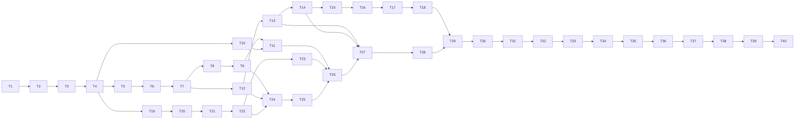

# novelhog Implementation Plan

> **For agentic workers:** REQUIRED SUB-SKILL: Use superpowers:subagent-driven-development (recommended) or superpowers:executing-plans to implement this plan task-by-task. Steps use checkbox (`- [ ]`) syntax for tracking.

**Goal:** Build novelhog v1, a self-hosted web UI around `web-novel-scraper`
(library, background chapter downloads, adaptive TOC refresh, Web Push release
notifications, asynchronous EPUB exports) as specified in the design spec.

**Architecture:** Two containers from one image. `novelhog-web` runs Caddy (SPA,
`/static`, reverse proxy) and a stateless FastAPI app that only talks to the database
through `novelhog.repo`. `novelhog-worker` owns everything about novels (scraper,
FlareSolverr, syncs, downloads, export builds) and delivers notifications by
consuming the `events` log through pluggable channels. The React PWA talks REST +
SSE to `/api/v1`.

**Tech Stack:** Python 3.14, uv, FastAPI, uvicorn, SQLAlchemy Core 2.x + Alembic over
SQLite (default) or PostgreSQL 16 (`psycopg`), `web-novel-scraper==2.13.1`, `requests`,
Pillow, `markdown-it-py`, `ebooklib`, `pywebpush`, `py-vapid`, `structlog`, `import-linter`; pytest,
`httpx`, `asgi-lifespan`; React 19, TypeScript, Vite, TanStack Query, React Router,
Tailwind CSS, `openapi-typescript`, Vitest, Testing Library, Playwright; Caddy 2,
Docker Compose, `tini`.

**Spec:** `docs/superpowers/specs/2026-10-18-novelhog-design.md`. Every task
cites the spec sections it implements (`§N`); executors read the cited sections
before starting. The spec wins over this plan if they ever disagree; report the
disagreement instead of guessing.

**How this plan is written (from the user's planning rules):**
- Task 1 created `STYLEGUIDE.md`; Task 2 amends it; every later task follows it.
- Each task has a **BDD skeleton** (`Class/Module → method → scenario →
  effect`). Tests come straight from it: **one test per effect, grouped by
  scenario**, named per the styleguide (`test_<unit>__<behaviour>`).
- The plan contains **no implementation code**. Signatures, data shapes,
  schemas and shell commands are given; behaviour is defined by the skeleton
  and the cited spec sections. Tricky algorithms (claims and fencing, event
  clock, sync diff, pruning, dispatch, download loop) are pinned down in the
  spec as pseudocode or exact rules (§4, §6); tasks point to them.

**Revision note (2026-10-19):** rewritten after the adversarial spec and plan
reviews (see the spec revision commit). Task 1 is already done (commits
`dea524c`, `b7641c7`); the old Tasks 2–35 became Tasks 3–40.

## Global Constraints

- Python **3.14**, managed with **uv**; `ruff format`, `ruff check`,
  `mypy --strict`, `pytest`; no bare `except:`.
- TypeScript strict; `eslint` + `prettier`; Vitest; components
  `PascalCase.tsx`, hooks `useX.ts`, tests colocated `*.test.tsx` / `*.test.ts`.
- Package `novelhog` under `src/novelhog/`; tests under
  `tests/{unit,integration,api,container,fixtures}` with an `__init__.py` in every
  test directory; web app under `web/`.
- Task 1 left placeholder modules (docstring only) for modules named in the
  import-linter contracts. A task that "creates" such a file overwrites the
  placeholder.
- `web-novel-scraper` pinned **`==2.13.1`**; imported **only** by
  `novelhog.scraper_adapter`.
- Database access only through **SQLAlchemy Core 2.x** in `novelhog.repo` (no
  ORM). The only raw SQL is the `PRAGMA` and `BEGIN IMMEDIATE` statements in
  `repo/db.py` connection events, `repo/db.py` `optimize()` (`PRAGMA optimize`, `wal_checkpoint(TRUNCATE)`) and the migration `env.py` (spec §4 foreign-key handling). Schema in `repo/schema.py` per spec §4 and its
  portability mapping; migrations are Alembic revisions in
  `src/novelhog/repo/migrations/`. Code and tests must pass on **SQLite ≥ 3.45**
  and **PostgreSQL 16**.
- Timestamps are timezone-aware UTC `datetime`s (column type
  `repo.types.UTCDateTime`); no timestamp arithmetic in SQL. On the wire: RFC 3339
  UTC with milliseconds and `Z`.
- Claims: compare-and-set `UPDATE … RETURNING` built by `repo/claims.py` (no
  `SELECT … FOR UPDATE`), columns `claimed_by` / `claimed_until`; every write
  that finishes claimed work is **fenced** (`claimed_by = :me AND claimed_until
  >= :now`) and reports whether it applied.
- Events: every `seq` comes from the `event_clock` row via `events.append`;
  which writes append which events is the table in spec §4 "Event log".
- No `ON DELETE CASCADE`; deletes remove child rows explicitly.
- No public `repo` method takes a `Connection`; transactions are composed inside
  `repo` (internal helpers may take one).
- IDs: two-letter prefix + 12 chars `[a-z0-9]` from `secrets`: `NV` novel,
  `CH` chapter, `EX` export, `SB` subscription. Malformed or wrong-prefix IDs
  → `404`.
- API base path **`/api/v1`**; error body
  `{"error": {"code", "message", "details"?}}` with `snake_case` codes; the API
  never calls external services (no `502`); endpoints are plain `def` on a sync
  engine.
- The API package must not import `scraper_adapter`, `exporter`, `images`,
  `image_fetcher`, `html_to_markdown`, `net`, `notifications.channels`,
  `notifications.dispatcher`, `worker`, nor `PIL`, `pywebpush`,
  `web_novel_scraper`; `repo` imports only the standard library, `sqlalchemy`,
  `alembic`, `ids` and `domain` (import-linter contracts, Tasks 1–2).
- Env vars are prefixed **`NOVELHOG_`** (spec §9 lists names and defaults).
- Chapter states: `not_requested | pending | downloading | downloaded | error`.
  Export states: `waiting | building | ready | failed`. Chapters are identified by
  normalised URL and ordered by `position`.
- UI copy, sizes and colours follow the spec §10 text and the sketches in
  `docs/superpowers/specs/sketches/`; text wins over sketches.
- Every DB-touching task runs its tests on both databases: `uv run scripts/check.sh`
  (SQLite) and `scripts/test_pg.sh` (Postgres, from Task 5 on).

## Review Focus

Five inputs the spec implies but does not test directly, most likely first.
Each has a pinned test in the owning task (marked **[RF-n]**).

1. **[RF-1] Novel titles with characters that are illegal or awkward in file
   names** (`/`, `\`, `:`, `"`, `?`, `*`, `<`, `>`, `|`, control characters,
   leading dots, 300 emoji): export `filename` and storage key must be valid on
   Linux, Windows and e-readers. Expected: the spec §8.3 rules; the title part is
   at most 150 UTF-8 bytes; the `Chapters <from>-<to>.<ext>` suffix is always
   intact; the whole name is below 255 bytes. Owner: Task 4.
2. **[RF-2] Scraped text containing characters that are invalid in XML 1.0**
   in chapter bodies, chapter titles or the novel title: EPUB readers reject the
   whole book. Expected: they are removed during conversion and before EPUB
   writing; the book always builds. Owners: Tasks 19 and 23.
3. **[RF-3] API and worker writing at the same time** ("database is locked").
   Expected: SQLite connections set `busy_timeout = 15000` and writes use
   `BEGIN IMMEDIATE`, so a concurrent writer waits instead of failing; a lock
   that outlasts the timeout raises `repo.Busy` (→ `503 database_busy`). Owner:
   Task 5.
4. **[RF-4] A site's table of contents changes shape** (chapters inserted,
   removed, reordered, or a truncated page). Expected: rows are matched by URL;
   downloaded content is never re-pointed or deleted; removed chapters lose
   their position; a TOC that loses more than half of at least 20 known chapters
   is a failed sync. Owners: Tasks 8 and 24.
5. **[RF-5] A novel with zero chapters** (import still running or failed):
   overview bar, range chips, counters and the export dialog must render without
   division by zero or empty-range errors. Expected: an empty bar, no chips, a
   "No chapters yet" table state, and the export action disabled. Owners:
   Tasks 34 and 38.

---

## File Structure

```
STYLEGUIDE.md                       Task 1, amended in Task 2
pyproject.toml, uv.lock             Task 1 (+ deps as tasks need them)
tools/importlinter_contracts.py     Task 1
scripts/check.sh                    Task 1   (ruff, mypy, import-linter, pytest; web check added in Task 31)
scripts/test_pg.sh                  Task 5   (Python suite on Postgres via Docker)
scripts/smoke_live.sh               Task 40
.github/workflows/ci.yml            Task 5   (extended in Tasks 30 and 31)
docker/Dockerfile, docker/Caddyfile Task 30
compose.yaml, compose.test.yaml     Task 30
src/novelhog/
  ids.py, config.py, log.py         Task 3
  domain/
    errors.py                       Task 4   NotFound, Conflict, ValidationFailed, DomainError
    chapters.py                     Task 4   states, transitions, selector
    refresh.py                      Task 4   interval rule
    exports.py                      Task 4   formats, export_filename, export_key
    urls.py                         Task 4   normalize_url, host_of, static_url
    text.py                         Task 4   strip_xml_invalid
    types.py                        Task 4   Host, Subscription, VapidKeys
    payloads.py                     Task 4   NovelView, ChapterView, ExportView, SubscriptionView
  repo/
    __init__.py                     Task 5   Repo facade, Busy
    types.py                        Task 5   UTCDateTime
    db.py                           Task 5   engine, write(), migrate, revisions
    schema.py                       Task 5
    migrations/                     Task 5   env.py, script.py.mako, versions/0001_initial.py
    claims.py                       Task 6
    events.py                       Task 7   append (+ clock); Task 12 reading and pruning
    novels.py, hosts.py, settings.py  Task 7   (+ sync methods in Task 24)
    chapters.py                     Task 8
    contents.py                     Task 9
    work.py                         Task 9   (+ export/consumer recovery in Tasks 11, 12)
    exports.py                      Task 11
    consumers.py                    Task 12
    trash.py                        Task 11  storage_trash
    subscriptions.py                Task 13
  storage.py                        Task 10
  vapid.py                          Task 14
  api/                              Tasks 14–18
  html_to_markdown.py               Task 19
  net.py                            Task 20
  images.py, image_fetcher.py       Task 20
  scraper_adapter/                  Tasks 21–22
  exporter/                         Task 23  (base: Exporter protocol, registry; epub)
  chapter_store.py                  Task 26
  worker/                           Tasks 24–28
  notifications/                    Task 27
  cli.py                            Task 29
tests/  unit/… integration/… api/… container/… fixtures/{html,images}/…
web/                                Tasks 31–40
```

---

## Phase A — Foundation

### Task 1: Styleguide, project scaffold and quality gates — DONE

Done in commits `dea524c` and `b7641c7`: `STYLEGUIDE.md`, `pyproject.toml`,
`scripts/check.sh`, the three import-linter contracts (`api-is-pure`,
`repo-is-standalone` as an allowlist contract type in
`tools/importlinter_contracts.py`, `scraper-is-isolated`), boundary tests, and
docstring-only placeholder modules.

---

### Task 2: Styleguide and gate amendments

**Files:**
- Modify: `STYLEGUIDE.md`, `pyproject.toml`, `scripts/check.sh`, `tests/unit/test_boundaries.py`
- Create: `tests/integration/__init__.py`, `tests/api/__init__.py`, `tests/container/__init__.py`, `tests/fixtures/__init__.py`, placeholder `src/novelhog/net.py`

**Interfaces:**
- Consumes: Task 1's contracts and `check.sh`.
- Produces: the amended rules every later task follows; `api-is-pure` also forbids
  `novelhog.net`, `novelhog.notifications.dispatcher`, `novelhog.worker`, `PIL`,
  `pywebpush`, `web_novel_scraper`.

**BDD skeleton:**
```
Project boundaries
    api-is-pure contract
        When novelhog.api imports novelhog.net, novelhog.worker or notifications.dispatcher
            - lint-imports exits non-zero naming api-is-pure
        When novelhog.api imports PIL, pywebpush or web_novel_scraper
            - lint-imports exits non-zero naming api-is-pure
scripts/check.sh
    On a clean tree (fake uv logging its arguments)
        - runs ruff format --check, ruff check, mypy --strict, lint-imports, pytest in that order
        - exits 0
    On the first failing gate
        - stops there (later gates are not run) and exits non-zero
```

- [ ] **Step 1: Amend `STYLEGUIDE.md`** with spec §14's additions: every test
  directory has an `__init__.py`; `*.test.ts` for non-JSX tests; query keys;
  error codes `snake_case`; wire timestamps RFC 3339 UTC with ms and `Z`; `repo`
  never logs (it returns reports and raises domain errors); no public `repo`
  method takes a `Connection`; the `tools/` directory; the custom contract checks
  direct imports only; the test layout `tests/{unit,integration/{repo,worker,
  notifications},api,container,fixtures}`. Remove rules that are not in spec §14
  or this plan (Task 1 review minor).
- [ ] **Step 2: Amend `pyproject.toml`:** move `import-linter` to the dev group
  only; add `requests` explicitly; add dev deps `asgi-lifespan`, `types-requests`; add
  `[[tool.mypy.overrides]]` with `ignore_missing_imports = true` for
  `web_novel_scraper.*`, `pywebpush.*`, `py_vapid.*`; extend `api-is-pure` as
  above.
- [ ] **Step 3: Write the failing tests** from the skeleton (boundary tests for
  the new forbidden imports; the clean-tree `check.sh` test).
- [ ] **Step 4: Run** `uv run pytest tests/unit/test_boundaries.py -q`. Expected: FAIL.
- [ ] **Step 5: Implement** the contract changes and the `__init__.py` files.
- [ ] **Step 6: Run** `uv run scripts/check.sh`. Expected: PASS.
- [ ] **Step 7: Commit** `git add -A && git commit -m "chore: styleguide and gate amendments"`

---

### Task 3: IDs, configuration and logging

**Files:**
- Create: `src/novelhog/ids.py`, `src/novelhog/config.py`, `src/novelhog/log.py`
- Test: `tests/unit/test_ids.py`, `tests/unit/test_config.py`, `tests/unit/test_log.py`

**Interfaces:**
- Produces:
  - `ids.PREFIXES: frozenset[str] = {"NV", "CH", "EX", "SB"}`
  - `ids.new_id(prefix: str) -> str`
  - `ids.is_valid(value: str, prefix: str) -> bool`
  - `config.Settings` (frozen dataclass) with a field for every variable in spec
    §9: `data_dir: Path`, `database_url: str`, `public_url: str | None`,
    `vapid_subject: str | None`, `allowed_hosts: tuple[str, ...]`,
    `flaresolverr_url: str`, `scraper_dir: Path`,
    `static_backend: Literal["local"]`, `static_base_url: str`,
    `refresh_min_interval: int`, `refresh_max_interval: int`, `batch_size: int`,
    `claim_ttl: int`, `idle_sleep: int`, `request_delay: float`,
    `max_toc_pages: int`, `max_image_bytes: int`, `max_image_pixels: int`,
    `image_max_dimension: int`, `allow_private_fetch: bool`, `worker_id: str`,
    `http_port: int`; properties `static_dir: Path` (`data_dir/static`) and
    `webpush_enabled: bool`
  - `config.load(env: Mapping[str, str] = os.environ) -> Settings`
  - `log.setup(service: Literal["api", "worker", "cli"]) -> None` (structlog, JSON lines to stdout, spec §11)
  - `log.get(**bound: str) -> structlog.typing.FilteringBoundLogger`

**BDD skeleton:**
```
ids
    new_id
        With a known prefix
            - returns prefix + 12 chars from [a-z0-9]
            - two calls return different values
        With an unknown prefix
            - raises ValueError
    is_valid
        With a well-formed id of that prefix
            - returns True
        With the wrong prefix, wrong length, uppercase or symbols in the body
            - returns False
config
    load
        With no NOVELHOG_ variables
            - returns the spec §9 defaults for every field
            - database_url is sqlite:////data/db/app.db and static_dir is /data/static
            - worker_id is "<hostname>:<pid>"
            - webpush_enabled is False and allowed_hosts is empty
        With NOVELHOG_DATA_DIR=/srv and no database URL
            - database_url follows it (sqlite:////srv/db/app.db)
        With NOVELHOG_PUBLIC_URL and NOVELHOG_VAPID_SUBJECT set
            - webpush_enabled is True
        With NOVELHOG_ALLOWED_HOSTS="a.lan, b.lan"
            - allowed_hosts is ("a.lan", "b.lan")
        With NOVELHOG_ALLOW_PRIVATE_FETCH=true / false / 1 / 0
            - parses the boolean; any other value raises ValueError naming the variable
        With a non-numeric value for a numeric variable
            - raises ValueError naming the variable
        With NOVELHOG_STATIC_BACKEND other than "local"
            - raises ValueError
log
    setup
        - writes one JSON object per line to stdout with timestamp, level, service and event
    get
        - includes bound fields (novel_id, chapter_id, worker_id, host) in every line
        - logging an exception includes the traceback in the JSON line
```

- [ ] **Step 1: Write the failing tests** from the skeleton in the three test files.
- [ ] **Step 2: Run** `uv run pytest tests/unit/test_ids.py tests/unit/test_config.py tests/unit/test_log.py -q`. Expected: FAIL.
- [ ] **Step 3: Implement** `ids.py` (spec §3), `config.py` (spec §9) and `log.py` (spec §11).
- [ ] **Step 4: Run** the tests, then `uv run scripts/check.sh`. Expected: PASS.
- [ ] **Step 5: Commit** `git add -A && git commit -m "feat: ids, configuration and logging"`

---

### Task 4: Domain rules, URLs, text, file names and payload models

**Files:**
- Create: `src/novelhog/domain/{__init__,errors,chapters,refresh,exports,urls,text,types,payloads}.py`
- Test: `tests/unit/domain/{__init__,test_chapters,test_refresh,test_exports,test_urls,test_text,test_payloads}.py`,
  `tests/fixtures/filenames.json` (the RF-1 cases with their expected file names; Task 31's TypeScript preview reads
  the same file)

**Interfaces:**
- Produces:
  - `errors.DomainError`; `errors.NotFound(entity: str, id: str)`,
    `errors.Conflict(code: str, message: str, details: dict[str, object] | None = None)`,
    `errors.ValidationFailed(code: str, message: str, details: dict[str, object] | None = None)`
  - `chapters.ChapterState` (`StrEnum`, the five states)
  - `chapters.CLIENT_TARGETS: frozenset[ChapterState]` = `{pending, not_requested}`
  - `chapters.transition_allowed(current: ChapterState, target: ChapterState) -> bool` (spec §5.4 table)
  - `chapters.ChapterRange(start: int, end: int)`; `chapters.Selector = list[int] | ChapterRange`
  - `chapters.resolve_selector(selector: Selector, total: int) -> list[int]` (sorted, unique positions)
  - `refresh.next_interval(current: int, *, found_new: bool, failed: bool, min_s: int, max_s: int) -> int`
  - `refresh.jittered(interval: int, rng: random.Random) -> int` (±10 %)
  - `exports.Format` (`StrEnum`, v1 `EPUB`); `exports.FormatInfo(mime: str, extension: str, accepted_images: frozenset[str])`;
    `exports.FORMATS: dict[Format, FormatInfo]`; `exports.format_for_mime(mime: str) -> Format`
  - `exports.export_filename(title: str | None, start: int, end: int, ext: str) -> str` (spec §8.3, RF-1)
  - `exports.export_key(novel_id: str, export_id: str, filename: str) -> str`
  - `urls.normalize_url(url: str) -> str` (spec §4 "URL normalisation"; raises `ValidationFailed("invalid_url")`)
  - `urls.host_of(normalized_url: str) -> str`
  - `urls.static_url(base: str, key: str) -> str` (spec §8.3)
  - `text.strip_xml_invalid(value: str) -> str`
  - `types.Host(host: str, supported: bool)`, `types.Subscription(id: str, channel: str, address: dict[str, object], address_key: str, label: str | None, created_at: datetime)`,
    `types.VapidKeys(public_key: str, private_key: str)`
  - `payloads.NovelView`, `ChapterView`, `ExportView`, `SubscriptionView`: frozen dataclasses with exactly the
    fields of the API objects in spec §5.2/§5.6; `to_json() -> dict[str, object]` (timestamps formatted by
    `payloads.format_time(dt) -> str`, RFC 3339 UTC with ms and `Z`); `NovelView.to_event(released: list[int]) -> dict`;
    `ChapterView.to_event(novel_id: str, error: str | None, error_at: datetime | None) -> dict`;
    `payloads.deleted_novel(novel_id) -> dict`, `payloads.deleted_export(export_id, novel_id) -> dict`

**BDD skeleton:**
```
domain.chapters
    transition_allowed
        From not_requested, error or downloaded to pending
            - returns True
        From pending to not_requested
            - returns True
        Any other pair (incl. to downloading, downloaded, error, and from downloading)
            - returns False
    resolve_selector
        With a list of positions inside 1..total
            - returns them sorted with duplicates removed
        With a range inside 1..total
            - returns every position from start to end inclusive
        With an empty list
            - raises ValidationFailed code "invalid_selector"
        With a position below 1 or above total
            - raises ValidationFailed "invalid_selector" with details.out_of_range
        With start > end
            - raises ValidationFailed code "invalid_selector"
        When total is 0
            - raises ValidationFailed code "no_chapters"
domain.refresh
    next_interval
        When new chapters were found
            - returns min_s
        When nothing was found or the sync failed
            - returns min(current * 2, max_s)
        Walking from 6 h with nothing found
            - yields 12 h, 1 d, 2 d, 4 d, 8 d, 16 d, 30 d, 30 d
    jittered
        - stays within ±10 % of the interval for 1000 seeded draws
        - is deterministic for a seeded Random
domain.exports
    FORMATS / format_for_mime
        - EPUB maps to application/epub+zip, extension epub, accepts jpeg/png/gif
        - application/epub+zip returns Format.EPUB; an unknown mime raises ValueError
    export_filename
        With a plain title
            - returns "<Title> Chapters <from>-<to>.<ext>"
        With a null or empty-after-cleaning title
            - uses "Untitled"
        [RF-1] With / \ : " ? * < > | and control characters in the title
            - replaces each with "_"
        [RF-1] With leading dots, surrounding spaces and runs of whitespace
            - strips the dots and spaces and collapses whitespace to one space
        [RF-1] With 300 emoji
            - the title part is at most 150 UTF-8 bytes, no character is split, the suffix is intact
            - the whole name is below 255 bytes
        [RF-1] With non-Latin letters and a decomposed accent
            - keeps the letters and returns NFC
        With XML-invalid characters in the title
            - removes them
    export_key
        - returns "exports/<novel_id>/<export_id>/<filename>"
domain.urls
    normalize_url
        - lower-cases scheme and host and strips a leading www.
        - drops fragment, default port, user info and a trailing slash on a non-root path; keeps the query
        - is idempotent
        With a non-http(s) scheme, a non-default port or no host
            - raises ValidationFailed invalid_url
    host_of
        - returns the host of a normalised URL
    static_url
        With base "/static"
            - returns "/static/<key>" with each segment percent-encoded
        With an absolute base with or without a trailing slash
            - joins with exactly one slash
        With "#", "%", "?", spaces and emoji in the key
            - every one is encoded so the URL round-trips to the key
domain.text
    strip_xml_invalid
        - removes U+0000–U+0008, U+000B, U+000C, U+000E–U+001F, lone surrogates, U+FFFE, U+FFFF
        - keeps tab, newline, carriage return, emoji and all other text
domain.payloads
    NovelView.to_json
        - contains exactly the spec §5.2 Novel fields with timestamps as "…Z" strings
    NovelView.to_event
        - contains the Novel fields plus released
    ChapterView.to_json
        - error and error_at are null unless state is error
        - queued_at is null unless state is pending or downloading
    ChapterView.to_event
        - adds novel_id, and error/error_at only in error state
    ExportView.to_json
        - url and size_bytes are null unless state is ready
        - includes waited, skip_missing, progress and blocked; chapter_from/to may be null
    deleted_novel / deleted_export
        - return {id, deleted: true} and {id, novel_id, deleted: true}
    format_time
        - formats aware UTC with milliseconds and Z
        - raises ValueError for a naive datetime
```

- [ ] **Step 1: Write the failing tests** from the skeleton, including all RF-1 tests (the `export_filename`
  cases come from `tests/fixtures/filenames.json`).
- [ ] **Step 2: Run** `uv run pytest tests/unit/domain -q`. Expected: FAIL.
- [ ] **Step 3: Implement** per spec §4 (URL normalisation), §5.2, §5.4, §5.5, §6.2, §8.1 (XML), §8.3.
- [ ] **Step 4: Run** tests and `uv run scripts/check.sh`. Expected: PASS.
- [ ] **Step 5: Commit** `git add -A && git commit -m "feat: domain rules, urls, file names and payload models"`

---

### Task 5: Schema, types, engine and migrations (SQLAlchemy Core)

**Files:**
- Create: `src/novelhog/repo/{__init__,types,db,schema}.py`, `src/novelhog/repo/migrations/{env.py,script.py.mako,versions/0001_initial.py}`,
  `scripts/test_pg.sh`, `.github/workflows/ci.yml`
- Test: `tests/integration/__init__.py`, `tests/integration/test_db.py`, `tests/integration/test_schema.py`,
  `tests/integration/test_migrations.py`, `tests/conftest.py`

**Interfaces:**
- Produces:
  - `types.UTCDateTime` (`TypeDecorator`, spec §4 portability mapping)
  - `schema.metadata` and one `Table` per spec §4 table (`novels`, `chapters`, `chapter_contents`, `exports`,
    `hosts`, `settings`, `subscriptions`, `event_clock`, `events`, `consumers`, `storage_trash`); JSON columns
    `JSON().with_variant(JSONB, "postgresql")`; big integers `BigInteger().with_variant(Integer, "sqlite")`
  - `db.create_engine(url: str) -> sqlalchemy.Engine` (SQLite: WAL, `foreign_keys=ON`, `busy_timeout=15000`;
    Postgres: `psycopg`, pool pre-ping)
  - `db.write(engine) -> ContextManager[Connection]` (one transaction; SQLite `BEGIN IMMEDIATE`; translates a
    "database is locked" `OperationalError` into `repo.Busy`)
  - `db.read(engine) -> ContextManager[Connection]`
  - `db.migrate(engine) -> str` (programmatic `upgrade head` with an absolute `script_location`, no `alembic.ini`;
    returns head)
  - `db.revisions(engine) -> Revisions` (`Revisions(current: str | None, head: str)`, `.is_current`)
  - `db.require_current(engine) -> None` (raises `db.SchemaOutdated(current, head)` with the spec §4 message)
  - `repo.Busy(Exception)`
  - `repo.Repo(url: str, *, clock: Callable[[], datetime] = utcnow, static_base_url: str = "/static")` holding the
    engine and exposing sub-repositories added in later tasks as attributes (`hosts`, `settings`, `novels`,
    `chapters`, `work`, `exports`, `events`, `consumers`, `subscriptions`, `trash`, `contents`) plus
    `migrate()`, `require_current()`, `revisions()`
  - Test fixtures in `tests/conftest.py`: `database_url` (from `NOVELHOG_TEST_DATABASE_URL`, default a temp SQLite
    file); a session-scoped migrated database; per test, rows of every table deleted in reverse
    `metadata.sorted_tables` order and `event_clock` reset to `(1, 0)`; `clock` (a controllable `FakeClock`);
    `repo` (a `Repo` on that database with the fake clock)
  - `scripts/test_pg.sh` (starts `postgres:16` with Docker on a free port, runs `pytest tests/integration tests/api`
    with `NOVELHOG_TEST_DATABASE_URL=postgresql+psycopg://…`, removes the container even on failure)
  - `.github/workflows/ci.yml` with jobs `python-sqlite` (`scripts/check.sh`) and `python-postgres`
    (service container, `pytest tests/integration tests/api`)

**BDD skeleton:**
```
types.UTCDateTime
    - round-trips an aware UTC datetime unchanged (SQLite and Postgres)
    - stores a non-UTC aware value as the same instant and returns it in UTC
    - rejects a naive datetime with ValueError
    - on SQLite, string order of stored values equals time order
db.create_engine
    With a SQLite URL
        - journal_mode is wal, foreign_keys is on, busy_timeout is 15000 on every connection
    With a Postgres URL
        - connects with the psycopg driver
db.write
    On success
        - commits the transaction
    On exception
        - rolls back and re-raises
    [RF-3] With another connection holding a write transaction for 1 s (SQLite)
        - waits and then succeeds instead of raising "database is locked"
    With a lock held longer than busy_timeout (timeout patched short)
        - raises repo.Busy
db.migrate
    On an empty database (SQLite and Postgres)
        - creates every table, constraint and index of schema.metadata and seeds event_clock (1, 0)
        - Alembic autogenerate against schema.metadata reports no differences
    On an up-to-date database
        - applies nothing and returns the same head
    From another working directory
        - still finds the migrations
    On SQLite with novels and chapters present, a test revision that rebuilds novels in batch mode
        - keeps every chapter row (foreign keys are off during the migration)
        - fails the migration when foreign_key_check reports an orphan
db.revisions / db.require_current
    On a database at head
        - is_current is True and require_current returns
    On an empty or older database
        - require_current raises SchemaOutdated naming the current and head revisions
    On a database newer than the build
        - require_current raises SchemaOutdated
schema (every claimable table: novels, chapters, exports, consumers)
    - has claimed_by and claimed_until and rejects a row with only one of them set
Schema constraints (spot checks against spec §4, both databases)
    - a novel id without the NV prefix raises IntegrityError
    - a pending or downloading chapter without queued_at raises IntegrityError
    - a downloading chapter without a claim raises IntegrityError
    - a claimed chapter in not_requested, downloaded or error raises IntegrityError
    - a chapter with a position and removed_at, or neither, raises IntegrityError
    - two chapters of one novel with the same url raise IntegrityError
    - a ready export without storage_key raises IntegrityError
    - a second waiting export with the same novel, ends, mime and skip_missing raises IntegrityError
    - deleting a novel that still has chapters raises IntegrityError (no cascade)
    - JSON columns round-trip dicts unchanged
```

- [ ] **Step 1: Write `types.py` and `schema.py`** from spec §4 (every table, column, default, foreign key,
  unique constraint, check and index; partial indexes with `sqlite_where` and `postgresql_where`).
- [ ] **Step 2: Set up Alembic** in `src/novelhog/repo/migrations/` (`env.py` with `render_as_batch=True` for
  SQLite, `compare_type=True`, an `include_object` hook, and the SQLite foreign-key handling of spec §4) and write
  revision `0001_initial` creating the full schema and seeding `event_clock`.
- [ ] **Step 3: Write the failing tests** from the skeleton (the batch-rebuild test uses a revision file created in
  `tmp_path` and a temporary script location).
- [ ] **Step 4: Run** `uv run pytest tests/integration/test_db.py tests/integration/test_schema.py tests/integration/test_migrations.py -q`. Expected: FAIL.
- [ ] **Step 5: Implement** `db.py`, the `Repo` shell, `scripts/test_pg.sh` and the CI workflow.
- [ ] **Step 6: Run** `uv run scripts/check.sh` and `scripts/test_pg.sh`. Expected: PASS on both.
- [ ] **Step 7: Commit** `git add -A && git commit -m "feat: sqlalchemy schema, types and migrations"`

---

### Task 6: Claims, fencing and recovery primitives

**Files:**
- Create: `src/novelhog/repo/claims.py`
- Test: `tests/integration/test_claims.py`

**Interfaces:**
- Consumes: `schema`, `db.write` (Task 5)
- Produces (all take a `Connection`; they are internal to `repo`):
  - `claims.CLAIMABLE: tuple[Table, ...]` (`novels`, `chapters`, `exports`, `consumers`)
  - `claims.available(table, now) -> ColumnElement[bool]`; `claims.owned(table, owner, now) -> ColumnElement[bool]`
  - `claims.claim(conn, table, *, eligible, priority: list[ColumnElement], owner, now, ttl, n=1,
    extra_set: Mapping[str, object] = {}, returning: list[Column], retries: int = 3) -> list[Row]`
    (spec §4 statement; `claimed_until` computed in Python; result re-sorted by `priority`)
  - `claims.renew(conn, table, keys, *, owner, now, ttl) -> int` (fenced; returns rows renewed)
  - `claims.release(conn, table, keys, *, owner, now, extra_set = {}) -> int` (fenced)
  - `claims.fenced_update(conn, table, key, *, owner, now, values: Mapping[str, object]) -> bool`
    (applies `values` only if the row is owned by `owner`; True if applied)
  - `claims.expired(conn, table, now) -> list[Row]`

**BDD skeleton:**
```
claims.claim (SQLite and Postgres)
    With an available eligible row
        - sets claimed_by and claimed_until = now + ttl and any extra_set values
        - returns the claimed rows
    With rows owned by a live claim
        - skips them and returns other eligible rows, or [] when none remain
    With a row whose claim expired
        - takes it over
    With n > 1
        - claims up to n rows and returns them sorted by priority
    With 8 threads claiming single rows from 5 eligible rows at once
        - every row is claimed exactly once and no thread gets a row twice
    With 4 threads claiming batches of 3 from 12 eligible rows at once
        - every row is claimed exactly once
    When a claim loses a race and eligible rows remain
        - retries and returns the next candidates
    - never issues SELECT … FOR UPDATE (statement inspection)
claims.renew
    - pushes claimed_until forward only on rows owned by owner and returns the count
    - returns 0 for a row whose claim expired (even if nobody took it over)
claims.release
    - clears both columns only on rows owned by owner and applies extra_set to them
claims.fenced_update
    On a row owned by owner
        - applies the values and returns True
    On a row owned by someone else, unclaimed, expired or deleted
        - changes nothing and returns False
claims.expired
    - returns claimed rows whose claimed_until < now and nothing else
```

- [ ] **Step 1: Write the failing tests** from the skeleton (a small test table is enough for the generic tests;
  use `chapters` for one end-to-end case).
- [ ] **Step 2: Run** `uv run pytest tests/integration/test_claims.py -q`. Expected: FAIL.
- [ ] **Step 3: Implement** per spec §4 "Claims".
- [ ] **Step 4: Run** `uv run scripts/check.sh` and `scripts/test_pg.sh`. Expected: PASS.
- [ ] **Step 5: Commit** `git add -A && git commit -m "feat: claims, fencing and recovery primitives"`

---

## Phase B — Repository layer (`novelhog.repo`)

Every write method in this phase runs inside `db.write` and appends the rows the
spec §4 "Event log" table requires **in the same transaction**, through
`events.append` (Task 7). Snapshots are built with `domain.payloads` **after**
`events.append` has taken the clock for the transaction's first event (see spec
§4 "Commit order = seq order"); the shared helper `events.emit_novel_change(conn,
novel_id, changed_chapter_ids)` (Task 8) writes the CH, NV and EX events of a
chapter change in the required order. Queries use SQLAlchemy Core expressions
against `schema` tables. Every claim, renewal, release and fenced write goes
through `claims.*`. No public method takes a `Connection`.

### Task 7: Event append, novels, hosts and settings repositories

**Files:**
- Create: `src/novelhog/repo/{events,novels,hosts,settings}.py`
- Test: `tests/integration/repo/{__init__,test_event_append,test_novels,test_hosts,test_settings}.py`

**Interfaces:**
- Produces:
  - `events.append(conn, novel_id: str, entity_id: str, payload: dict) -> int` (internal; increments `event_clock`
    and returns the new seq)
  - `events.latest_seq() -> int` (the clock value)
  - `hosts.publish(hosts: list[str]) -> PublishReport` (`PublishReport(added: list[str], unsupported: list[str])`):
    upsert listed hosts as supported, mark the others unsupported, never delete
  - `hosts.list_supported() -> list[Host]`, `hosts.is_supported(host: str) -> bool`, `hosts.any_published() -> bool`
  - `novels.create(toc_url: str, followed: bool) -> NovelView` (normalises; raises `ValidationFailed("invalid_url")`,
    `ValidationFailed("unsupported_host", details={"hosts"})`, `Conflict("novel_exists", details={"novel_id"})`,
    `domain.errors.ServiceUnavailable("hosts_not_published")`)
  - `novels.get(novel_id) -> NovelView` (raises `NotFound`), `novels.list() -> list[NovelView]` (created_at desc)
  - `novels.update(novel_id, *, followed: bool | None = None, seen: bool | None = None, title: str | None = None) -> NovelView`
  - `novels.request_sync(novel_id) -> NovelView`
  - `novels.delete(novel_id) -> None` (spec §5.3)
  - `settings.get(key: str) -> dict | None`, `settings.put_if_absent(key: str, value: dict) -> bool`
  - Internal: `novels.snapshot(conn, novel_id) -> NovelView` (counters per spec §4 "Derived values")
- Also adds `errors.ServiceUnavailable(code, message)` to `domain/errors.py`.

**BDD skeleton:**
```
repo.events
    append
        - increments event_clock and uses the new value as seq
        - stores novel_id, entity_id, payload and at = now
    Two transactions appending events and committing in the opposite order (two connections, both databases)
        - the second waits for the first at the clock
        - a reader polling seq > cursor after each commit never skips an event
    latest_seq
        - returns 0 on an empty log and the clock value afterwards
repo.hosts
    publish
        - inserts new hosts as supported and sets updated_at
        - marks hosts missing from the list unsupported without deleting them
        - succeeds when a novel references a host that is no longer listed
        - marks a host that comes back supported again
    list_supported / is_supported / any_published
        - list and is_supported see only supported hosts
        - any_published is False on an empty table and True after publish
repo.novels
    create
        On a supported host (www. and case differences normalised)
            - inserts the novel with the normalised toc_url, title null, followed as given,
              refresh_interval = min interval, next_refresh_at = now
            - appends one NV event with the Novel payload
            - returns importing = true, syncing = false and zero counters
        On a toc_url that normalises to an existing one
            - raises Conflict novel_exists with details.novel_id
        On a host that is unknown or unsupported
            - raises ValidationFailed unsupported_host with details.hosts listing supported hosts
        On a URL that is not http(s) or has a non-default port
            - raises ValidationFailed invalid_url
        Before any host was published
            - raises ServiceUnavailable hosts_not_published
    get / list
        - computes total, downloaded, pending (pending + downloading), error and new pages over positioned chapters
        - new_pages counts released_at > seen_at, or all released when seen_at is null
        - syncing is true only while the novel is claimed by a live claim
        - importing is true while last_refreshed_at and import_error are null
        - cover_url is static_url(static_base_url, cover_key), or null
        - list orders by created_at desc
        - unknown or malformed id raises NotFound
    update
        With followed
            - changes only the flag and appends an NV event
        With seen
            - sets seen_at = now, new_pages becomes 0, appends an NV event
        With title
            - stores the trimmed title with XML-invalid characters removed and appends an NV event
            - an empty or whitespace title raises ValidationFailed invalid_title
        On an unknown id
            - raises NotFound
    request_sync
        - sets next_refresh_at = now and sync_requested, appends an NV event
        - unknown id raises NotFound
    delete
        - removes the novel, its chapters, chapter contents and exports
        - adds the cover key and every ready export's storage key to storage_trash
        - appends one NV event {id, deleted: true}
        - unknown id raises NotFound
repo.settings
    get
        - returns the stored dict or None
    put_if_absent
        When the key is missing
            - stores the value and returns True
        When the key exists
            - leaves the value unchanged and returns False
        With two connections racing
            - exactly one returns True
```

- [ ] **Step 1: Write the failing tests** from the skeleton (use the `clock` fixture).
- [ ] **Step 2: Run** `uv run pytest tests/integration/repo -q`. Expected: FAIL.
- [ ] **Step 3: Implement** per spec §4 (event log, derived values), §5.3. `novels.delete` needs rows from
  tables owned by later tasks; delete them with schema-level statements here (the tables exist since Task 5).
- [ ] **Step 4: Run** `uv run scripts/check.sh` and `scripts/test_pg.sh`. Expected: PASS.
- [ ] **Step 5: Commit** `git add -A && git commit -m "feat: event append, novels, hosts and settings repositories"`

---

### Task 8: Chapters repository and TOC diff

**Files:**
- Create: `src/novelhog/repo/chapters.py`
- Modify: `src/novelhog/repo/events.py` (`emit_novel_change`)
- Test: `tests/integration/repo/test_chapters.py`, `tests/integration/repo/test_toc_diff.py`

**Interfaces:**
- Consumes: `domain.chapters.*`, `domain.urls.normalize_url`, `events.append`, `novels.snapshot`
- Produces:
  - `chapters.list(novel_id, *, offset: int = 0, limit: int = 1000, state: ChapterState | None = None) -> tuple[list[ChapterView], int]`
    (positioned chapters only, by position; `limit` capped at 5000; raises `NotFound` for an unknown novel)
  - `chapters.get(chapter_id) -> ChapterView` (raises `NotFound`)
  - `chapters.patch(novel_id, target: ChapterState, selector: Selector) -> PatchResult`
    (`PatchResult(updated: list[int], skipped: list[tuple[int, ChapterState]])`; raises
    `ValidationFailed("invalid_target_state")` for a non-client target)
  - Internal: `chapters.queue(conn, novel_id, positions, *, now) -> PatchResult` (shared with `exports.create`)
  - Internal: `chapters.apply_toc(conn, novel_id, urls: list[str], *, initial: bool, followed: bool, now) -> TocDiff`
    (`TocDiff(new: list[int], moved: list[str], removed: list[str], returned: list[str])`: positions of new
    chapters, ids of moved / removed / returned chapters; spec §6.2)
  - Internal: `events.emit_novel_change(conn, novel_id, changed_chapter_ids: list[str]) -> None`
  - Internal: `chapters.error_of(conn, chapter_id) -> tuple[str, datetime] | None` (from the newest CH event)

**BDD skeleton:**
```
repo.chapters
    list
        - returns positioned chapters ordered by position with the total count
        - filters by state when given
        - caps limit at 5000
        - error/error_at come from the newest CH event only while state is error
        - an unknown novel raises NotFound
    get
        - returns the chapter; an unknown id raises NotFound
    patch
        To pending from not_requested, error or downloaded
            - sets state pending, queued_at = now, priority 0
            - appends one CH event per updated chapter, one NV event, and EX events for affected waiting exports
            - returns their positions in updated
        To pending from downloaded (re-download)
            - keeps the stored content
        To not_requested from pending
            - clears queued_at
        To not_requested from pending claimed by a worker (not started)
            - clears queued_at and the claim
        On chapters in any other state (incl. downloading)
            - leaves them unchanged and reports them in skipped with their current state
        With target downloading, downloaded or error
            - raises ValidationFailed invalid_target_state and changes nothing
        With an invalid selector
            - raises ValidationFailed and changes nothing
        On an unknown novel
            - raises NotFound
    events written by any chapter change
        - the NV event's counters equal novels.get after the change
        - an EX event is written for each waiting export whose range contains a changed chapter, matching exports.get
        - a later CH snapshot of a chapter still in error carries the previous error and error_at
apply_toc (TOC diff by URL)
    On the initial import
        - inserts every URL as not_requested with released_at null at its position
        - returns new = []
    On a later sync with new URLs, novel followed
        - inserts them as pending with queued_at = now, priority 1 and released_at = now
        - returns their positions in new
    On a later sync with new URLs, novel not followed
        - inserts them as not_requested with released_at = now
    [RF-4] With a URL inserted in the middle
        - existing rows keep their ids, states and content; later rows get position + 1
    [RF-4] With a URL removed
        - its row keeps state and content, gets position null and removed_at = now, and is reported in removed
        - later rows move up by one
    [RF-4] With URLs reordered
        - positions follow the TOC; states and content stay with their URLs
    When a removed URL comes back
        - it gets a position again and removed_at null, and is reported in returned
    With a URL listed twice
        - keeps its first position only
    - URLs are compared after normalize_url
    - appends a CH event for every inserted, moved, removed or returned chapter
```

- [ ] **Step 1: Write the failing tests** from the skeleton, including the RF-4 tests.
- [ ] **Step 2: Run** `uv run pytest tests/integration/repo/test_chapters.py tests/integration/repo/test_toc_diff.py -q`. Expected: FAIL.
- [ ] **Step 3: Implement** per spec §4, §5.4, §6.2.
- [ ] **Step 4: Run** `uv run scripts/check.sh` and `scripts/test_pg.sh`. Expected: PASS.
- [ ] **Step 5: Commit** `git add -A && git commit -m "feat: chapters repository and toc diff"`

---

### Task 9: Download work, chapter contents and recovery

**Files:**
- Create: `src/novelhog/repo/{work,contents}.py`
- Test: `tests/integration/repo/{test_work,test_contents}.py`

**Interfaces:**
- Consumes: `claims.*` (Task 6), `events.emit_novel_change` (Task 8)
- Produces:
  - `work.claim_batch(worker_id: str, size: int, ttl: int) -> list[ChapterClaim]` (pending, available; order
    `priority DESC, queued_at, position`; chapters stay `pending`; no events)
  - `work.start(claim: ChapterClaim, worker_id: str) -> bool` (fenced `pending` → `downloading`; events)
  - `work.complete(chapter_id: str, worker_id: str, *, markdown: str, title: str, has_images: bool) -> bool`
    (fenced; upserts `chapter_contents`; `downloaded`; clears queued_at, priority and claim; events)
  - `work.fail(chapter_id: str, worker_id: str, message: str) -> bool` (fenced; `error`; CH payload carries
    `error`, `error_at`)
  - `work.requeue(chapter_id: str, worker_id: str) -> bool` (fenced `downloading` → `pending`, keeps `queued_at`)
  - `work.release_chapters(chapter_ids: list[str], worker_id: str) -> int` (fenced; unstarted chapters stay pending)
  - `work.renew_chapters(chapter_ids: list[str], worker_id: str, ttl: int) -> list[str]` (ids still owned)
  - `work.recover() -> RecoveryReport` (`RecoveryReport(chapters_requeued: int, chapters_freed: int,
    novels_freed: int, exports_reset: int, consumers_freed: int)`; this task fills the chapter and novel parts)
  - `contents.get(chapter_id: str) -> str` (raises `NotFound`)
  - Internal: `contents.put(conn, chapter_id, markdown, now) -> None` (upsert)
  - `ChapterClaim(chapter_id: str, novel_id: str, host: str, toc_url: str, position: int, url: str)`

**BDD skeleton:**
```
repo.work
    claim_batch
        - claims up to size pending chapters of any novel and returns them in priority, queued_at, position order
        - sets claimed_by and claimed_until = now + ttl; the chapters stay pending
        - appends no events
        - auto-queued releases (priority 1) come before older bulk-queued chapters
        - never claims removed chapters (no position)
        With nothing pending
            - returns []
        Two workers claiming at once (two Repo instances)
            - never claim the same chapter
    start
        On a chapter claimed by this worker and still pending
            - sets downloading, appends CH/NV/EX events, returns True
        On a chapter dequeued after the claim
            - returns False and changes nothing
        On a chapter whose claim expired and was taken by another worker
            - returns False and changes nothing
    complete
        On a chapter downloading under this worker's claim
            - stores the markdown, sets downloaded, title and has_images, clears queued_at, priority and the claim
            - appends CH/NV/EX events whose counters match novels.get
            - replaces earlier content on a re-download
            - returns True
        When the claim was lost (expired and recovered, re-claimed, or the novel was deleted)
            - stores nothing, changes nothing and returns False
    fail
        - sets error, clears queued_at, priority and the claim, appends a CH event with error and error_at, returns True
        - returns False and changes nothing when the claim was lost
    requeue
        - moves this worker's downloading chapter back to pending with its original queued_at and clears the claim
    release_chapters
        - frees this worker's unstarted claimed chapters; they stay pending with their queued_at
        - ignores chapters owned by others
    renew_chapters
        - pushes claimed_until forward on this worker's chapters and returns their ids
        - omits chapters that were dequeued or taken over
    recover
        With downloading chapters whose claims expired
            - moves them to pending keeping queued_at, clears claims, appends events
        With pending chapters whose claims expired
            - frees them without events
        With a novel whose sync claim expired
            - frees the novel and appends an NV event (syncing false)
        With live claims
            - changes nothing
repo.contents
    get
        - returns the stored markdown; a chapter without content raises NotFound
```

- [ ] **Step 1: Write the failing tests** from the skeleton (two `Repo` instances on the same database for the
  competition test).
- [ ] **Step 2: Run** `uv run pytest tests/integration/repo/test_work.py tests/integration/repo/test_contents.py -q`. Expected: FAIL.
- [ ] **Step 3: Implement** per spec §4 (Claims, Event log), §6.3, §6.4.
- [ ] **Step 4: Run** `uv run scripts/check.sh` and `scripts/test_pg.sh`. Expected: PASS.
- [ ] **Step 5: Commit** `git add -A && git commit -m "feat: download work, chapter contents and recovery"`

---

### Task 10: Static storage

**Files:**
- Create: `src/novelhog/storage.py`
- Test: `tests/unit/test_storage.py`

**Interfaces:**
- Consumes: `domain.urls.static_url`
- Produces:
  - `storage.StaticStorage` protocol: `put(key: str, data: bytes, mime: str, download_name: str | None = None) -> None`,
    `put_file(key: str, path: Path, mime: str, download_name: str | None = None) -> None`,
    `get(key: str) -> bytes | None`, `delete(key: str) -> None`, `url(key: str) -> str`
  - `storage.LocalStaticStorage(root: Path, base_url: str)`
  - `storage.cover_key(novel_id: str, data: bytes, ext: str) -> str` (`covers/<novel_id>/<sha256[:16]>.<ext>`)
  - `storage.InvalidKey(ValueError)`

**BDD skeleton:**
```
storage.LocalStaticStorage
    put / put_file
        - writes the bytes (or moves the file's content) under root/key, creating parent directories
        - writes a temporary file in the target directory and renames it; no temporary file remains after success
        - leaves no temporary file and no target file when writing fails
    get
        - returns the stored bytes, or None for a missing key
    delete
        - removes the file and ignores a missing one
    url
        - equals domain.urls.static_url(base_url, key)
    With a key containing "..", an absolute path or a backslash
        - put, put_file, get and delete raise InvalidKey
storage.cover_key
    - is content-addressed: same bytes give the same key, different bytes a different key
```

- [ ] **Step 1: Write the failing tests** from the skeleton.
- [ ] **Step 2: Run** `uv run pytest tests/unit/test_storage.py -q`. Expected: FAIL.
- [ ] **Step 3: Implement** per spec §8.3.
- [ ] **Step 4: Run** tests and `uv run scripts/check.sh`. Expected: PASS.
- [ ] **Step 5: Commit** `git add -A && git commit -m "feat: static storage"`

---

### Task 11: Exports and storage-trash repositories

**Files:**
- Create: `src/novelhog/repo/{exports,trash}.py`
- Modify: `src/novelhog/repo/work.py` (`recover` resets expired `building` exports to `waiting`)
- Test: `tests/integration/repo/{test_exports,test_trash}.py`

**Interfaces:**
- Consumes: `domain.exports.export_filename`, `domain.exports.export_key`, `chapters.queue`, `claims.*`
- Produces:
  - `exports.create(novel_id, start: int, end: int, fmt: Format, *, skip_missing: bool = False) -> tuple[ExportView, bool]`
    (bool = created; raises `ValidationFailed("invalid_selector" | "nothing_to_export")`, `NotFound`)
  - `exports.list(novel_id) -> list[ExportView]` (raises `NotFound`), `exports.get(novel_id, export_id) -> ExportView`
  - `exports.delete(novel_id, export_id) -> None` (raises `Conflict("export_building")`, `NotFound`)
  - `exports.claim_ready(worker_id: str, ttl: int) -> ExportClaim | None`
  - `exports.renew(export_id, worker_id, ttl) -> bool`
  - `exports.finish(export_id, worker_id, *, storage_key: str, size_bytes: int) -> bool` (fenced)
  - `exports.fail(export_id, worker_id, message: str) -> bool` (fenced)
  - `ExportClaim(export_id: str, novel_id: str, fmt: Format, filename: str, novel_title: str | None,
    language: str | None, cover_key: str | None, chapter_ids: list[str] | None)` (`chapter_ids` = downloaded,
    positioned chapters of the range in order; `None` when an end chapter lost its position)
  - `trash.add(conn, keys: list[str], now) -> None` (internal), `trash.take(limit: int = 100) -> list[str]`,
    `trash.remove(keys: list[str]) -> None`

**BDD skeleton:**
```
repo.exports
    create
        With every chapter of the range downloaded
            - stores the end chapters' ids, inserts waiting with waited = 0 and filename from export_filename
            - queues nothing
        With chapters not_requested or error in the range
            - moves them to pending (same rules and events as chapters.patch)
            - inserts waiting with waited = 1
        With skip_missing
            - queues nothing and inserts waiting with waited = 0
            - raises ValidationFailed nothing_to_export when no chapter of the range is downloaded
        With an identical export still waiting or building
            - returns it with created = False and inserts nothing
        With two identical creates racing
            - one creates, the other returns the same export with created = False
        With out-of-range bounds or start > end
            - raises ValidationFailed invalid_selector
        On an unknown novel
            - raises NotFound
        - appends an EX event
    list / get
        - chapter_from/to are the current positions of the end chapters (null if removed)
        - progress counts downloaded chapters of the range
        - blocked lists error and not_requested positions only while waiting and not skip_missing
        - a chapter inserted upstream inside the range is counted
        - url is static_url(base, storage_key) only when ready
        - unknown export, or an export of another novel, raises NotFound
    delete
        On a waiting or failed export
            - deletes the row, leaves its chapters queued, appends EX {id, novel_id, deleted: true}
        On a ready export
            - also adds its storage key to storage_trash
        On a building export
            - raises Conflict export_building
    claim_ready
        - picks the oldest waiting export whose positioned range is fully downloaded, or any skip_missing export
        - sets building and the claim, appends an EX event, returns ExportClaim with the chapters in order
        - returns chapter_ids = None when an end chapter has no position
        - skips exports with a chapter not downloaded; returns None when nothing is buildable
    finish
        - sets ready, storage_key, size_bytes, ready_at, clears the claim, appends an EX event, returns True
        - returns False and changes nothing when the claim was lost
    fail
        - sets failed with error, clears the claim, appends an EX event, returns True
        - returns False and changes nothing when the claim was lost
    recover (via work.recover)
        - moves building exports whose claim expired back to waiting with cleared claims and an EX event
repo.trash
    - take returns at most limit keys, oldest first; remove deletes them; adding an existing key is a no-op
```

- [ ] **Step 1: Write the failing tests** from the skeleton.
- [ ] **Step 2: Run** `uv run pytest tests/integration/repo/test_exports.py tests/integration/repo/test_trash.py -q`. Expected: FAIL.
- [ ] **Step 3: Implement** per spec §4, §5.5, §6.5.
- [ ] **Step 4: Run** `uv run scripts/check.sh` and `scripts/test_pg.sh`. Expected: PASS.
- [ ] **Step 5: Commit** `git add -A && git commit -m "feat: exports and storage trash repositories"`

---

### Task 12: Event log reading, consumers and pruning

**Files:**
- Modify: `src/novelhog/repo/events.py`, `src/novelhog/repo/work.py` (`recover` frees expired consumer claims)
- Create: `src/novelhog/repo/consumers.py`
- Test: `tests/integration/repo/{test_events,test_consumers,test_pruning}.py`

**Interfaces:**
- Produces:
  - `events.since(seq: int, *, novel_id: str | None = None, limit: int = 500) -> list[EventRow]`
  - `events.replay_status(seq: int, *, max_age_s: int = 86400, max_rows: int = 5000) -> Literal["ok", "resync"]`
  - `events.prune(*, keep_s: int = 86400, max_consumer_lag_s: int = 604800) -> PruneReport`
    (`PruneReport(deleted: int, consumers_moved: list[tuple[str, int, int]])` — name, old and new last_seq)
  - `EventRow(seq: int, novel_id: str, entity_id: str, payload: dict, at: datetime)`; `EventRow.kind -> Literal["novel", "chapter", "export"]`
  - `consumers.claim(name: str, owner: str, ttl: int) -> int | None` (returns last_seq; creates a missing row with
    `last_seq = events.latest_seq()`; None when another owner's claim is live)
  - `consumers.renew(name, owner, ttl) -> bool`
  - `consumers.advance(name: str, owner: str, last_seq: int) -> bool` (fenced; also releases)
  - `consumers.release(name: str, owner: str) -> bool`

**BDD skeleton:**
```
repo.events
    since
        - returns events with seq greater than the given one, ordered, at most limit
        - filters by novel_id when given
        - kind is derived from the entity_id prefix
    replay_status
        - is ok when the row with that seq exists, is younger than max_age and fewer than max_rows follow
        - is resync when the row was pruned, is older than max_age, more than max_rows follow,
          or seq is above latest_seq
prune
    - deletes events below the boundary (first seq younger than keep_s), keeping the newest event of every entity_id
    - never deletes events after the slowest consumer's last_seq
    - moves a consumer more than max_consumer_lag_s behind forward to the age boundary and reports old and new seq
    - deletes nothing when every event is recent
repo.consumers
    claim
        On a missing consumer row
            - creates it with last_seq = the current clock and claims it
        On a free row
            - sets claimed_by and claimed_until and returns last_seq
        On a row held by another live owner
            - returns None
        On a row whose claim expired
            - takes it over
    advance
        - sets last_seq and clears the claim in one transaction and returns True
        - never moves last_seq backwards (raises ValueError)
        - returns False and changes nothing when the claim was lost
    release
        - clears the claim when owned; returns False otherwise
    renew
        - extends the claim when owned; returns False otherwise
recover (via work.recover)
    - frees consumers whose claim expired
```

- [ ] **Step 1: Write the failing tests** from the skeleton.
- [ ] **Step 2: Run** `uv run pytest tests/integration/repo/test_events.py tests/integration/repo/test_consumers.py tests/integration/repo/test_pruning.py -q`. Expected: FAIL.
- [ ] **Step 3: Implement** per spec §4 (event log), §5.7, §6.6.
- [ ] **Step 4: Run** `uv run scripts/check.sh` and `scripts/test_pg.sh`. Expected: PASS.
- [ ] **Step 5: Commit** `git add -A && git commit -m "feat: event log reading, consumers and pruning"`

---

### Task 13: Subscriptions repository

**Files:**
- Create: `src/novelhog/repo/subscriptions.py`
- Test: `tests/integration/repo/test_subscriptions.py`

**Interfaces:**
- Produces:
  - `subscriptions.upsert(channel: str, address: dict, address_key: str, label: str | None) -> tuple[SubscriptionView, bool]` (bool = created)
  - `subscriptions.list() -> list[SubscriptionView]` (no addresses)
  - `subscriptions.all_with_address() -> list[Subscription]` (worker only)
  - `subscriptions.delete(subscription_id: str) -> None` (raises `NotFound`)

**BDD skeleton:**
```
repo.subscriptions
    upsert
        With a new (channel, address_key)
            - inserts with an SB id and returns created = True
        With an existing (channel, address_key)
            - replaces address and label, keeps the id, returns created = False
    list
        - returns id, channel, label, created_at ordered by created_at, never the address
    all_with_address
        - returns every subscription including its address
    delete
        - removes the row
        - unknown or malformed id raises NotFound
```

- [ ] **Step 1: Write the failing tests** from the skeleton.
- [ ] **Step 2: Run** `uv run pytest tests/integration/repo/test_subscriptions.py -q`. Expected: FAIL.
- [ ] **Step 3: Implement** per spec §4, §5.6.
- [ ] **Step 4: Run** `uv run scripts/check.sh` and `scripts/test_pg.sh`. Expected: PASS.
- [ ] **Step 5: Commit** `git add -A && git commit -m "feat: subscriptions repository"`

---
## Phase C — API (`novelhog-web`, Python side)

All API tests use `httpx.AsyncClient` with `ASGITransport` against `create_app(settings)`
wrapped in `asgi_lifespan.LifespanManager` (so startup runs), with a real temporary
database migrated by the fixture (fixture `api_client`; `Host: localhost`), no
scraper and no network. Endpoints are plain `def` functions. Response models are
Pydantic models validated from `domain.payloads` `to_json()` output, so REST and
SSE share one source.

### Task 14: App factory, errors, origin checks, settings and VAPID keys

**Files:**
- Create: `src/novelhog/vapid.py`, `src/novelhog/api/{__init__,app,deps,schemas,checks,routes_settings,export_openapi}.py`
- Test: `tests/unit/test_vapid.py`, `tests/api/{__init__,conftest,test_errors,test_checks,test_settings,test_startup}.py`

**Interfaces:**
- Produces:
  - `vapid.ensure_keys(repo: Repo) -> VapidKeys` (P-256; encodings per spec §4: public = URL-safe base64 of the
    65-byte uncompressed point, private = URL-safe base64 of the 32-byte scalar, both unpadded)
  - `vapid.load(repo: Repo) -> VapidKeys | None`
  - `api.app.create_app(settings: Settings, *, repo: Repo | None = None, check_schema: bool = True,
    sse_poll_s: float = 1.0, sse_keepalive_s: float = 15.0) -> FastAPI` — lifespan: `require_current` (unless
    `check_schema` is False), then `ensure_keys` when `webpush_enabled`
  - Error handlers: `NotFound → 404 not_found`, `Conflict → 409 <code>`, `ValidationFailed → 422 <code>`,
    `ServiceUnavailable → 503 <code>`, `repo.Busy → 503 database_busy` with `Retry-After: 2`,
    `RequestValidationError → 422 validation_error`, anything else → `500 internal_error` (generic message,
    traceback logged)
  - `api.checks`: host check and origin check middleware (spec §5.9)
  - `api.deps.path_id(prefix)`: dependency that turns a malformed or wrong-prefix path id into `404`
  - `GET /api/v1/settings` response model `SettingsOut` (spec §5.6)
  - `python -m novelhog.api.export_openapi` prints the OpenAPI JSON (builds the app with `check_schema=False` and
    no database)

**BDD skeleton:**
```
vapid.ensure_keys
    On an empty settings table
        - creates a pair whose public key decodes to 65 bytes starting with 0x04 and private key to 32 bytes
        - stores it under "vapid"
    When keys exist
        - returns them unchanged
    With two app instances starting together
        - both end with the same single pair
vapid.load
    - returns the stored pair, or None when there is none
create_app startup
    On a database at head
        - starts; with push configured the keys exist afterwards
    On an outdated database
        - raising SchemaOutdated aborts startup
    With check_schema=False and no database (export_openapi)
        - builds and returns the OpenAPI document
api error handling
    NotFound
        - returns 404 with {"error": {"code": "not_found", "message"}}
    Conflict / ValidationFailed / ServiceUnavailable
        - return 409 / 422 / 503 with the domain code and details
    repo.Busy
        - returns 503 database_busy with Retry-After 2
    Request body validation failure
        - returns 422 validation_error in the same error shape
    Unexpected exception
        - returns 500 internal_error without a traceback in the body
        - logs the traceback
    Malformed or wrong-prefix id in a path
        - returns 404 not_found
api checks
    Host check
        With Host localhost, an IP literal, the PUBLIC_URL host or an allowed host (with or without port)
            - passes
        With any other Host
            - returns 403 host_not_allowed
    Origin check
        With POST/PATCH/DELETE and an Origin matching Host
            - passes
        With POST/PATCH/DELETE and a different Origin
            - returns 403 cross_origin
        With GET and a different Origin, or no Origin at all
            - passes
GET /api/v1/settings
    With push configured
        - notifications.channels.webpush is {enabled: true, vapid_public_key: <key>}
        - never contains the private key
    Without push configured
        - webpush is {enabled: false, vapid_public_key: null}
    - includes static_base_url and both refresh intervals
```

- [ ] **Step 1: Write the failing tests** from the skeleton.
- [ ] **Step 2: Run** `uv run pytest tests/unit/test_vapid.py tests/api -q`. Expected: FAIL.
- [ ] **Step 3: Implement** per spec §4 (VAPID), §5.6, §5.8, §5.9, §11.
- [ ] **Step 4: Run** `uv run scripts/check.sh` (import-linter must still pass) and `scripts/test_pg.sh`. Expected: PASS.
- [ ] **Step 5: Commit** `git add -A && git commit -m "feat: api app, errors, origin checks, settings and vapid keys"`

---

### Task 15: Hosts and novels routes

**Files:**
- Create: `src/novelhog/api/routes_novels.py`
- Modify: `src/novelhog/api/schemas.py`, `src/novelhog/api/app.py`
- Test: `tests/api/test_novels.py`

**Interfaces:**
- Consumes: `repo.hosts`, `repo.novels`
- Produces routes: `GET /hosts`, `GET /novels`, `POST /novels`, `GET /novels/{id}`, `PATCH /novels/{id}`,
  `DELETE /novels/{id}`, `POST /novels/{id}/sync` (spec §5.3)

**BDD skeleton:**
```
GET /api/v1/hosts
    - returns the supported hosts only
GET /api/v1/novels
    - returns Novel objects ordered by created_at desc
POST /api/v1/novels
    With a supported toc_url
        - returns 201 Novel with title null, importing true and the normalised toc_url
        - followed defaults to true
    With a toc_url that normalises to an existing novel's
        - returns 409 novel_exists with details.novel_id
    With an unsupported host
        - returns 422 unsupported_host with details.hosts
    With a non-http(s) URL or a non-default port
        - returns 422 invalid_url
    Before hosts are published
        - returns 503 hosts_not_published
    With a missing toc_url or extra keys
        - returns 422 validation_error
GET /api/v1/novels/{id}
    - returns the Novel; an unknown id returns 404
PATCH /api/v1/novels/{id}
    - followed, seen and title update as in the repository
    - an empty title returns 422 invalid_title
    - an unknown id returns 404
DELETE /api/v1/novels/{id}
    - returns 204 and the novel is gone (GET returns 404)
    - an unknown id returns 404
POST /api/v1/novels/{id}/sync
    - returns 202 Novel with next_refresh_at = now
    - an unknown id returns 404
```

- [ ] **Step 1: Write the failing tests** from the skeleton.
- [ ] **Step 2: Run** `uv run pytest tests/api/test_novels.py -q`. Expected: FAIL.
- [ ] **Step 3: Implement** the routes and models.
- [ ] **Step 4: Run** `uv run scripts/check.sh` and `scripts/test_pg.sh`. Expected: PASS.
- [ ] **Step 5: Commit** `git add -A && git commit -m "feat: hosts and novels routes"`

---

### Task 16: Chapters routes

**Files:**
- Create: `src/novelhog/api/routes_chapters.py`
- Modify: `src/novelhog/api/schemas.py`, `src/novelhog/api/app.py`
- Test: `tests/api/test_chapters.py`

**Interfaces:**
- Produces: `GET /novels/{id}/chapters?offset&limit&state`, `PATCH /novels/{id}/chapters` with body
  `{state: ChapterState, chapters: list[int] | {start: int, end: int}}` (extra keys forbidden)

**BDD skeleton:**
```
GET /api/v1/novels/{id}/chapters
    - returns {items, total} ordered by position
    - offset and state filter work; limit above 5000 returns 422 validation_error
    - an unknown novel returns 404
PATCH /api/v1/novels/{id}/chapters
    With a list selector
        - returns {updated, skipped} from the repository (skipped items as {position, state})
    With a range selector
        - accepts {start, end}; extra keys return 422 validation_error
    With state downloading, downloaded or error
        - returns 422 invalid_target_state
    With a state that is not a chapter state
        - returns 422 validation_error
    With both a list and range shape, or neither
        - returns 422 validation_error
    With positions out of range
        - returns 422 invalid_selector with details.out_of_range
    On an unknown novel
        - returns 404
```

- [ ] **Step 1: Write the failing tests** from the skeleton.
- [ ] **Step 2: Run** `uv run pytest tests/api/test_chapters.py -q`. Expected: FAIL.
- [ ] **Step 3: Implement** per spec §5.4.
- [ ] **Step 4: Run** `uv run scripts/check.sh` and `scripts/test_pg.sh`. Expected: PASS.
- [ ] **Step 5: Commit** `git add -A && git commit -m "feat: chapters routes"`

---

### Task 17: Exports and subscriptions routes

**Files:**
- Create: `src/novelhog/api/routes_exports.py`, `src/novelhog/api/routes_subscriptions.py`
- Modify: `src/novelhog/api/schemas.py`, `src/novelhog/api/app.py`
- Test: `tests/api/test_exports.py`, `tests/api/test_subscriptions.py`

**Interfaces:**
- Produces: `GET/POST /novels/{id}/exports`, `DELETE /novels/{id}/exports/{export_id}`,
  `POST /webpush/subscriptions`, `GET /subscriptions`, `DELETE /subscriptions/{id}` (spec §5.5, §5.6)

**BDD skeleton:**
```
POST /api/v1/novels/{id}/exports
    With a new range
        - returns 201 Export in waiting
    With an identical waiting export
        - returns 200 with the existing export
    With skip_missing and nothing downloaded in the range
        - returns 422 nothing_to_export
    With a list selector
        - returns 422 invalid_selector
    With an unknown format
        - returns 422 unsupported_format
    On an unknown novel
        - returns 404
GET /api/v1/novels/{id}/exports
    - returns exports newest first with progress, blocked and url
    - an unknown novel returns 404
DELETE /api/v1/novels/{id}/exports/{export_id}
    - returns 204 for a waiting, ready or failed export
    - returns 409 export_building while building
    - returns 404 for an export of another novel or an unknown id
POST /api/v1/webpush/subscriptions
    With push enabled and a new endpoint on a known push service
        - returns 201 Subscription with channel webpush and label from User-Agent
    With an existing endpoint
        - returns 200 with the same id
    With an endpoint that is not https or not a known push service
        - returns 422 invalid_endpoint
    With missing keys or keys that are not URL-safe base64
        - returns 422 validation_error
    With push disabled
        - returns 503 channel_disabled
GET /api/v1/subscriptions
    - lists every channel's subscriptions without addresses
DELETE /api/v1/subscriptions/{id}
    - returns 204; unknown id returns 404
```

- [ ] **Step 1: Write the failing tests** from the skeleton.
- [ ] **Step 2: Run** `uv run pytest tests/api/test_exports.py tests/api/test_subscriptions.py -q`. Expected: FAIL.
- [ ] **Step 3: Implement** the routes.
- [ ] **Step 4: Run** `uv run scripts/check.sh` and `scripts/test_pg.sh`. Expected: PASS.
- [ ] **Step 5: Commit** `git add -A && git commit -m "feat: exports and subscriptions routes"`

---

### Task 18: SSE event stream

**Files:**
- Create: `src/novelhog/api/routes_events.py`
- Modify: `src/novelhog/api/app.py`
- Test: `tests/unit/test_sse_stream.py` (the event generator with a fake repo and fake clock),
  `tests/api/test_events.py` (uvicorn in a background thread on a free port; `httpx` streaming over TCP)

**Interfaces:**
- Consumes: `events.since`, `events.replay_status`, `events.latest_seq`
- Produces: `GET /api/v1/events?novel_id=` (`text/event-stream`); `api.routes_events.stream(repo, *, last_event_id:
  str | None, novel_id: str | None, poll_s, keepalive_s, should_stop) -> Iterator[str]` (the generator; repo calls
  run in the threadpool from the route)

**BDD skeleton:**
```
stream (unit)
    Without Last-Event-ID
        - first yields a ready event whose id is the latest seq
        - then yields events written after it, with id = seq and event = kind
    With a Last-Event-ID whose replay_status is ok
        - replays every later event in order, then streams live ones
    With a Last-Event-ID whose replay_status is resync (pruned, older than 24 h, more than 5000 behind, above latest)
        - yields one resync event with id = latest seq, then streams live ones
    With a Last-Event-ID that is not a number
        - yields resync
    With novel_id
        - only yields events of that novel (ready and resync are always sent)
    When idle
        - yields a comment line at the keepalive interval
    Payloads
        - novel events carry the stored payload (Novel plus released, or {id, deleted})
        - chapter events carry the Chapter object plus novel_id
GET /api/v1/events (over TCP)
    - responds with text/event-stream and delivers an event appended after connecting
    - with an unknown novel_id returns 404
    - two connections receive the same events independently
```

- [ ] **Step 1: Write the failing tests** from the skeleton.
- [ ] **Step 2: Run** `uv run pytest tests/unit/test_sse_stream.py tests/api/test_events.py -q`. Expected: FAIL.
- [ ] **Step 3: Implement** per spec §5.7.
- [ ] **Step 4: Run** `uv run scripts/check.sh` and `scripts/test_pg.sh`. Expected: PASS.
- [ ] **Step 5: Commit** `git add -A && git commit -m "feat: sse event stream"`

---

## Phase D — Content pipeline (worker-side libraries)

### Task 19: HTML → Markdown converter

**Files:**
- Create: `src/novelhog/html_to_markdown.py`, `src/novelhog/images.py` (only the `FetchedImage` dataclass for now)
- Test: `tests/unit/test_html_to_markdown.py`

**Interfaces:**
- Consumes: `domain.text.strip_xml_invalid`
- Produces:
  - `images.FetchedImage(data: bytes, mime: str)` (frozen dataclass; Task 20 adds functions to `images.py`)
  - `html_to_markdown.convert(body_html: str, fetch_image: Callable[[str], FetchedImage | None]) -> Conversion`
    (`Conversion(markdown: str, has_images: bool, warnings: list[str])`)

**BDD skeleton:**
```
html_to_markdown.convert
    Allowed inline tags
        - em/i become *…*, strong/b become **…**, br becomes a hard line break
    Paragraphs
        - are separated by one blank line
        - empty paragraphs are dropped
        - in-text headings like "Chapter 29 …" stay plain paragraphs
        - a sequence of bare <p> fragments without a wrapper converts like a document
    Dropped tags
        - unknown tags are removed and their text kept
        - script, style, noscript and iframe are removed with their contents
    Escaping
        - backslash, *, _, #, >, [, ], `, |, ~ in text stay literal after rendering with markdown-it-py
        - a leading "-", "+" or "1." at the start of a line does not start a list
    Lists
        - ul becomes "- " items; ol becomes "1. " items and keeps start
        - nested lists are indented 4 spaces per level
        - multi-paragraph li keeps continuation paragraphs
        - dl becomes a bold term paragraph followed by its definition paragraph
        - empty li/dd and lists left empty are dropped
        - rendering the output with markdown-it-py yields the same list structure
    Images
        When fetch_image returns an image
            - writes  and has_images is True
        When fetch_image returns None
            - writes the literal text [image unavailable], adds a warning, has_images stays False
    [RF-2] Text with XML-invalid characters (U+0000–U+0008, U+000B, U+000C, U+000E–U+001F, lone surrogates)
        - removes them from the output
    With empty input
        - returns empty markdown and no images
```

- [ ] **Step 1: Write the failing tests** from the skeleton, including the RF-2 test.
- [ ] **Step 2: Run** `uv run pytest tests/unit/test_html_to_markdown.py -q`. Expected: FAIL.
- [ ] **Step 3: Implement** per spec §8.1 (own converter over the standard library HTML parser).
- [ ] **Step 4: Run** tests and `uv run scripts/check.sh`. Expected: PASS.
- [ ] **Step 5: Commit** `git add -A && git commit -m "feat: html to markdown converter"`

---

### Task 20: Outbound guard, image helpers and image fetcher

**Files:**
- Create: `src/novelhog/net.py`, `src/novelhog/image_fetcher.py`
- Modify: `src/novelhog/images.py`
- Test: `tests/unit/test_net.py`, `tests/unit/test_images.py`, `tests/unit/test_image_fetcher.py`; fixtures
  generated by a Pillow helper in `tests/fixtures/images/conftest.py` (plus the text file `evil.svg`)

**Interfaces:**
- Produces:
  - `net.GuardedSession(*, allow_private: bool, resolver: Callable[[str], list[str]] = default_resolver)`
    (a `requests.Session` subclass; connect 10 s / read 30 s timeouts; at most 5 redirects, each re-checked)
  - `net.Refused(Exception)`; `net.is_public(address: str) -> bool`
  - `images.sniff(data: bytes) -> str | None`, `images.check_pixels(data: bytes, max_pixels: int) -> None` (raises
    `images.TooLarge`), `images.downscale(data: bytes, mime: str, max_dimension: int) -> bytes`,
    `images.convert_for(data: bytes, mime: str, accepted: frozenset[str]) -> tuple[bytes, str]`
  - `image_fetcher.ImageFetcher(session: requests.Session, *, max_bytes: int, max_pixels: int, max_dimension: int)`
    with `fetch(url: str) -> FetchedImage | None`

**BDD skeleton:**
```
net.is_public
    - is False for 127.0.0.1, ::1, 10/8, 172.16/12, 192.168/16, 169.254/16, fe80::/10, fc00::/7, 0.0.0.0, multicast
    - is True for a public address
net.GuardedSession
    With a host resolving to a private address
        - raises Refused before connecting
    With allow_private
        - connects
    With a redirect to a private address
        - raises Refused
    With more than 5 redirects
        - raises TooManyRedirects
    With a non-http(s) URL
        - raises Refused
    - uses the 10 s / 30 s timeouts
images.sniff
    - recognises png, jpeg, gif and webp from their first bytes
    - returns None for svg, html and unknown data
images.check_pixels
    - raises TooLarge when the header declares more than max_pixels, without decoding the image
images.downscale
    With an image whose longest side exceeds max_dimension
        - scales it down keeping the aspect ratio and the original format
        - re-encodes jpeg at quality 90
    With an image within the limit, an animated gif or webp, or max_dimension 0
        - returns the bytes unchanged
images.convert_for
    With a mime already accepted
        - returns the bytes unchanged
    With webp with alpha and png accepted
        - returns png
    With webp without alpha
        - returns jpeg at quality 90
    With animated webp
        - returns the first frame
ImageFetcher.fetch (local http.server fixture; session allows private for the test)
    With an allowed image under the caps
        - returns FetchedImage with the sniffed mime, downscaled when needed
    With a response larger than max_bytes (checked while streaming)
        - returns None without reading the rest
    With too many pixels
        - returns None
    With svg or unknown content
        - returns None
    With a network error, a non-2xx status or a refused address
        - returns None
```

- [ ] **Step 1: Write the failing tests** from the skeleton (resolver injected so no DNS is needed).
- [ ] **Step 2: Run** `uv run pytest tests/unit/test_net.py tests/unit/test_images.py tests/unit/test_image_fetcher.py -q`. Expected: FAIL.
- [ ] **Step 3: Implement** per spec §6.8, §8.2, §8.4.
- [ ] **Step 4: Run** tests and `uv run scripts/check.sh`. Expected: PASS.
- [ ] **Step 5: Commit** `git add -A && git commit -m "feat: outbound guard, image helpers and fetcher"`

---

### Task 21: Scraper adapter core

**Files:**
- Create: `src/novelhog/scraper_adapter/{__init__,adapter,errors,guard}.py`
- Test: `tests/integration/scraper/{__init__,test_adapter}.py`, `tests/fixtures/fake_flaresolverr.py`,
  fixtures `tests/fixtures/html/` (synthetic pages with the real sites' tag structure and invented text)

**Interfaces:**
- Consumes: `config.Settings`, `domain.urls.normalize_url`, `domain.types.Host`
- Produces:
  - `scraper_adapter.ScraperAdapter(settings: Settings)` with
    `supported_hosts() -> list[str]`,
    `sync_toc(novel_id: str, host: str, toc_url: str) -> TocResult`
    (`TocResult(title: str | None, language: str | None, cover_url: str | None, urls: list[str], toc_html: str)`;
    `title`/`cover_url` are filled by Task 22's finders, `None` until then),
    `fetch_chapter(novel_id: str, host: str, toc_url: str, url: str) -> FetchedChapter`
    (`FetchedChapter(title: str | None, body_html: str)`)
  - `scraper_adapter.errors.InfrastructureError`, `SiteError`, `TocLoopError(SiteError)`
  - `scraper_adapter.guard.page_budget(max_pages: int) -> ContextManager[None]` (wraps the scraper's page requests
    for the current operation; raises `TocLoopError`)
  - `tests/fixtures/fake_flaresolverr.py`: a local HTTP server implementing FlareSolverr's `POST /v1` commands
    `sessions.create`, `sessions.destroy`, `request.get` from a URL → fixture-file map

**BDD skeleton:**
```
ScraperAdapter.supported_hosts
    - returns every host of the installed decode guide, without "www."
ScraperAdapter.sync_toc (fake FlareSolverr)
    - uses the scraper's Novel API with the novel id as the scraper title, in NOVELHOG_SCRAPER_DIR
    - follows pagination and returns normalised chapter URLs in TOC order
    - with a descending-order host returns URLs in ascending reading order
    - with a relative next-page link follows it
    - returns language from <html lang> and the first TOC page's HTML
    - applies the host's request config (e.g. timeouts) with the FlareSolverr URL from settings
    - works again after the scraper directory was deleted (rebuilt from the arguments)
    With a self-referential last page
        - raises TocLoopError
    With more pages than NOVELHOG_MAX_TOC_PAGES
        - raises TocLoopError
    When FlareSolverr is unreachable
        - raises InfrastructureError
    When the TOC page decodes to no chapters
        - raises SiteError
ScraperAdapter.fetch_chapter (fake FlareSolverr)
    - returns the host's content-selector body and the chapter title
    - never prepends the title to the body (title_in_content off)
    - with a missing chapter title returns title None instead of failing
    - deletes the chapter's cached HTML file afterwards
    When the content selector matches nothing
        - raises SiteError
    When FlareSolverr is unreachable
        - raises InfrastructureError
    - the adapter enforces at least one request retry
```

- [ ] **Step 1: Create the synthetic fixtures and the fake FlareSolverr.**
- [ ] **Step 2: Write the failing tests** from the skeleton.
- [ ] **Step 3: Run** `uv run pytest tests/integration/scraper -q`. Expected: FAIL.
- [ ] **Step 4: Implement** per spec §6.7 (read the scraper's `novel_scraper.py`, `decode.py`, `request_helper.py`
  and `config_manager.py` in the installed package for the exact API).
- [ ] **Step 5: Run** tests and `uv run scripts/check.sh` (`scraper-is-isolated` must pass). Expected: PASS.
- [ ] **Step 6: Commit** `git add -A && git commit -m "feat: scraper adapter core"`

---

### Task 22: Title and cover finders, site overrides

**Files:**
- Create: `src/novelhog/scraper_adapter/finders.py`, `src/novelhog/scraper_adapter/overrides/{__init__,fanmtl_com}.py`
- Modify: `src/novelhog/scraper_adapter/adapter.py` (fill `TocResult.title` and `cover_url`)
- Test: `tests/unit/scraper/{__init__,test_finders,test_fanmtl_override}.py`, extend `tests/integration/scraper/test_adapter.py`

**Interfaces:**
- Produces:
  - `finders.find_title(toc_html: str) -> str | None`
  - `finders.find_cover_url(toc_html: str, toc_url: str, title: str | None) -> str | None`
  - `overrides.register_all() -> None` (called on adapter import; host-specific finder rules may register too)

**BDD skeleton:**
```
finders.find_title
    - prefers og:title
    - then <title> with a trailing " - Site" or " | Site" suffix removed
    - then the first <h1>
    - strips XML-invalid characters and surrounding whitespace
    - returns None when nothing matches
finders.find_cover_url
    - prefers og:image / twitter:image
    - then schema.org image
    - then .cover img, .book img, .novel-cover img, figure img
    - then the first img whose alt equals the title
    - resolves relative URLs against toc_url
    - returns None when nothing matches
fanmtl_com override (next_page processor)
    With a "next" link written as ">"
        - returns the absolute next-page URL
    With a "next" link written as "&gt;"
        - returns the absolute next-page URL
    On the last page
        - returns None
ScraperAdapter.sync_toc
    - returns the detected title and cover URL
```

- [ ] **Step 1: Write the failing tests** from the skeleton.
- [ ] **Step 2: Run** `uv run pytest tests/unit/scraper tests/integration/scraper -q`. Expected: FAIL.
- [ ] **Step 3: Implement** per spec §6.7, §7 (site support).
- [ ] **Step 4: Run** tests and `uv run scripts/check.sh`. Expected: PASS.
- [ ] **Step 5: Commit** `git add -A && git commit -m "feat: title and cover finders and fanmtl override"`

---

### Task 23: Export pipeline and EPUB exporter

**Files:**
- Create: `src/novelhog/exporter/{__init__,base,epub}.py`
- Test: `tests/unit/exporter/{__init__,test_registry,test_epub}.py`

**Interfaces:**
- Consumes: `domain.exports.FORMATS`, `domain.text.strip_xml_invalid`, `images.convert_for`
- Produces:
  - `exporter.base.Exporter` protocol: `format: Format`, `build(book: BookInput, out: Path) -> None`
  - `exporter.base.BookInput(identifier: str, title: str, language: str, cover: tuple[bytes, str] | None,
    chapters: list[BookChapter])`, `BookChapter(position: int, title: str, markdown: str)`
  - `exporter.REGISTRY: Mapping[Format, Exporter]` (v1: `{Format.EPUB: EpubExporter()}`)
  - `exporter.build(fmt: Format, book: BookInput, out: Path) -> None` (dispatches through the registry)
  - `exporter.epub.EpubExporter`

**BDD skeleton:**
```
exporter registry
    - has an exporter for every member of domain.exports.Format, and each exporter's format matches its key
    build
        - dispatches to the exporter registered for the format (a fake exporter in a patched registry receives the book
          and the output path)
        With a format that has no registered exporter
            - raises ValueError
EpubExporter.build
    - produces a valid EPUB 3 zip (mimetype first, uncompressed, then container, package and nav documents)
    - has one XHTML document per chapter in the given order, headed by the chapter title
    - sets the cover when given, converted to an accepted type
    - turns inline data: images into EPUB image items and references them
    - converts webp images to png/jpeg; the book contains no webp
    - renders Markdown with raw HTML disabled (escaped text stays literal)
    - sets title, identifier, dc:language and modification date metadata
    - every XHTML, OPF and nav document parses as well-formed XML
    [RF-2] With XML-invalid characters in the book title and chapter titles
        - removes them and the book still builds
    With no chapters
        - raises ValueError
```

- [ ] **Step 1: Write the failing tests** from the skeleton (open the EPUB with `zipfile` and `xml.etree`).
- [ ] **Step 2: Run** `uv run pytest tests/unit/exporter -q`. Expected: FAIL.
- [ ] **Step 3: Implement** per spec §8.4, §8.5 (`ebooklib` for EPUB).
- [ ] **Step 4: Run** tests and `uv run scripts/check.sh`. Expected: PASS.
- [ ] **Step 5: Commit** `git add -A && git commit -m "feat: export pipeline and epub exporter"`

---

## Phase E — Worker

All worker tests use a real temporary database, `LocalStaticStorage` in
`tmp_path`, a fake scraper adapter and a fake channel, an injectable clock and a
`threading.Event`-based stop signal; no network.

### Task 24: Worker runtime, host publishing and TOC refresh

**Files:**
- Create: `src/novelhog/worker/{__init__,runtime,refresh}.py`
- Modify: `src/novelhog/repo/novels.py` (`claim_due_refresh`, `finish_sync`)
- Test: `tests/integration/worker/{__init__,test_runtime,test_refresh}.py`, `tests/integration/repo/test_sync.py`

**Interfaces:**
- Consumes: `chapters.apply_toc`, `events.emit_novel_change`, `ScraperAdapter.sync_toc`, `ImageFetcher`,
  `StaticStorage`, `storage.cover_key`, `refresh.next_interval/jittered`
- Produces:
  - `worker.runtime.Heartbeat(renew: Callable[[], bool], interval_s: float)` — context manager running `renew` on a
    thread every interval; `.lost: bool` once a renewal returns False
  - `worker.runtime.Backoff(cap_s: float)` with `next() -> float` (5, 10, 20 … capped) and `reset()`
  - `novels.claim_due_refresh(worker_id: str, ttl: int) -> NovelClaim | None` (NV event: syncing true)
  - `novels.renew_claim(novel_id, worker_id, ttl) -> bool`
  - `novels.finish_sync(novel_id, worker_id, outcome: SyncOutcome) -> FinishReport | None` (one fenced transaction
    per spec §6.2 `finish_sync`; None when the claim was lost); `SyncOutcome` = `SyncSucceeded(urls, title,
    language, cover_key, min_s, max_s, rng)` | `SyncFailed(import_error: str | None, interval: int, next_at)`;
    `FinishReport(diff: TocDiff)`
  - `NovelClaim(novel_id, host, toc_url, title, cover_key, followed, initial: bool, refresh_interval)`
  - `worker.refresh.publish_hosts(repo, adapter) -> None`
  - `worker.refresh.refresh(repo, adapter, fetcher, storage, claim: NovelClaim, *, settings, rng) -> None`

**BDD skeleton:**
```
Heartbeat
    - calls renew every interval while the block runs and stops afterwards
    - sets lost when renew returns False and stops renewing
Backoff
    - yields 5, 10, 20 … capped at the cap; reset starts again at 5
repo.novels.claim_due_refresh
    - claims the available novel with the oldest next_refresh_at <= now and appends an NV event with syncing true
    - returns None when nothing is due or the due novel is claimed by a live claim; takes over an expired claim
repo.novels.finish_sync
    Succeeded
        - applies the TOC diff, sets title (only if null), language, cover_key, clears import_error, sets last_refreshed_at
        - interval = min on new chapters (not initial), else doubled up to max
        - next_refresh_at = now + jittered interval, or now when sync_requested; sync_requested cleared
        - releases the claim; the NV event has syncing false and released = positions of new chapters
    Failed
        - sets import_error when given, the given interval and next_at, releases the claim
        - appends an NV event with released = [] and syncing false
    When the claim was lost
        - changes nothing and returns None
worker.refresh.publish_hosts
    - publishes the adapter's hosts; a host that disappeared is marked unsupported and its novels remain
worker.refresh.refresh
    On the initial import
        - sets title from the TOC when the novel has none and inserts chapters as not_requested without released_at
        - writes an NV event with released = [] and stores the cover under covers/<novel_id>/…
    On a later sync with new chapters
        - inserts them (pending with priority 1 if followed, else not_requested) with released_at
        - resets refresh_interval to the minimum and writes released with the new positions
    On a later sync with nothing new
        - doubles refresh_interval up to the maximum
    When the novel already has a title
        - keeps it
    When the cover fetch fails or is refused
        - logs and continues; cover_key stays null
    When sync_toc raises SiteError on the initial import
        - sets import_error to "<ExceptionType>: <summary>" and doubles the interval
    When sync_toc raises SiteError on a later sync
        - keeps import_error null and backs off
    When sync_toc raises InfrastructureError
        - keeps the interval, schedules now + min interval, and re-raises for the loop's backoff
    [RF-4] When a later TOC has fewer than half of at least 20 known chapters
        - treats it as a SiteError: no chapter loses its position
    [RF-4] When the TOC lost a few chapters
        - logs a warning listing them; their rows keep state and content
    When POST /sync arrived during the sync
        - the next sync is due immediately
    When the claim was lost during the sync
        - discards the result and logs it
    - renews the novel claim through a Heartbeat while sync_toc runs
```

- [ ] **Step 1: Write the failing tests** from the skeleton.
- [ ] **Step 2: Run** `uv run pytest tests/integration/worker tests/integration/repo/test_sync.py -q`. Expected: FAIL.
- [ ] **Step 3: Implement** per spec §6.1, §6.2 (pseudocode there), §6.3.
- [ ] **Step 4: Run** `uv run scripts/check.sh` and `scripts/test_pg.sh`. Expected: PASS.
- [ ] **Step 5: Commit** `git add -A && git commit -m "feat: worker runtime, host publishing and toc refresh"`

---

### Task 25: Downloads, worker loop and signals

**Files:**
- Create: `src/novelhog/worker/{downloads,loop}.py`
- Test: `tests/integration/worker/{test_downloads,test_loop}.py`

**Interfaces:**
- Consumes: `work.claim_batch/start/complete/fail/requeue/release_chapters/renew_chapters/recover`,
  `ScraperAdapter.fetch_chapter`, `html_to_markdown.convert`, `ImageFetcher`, `Heartbeat`, `Backoff`
- Produces:
  - `worker.downloads.download(repo, adapter, fetcher, batch: list[ChapterClaim], *, settings, stop: threading.Event) -> BatchReport`
    (`BatchReport(downloaded: int, failed: int, skipped: int, released: int, lost: int)`; raises
    `InfrastructureError` after requeueing)
  - `worker.loop.Worker(repo, adapter, fetcher, storage, channels: Mapping[str, NotificationChannel], settings, *,
    stop: threading.Event | None = None, clock = utcnow)` with `run() -> None` (raises `SchemaOutdated`),
    `step() -> StepResult` (one iteration; `StepResult` names the work done: `"refresh" | "build" | "download" |
    "idle"`), `request_stop() -> None`; build and dispatch steps are no-ops until Tasks 26 and 27

**BDD skeleton:**
```
worker.downloads.download
    For each claimed chapter
        - starts it, fetches, converts, and completes it with title (or "Chapter <position>") and has_images
        - waits REQUEST_DELAY between chapters through stop.wait
        - renews the remaining claims through a Heartbeat
    When a chapter was dequeued after the claim
        - start returns False and it is skipped
    When fetching or converting raises a SiteError or any other exception
        - fails that chapter with "<ExceptionType>: <summary>" and continues
    When fetching raises InfrastructureError
        - requeues that chapter, releases the rest and re-raises
    When stop is set mid-batch
        - finishes the current chapter and releases the rest (they stay pending with their queued_at)
    When the claim was lost (complete returns False)
        - counts it as lost and continues
worker.loop.Worker.step
    Order of work
        - recovers expired claims first
        - prefers a due refresh over an export build over a download batch
    When there is no work
        - returns idle
    When a step raises (Busy, InfrastructureError, unexpected)
        - logs it and waits 5 s, 10 s, 20 s … capped at IDLE_SLEEP through stop.wait
worker.loop.Worker.run
    On start
        - raises SchemaOutdated when the schema is not at head (the CLI maps it to the message and exit code)
        - publishes hosts and recovers once
    When idle
        - waits IDLE_SLEEP through stop.wait and wakes immediately when stop is set
    After request_stop
        - returns after the current step
```

- [ ] **Step 1: Write the failing tests** from the skeleton (the real-process SIGTERM test is in Task 29).
- [ ] **Step 2: Run** `uv run pytest tests/integration/worker -q`. Expected: FAIL.
- [ ] **Step 3: Implement** per spec §6.1, §6.4.
- [ ] **Step 4: Run** `uv run scripts/check.sh` and `scripts/test_pg.sh`. Expected: PASS.
- [ ] **Step 5: Commit** `git add -A && git commit -m "feat: worker downloads, loop and signals"`

---

### Task 26: Export builds and chapter store

**Files:**
- Create: `src/novelhog/worker/builds.py`, `src/novelhog/chapter_store.py`
- Modify: `src/novelhog/worker/loop.py`
- Test: `tests/integration/worker/test_builds.py`, `tests/integration/test_chapter_store.py`

**Interfaces:**
- Consumes: `exports.claim_ready/renew/finish/fail`, `contents.get`, `exporter.build`, `StaticStorage.put_file/get`,
  `domain.exports.export_key`
- Produces:
  - `chapter_store.ChapterStore(repo)` with `get(chapter_id: str) -> str` (raises `NotFound`)
  - `worker.builds.build(repo, store, storage, claim: ExportClaim, *, tmp_dir: Path) -> None`

**BDD skeleton:**
```
ChapterStore.get
    - returns the stored markdown; a chapter without content raises NotFound
worker.builds.build
    On success
        - builds the file from the stored chapters in position order and the stored cover (storage.get)
        - stores it at exports/<novel_id>/<export_id>/<filename> with the format's mime and download name
        - marks the export ready with storage_key, size_bytes and ready_at
        - removes its temporary file
    With skip_missing
        - contains only the downloaded chapters
    When an end chapter was removed upstream (chapter_ids None)
        - fails the export with "Range changed upstream"
    When building raises
        - marks the export failed with "<ExceptionType>: <summary>", logs the traceback, removes the temporary file
    When the claim was lost before finish
        - puts the stored key into the trash and leaves the export as the new owner set it
    - takes no novel claim (runs while the same novel downloads)
    - renews the export claim through a Heartbeat
Worker.step with a waiting export whose range just completed
    - builds it before starting another download batch
End-to-end (repo + worker, fake adapter): export requested with missing chapters
    - stays waiting while chapters download
    - reports blocked positions when a chapter errors and continues after it is retried
    - becomes ready once the last chapter is downloaded
```

- [ ] **Step 1: Write the failing tests** from the skeleton.
- [ ] **Step 2: Run** `uv run pytest tests/integration/worker/test_builds.py tests/integration/test_chapter_store.py -q`. Expected: FAIL.
- [ ] **Step 3: Implement** per spec §6.5.
- [ ] **Step 4: Run** `uv run scripts/check.sh` and `scripts/test_pg.sh`. Expected: PASS.
- [ ] **Step 5: Commit** `git add -A && git commit -m "feat: worker export builds"`

---

### Task 27: Notifications (rules, channels, dispatcher)

**Files:**
- Create: `src/novelhog/notifications/{__init__,rules,channels,dispatcher}.py`
- Modify: `src/novelhog/worker/loop.py`
- Test: `tests/unit/notifications/{__init__,test_rules,test_webpush_channel}.py`, `tests/integration/notifications/{__init__,test_dispatcher}.py`

**Interfaces:**
- Consumes: `events.since`, `consumers.claim/renew/advance/release`, `subscriptions.all_with_address/delete`,
  `novels.get`, `vapid.load`, `net.GuardedSession`
- Produces:
  - `rules.NotificationMessage(title: str, body: str, url: str, icon: str, topic: str)`
  - `rules.match(event: EventRow, novel: NovelView | None, *, public_url: str) -> NotificationMessage | None`
  - `channels.Delivered`, `channels.Gone`, `channels.Failed(reason: str)`; `channels.NotificationChannel` protocol
    (`name: str`, `send(subscription: Subscription, message: NotificationMessage) -> Delivered | Gone | Failed`)
  - `channels.WebPushChannel(vapid: VapidKeys, subject: str, session: requests.Session)`
  - `channels.build_registry(settings, repo, session) -> dict[str, NotificationChannel]` (no `webpush` entry when
    push is not configured or no keys exist yet)
  - `dispatcher.dispatch(repo, registry, *, owner: str, ttl: int, public_url: str, batch: int = 100) -> DispatchReport`

**BDD skeleton:**
```
notifications.rules.match
    NV event with non-empty released and followed true
        - returns title = novel title (or host), body "<N> new chapters (<first>–<last>)", url <public_url>/novels/<id>, topic = novel id
    NV event with released empty or missing, followed false, or a deleted marker
        - returns None
    EX event with state ready and waited true
        - returns body "<filename> is ready", url <public_url>/novels/<id>#exports
    EX event ready with waited false, any other state, or a deleted marker
        - returns None
    CH events, or a novel that no longer exists
        - return None
    icon
        - is the cover URL made absolute with public_url when the novel has a cover
        - is <public_url>/icons/192.png otherwise
WebPushChannel.send (pywebpush monkeypatched)
    On 201
        - returns Delivered and sends the message as JSON with VAPID claims, ttl 86400, urgency normal, topic, timeout 10
        - signs with the stored key pair (decoding the private scalar)
    On 404 or 410
        - returns Gone
    On other errors, a timeout or a refused address
        - returns Failed with the reason
channels.build_registry
    - registers webpush when push is configured and keys exist
    - registers nothing when push is not configured or keys are missing
dispatcher.dispatch
    When the notifier consumer is free
        - reads events after last_seq in order, at most batch
        - sends each matching message to every subscription through its channel
        - deletes subscriptions that returned Gone and logs Failed
        - skips subscriptions of unknown channels with a log line
        - advances last_seq to the last event read and releases the claim
    On the very first run (no consumer row)
        - starts at the current clock and sends nothing for older events
    When another live process holds the claim
        - does nothing
    When a previous holder crashed (claim expired)
        - takes over and re-delivers at most that unfinished batch
    When push is not configured
        - still advances the cursor
    When the claim was lost during sending
        - does not advance and reports it
Worker.step
    - calls dispatch every iteration
```

- [ ] **Step 1: Write the failing tests** from the skeleton.
- [ ] **Step 2: Run** `uv run pytest tests/unit/notifications tests/integration/notifications -q`. Expected: FAIL.
- [ ] **Step 3: Implement** per spec §6.6 (pseudocode there), §8.6.
- [ ] **Step 4: Run** `uv run scripts/check.sh` (the API must still not import `notifications.channels`) and
  `scripts/test_pg.sh`. Expected: PASS.
- [ ] **Step 5: Commit** `git add -A && git commit -m "feat: notifications from the event log"`

---

### Task 28: Trash and maintenance

**Files:**
- Create: `src/novelhog/worker/maintenance.py`
- Modify: `src/novelhog/worker/loop.py`, `src/novelhog/repo/db.py` (`optimize(engine)` for SQLite)
- Test: `tests/integration/worker/test_maintenance.py`

**Interfaces:**
- Consumes: `trash.take/remove`, `events.prune`, `StaticStorage.delete`
- Produces:
  - `worker.maintenance.empty_trash(repo, storage, *, limit: int = 100) -> int`
  - `worker.maintenance.maintain(repo, *, now) -> MaintenanceReport` (prune + SQLite `PRAGMA optimize` and
    `wal_checkpoint(TRUNCATE)`; logs moved consumers as warnings)
  - `repo.Repo.optimize() -> None` (no-op on Postgres)

**BDD skeleton:**
```
empty_trash
    - deletes the trashed files and their rows, at most limit per call
    - removes the row of a key whose file is already missing
maintain
    - prunes the event log and reports it
    - logs a warning for every consumer moved forward, with the skipped seq range
    - on SQLite runs optimize and a WAL checkpoint (the -wal file is truncated)
Worker.step
    - empties the trash every iteration
    - runs maintain at most once per hour, only on idle passes
```

- [ ] **Step 1: Write the failing tests** from the skeleton.
- [ ] **Step 2: Run** `uv run pytest tests/integration/worker/test_maintenance.py -q`. Expected: FAIL.
- [ ] **Step 3: Implement** per spec §4 (pruning), §6.1, §11.1.
- [ ] **Step 4: Run** `uv run scripts/check.sh` and `scripts/test_pg.sh`. Expected: PASS.
- [ ] **Step 5: Commit** `git add -A && git commit -m "feat: worker trash and maintenance"`

---

## Phase F — Packaging

### Task 29: CLI

**Files:**
- Create: `src/novelhog/cli.py`
- Test: `tests/integration/test_cli.py`

**Interfaces:**
- Produces: console script `novelhog` with `db migrate`, `db status`, `api [--migrate]` (uvicorn on
  `127.0.0.1:8000`), `web` (API + Caddy under the current process; Caddy binary from `PATH`), `worker`

**BDD skeleton:**
```
novelhog db migrate
    - applies pending migrations and exits 0
    - exits non-zero with the Alembic error when a migration fails
novelhog db status
    - prints current and head revisions; exits 0 at head, 1 otherwise
novelhog api --migrate
    - migrates, then serves (startup observed via /api/v1/settings)
novelhog api / web / worker on an outdated database
    - exit non-zero printing "run novelhog db migrate"
novelhog worker
    - builds the Worker from config and runs it until a signal
    - with an empty temporary database, exits 0 within 2 s of SIGTERM while idle
novelhog web (fake caddy script on PATH)
    - starts uvicorn and caddy, and exits non-zero when either exits
```

- [ ] **Step 1: Write the failing tests** from the skeleton (subprocesses against a temporary database).
- [ ] **Step 2: Run** `uv run pytest tests/integration/test_cli.py -q`. Expected: FAIL.
- [ ] **Step 3: Implement** per spec §2, §4, §7.
- [ ] **Step 4: Run** `uv run scripts/check.sh` and `scripts/test_pg.sh`. Expected: PASS.
- [ ] **Step 5: Commit** `git add -A && git commit -m "feat: novelhog cli"`

---

### Task 30: Docker image, Caddy, Compose, container smoke tests and CI

**Files:**
- Create: `docker/Dockerfile`, `docker/Caddyfile`, `compose.yaml`, `compose.test.yaml`, `tests/container/test_smoke.py`,
  `README.md` (deployment with Caddy and nginx proxy snippets, volume layout, backups, upgrades)
- Modify: `.github/workflows/ci.yml` (container job)

**Interfaces:**
- Produces: an image with the Python app, Caddy and `tini`, and the SPA at `/srv/web` (a placeholder `index.html`
  until Task 31 adds the web build stage); Compose services per spec §2 Deployment, including the worker's own
  `flaresolverr` service on a private network shared only with the worker; `compose.test.yaml` leaves FlareSolverr
  out and publishes the port for tests.

**BDD skeleton:**
```
Container smoke (pytest marker container; skipped unless NOVELHOG_CONTAINER_TESTS=1)
    Migration ordering
        - novelhog-migrate runs once and exits 0 before novelhog-web and novelhog-worker start
        - novelhog db migrate works with working directory /
    Caddy
        - serves / and unknown app routes with index.html (no-cache)
        - returns 404 (not index.html) for a missing /static/ file and an unknown /api/ path
        - serves /sw.js with Cache-Control no-cache and manifest.webmanifest at the root
        - serves a file under /static/exports/ (written via docker compose exec in the worker) with
          Content-Disposition attachment and application/epub+zip
        - serves /static/covers/* with immutable caching
        - proxies /api/v1/settings to the API
        - streams /api/v1/events without buffering (the ready event arrives before the response ends)
        - listens on NOVELHOG_HTTP_PORT
    Shared database
        - a POST /api/v1/novels write through the API succeeds (web can write the WAL database)
    Process supervision
        - killing the API process stops the web container
    Worker pairing (compose config, `docker compose config` output)
        - novelhog-worker and flaresolverr share a network that novelhog-web does not join
        - the worker's NOVELHOG_FLARESOLVERR_URL points at its own flaresolverr service
        - the worker does not depends_on flaresolverr
```

- [ ] **Step 1: Write the failing smoke tests.**
- [ ] **Step 2: Run** `NOVELHOG_CONTAINER_TESTS=1 uv run pytest tests/container -q`. Expected: FAIL.
- [ ] **Step 3: Implement** the Dockerfile (Python stage with Caddy binary and `tini`; a web stage placeholder),
  `Caddyfile` per spec §8.3 headers, `compose.yaml` per spec §2 Deployment (volume layout, `stop_grace_period`),
  `compose.test.yaml`, the README and the CI job.
- [ ] **Step 4: Run** `docker compose -f compose.yaml -f compose.test.yaml build && NOVELHOG_CONTAINER_TESTS=1 uv run pytest tests/container -q`
  and `uv run scripts/check.sh`. Expected: PASS.
- [ ] **Step 5: Commit** `git add -A && git commit -m "feat: docker image, caddy, compose and container smoke tests"`

---
## Phase G — Web UI

Before each UI task, read spec §10 and look at the sketches listed in the task.
Use the `frontend-design` skill for visual decisions within the sketches' look.
Every UI task **wires what it builds into the running app** (the files named
under "Modify") and has at least one effect that proves it is rendered from the
app shell, not only in isolation.

### Task 31: Web scaffold, API client, theme and shared pieces

**Files:**
- Create: `web/` (Vite React-TS app: `package.json`, `vite.config.ts`, `tsconfig.json`, eslint and prettier
  configs, `index.html` with the theme pre-paint script), `web/src/api/{client.ts,schema.d.ts}`,
  `web/src/theme/{tokens.css,useTheme.ts,prepaint.ts}`, `web/src/components/{ThemeMenu,Header,Toast,StatusIcon}.tsx`,
  `web/src/lib/{time.ts,filename.ts}`, `web/src/App.tsx`, `web/src/main.tsx`
- Modify: `docker/Dockerfile` (web build stage copying `web/dist` to `/srv/web`), `scripts/check.sh` (adds
  `npm --prefix web run check`), `.github/workflows/ci.yml` (web job)
- Test: colocated `*.test.ts(x)` for every new module

**Interfaces:**
- Produces:
  - `npm run gen:api` (runs `uv run python -m novelhog.api.export_openapi` and `openapi-typescript`);
    `schema.d.ts` is committed, and `npm run check` fails when it is out of date with the Python schema
    (`npm run check:api`, which needs Python; the Docker web stage does not run it)
  - typed `api` client functions per route (error bodies surfaced as `ApiError{status, code, message, details}`)
  - `useTheme(): {choice, setChoice}`; design tokens for light and dark (page `#f6f7f9`/`#0f141a`, surface
    `#ffffff`/`#161d26`, ink `#18202a`/`#e3e8ef`, accent `#1f5fae`/`#7fb0f0`, status colours per spec §10)
  - `Header` with slots for the theme menu (now), the bell (Task 39) and "Add novel" (Task 33)
  - `Toast` (`useToast().show(text)`), `StatusIcon({state})` (icon + screen-reader label per spec §10 table),
    `lib/time.ts` (`relative(date, now)`, `dateOnly(date)`), `lib/filename.ts` (client preview of §8.3)
  - `App` with React Router (`/` and `/novels/:id` routes rendering placeholders until Tasks 33–34) and a
    `QueryClient`

**BDD skeleton:**
```
useTheme
    With no stored choice
        - choice is system and follows prefers-color-scheme
    With a stored choice light or dark
        - applies data-theme on <html>
    When the OS scheme changes while on system
        - updates live
    When localStorage throws
        - falls back to system without crashing
ThemeMenu
    - the button shows monitor, sun or moon for the current choice and is labelled "Theme: <choice>"
    - the menu has three menuitemradio entries with the current one checked
prepaint script (run in jsdom with novelhog.theme = dark)
    - sets data-theme = dark before the app module loads
StatusIcon
    - renders the icon and the screen-reader label for each of the five states
lib/time
    - relative() gives "12 min ago" style strings; dateOnly() gives the local date only
lib/filename
    - matches domain.exports.export_filename for the shared fixture cases (plain, illegal characters, long title)
api client
    - turns an error body into ApiError with code and details
App
    - renders the header with the theme menu on / and on /novels/:id
```

- [ ] **Step 1: Scaffold** with `npm create vite@latest web -- --template react-ts`; add TanStack Query, React
  Router, Tailwind, eslint, prettier, Vitest, Testing Library; `npm run check` = lint + typecheck + test.
- [ ] **Step 2: Write the failing tests** from the skeleton (the filename cases come from
  `tests/fixtures/filenames.json`, created in Task 4).
- [ ] **Step 3: Run** `npm --prefix web run test`. Expected: FAIL.
- [ ] **Step 4: Implement** per spec §10.
- [ ] **Step 5: Run** `npm --prefix web run check` and `uv run scripts/check.sh`. Expected: PASS.
- [ ] **Step 6: Commit** `git add -A && git commit -m "feat: web scaffold, api client, theme and shared pieces"`

---

### Task 32: Live updates (SSE → query cache)

**Files:**
- Create: `web/src/api/events.ts`, `web/src/hooks/useLiveEvents.ts`, `web/src/hooks/useChapters.ts`
- Modify: `web/src/App.tsx` (mounts `useLiveEvents` once)
- Test: `web/src/hooks/useLiveEvents.test.ts`, `web/src/hooks/useChapters.test.ts`

**Interfaces:**
- Produces:
  - `useLiveEvents(queryClient)`; cache keys `['novels']`, `['novel', id]`, `['chapters', novelId]` (the whole
    list), `['exports', novelId]`, `['settings']`
  - `useChapters(novelId)`: loads every page of `GET /chapters` until `total` is reached into `['chapters', novelId]`

**BDD skeleton:**
```
useLiveEvents
    - opens exactly one EventSource for the app
    - enables REST queries only after the ready event; refetches everything after resync
    On a novel event
        - updates ['novel', id] and the matching item in ['novels']; inserts an unknown novel
    On a novel event with deleted
        - removes it from ['novels'] and marks ['novel', id] as deleted
    On a chapter event
        - replaces the chapter in ['chapters', novel_id]; inserts an unknown chapter at its position
    On an export event
        - upserts it into ['exports', novel_id]; removes it on deleted
    With 1000 chapter events arriving at once
        - applies them in one cache update per animation frame
    On reconnect
        - relies on the browser's Last-Event-ID (no client-side cursor storage)
useChapters
    - for a novel with 2500 chapters fetches pages until total and exposes all 2500 in position order
```

- [ ] **Step 1: Write the failing tests** (mock `EventSource`, `fetch` and `requestAnimationFrame`).
- [ ] **Step 2: Run** `npm --prefix web run test -- useLiveEvents useChapters`. Expected: FAIL.
- [ ] **Step 3: Implement** per spec §5.7, §10 (data loading and live updates).
- [ ] **Step 4: Run** `npm --prefix web run check`. Expected: PASS.
- [ ] **Step 5: Commit** `git add -A && git commit -m "feat: live updates from sse"`

---

### Task 33: Library page and add-novel dialog

Sketches: `library.png`, `add-novel.png`, `dark-library.png`.

**Files:**
- Create: `web/src/routes/Library.tsx`, `web/src/components/{NovelCard,AddNovelDialog,FollowToggle}.tsx`
- Modify: `web/src/App.tsx` (route `/`), `web/src/components/Header.tsx` (Add novel button)
- Test: colocated `*.test.tsx`

**BDD skeleton:**
```
Library (rendered through App at /)
    - lists novel cards newest first
    - shows an empty state with an explanation and Add novel when there are none
NovelCard
    - shows cover or placeholder, title (or the host when there is none), host, stacked bar, "N new" badge
    - shows a syncing/downloading indicator while syncing or pending_pages > 0
    - shows "Importing…" while importing
    - shows "Import failed: <message>" with Retry (POST sync) when import_error is set
    - links to the novel page
FollowToggle
    - shows a gold filled star and "Following" when followed, a grey outline star and "Follow" otherwise
    - is a button with aria-pressed and sends PATCH {followed}
AddNovelDialog
    - submits {toc_url, followed} and closes on 201
    - shows the supported-host list on 422 unsupported_host
    - shows a link to the existing novel on 409 novel_exists
    - shows "The worker has not started yet; try again in a minute" on 503 hosts_not_published
    - follow toggle is on by default
Header
    - Add novel opens the dialog
```

- [ ] **Step 1: Write the failing tests** from the skeleton.
- [ ] **Step 2: Run** `npm --prefix web run test -- Library NovelCard FollowToggle AddNovelDialog`. Expected: FAIL.
- [ ] **Step 3: Implement** per spec §10 screens 1–2 and the sketches.
- [ ] **Step 4: Run** `npm --prefix web run check`. Expected: PASS.
- [ ] **Step 5: Commit** `git add -A && git commit -m "feat: library page and add-novel dialog"`

---

### Task 34: Novel page header, overview bar, range chips, search and filters

Sketches: `desktop-normal-mode.png`, `phone-normal-mode.png`, dark variants.

**Files:**
- Create: `web/src/routes/Novel.tsx`, `web/src/components/{NovelHeader,OverviewBar,RangeChips,ChapterFilters,DeleteNovelDialog}.tsx`,
  `web/src/hooks/useChapterView.ts` (range/search/filter selection over the cached list)
- Modify: `web/src/App.tsx` (route `/novels/:id`)
- Test: colocated `*.test.tsx`

**BDD skeleton:**
```
Novel page (rendered through App at /novels/:id)
    - sends PATCH {seen: true} once on open
    - shows "This novel was deleted" with a library link after a deleted novel event
NovelHeader
    - shows cover, title (editable via PATCH {title}), host, TOC link, follow toggle, Sync, "checked … · next in …", counters
    - More → Delete novel… opens a confirmation naming the novel and its downloaded count; confirming sends DELETE
      and navigates to /
OverviewBar
    - draws one segment per run of equal states with widths proportional to run length (min 2 px)
    - places the frame on the current range
    - click/tap jumps to the range containing that chapter
    - dims non-matching segments while a search or filter is active
    - updates when a chapter event arrives
    - exposes a text alternative summarising the runs
    [RF-5] With zero chapters
        - renders an empty bar without errors and no frame
RangeChips
    - one chip per 50 positions with a mini bar; defaults to the range holding the highest position
    - has the wrap layout class at ≥ 720 px and the scroll layout class below (matchMedia mock)
    - hidden while a search or filter is active
    [RF-5] With zero chapters
        - renders no chips
ChapterFilters
    - search matches position or title
    - state chips show StatusIcon and count; "New" filters released since the last visit
    - results from all ranges are grouped under range headings
[RF-5] Novel page with zero chapters
    - shows "No chapters yet" (or the import state)
```

- [ ] **Step 1: Write the failing tests** from the skeleton, including the RF-5 tests.
- [ ] **Step 2: Run** `npm --prefix web run test -- Novel OverviewBar RangeChips ChapterFilters DeleteNovelDialog`. Expected: FAIL.
- [ ] **Step 3: Implement** per spec §10 screen 3 (header, overview bar, range chips, search and filters).
- [ ] **Step 4: Run** `npm --prefix web run check`. Expected: PASS.
- [ ] **Step 5: Commit** `git add -A && git commit -m "feat: novel header, overview bar, ranges and filters"`

---

### Task 35: Chapter table and status tab (normal mode)

Sketches: `desktop-normal-mode.png`, `phone-normal-mode.png`.

**Files:**
- Create: `web/src/components/{ChapterTable,StatusTab}.tsx`
- Modify: `web/src/routes/Novel.tsx` (renders the table for the current view)
- Test: colocated `*.test.tsx`

**BDD skeleton:**
```
ChapterTable (normal mode, rendered inside the Novel page)
    - desktop columns: #, title with new dot, Added (date only from released_at, "—" with tooltip for the initial
      import), Updated (relative), status tab
    - phone rows: position, title with new dot, status tab
    - never shows error text in rows
    - rows are links named "<title>, <status>, open details"
    - clicking/tapping a row calls onOpenDetails with the chapter
StatusTab
    - colour and icon per state (spec §10 table); chevron point facing the row in normal mode only
    - icon has a text label for screen readers
```

- [ ] **Step 1: Write the failing tests** from the skeleton.
- [ ] **Step 2: Run** `npm --prefix web run test -- ChapterTable StatusTab`. Expected: FAIL.
- [ ] **Step 3: Implement** per spec §10 (chapter table, status tab).
- [ ] **Step 4: Run** `npm --prefix web run check`. Expected: PASS.
- [ ] **Step 5: Commit** `git add -A && git commit -m "feat: chapter table and status tab"`

---

### Task 36: Select mode and action bar

Sketches: `desktop-select-mode.png`, `phone-select-mode.png`.

**Files:**
- Create: `web/src/components/SelectionBar.tsx`, `web/src/hooks/useSelection.ts`
- Modify: `web/src/components/ChapterTable.tsx`, `web/src/routes/Novel.tsx`
- Test: colocated `*.test.tsx`, `web/src/hooks/useSelection.test.ts`

**BDD skeleton:**
```
Entering select mode (normal mode)
    - the Select button, a long-press, or Shift/Ctrl/Cmd-click enters select mode with the right selection
ChapterTable (select mode)
    - a drawn checkbox appears at the start of every row; with prefers-reduced-motion it has no transition class
    - tap/click toggles a row; long-press or Shift-click selects from the last selected row; Ctrl/Cmd-click toggles one
    - rows are a list with aria-multiselectable and aria-selected per row; entering announces "Select mode, N selected"
    - Select all covers every visible row including search/filter results
    - the desktop header checkbox reflects none / some / all and toggles all visible
    - Done, Escape and the back gesture (a history entry pushed on entering) leave the mode and clear the selection
    - selection survives chapter events for selected rows
SelectionBar
    - shows "N selected · from–to · summary"
    - desktop: Download (PATCH pending), Cancel queued (PATCH not_requested), Retry errors, Export EPUB…
    - phone: Download, Retry, More… (Cancel queued, Export EPUB…), as a bottom sheet below 720 px
    - Cancel queued asks for confirmation naming a waiting export that needs those chapters
    - after a bulk action shows the toast "Queued N · skipped M" and leaves select mode
    - Export EPUB… calls onExport with the selection's first and last position
```

- [ ] **Step 1: Write the failing tests** from the skeleton.
- [ ] **Step 2: Run** `npm --prefix web run test -- ChapterTable SelectionBar useSelection`. Expected: FAIL.
- [ ] **Step 3: Implement** per spec §10 (modes, action bar).
- [ ] **Step 4: Run** `npm --prefix web run check`. Expected: PASS.
- [ ] **Step 5: Commit** `git add -A && git commit -m "feat: select mode and action bar"`

---

### Task 37: Chapter details dialog and sheet

Sketches: `desktop-chapter-details.png`, `phone-chapter-details.png`.

**Files:**
- Create: `web/src/components/ChapterDetails.tsx`
- Modify: `web/src/routes/Novel.tsx` (row click opens it)
- Test: `web/src/components/ChapterDetails.test.tsx`

**BDD skeleton:**
```
ChapterDetails (opened from a row on the Novel page)
    - opens as a modal dialog at ≥ 720 px and a bottom sheet below (matchMedia mock)
    - heading "Chapter N of M" and the title; previous/next step through chapters; Escape/close/swipe down closes
    - error box only in error state, with relative failure time and the full message in monospace
    - copy button copies the message (falls back to selecting the text)
    - fields: status, source link, added (date only or "—"), queued (when pending), last change, images
    - primary action by state: Download (not_requested), Cancel (pending), Retry download (error),
      Download again (downloaded), none for downloading
    - the action sends PATCH with a one-item list
```

- [ ] **Step 1: Write the failing tests** from the skeleton.
- [ ] **Step 2: Run** `npm --prefix web run test -- ChapterDetails`. Expected: FAIL.
- [ ] **Step 3: Implement** per spec §10 (chapter details).
- [ ] **Step 4: Run** `npm --prefix web run check`. Expected: PASS.
- [ ] **Step 5: Commit** `git add -A && git commit -m "feat: chapter details dialog and sheet"`

---

### Task 38: Export dialog and exports panel

Sketches: `export-dialog.png`, `phone-export-missing.png`, `dark-export-dialog.png`.

**Files:**
- Create: `web/src/components/{ExportDialog,ExportsPanel}.tsx`
- Modify: `web/src/routes/Novel.tsx` (panel with `id="exports"`, dialog opened from `SelectionBar` and the header)
- Test: colocated `*.test.tsx`

**BDD skeleton:**
```
ExportDialog (opened from Export EPUB… on the Novel page)
    - From/To prefilled from the selection; a small bar shows the range's states
    - shows format EPUB and the expected file name (lib/filename preview)
    - all downloaded: "<n> chapters, all downloaded" and button Export
    - otherwise: "<n> chapters will be downloaded first (<ranges>)" (errors counted) and button Download & export
    - Skip missing chapters: "Export the <d> downloaded chapters now; <m> are left out", button Export now,
      sends skip_missing true; disabled when nothing is downloaded
    - submits POST exports and closes with a toast ("Export queued" / "Exporting…")
    - invalid range shows inline validation and disables the button
    [RF-5] With zero chapters
        - the Export action that opens the dialog is disabled
ExportsPanel (anchor id "exports")
    - one row per export, newest first: filename, range, state, actions
    - waiting: progress "x / y downloaded" and Cancel (DELETE)
    - waiting & blocked: "Blocked by N errors" with Retry, "N chapters not queued" with Queue them
    - building: spinner "Building…"
    - ready: size, date, a Download link to url, and Delete
    - failed: message, Try again (new export, same range) and Delete
    - updates from export events, including removal on deleted
```

- [ ] **Step 1: Write the failing tests** from the skeleton.
- [ ] **Step 2: Run** `npm --prefix web run test -- ExportDialog ExportsPanel`. Expected: FAIL.
- [ ] **Step 3: Implement** per spec §5.5, §10 (export dialog, exports panel).
- [ ] **Step 4: Run** `npm --prefix web run check`. Expected: PASS.
- [ ] **Step 5: Commit** `git add -A && git commit -m "feat: export dialog and exports panel"`

---

### Task 39: Notifications bell, banners, service worker and PWA manifest

Sketches: `notification-banner.png`, `library.png`.

**Files:**
- Create: `web/public/sw.js`, `web/public/manifest.webmanifest`, `web/public/icons/{192,512}.png`,
  `web/src/components/{NotificationsBell,PushBanner}.tsx`, `web/src/hooks/usePush.ts`
- Modify: `web/src/components/Header.tsx` (bell), `web/src/App.tsx` (banner, service worker registration),
  `web/index.html` (manifest link)
- Test: colocated `*.test.tsx`, `web/src/sw.test.ts` (evaluates `public/sw.js` with a fake `self` via `vm`;
  `sw.js` registers its handlers on `self` and has no exports)

**BDD skeleton:**
```
usePush
    - is unavailable when settings.notifications.channels.webpush.enabled is false (bell hidden)
    - is "needs HTTPS" when not a secure context
    - is "install first" on iOS outside an installed PWA
    - is "blocked" when Notification.permission is denied
    - on load reports subscribed when pushManager.getSubscription() returns one
    subscribe
        - requests permission, subscribes with vapid_public_key, POSTs /webpush/subscriptions, stores the SB id
        - on InvalidStateError unsubscribes the old subscription and subscribes again
    unsubscribe
        - unsubscribes the browser and DELETEs /subscriptions/{id}
NotificationsBell (in the Header)
    - outline when off, filled when on, struck through and disabled when unavailable with the reason as tooltip
PushBanner (in the App shell)
    - default: shown while not subscribed and not dismissed; Turn on subscribes; × stores novelhog.pushBannerDismissed
    - blocked: amber, no Turn on, dismissal stored separately as novelhog.pushBlockedBannerDismissed
    - iOS not installed: explains Add to Home Screen
    - hidden over plain HTTP
    - storage errors only cause the banner to reappear
sw.js
    push
        - shows a notification with the payload's title, body and icon
    notificationclick
        - focuses an open tab on the payload url or opens it
manifest.webmanifest
    - name novelhog, display standalone, icons 192 and 512, start_url /
```

- [ ] **Step 1: Write the failing tests** from the skeleton.
- [ ] **Step 2: Run** `npm --prefix web run test -- usePush NotificationsBell PushBanner sw`. Expected: FAIL.
- [ ] **Step 3: Implement** per spec §10 (device notifications), §8.6.
- [ ] **Step 4: Run** `npm --prefix web run check`. Expected: PASS.
- [ ] **Step 5: Commit** `git add -A && git commit -m "feat: notifications bell, banners and service worker"`

---

### Task 40: End-to-end smoke tests and live smoke script

**Files:**
- Create: `web/e2e/smoke.spec.ts`, `web/playwright.config.ts`, `scripts/smoke_live.sh`,
  `tests/fixtures/fake_backend.py`

**Interfaces:**
- Produces: `tests/fixtures/fake_backend.py` — runs the real `create_app` on a temporary SQLite database under
  uvicorn, serves `web/dist` with SPA fallback and `/static` from a temporary directory on the same origin, and runs
  a real `Worker` in a thread with a fake scraper adapter (deterministic TOC; `fetch_chapter` fails for one known
  chapter). `playwright.config.ts` starts it through `webServer` after `npm run build`.

**BDD skeleton:**
```
Playwright smoke (desktop and phone viewports, light and dark)
    - add a novel; the card shows Importing… then the imported title
    - open the novel, select a range in select mode, Download; states move to queued then downloaded via SSE
    - open chapter details from a row and see the error message of the failing chapter
    - request an export with missing chapters; it waits, then becomes ready and downloads
    - delete the novel; the app returns to an empty library
scripts/smoke_live.sh <toc_url>
    - runs one real sync and one chapter download against a live site through FlareSolverr
    - prints the title, chapter count and the first chapter's Markdown length (never the text)
    - exits non-zero on any failure
```

- [ ] **Step 1: Write the Playwright spec** from the skeleton.
- [ ] **Step 2: Run** `npm --prefix web run e2e`. Expected: FAIL until the fake backend exists.
- [ ] **Step 3: Implement** the fake backend and `smoke_live.sh` (not run in CI).
- [ ] **Step 4: Run** `npm --prefix web run e2e`, `npm --prefix web run check`, `uv run scripts/check.sh`. Expected: PASS.
- [ ] **Step 5: Commit** `git add -A && git commit -m "test: end-to-end smoke and live smoke script"`

---

## Execution order and dependencies



Run the tasks in numeric order.
