# novelhog — Design Spec

- **Date:** 2026-10-18 (revised 2026-10-19)
- **Status:** Approved in brainstorming; pending written-spec review
- **Repo:** `~/dev/novel-shelf` (directory name is incidental; the project is `novelhog`)

## 1. Purpose

novelhog is a self-hosted web UI around
[`web-novel-scraper`](https://github.com/ImagineBrkr/web-novel-scraper). It lets
one person keep a library of web novels, have new chapters discovered and
downloaded in the background, get push notifications for new releases, and export
chapter ranges to EPUB for phones and e-readers.

### Success criteria

1. Add a novel from any URL whose host `web-novel-scraper` supports; title and
   cover are detected and the TOC is imported in the background.
2. Queue a single chapter, a list or a range; downloads continue with the browser
   closed and progress is visible live from any device.
3. Every novel's TOC is re-checked automatically, more often for active novels
   and down to monthly for dormant ones.
4. For followed novels, new chapters download automatically and a push
   notification arrives even when no novelhog tab is open.
5. Export a downloaded range to an EPUB with a cover, without ads or empty
   paragraphs, and download it from any device.
6. `docker compose up` next to an existing FlareSolverr, behind the user's own
   HTTPS reverse proxy, is the whole deployment.

### In scope (v1)

- Library, add novel from a URL (details filled in by the first import),
  automatic and manual TOC sync with adaptive interval.
- Follow switch: auto-download of new chapters + Web Push notifications.
- Chapter queueing (single, list, range), dequeue, retry, live progress.
- "New" badges for chapters released since the novel page was last opened.
- EPUB export and download; cover detection and display.
- Installable PWA (required for push on iOS).

### Out of scope (v1)

- In-browser reader, full-text search, metadata editing, deleting novels.
- Authentication (no auth; the reverse proxy can add it).
- TLS termination (done by the user's reverse proxy).
- Manual cover upload.
- Splitting site "pages" into the novel's real chapters (titles are shown as the
  site provides them, e.g. fanmtl's "Page N").
- S3 static backend (interface exists; only the local backend ships).
- Worker wake-up ("poke"), see §12.

## 2. Architecture

```
 Browser (React PWA + service worker)
      │  REST /api/v1  +  SSE /api/v1/events        static: STATIC_BASE_URL (/static)
      ▼
 HTTPS reverse proxy (user's)
      ▼
 novelhog-web container
 ┌──────────────────────────────────────────────┐
 │ Caddy :8080                                   │
 │   /            → SPA files (/srv/web)         │
 │   /sw.js, /manifest.webmanifest               │
 │   /static/*    → /data/static (read only)     │
 │   /api/*       → api (uvicorn :8000)          │
 │ api (FastAPI, stateless) ── novelhog.repo ────┼──►  SQLite  /data/app.db  (WAL)
 └──────────────────────────────────────────────┘          ▲
                                                           │ novelhog.repo: syncs, downloads,
                                                           │ export builds, outbox, changes
 /data/static ◄── covers, exports ── worker ───────────────┘
                                      │ web_novel_scraper        notification channels
                                      ├──► FlareSolverr ──► sites  ──► Web Push (v1), Telegram (later)
```

Responsibilities are split by concern, not by load:

| Component | Responsibility |
|---|---|
| `novelhog-web` (container) | Everything that faces people, and nothing about novel sites. Runs two processes: **Caddy** (the only exposed port) and the **API**. |
| Caddy (in `novelhog-web`) | Serves the built SPA at `/` (with SPA fallback to `index.html`), `sw.js` and `manifest.webmanifest` at the root, and local static files from `/data/static` at `/static`; reverse-proxies `/api/*` to the API on `127.0.0.1:8000` with response buffering off (SSE). Owns cache and download headers (§8.3). |
| API (in `novelhog-web`) | FastAPI app, `/api/v1` only: REST, SSE stream, settings (including generating the VAPID key pair into the database), Web Push target registration. Stateless: no local files of its own, no background jobs; every instance is interchangeable. Never serves files and never talks to novel sites, FlareSolverr or the scraper. |
| `worker` | Everything about novels. Separate container from the same image. The only user of the scraper and FlareSolverr and the only writer of scraper working files. Publishes supported hosts, runs TOC syncs (initial import included), downloads chapters, builds exports, delivers notifications through channels, prunes the change log it writes. |
| SPA | React app + service worker, built to static files baked into the image at `/srv/web` and served by Caddy (single origin, no CORS). |
| `novelhog.repo` | The database interface: a standalone package (no FastAPI, scraper or image imports) used by `api`, `worker` and future services such as a Telegram bot. |
| SQLite | Single source of truth: novels, chapters, chapter content (Markdown), exports, hosts, settings, notification targets and outbox, change log. Accessed only through `novelhog.repo`. |
| Static storage | Covers and export files behind `StaticStorage`; v1 backend is local disk under `/data/static`. |

### Deployment

- `compose.yaml` with services `novelhog-web` and `novelhog-worker`, one image,
  different commands (`novelhog web`, `novelhog worker`).
- `novelhog web` starts the API (uvicorn on `127.0.0.1:8000`) and Caddy
  (`:8080`, config in `docker/Caddyfile`) under `tini`; if either process exits,
  the other is stopped and the container exits so Docker restarts it.
- Both services mount the `/data` volume (`novelhog-web` read-only except
  `app.db`); only `novelhog-worker` joins FlareSolverr's Docker network.
- `novelhog-web` publishes one port (default `8080`) for the user's HTTPS
  reverse proxy.
- The API process needs only FastAPI, the repository layer and `py-vapid` for key
  generation; the scraper, FlareSolverr access, Pillow, `ebooklib` and
  `pywebpush` are used only by the worker. One image still serves both for
  simplicity; the import-linter contract (§13) keeps the boundary.
- Both `NOVELHOG_PUBLIC_URL` and `NOVELHOG_VAPID_SUBJECT` are set on both
  services: the API reports `push_enabled`, the worker builds links and VAPID
  claims.
- The user's reverse proxy must terminate HTTPS (required for service workers and
  push) and must not buffer `/api/v1/events`. The README includes Caddy and
  nginx snippets. Cache headers come from the built-in Caddy.
- Scaling: `novelhog-web` (stateless) and `novelhog-worker` can both be scaled on
  one host; multi-host clustering requires a networked database (§12).

## 3. Identifiers

- Format: two-letter uppercase type prefix + 12 random characters from
  `[a-z0-9]`, generated with `secrets`.
  - `NV` novel, `CH` chapter, `EX` export, `NT` notification target,
    `NF` notification. Example: `CHk3x9q2m7b4wz`.
- 36¹² ≈ 4.7·10¹⁸ (~62 bits). Primary keys are unique; an insert that collides is
  retried with a fresh ID.
- IDs carry no ordering. Every listing orders by an explicit column
  (`created_at`, `number`).
- An ID with the wrong prefix or format in a path or body is treated as unknown →
  `404`.

## 4. Database schema (SQLite)

SQLite ≥ 3.45, WAL mode, `foreign_keys = ON`. Timestamps are UTC ISO-8601 TEXT
(`2026-10-19T08:15:00Z`). Schema version is tracked with `PRAGMA user_version`;
migrations are numbered SQL files `migrations/NNNN_<name>.sql`, applied at startup
in one transaction each. This DDL is the contract.

```sql
CREATE TABLE novels (
    id                TEXT PRIMARY KEY
                      CHECK (length(id) = 14 AND substr(id, 1, 2) = 'NV'
                             AND substr(id, 3) NOT GLOB '*[^a-z0-9]*'),
    title             TEXT,                      -- display only; NULL until the initial import
    host              TEXT NOT NULL REFERENCES hosts (host),
    toc_url           TEXT NOT NULL UNIQUE,
    import_error      TEXT,                      -- set if the initial import failed
    cover_key         TEXT,                      -- static storage key; NULL = no cover
    followed          INTEGER NOT NULL DEFAULT 1 CHECK (followed IN (0, 1)),
    refresh_interval  INTEGER NOT NULL CHECK (refresh_interval > 0),  -- seconds, current
    next_refresh_at   TEXT NOT NULL,
    last_refreshed_at TEXT,                      -- NULL = initial import not done yet
    seen_at           TEXT,                      -- last time the novel page was opened
    lease_owner       TEXT,                      -- worker id
    lease_expires_at  TEXT,
    created_at        TEXT NOT NULL,
    updated_at        TEXT NOT NULL,
    CHECK ((lease_owner IS NULL) = (lease_expires_at IS NULL))
) STRICT;

CREATE INDEX novels_due_refresh ON novels (next_refresh_at);

CREATE TABLE chapters (
    id           TEXT PRIMARY KEY
                 CHECK (length(id) = 14 AND substr(id, 1, 2) = 'CH'
                        AND substr(id, 3) NOT GLOB '*[^a-z0-9]*'),
    novel_id     TEXT NOT NULL REFERENCES novels (id) ON DELETE CASCADE,
    number       INTEGER NOT NULL CHECK (number >= 1),   -- 1-based TOC position
    url          TEXT NOT NULL,
    title        TEXT,                                   -- set after download
    state        TEXT NOT NULL DEFAULT 'not_requested'
                 CHECK (state IN ('not_requested', 'pending', 'downloading',
                                  'downloaded', 'error')),
    has_images   INTEGER NOT NULL DEFAULT 0 CHECK (has_images IN (0, 1)),
    released_at  TEXT,                                   -- NULL = part of initial import
    queued_at    TEXT,
    claimed_by   TEXT,
    updated_at   TEXT NOT NULL,
    UNIQUE (novel_id, number),
    CHECK ((state = 'pending') = (queued_at IS NOT NULL)),
    CHECK ((state = 'downloading') = (claimed_by IS NOT NULL))
) STRICT;

CREATE INDEX chapters_queue    ON chapters (queued_at) WHERE state = 'pending';
CREATE INDEX chapters_claim    ON chapters (novel_id, state, number);
CREATE INDEX chapters_released ON chapters (novel_id, released_at)
    WHERE released_at IS NOT NULL;

CREATE TABLE chapter_contents (
    chapter_id TEXT PRIMARY KEY REFERENCES chapters (id) ON DELETE CASCADE,
    markdown   TEXT NOT NULL,                    -- images inline as data: URIs
    fetched_at TEXT NOT NULL
) STRICT;

CREATE TABLE exports (
    id          TEXT PRIMARY KEY
                CHECK (length(id) = 14 AND substr(id, 1, 2) = 'EX'
                       AND substr(id, 3) NOT GLOB '*[^a-z0-9]*'),
    novel_id    TEXT NOT NULL REFERENCES novels (id) ON DELETE CASCADE,
    chapter_from INTEGER NOT NULL CHECK (chapter_from >= 1),
    chapter_to   INTEGER NOT NULL,
    mime         TEXT NOT NULL,                  -- e.g. 'application/epub+zip'
    filename     TEXT NOT NULL,                  -- '<Title> Chapters <from>-<to>.<ext>'
    state        TEXT NOT NULL DEFAULT 'waiting'
                 CHECK (state IN ('waiting', 'building', 'ready', 'failed')),
    error        TEXT,                           -- build failure message, 'failed' only
    storage_key  TEXT UNIQUE,                    -- set when ready
    size_bytes   INTEGER CHECK (size_bytes >= 0),-- set when ready
    waited       INTEGER NOT NULL DEFAULT 0 CHECK (waited IN (0, 1)), -- range was incomplete at request time
    claimed_by   TEXT,                           -- worker id while building
    claimed_at   TEXT,                           -- build start, for recovery
    created_at   TEXT NOT NULL,
    ready_at     TEXT,
    CHECK (chapter_to >= chapter_from),
    CHECK ((state = 'ready') = (storage_key IS NOT NULL AND size_bytes IS NOT NULL)),
    CHECK ((state = 'failed') = (error IS NOT NULL)),
    CHECK ((state = 'building') = (claimed_by IS NOT NULL AND claimed_at IS NOT NULL))
) STRICT;

CREATE INDEX exports_by_novel ON exports (novel_id, created_at);
CREATE INDEX exports_waiting  ON exports (created_at) WHERE state = 'waiting';

CREATE TABLE hosts (                             -- published by the worker from the scraper
    host           TEXT PRIMARY KEY,             -- e.g. 'fanmtl.com'
    has_pagination INTEGER NOT NULL CHECK (has_pagination IN (0, 1)),
    updated_at     TEXT NOT NULL
) STRICT;

CREATE TABLE settings (                          -- small key/value store
    key        TEXT PRIMARY KEY,                 -- e.g. 'vapid'
    value      TEXT NOT NULL CHECK (json_valid(value)),
    updated_at TEXT NOT NULL
) STRICT;

CREATE TABLE notification_targets (              -- where notifications are delivered
    id         TEXT PRIMARY KEY
               CHECK (length(id) = 14 AND substr(id, 1, 2) = 'NT'
                      AND substr(id, 3) NOT GLOB '*[^a-z0-9]*'),
    channel    TEXT NOT NULL,                    -- 'webpush' (v1); 'telegram', … later
    address    TEXT NOT NULL CHECK (json_valid(address)), -- channel-specific
    address_key TEXT NOT NULL,                   -- channel-specific identity, e.g. push endpoint
    label      TEXT,                             -- e.g. user agent, chat name
    created_at TEXT NOT NULL,
    UNIQUE (channel, address_key)
) STRICT;

CREATE TABLE notifications (                     -- outbox, written with the event
    id         TEXT PRIMARY KEY
               CHECK (length(id) = 14 AND substr(id, 1, 2) = 'NF'
                      AND substr(id, 3) NOT GLOB '*[^a-z0-9]*'),
    kind       TEXT NOT NULL CHECK (kind IN ('release', 'export_ready')),
    novel_id   TEXT NOT NULL REFERENCES novels (id) ON DELETE CASCADE,
    payload    TEXT NOT NULL CHECK (json_valid(payload)), -- kind-specific facts
    created_at TEXT NOT NULL,
    claimed_by TEXT,
    claimed_at TEXT,
    sent_at    TEXT,
    CHECK ((claimed_by IS NULL) = (claimed_at IS NULL))
) STRICT;

CREATE INDEX notifications_pending ON notifications (created_at) WHERE sent_at IS NULL;

CREATE TABLE changes (
    seq       INTEGER PRIMARY KEY AUTOINCREMENT, -- SSE event id
    novel_id  TEXT NOT NULL,                     -- for ?novel_id filtering
    entity_id TEXT NOT NULL                      -- NV…/CH…/EX…; prefix = event type
              CHECK (substr(entity_id, 1, 2) IN ('NV', 'CH', 'EX')),
    payload   TEXT NOT NULL CHECK (json_valid(payload)),
    at        TEXT NOT NULL
) STRICT;

CREATE INDEX changes_by_novel  ON changes (novel_id, seq);
CREATE INDEX changes_by_entity ON changes (entity_id, seq);
CREATE INDEX changes_by_time   ON changes (at);
```

Notes:

- Every state-changing write appends to `changes` in the same transaction.
- Pruning: the worker, which writes `changes`, deletes rows older than 24 h on
  its idle passes, **except the newest row of each `entity_id`**, so every novel,
  chapter and export always keeps its latest event. It also deletes sent
  `notifications` older than 7 days.
- Error messages are not stored on `chapters`. A chapter that fails gets
  `state = 'error'` and a `CH` change whose payload carries `"error": "<message>"`.
  `Chapter.error` in the API is read from the chapter's newest change when its
  state is `error`, and is `null` otherwise. Re-queuing writes a new change, so
  the old message stops being current without any clearing.
- The VAPID key pair lives in `settings` under `vapid`
  (`{"public_key", "private_key"}`). The API creates it on startup when it is
  missing, with an insert that is a no-op if another instance won the race, and
  never regenerates it. The worker reads it to deliver Web Push.
- The scraper identifies a novel by its novel ID, which is also the name of its
  working folder under `/data/work`; `title` is display only.
- `ON DELETE CASCADE` is declared now so that deleting a novel later needs only a
  route.

### Derived values (not stored)

| Value | Definition |
|---|---|
| `total_pages` | count of chapters |
| `downloaded_pages` | count with `state = 'downloaded'` |
| `pending_pages` | count with `state IN ('pending', 'downloading')` |
| `error_pages` | count with `state = 'error'` |
| `new_pages` | count with `released_at IS NOT NULL AND (seen_at IS NULL OR released_at > seen_at)` |
| `syncing` | `next_refresh_at <= now` or the novel is leased by a worker running a sync |
| `cover_url`, `Export.url` | `STATIC_BASE_URL` + storage key |

## 5. API

Base path `/api/v1`. JSON in/out. OpenAPI generated by FastAPI.

### 5.1 Routes

```
GET    /api/v1/settings
GET    /api/v1/hosts
GET    /api/v1/novels
POST   /api/v1/novels
GET    /api/v1/novels/{novel_id}
PATCH  /api/v1/novels/{novel_id}
POST   /api/v1/novels/{novel_id}/sync
GET    /api/v1/novels/{novel_id}/chapters
PATCH  /api/v1/novels/{novel_id}/chapters
GET    /api/v1/novels/{novel_id}/exports
POST   /api/v1/novels/{novel_id}/exports
DELETE /api/v1/novels/{novel_id}/exports/{export_id}
POST   /api/v1/push/subscriptions
DELETE /api/v1/push/subscriptions/{subscription_id}
GET    /api/v1/events
```

Static files (covers, EPUBs) are not API routes; they are addressed by URLs built
from `STATIC_BASE_URL` (§8.3).

### 5.2 Objects

**Host**: `{host: string, has_pagination: bool}`, read from the `hosts` table
(published by the worker from the installed scraper's decode guide).

**Novel**

```
id                 string          NV…
title              string | null   null until the initial import
host               string
toc_url            string
import_error       string | null   initial import failed; cleared by a later successful sync
cover_url          string | null
followed           bool
syncing            bool
refresh_interval   int             seconds, current adaptive interval
next_refresh_at    string
last_refreshed_at  string | null
total_pages        int
downloaded_pages   int
pending_pages      int
error_pages        int
new_pages          int
created_at         string
updated_at         string
```

**Chapter**

```
id           string   CH…
number       int
url          string
title        string | null
state        "not_requested" | "pending" | "downloading" | "downloaded" | "error"
error        string | null    from the newest change, only in "error" state
error_at     string | null    time of that change, only in "error" state
has_images   bool
released_at  string | null
queued_at    string | null    only in "pending" state
updated_at   string
```

**Export**

```
id           string   EX…
novel_id     string
filename     string
chapter_from int
chapter_to   int
format       "epub"           v1; later "pdf", "fb2", …
mime         string           e.g. "application/epub+zip"
state        "waiting" | "building" | "ready" | "failed"
progress     {downloaded: int, total: int}      chapters of the range downloaded
blocked      {errors: int[], not_queued: int[]} chapter numbers holding a waiting export back
error        string | null    only in "failed"
size_bytes   int | null       set when ready
url          string | null    set when ready
created_at   string
ready_at     string | null
```

`progress` and `blocked` are computed from the chapters of the range; `blocked`
is empty unless the export is `waiting`.

**Chapter selector** (`chapters` field): `int[] | {start: int, end: int}`.
The range is inclusive. A list must be non-empty; duplicates are ignored; every
number must be in `1..total_pages`. A range requires `start ≤ end`, both in
bounds, no extra keys.

**Error body**: `{"error": {"code": string, "message": string, "details"?: object}}`.

### 5.3 Novels

| Route | Request | Response | Errors |
|---|---|---|---|
| `GET /hosts` | — | `Host[]` | — |
| `GET /novels` | — | `Novel[]` by `created_at` desc | — |
| `POST /novels` | `{toc_url, followed?: bool = true}` | `201 Novel` immediately: `title = null`, no chapters, `syncing = true` | `409 novel_exists` (same `toc_url`; `details.novel_id`), `422 unsupported_host` |
| `GET /novels/{id}` | — | `Novel` | `404` |
| `PATCH /novels/{id}` | `{followed?: bool, seen?: true, title?: string}` | `Novel` | `404`, `422` |
| `POST /novels/{id}/sync` | — | `202 Novel` | `404` |

- `POST /novels` only writes the database: it checks the URL's host against the
  `hosts` table, then inserts the novel with `refresh_interval =
  REFRESH_MIN_INTERVAL` and `next_refresh_at = now`. The worker's initial import
  fills in title, cover and chapters; a failure sets `import_error`.
- `PATCH {title}` renames the novel (display only, non-empty, trimmed). A later
  sync never overwrites a title set by the user.
- `POST /sync` sets `next_refresh_at = now`. The result arrives over SSE.
- `PATCH {seen: true}` sets `seen_at = now` (resets `new_pages`). The UI sends it
  when the novel page is opened.
- `PATCH {followed}` only changes the flag; it does not change the schedule.

### 5.4 Chapters

`GET /novels/{id}/chapters?offset=0&limit=1000&state=<state>` →
`{items: Chapter[], total: int}` ordered by `number`.

`PATCH /novels/{id}/chapters`

```
request:  {state: "pending" | "not_requested", chapters: <selector>}
response: {updated: int[], skipped: [{number: int, state: <current state>}]}
```

| From | To | Effect |
|---|---|---|
| `not_requested`, `error` | `pending` | Sets `queued_at` |
| `pending` | `not_requested` | Clears `queued_at` |

Chapters in any other state are listed in `skipped`. Requesting `downloading`,
`downloaded` or `error` → `422`. Each updated chapter appends a `chapter` change.

### 5.5 Exports

| Route | Request | Response | Errors |
|---|---|---|---|
| `GET /novels/{id}/exports` | — | `Export[]` by `created_at` desc | `404` |
| `POST /novels/{id}/exports` | `{chapters: {start, end}, format?: "epub"}` | `201 Export`; an identical export (same range and format) that is still `waiting` or `building` is returned instead with `200` | `404`, `422` (list selector, unsupported format) |
| `DELETE /novels/{id}/exports/{export_id}` | — | `204`; only for `waiting` exports | `404`, `409` (already building or finished) |

- One export is one file. Several books are several exports with their own
  ranges; there is no chapters-per-book option.
- `POST` is asynchronous. In one transaction it moves every chapter of the range
  that is `not_requested` or `error` to `pending` (same rules and changes as
  `PATCH /chapters`) and creates the export in `waiting`, with `waited = 1` if
  any chapter of the range was not yet `downloaded`.
- The worker builds it once every chapter of the range is `downloaded` (§6.5).
  If the range was already complete, that happens on the worker's next pass.
- A `waiting` export never fails because of chapters. If chapters of the range
  are in `error` or were dequeued (`not_requested`), it stays `waiting` and
  reports them in `blocked`; re-queuing them lets it continue.
- `DELETE` cancels a waiting export and removes its row; it does not dequeue
  the chapters it queued.
- `format` defaults to `"epub"`, the only format in v1. Formats live in a
  registry in `exporter` mapping `format → (mime, extension, accepted image
  types, builder)`; `Export.format` is derived from the stored `mime` through
  that registry, so adding PDF or FB2 later needs no schema change.
- Every state change of an export appends an `export` change (SSE).

### 5.6 Settings and push

`GET /api/v1/settings` returns the server settings the UI needs at startup:

```
push_enabled           bool
vapid_key              string | null    VAPID public key (URL-safe base64); null when push is disabled
static_base_url        string
refresh_min_interval   int              seconds
refresh_max_interval   int              seconds
```

The UI loads it once, hides the notifications toggle when `push_enabled` is
false, and uses `vapid_key` for `PushManager.subscribe`. `vapid_key` is read
from the `settings` table.

| Route | Request | Response | Errors |
|---|---|---|---|
| `POST /push/subscriptions` | `{endpoint, keys: {p256dh, auth}}` | `201 {id}`; an existing `endpoint` is replaced and keeps its `id` (`200`) | `422`, `503 push_disabled` |
| `DELETE /push/subscriptions/{id}` | — | `204` | `404`, `503 push_disabled` |

The push routes are the Web Push front door to `notification_targets`: a
subscription is stored as a target with `channel = 'webpush'`,
`address = {endpoint, keys}`, `address_key = endpoint`, `label = User-Agent`,
and `{id}` is the target's `NT…` ID. Other channels register their targets
through their own services (e.g. a Telegram bot), not through these routes.

### 5.7 Events (SSE)

`GET /api/v1/events?novel_id=<id>` (filter optional).

| Event | Source (`entity_id` prefix) | Data |
|---|---|---|
| `novel` | `NV` | `Novel` |
| `chapter` | `CH` | `Chapter` plus `novel_id` |
| `export` | `EX` | `Export` |
| `resync` | not stored | `{}`: client must refetch over REST |

- The event name is derived from the `entity_id` prefix; `changes` stores no kind.
- New chapters found by a sync arrive as `chapter` events with `released_at`
  set; the UI updates "new" badges from them. There is no separate release event.
- `id:` of every event is `changes.seq`.
- On connect with `Last-Event-ID`, the API replays later changes. Because pruning
  keeps the newest row per entity, older history has gaps: if the row with that
  seq no longer exists or is older than 24 h, the API sends one `resync` instead
  of replaying.
- The API polls `changes` about once per second and pushes new rows.
- A comment line is sent every 15 s as keepalive.

### 5.8 Status codes

`404` unknown or malformed ID; `409 novel_exists`; `422` validation (including
FastAPI's own errors, reshaped into the error body, and `unsupported_host`);
`503 push_disabled` (push routes when push is not configured); `500`
unexpected, generic message, traceback only in logs. The API never calls
external services, so it has no `502`.

## 6. Worker

### 6.1 Loop

```
on start: publish_hosts(); recover()                 # hosts table from the decode guide
loop:
    if shutting_down: exit
    recover()                                        # expired leases and claims only
    dispatch_notifications()                         # outbox → channels (§6.6)
    if novel = lease_due_refresh():                  # next_refresh_at <= now, free lease,
        refresh(novel); release_lease(novel)         # oldest next_refresh_at first
        continue
    if export = claim_ready_export():                # waiting, range fully downloaded,
        build(export)                                # oldest created_at first (§6.5)
        continue
    if novel = lease_next_download():                # oldest queued_at with free lease
        batch = claim(novel, BATCH_SIZE)             # lowest numbers → downloading
        for chapter in batch:
            if shutting_down: requeue(rest); break
            if state(chapter) != downloading: continue   # dequeued meanwhile
            try: fetch → convert → store → downloaded
            except: state = error; change payload carries the message
            renew_lease(novel); sleep(REQUEST_DELAY)
        release_lease(novel)
        continue
    prune()                                          # changes + sent notifications, at most hourly
    sleep(IDLE_SLEEP)
```

- Each lease/claim step is one atomic transaction.
- `publish_hosts()` replaces the `hosts` table with the hosts in the installed
  scraper's decode guide (one transaction). Novels whose host is no longer
  listed keep working until a sync fails.
- `recover()` moves `downloading` chapters of novels whose lease expired back to
  `pending` and clears the lease, moves `building` exports whose `claimed_at` is
  older than `LEASE_TTL` back to `waiting`, and releases notification claims
  older than `LEASE_TTL`.
- SIGTERM/SIGINT: finish the current chapter, requeue the rest of the batch,
  release the lease, exit 0.
- Errors in the loop itself (e.g. database locked) are logged, then back off 5 s,
  10 s, 20 s, … capped at `IDLE_SLEEP`.
- Priority: refreshes, then export builds, then downloads. Refreshes and builds
  are short; downloads are batched.

### 6.2 Refresh (TOC sync)

```
refresh(novel):
    initial = novel.last_refreshed_at is null
    try:
        toc = scraper_adapter.sync_toc(novel.id, novel.toc_url)  # {title, cover_url, chapters: [(number, url)]}
    except:
        log
        if initial: import_error = '<ExceptionType>: <summary>'
        interval = min(interval * 2, MAX); schedule; append novel change; return
    import_error = null
    if novel.title is null: title = toc.title          # never overwrite a user-set title
    new = upsert chapters by number (existing rows keep state; changed URL updated)
    for each new chapter:
        released_at = null if initial else now
        state = pending (queued_at = now) if novel.followed and not initial else not_requested
    if cover_key is null: try fetch cover (failure is logged, never fatal)
    last_refreshed_at = now
    interval = MIN if new and not initial else min(interval * 2, MAX)
    next_refresh_at = now + interval ± 10% jitter
    append changes: one per new or changed chapter, one for the novel
    if new and not initial and novel.followed:
        insert notification(kind = 'release', novel_id, payload = {numbers})   # same transaction
```

- The initial import is the first sync after `POST /novels`: it fills in title,
  cover and chapters. If it fails, `import_error` is set and shown on the card;
  the novel keeps its backoff schedule and a manual sync retries.
- Initial import never sets `released_at`, never auto-queues, never notifies.
- With `MIN = 6 h`, `MAX = 30 d` the interval walks 6 h → 12 h → 1 d → 2 d → 4 d
  → 8 d → 16 d → 30 d while nothing is found, and resets to 6 h on any release.
- A failed sync backs off the same way, so a dead site settles at monthly; a
  manual sync forces an immediate retry.

### 6.3 Novel lease

- One writer of a novel's scraper working files at a time. Only the worker takes
  leases (`lease_owner = worker id`, `lease_expires_at = now + LEASE_TTL`),
  renewed after each chapter.
- The API never touches scraper working files and never takes a lease.

### 6.4 Per-chapter pipeline

1. `scraper_adapter.fetch_chapter(novel_id, number)` → `{title, body_html, http_session}`.
   The body is selected with the scraper decoder's content selector for the host;
   the scraper's own cleaner is not used.
2. `html_to_markdown.convert(body_html, fetch_image)` → `{markdown, has_images, warnings}`.
3. `chapter_store.put(chapter_id, markdown)`; the chapter row gets `title`,
   `has_images`, `state = downloaded`.

### 6.5 Export builds

```
claim_ready_export():
    one transaction: pick the oldest export in 'waiting' whose chapters
    chapter_from..chapter_to are all 'downloaded'; set state = 'building',
    claimed_by = me, claimed_at = now; append an export change

build(export):
    try:
        data = exporter.build(export.format, novel, chapters of the range, cover)
        storage.put(key, data, mime, download_name = filename)
        state = 'ready', storage_key, size_bytes, ready_at = now
        if export.waited:                              # same transaction
            insert notification(kind = 'export_ready', novel_id, payload = {export_id, filename})
    except:
        state = 'failed', error = '<ExceptionType>: <summary>' (traceback logged)
    clear claimed_by / claimed_at; append an export change
```

- Builds read only the database, the cover and static storage; they take no
  novel lease and can run while chapters of the same novel download.
- A `failed` export is final; the UI offers "Try again", which creates a new
  export for the same range.
- Exports whose range was already complete at request time (`waited = 0`) do
  not notify; the user is still on the page.

### 6.6 Notification delivery

Events that should reach a person are written to the `notifications` outbox in
the same transaction as the event itself (§6.2, §6.5). Delivery is a separate
step, so a crash between the two loses nothing and a channel outage never rolls
back novel work.

```
dispatch_notifications():
    claim up to 20 notifications with sent_at null and no live claim
      (one transaction: claimed_by = me, claimed_at = now)
    for each notification:
        message = messages.render(notification)          # channel-neutral text
        for each target in notification_targets:
            channel = channels[target.channel]           # unknown channel: skip, log
            result = channel.send(target, message)
            Gone   → delete the target
            Failed → log (no retry)
        sent_at = now, clear the claim
```

- Every target receives every notification in v1 (one person, no per-target
  filters).
- If push is not configured (no `NOVELHOG_PUBLIC_URL` / `VAPID_SUBJECT`), the
  `webpush` channel is not registered; notifications are still marked sent.

## 7. Modules

Package `novelhog`, under `src/novelhog/`.

| Module | Responsibility |
|---|---|
| `ids` | `new_id(prefix) -> str`, `is_valid(id, prefix) -> bool` |
| `config` | Reads `NOVELHOG_*` env vars into a typed settings object |
| `domain` | Chapter state rules, selector validation, refresh interval rule, domain exceptions (`NotFound`, `Conflict`, `ValidationFailed`) |
| `repo` | The database interface: all SQL, migrations, leases, claiming, change log, outbox, targets, settings. The only module that talks to SQLite. Importable on its own (depends only on the standard library, `ids` and `domain`), so the API, the worker and future services (e.g. a Telegram bot) share it |
| `scraper_adapter` | The only importer of `web_novel_scraper` (pinned `==2.13.1`). `supported_hosts() -> [Host]`, `sync_toc(novel_id, toc_url) -> {title, cover_url, chapters: [(number, url)]}` (creates the scraper novel, identified by `novel_id`, on first use), `fetch_chapter(novel_id, number)`, `find_cover_url(toc_html, toc_url)`. Builds scraper config from `NOVELHOG_*` (base dir `/data/work`, FlareSolverr URL, force FlareSolverr). Used only by the worker |
| `scraper_adapter.overrides` | One module per host with fixes for scraper defects, registered when the adapter is imported. v1: `fanmtl_com` (next-page link written as `&gt;`) |
| `html_to_markdown` | Chapter body → Markdown (§8.1) |
| `image_fetcher` | Plain HTTP image download reusing FlareSolverr cookies and user agent; validation (§8.2) |
| `chapter_store` | `put(chapter_id, markdown)`, `get(chapter_id)` over `chapter_contents` |
| `storage` | `StaticStorage`: `put(key, data, mime, download_name=None)`, `delete(key)`, `url(key) -> str`. v1: `LocalStaticStorage` |
| `exporter` | Format registry (`format → mime, extension, accepted image types, builder`). EPUB: Markdown → XHTML (`markdown-it-py`, raw HTML disabled) → `ebooklib`; cover; inline images extracted to EPUB items and converted per §8.4 |
| `images` | Pillow helpers: `downscale(data, mime, max_dimension)`, `convert_for(data, mime, accepted) -> (data, mime)` |
| `notifications.messages` | `render(notification) -> NotificationMessage(title, body, url, icon)`: channel-neutral wording per `kind` (§8.6) |
| `notifications.channels` | `NotificationChannel` protocol: `name: str`, `send(target, message) -> Delivered \| Gone \| Failed(reason)`. Registry `name → channel`. v1: `WebPushChannel` (`pywebpush`, VAPID keys from `settings`; `404`/`410` → `Gone`). Later: `TelegramChannel` |
| `notifications.dispatcher` | `dispatch()`: claims outbox rows and delivers them through the registry (§6.6) |
| `vapid` | `ensure_keys(repo)`: creates the VAPID key pair in `settings` if missing (API startup) |
| `api` | FastAPI app under `/api/v1`: routers, SSE, error handlers. Serves no files. Uses only `repo`, `domain`, `ids`, `vapid`, `storage.url` |
| `worker` | Loop, host publishing, refresh, downloads, export builds, notification dispatch, pruning, signal handling, recovery |
| `cli` | `novelhog web` (API + Caddy), `novelhog api` (API only, for development), `novelhog worker` |

### Site support

- Supported hosts are exactly those in the installed scraper's decode guide (21 at
  2.13.1). novelhog keeps no host list of its own.
- No module outside `scraper_adapter.overrides` names a specific site.
- `find_cover_url` tries, in order: `og:image` / `twitter:image` meta; schema.org
  `image`; common selectors (`.cover img`, `.book img`, `.novel-cover img`,
  `figure img`); the first `` whose `alt` equals the novel title. An override
  may register a host-specific rule ahead of these. Relative URLs are resolved
  against the TOC URL.

## 8. Content rules

### 8.1 HTML → Markdown

- Allowed tags: `p`, `br`, `em`/`i`, `strong`/`b`, `img`, and the list tags
  `ul`, `ol`, `li`, `dl`, `dt`, `dd`. Other tags are dropped, keeping their text.
- Lists:
  - `ul` → `- ` items; `ol` → `1. ` items, keeping a `start` attribute as the
    first number.
  - Nested lists are indented by 4 spaces per level (CommonMark nesting).
  - A `li` containing several paragraphs keeps them as indented continuation
    paragraphs of that item.
  - Definition lists have no CommonMark form: each `dt` becomes a bold paragraph
    and each `dd` a paragraph after it.
  - Empty `li`/`dd` are dropped; a list left with no items is dropped.
  - Text inside items is escaped like any other text, so a literal leading `-`
    or `1.` inside an item never starts a new list.
- `script`, `style`, `noscript`, `iframe` and their contents are removed entirely.
- All text is escaped so Markdown metacharacters stay literal: backslash,
  asterisk, underscore, hash, greater-than, square brackets, backtick, pipe,
  tilde, and a leading `-`, `+` or `<digits>.` at the start of a line.
- Paragraphs are separated by one blank line; empty paragraphs are dropped.
- In-text headings such as "Chapter 29 …" remain plain paragraphs.
- `img` → `` via `image_fetcher`; failure → the
  literal text `[image unavailable]` plus a warning; the chapter still succeeds.
  `has_images` is true if at least one image was embedded.

### 8.2 Images (chapter images and covers)

- Fetched over plain HTTP with the cookies and user agent from the FlareSolverr
  session (FlareSolverr itself returns HTML only).
- Type detected from magic bytes; allowed: PNG, JPEG, GIF, WebP. SVG and anything
  else are rejected.
- Size cap `NOVELHOG_MAX_IMAGE_BYTES` (default 2 MiB), checked on the downloaded
  bytes before any processing.
- **Originals are kept**: images are stored in the format they were served in; no
  format conversion at ingest.
- **Oversized images are downscaled** at ingest, in their original format, when
  either side exceeds `NOVELHOG_IMAGE_MAX_DIMENSION` (default 1600 px; `0`
  disables). Aspect ratio is preserved; animated GIF/WebP are left untouched;
  JPEG is re-encoded at quality 90; images within the limit are stored byte for
  byte as downloaded.
- Chapter images are inlined in Markdown; covers go to static storage. The UI
  shows covers as stored (all four types render in current browsers).
- Image processing uses Pillow.

### 8.3 Static storage keys

- Covers: `covers/<novel_id>/<sha256[:16]>.<ext>` (content-addressed, cached as
  immutable).
- Exports: `exports/<novel_id>/<export_id>/<Title> Chapters <from>-<to>.<ext>`;
  the last path segment is the download filename (URL-encoded in URLs).
- `LocalStaticStorage` writes under `/data/static` (worker only). Caddy in
  `novelhog-web` serves it read-only at `/static`:
  - `/static/covers/*`: `Cache-Control: public, max-age=31536000, immutable`.
  - `/static/exports/*`: `Content-Disposition: attachment`, and an explicit
    `Content-Type` per extension (`.epub` → `application/epub+zip`), since
    Caddy's default type table may not know it.
  - `/sw.js`: `Cache-Control: no-cache`; other SPA assets are hashed by Vite and
    cached as immutable; `index.html` is `no-cache`.

### 8.4 Export image compatibility

Every export format declares the image types it accepts. The exporter converts
any other image to an accepted type at export time; stored originals are never
modified, so each export starts from the best available source.

| Format | Accepted | Conversion of anything else |
|---|---|---|
| EPUB | JPEG, PNG, GIF | WebP with alpha → PNG; other WebP → JPEG (quality 90); animated WebP → first frame |
| FB2 (future) | JPEG, PNG | as EPUB; GIF → PNG (first frame) |

The cover goes through the same conversion.

### 8.5 EPUB

- One XHTML document per chapter in `number` order, headed by the stored title.
- The cover, when present, is the book cover.
- Inline `data:` images become EPUB image items, converted per §8.4.
- Metadata: title; identifier = export ID.

### 8.6 Notification messages

`messages.render` turns an outbox row into a channel-neutral
`NotificationMessage`; each channel decides how to present it.

| Kind | title | body | url |
|---|---|---|---|
| `release` | novel title | "<N> new chapters (<first>–<last>)" | `<PUBLIC_URL>/novels/<id>` |
| `export_ready` | novel title | "<filename> is ready" | `<PUBLIC_URL>/novels/<id>#exports` |

`icon` is the novel's cover URL, or the app icon. Web Push sends the message as
the JSON payload; the service worker shows it and opens/focuses `url` on click.

## 9. Configuration

| Variable | Default | Meaning |
|---|---|---|
| `NOVELHOG_DATA_DIR` | `/data` | Holds `app.db`, `work/`, `static/` |
| `NOVELHOG_PUBLIC_URL` | — (required for push) | External HTTPS URL, used in push links and the VAPID claim |
| `NOVELHOG_VAPID_SUBJECT` | — (required for push) | `mailto:` contact for the VAPID claim |
| `NOVELHOG_FLARESOLVERR_URL` | `http://flaresolverr:8191` | |
| `NOVELHOG_STATIC_BACKEND` | `local` | Only `local` in v1 |
| `NOVELHOG_STATIC_BASE_URL` | `/static` | May be an absolute URL (separate domain/CDN) |
| `NOVELHOG_REFRESH_MIN_INTERVAL` | `21600` (6 h) | |
| `NOVELHOG_REFRESH_MAX_INTERVAL` | `2592000` (30 d) | |
| `NOVELHOG_BATCH_SIZE` | `10` | Chapters claimed per batch |
| `NOVELHOG_LEASE_TTL` | `300` s | |
| `NOVELHOG_IDLE_SLEEP` | `30` s | Worker sleep when no work |
| `NOVELHOG_REQUEST_DELAY` | `1` s | Pause between chapter fetches |
| `NOVELHOG_MAX_IMAGE_BYTES` | `2097152` | Download size cap per image |
| `NOVELHOG_IMAGE_MAX_DIMENSION` | `1600` | Longest side in px before downscaling; `0` disables |
| `NOVELHOG_WORKER_ID` | `<hostname>:<pid>` | |
| `NOVELHOG_HTTP_PORT` | `8080` | API listen port |

If push variables are missing, `GET /settings` reports `push_enabled: false` and
`vapid_key: null`, the subscription routes return `503 push_disabled`, and the UI
hides the notification toggle; everything else works.

## 10. UI

React 19 + TypeScript + Vite; TanStack Query; React Router; Tailwind CSS with a
few local components; API types generated with `openapi-typescript`. One app-wide
`EventSource` patches the query cache from SSE events. Service worker (`sw.js`)
handles `push` and `notificationclick` only (no offline caching in v1). A web app
manifest makes the app installable.

### Screens

1. **Library (`/`)**: cards with cover (placeholder if none), title, host, a
   stacked bar of downloaded / pending / error over total, a "N new" badge, the
   follow toggle, and a syncing/downloading indicator. "Add novel" button. Empty
   state with explanation.
2. **Add novel (dialog)**: one step: table-of-contents URL, follow toggle (on by
   default), **Add**. The host check is a database lookup, so `422
   unsupported_host` (with the supported-host list) and `409 novel_exists` (with
   a link to the existing novel) appear immediately. On success the dialog
   closes and the new card shows the URL's host and "Importing…" until the first
   `novel` event fills in title and cover. If the import fails, the card shows
   "Import failed: <message>" with **Retry** (`POST /sync`). The title can be
   edited later on the novel page (`PATCH {title}`).
3. **Novel (`/novels/:id`)**: sends `PATCH {seen: true}` on open.
   - Header: cover, title, host, TOC link, follow toggle, Sync button,
     "checked 2 h ago · next in 4 h", counters.
   - **Overview bar** (both layouts): a full-width strip of the whole novel, one
     segment per run of consecutive chapters in the same state, widths
     proportional to run length (minimum 2 px). Colours: downloaded solid blue,
     pending light blue, downloading amber, error red, not requested grey. Tick
     labels at the start, end and two evenly spaced points. A dark frame marks
     the chapters currently shown below. Tapping or clicking the bar jumps to
     the range containing that chapter (the frame snaps to ranges; no
     fine-grained drag). It updates live from SSE events. While a search or
     filter is active, non-matching segments are dimmed. It has a text
     alternative summarising the runs.
   - **Search and filters** (both layouts): a search field matching chapter
     number or title, and filter chips per state (each with its status icon and
     count) plus "New". While search or a filter is active, results from all
     ranges are shown, grouped under range headings.
   - **Range chips** (both layouts): ranges of 50 chapters ("1–50" … "601–630"),
     each with a mini bar of downloaded / pending / error. Default: the range
     holding the newest chapter. Hidden while search or a filter is active. On
     desktop they wrap onto several rows; on phones (< 720 px) they scroll
     sideways.
   - **Chapter table** of the chosen range (both layouts). Error messages are
     never shown in the table; an error is visible only as the red status tab.
     - Desktop (≥ 720 px) columns: `#` · title (with "new" dot) · **Added** ·
       **Updated** · status tab. Added shows the date only, from
       `released_at`; chapters from the initial import show "—" with the
       tooltip "Part of the initial import". Updated is relative ("12 min ago")
       from `updated_at`.
     - Phone (< 720 px) rows: number · title (with "new" dot) · status tab. No
       Added/Updated columns.
     - **Status tab**: a full-row-height block at the end of each row, about
       44–52 px wide, holding the status icon (display only; text label for
       screen readers). Calm states use soft tints, attention states full
       colour; icon colours keep at least 3:1 contrast in both themes:

       | State | Tab | Icon |
       |---|---|---|
       | not requested | pale grey | grey empty circle |
       | pending | pale blue | blue clock |
       | downloading | amber | dark down arrow |
       | downloaded | pale blue | blue check in a circle |
       | error | red | white warning triangle |

       In normal mode the tab's leading edge is a chevron point facing into the
       row (mirrored for right-to-left); in select mode it is a plain
       rectangle.
   - **Normal mode** (default):
     - Clicking or tapping a row opens chapter details. Rows are links named
       "<title>, <status>, open details".
     - The toolbar has a **Select** button. Long-press (phone) or
       Shift-/Ctrl-/Cmd-click (desktop) on a row enters select mode with that
       row (or range) selected.
     - No action bar.
   - **Select mode**:
     - A drawn rounded-square checkbox slides in at the start of every row
       (visual only, hidden from assistive tech; reduced motion: no slide).
       Selected rows show a filled checkbox with a check mark and a tinted
       background distinct from the downloaded tint.
     - Clicking or tapping anywhere on a row toggles it; long-press (phone) or
       Shift-click (desktop) selects from the last selected row to that one;
       Ctrl/Cmd-click toggles one.
     - Rows form a multi-select list (`aria-multiselectable`, `aria-selected`
       per row); entering the mode is announced ("Select mode, N selected").
     - Header shows "N selected", **Select all** (all visible rows, including
       search/filter results) and **Done**. Desktop also has a header checkbox
       (a real button with none / some / all states).
     - Action bar: "N selected · from–to · summary" with Download, Cancel
       queued, Retry errors and Export EPUB… (phone: Download, Retry, More…).
     - Leaving: Done, Escape, the back gesture, or completing any bulk action
       (toast "Queued N · skipped M", then back to normal mode, selection
       cleared).
     - Selection survives live SSE updates of the selected chapters.
   - **Chapter details**: opened from a row in normal mode; a modal dialog on
     desktop and a bottom sheet on phones, with the same content:
     - Heading: "Chapter N of M" and the chapter title; previous/next buttons to
       step through chapters without closing; close (also Escape / swipe down).
     - Error box (only in `error` state): when it failed (relative, from the
       newest change) and the full error message in monospace with a copy
       button.
     - Fields: status (icon + name), source URL (link), added (date only, from
       `released_at`, or "—"), queued (`queued_at`, when pending), last change
       (`updated_at`), images (yes / no / not downloaded yet).
     - Actions: "Open on site" plus one state-dependent primary action:
       Download (`not_requested`), Cancel (`pending`), Retry download
       (`error`), none for `downloading`/`downloaded`. Actions use the same
       `PATCH /chapters` call with a one-item list.
   - **Export dialog** (Export EPUB… in the action bar; dialog on desktop, bottom
     sheet on phones): one export, one file.
     - From/To inputs prefilled from the selection's first and last chapter,
       with a small bar showing the range's chapter states.
     - Format (EPUB only in v1) and the resulting file name.
     - If every chapter is downloaded: "110 chapters, all downloaded" and the
       button **Export**.
     - Otherwise a calm note "30 chapters will be downloaded first (601–630)"
       and the button **Download & export**; chapters in `error` are counted
       there too and re-queued.
     - Closing after submit shows a toast ("Export queued" or "Exporting…");
       progress continues in the exports panel.
   - **Exports panel**: one row per export, newest first: filename, range,
     state and actions.

     | State | Row shows | Actions |
     |---|---|---|
     | `waiting` | progress bar "84 / 110 downloaded" | Cancel |
     | `waiting`, blocked | "Blocked by 2 errors" / "3 chapters not queued" | Retry / Queue them, Cancel |
     | `building` | spinner "Building…" | — |
     | `ready` | size and date | Download |
     | `failed` | error message | Try again (new export, same range) |

   - Dequeuing chapters (select mode → Cancel queued) that a waiting export
     needs shows a confirmation naming the export.
- **Follow toggle**: a pill button with a star icon (`aria-pressed`). Following:
  solid gold star, label "Following". Not following: grey outline star, label
  "Follow". Used on library cards, the novel header and the add dialog.
- **Device notifications** (only when `/settings` reports `push_enabled`):
  - Header: a small icon-only bell button (`aria-label` "Notifications on this
    device: on/off"); outline when this device is not subscribed, filled when it
    is. Clicking it subscribes or unsubscribes this device.
  - Banner below the header, shown only while this device is not subscribed and
    the banner has not been dismissed: "Get a notification on this device when a
    followed novel has new chapters." with **Turn on** and a dismiss (×) button.
    Dismissal is stored in `localStorage` (`novelhog.pushBannerDismissed`); if
    storage is unavailable the banner simply shows again next load. Subscribing
    hides it.
  - **Blocked variant**: when `Notification.permission` is `denied`, the banner
    turns amber with a struck-through bell and reads "Notifications are blocked
    for this site. Allow them in your browser's site settings, then reload the
    page." It has no Turn on button (the browser will not prompt again), only
    dismiss, stored separately as `novelhog.pushBlockedBannerDismissed` so a
    later block shows it again. The header bell is shown struck through and
    disabled with the tooltip "Blocked in browser settings".
  - Subscribing requests permission, calls `PushManager.subscribe` with
    `vapid_key`, then `POST /push/subscriptions`; unsubscribing calls
    `unsubscribe()` and `DELETE`. Over plain HTTP the bell is disabled with a
    tooltip that HTTPS is required and the banner is not shown; on iOS outside an
    installed PWA the banner explains "Add to Home Screen" instead of Turn on.
- Works at phone width; on narrow screens the action bar becomes a bottom sheet.
- **Theme switcher**: an icon-only button in the header, immediately left of the
  notifications bell (`aria-haspopup="menu"`, `aria-label` "Theme: <choice>").
  Its icon shows the current choice: monitor (System), sun (Light), moon (Dark).
  It opens a three-item menu (`menuitemradio`, check mark on the current one).
  - System follows `prefers-color-scheme` and reacts to OS changes live; Light
    and Dark set `data-theme="light"|"dark"` on `<html>`.
  - The choice is stored per device in `localStorage` (`novelhog.theme`, default
    `system`); if storage is unavailable the app uses System.
  - A small inline script in `index.html` applies the stored theme before first
    paint, so a reload never flashes the wrong theme.
  - All colours are design tokens defined for both themes.
- Visual design is done during implementation with the `frontend-design` skill.

### Sketches

Static captures of the approved sketches, as a visual guide for implementers.
Novel titles, chapter states and numbers are made-up sample data. Where a
sketch and the text above differ, the text wins.

**Library**: cards, header theme switcher and bell, push banner (device not
subscribed).

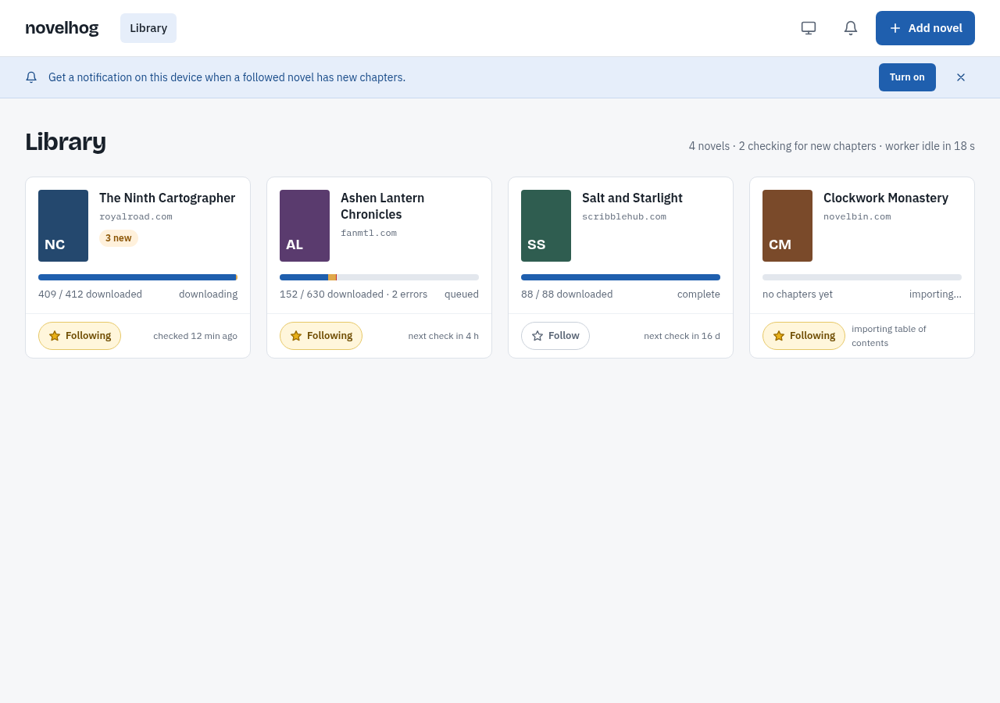

**Add novel dialog**: one step; the host check is a database lookup and the
details arrive with the first import.

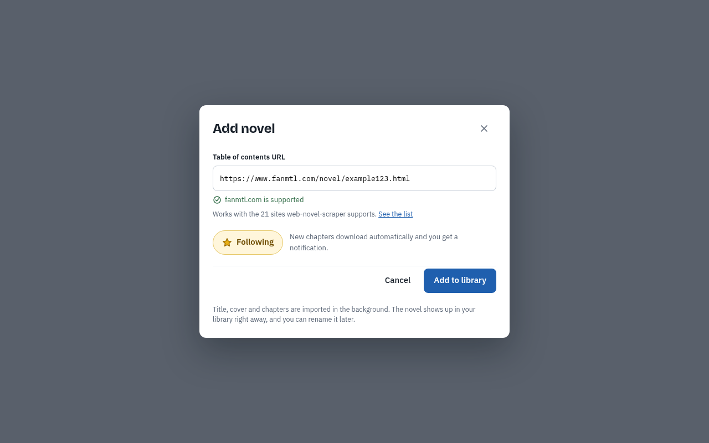

**Notification banner**: default, iOS not installed, permission blocked, phone
width, header bell states, theme menu.

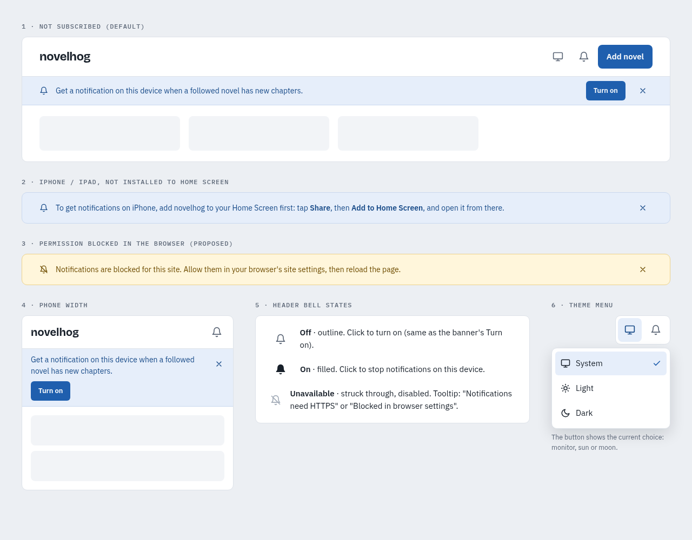

**Chapters, desktop, normal mode**: search, state filters, overview bar with
frame, range chips, table with chevron status tabs; clicking a row opens
details.

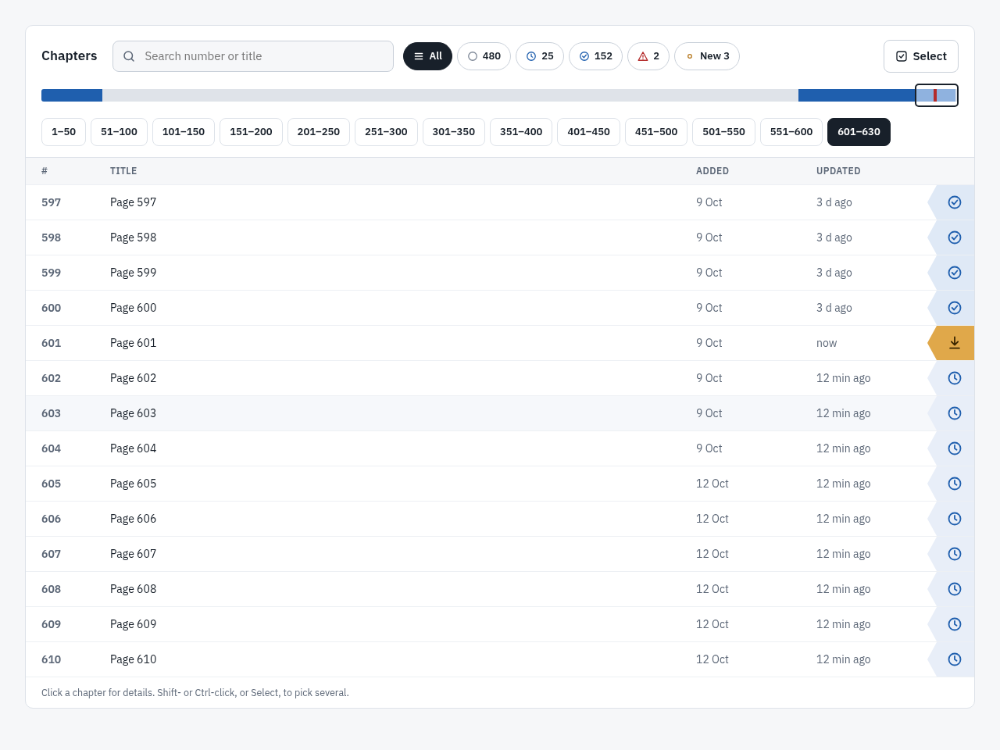

**Chapters, desktop, select mode**: drawn checkboxes, header checkbox in the
"some" state, plain status tabs, action bar.

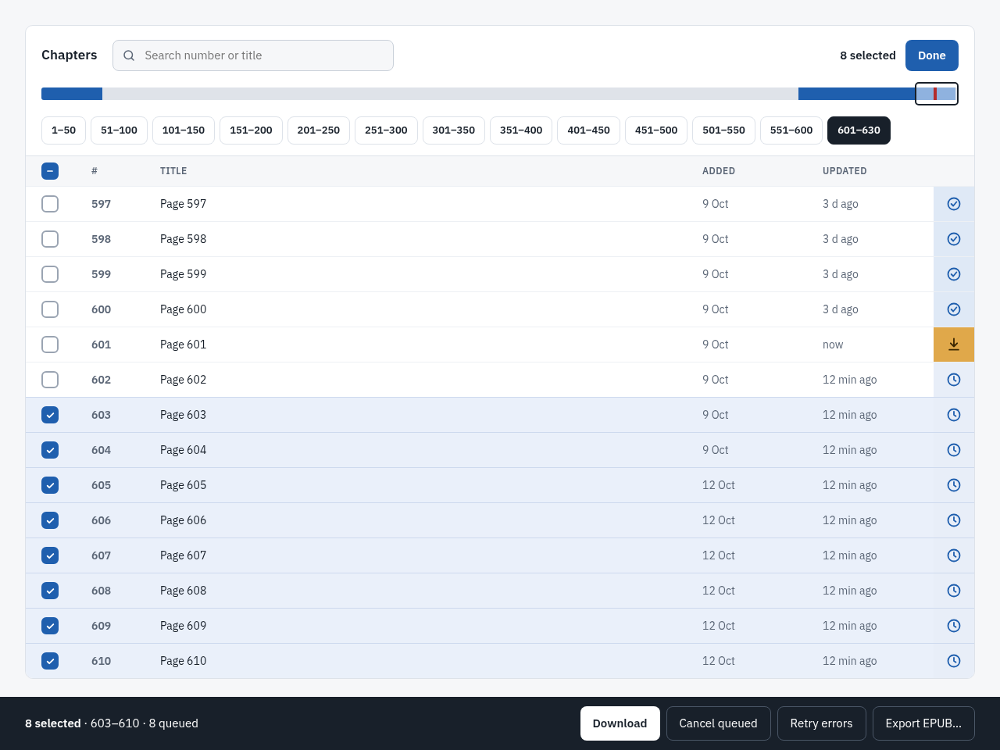

**Chapter details, desktop dialog**

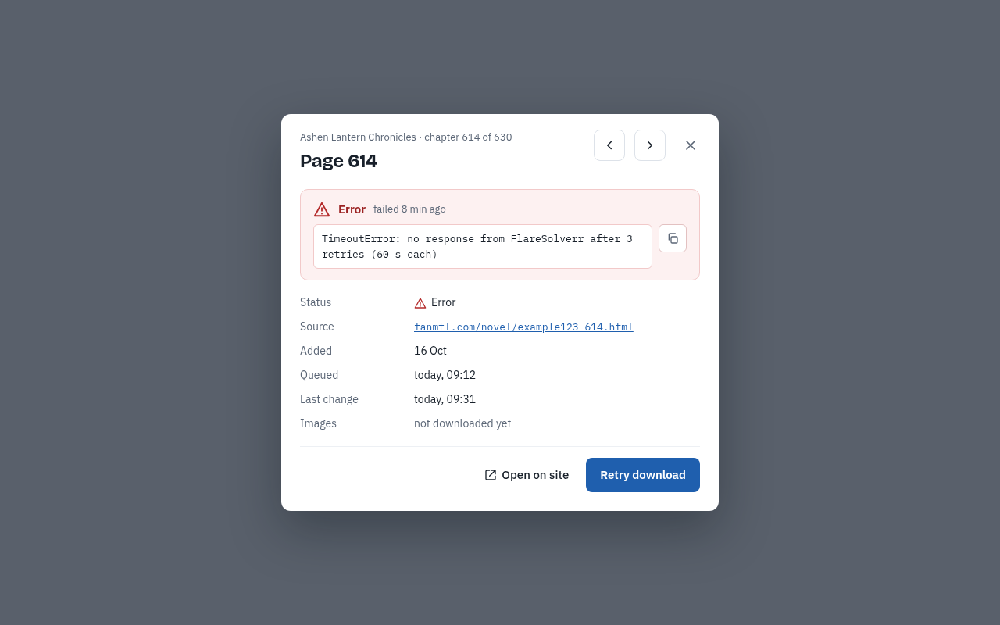

**Chapters, phone**: normal mode and select mode.

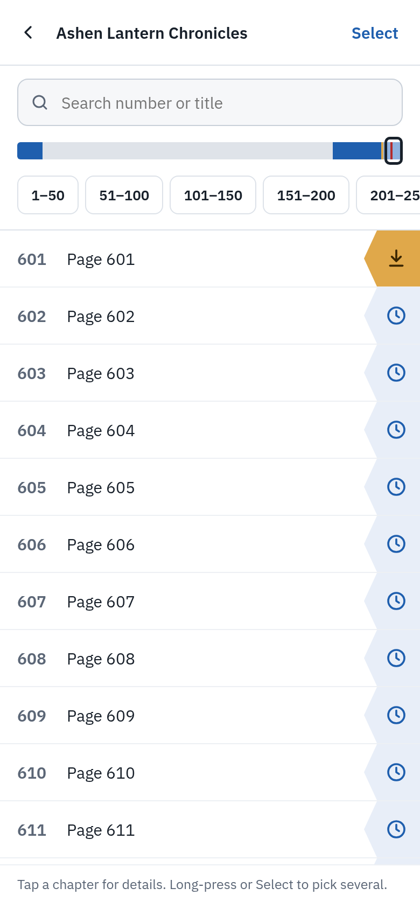
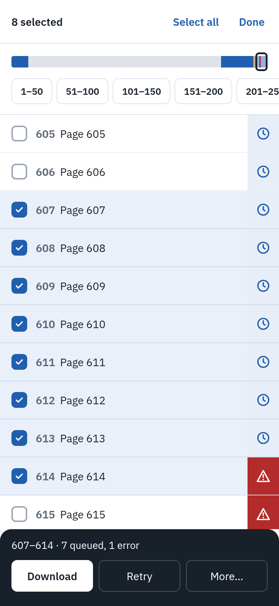

**Chapter details, phone bottom sheet**

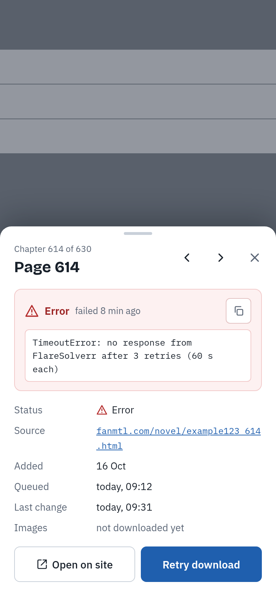

**Export dialog, desktop**: all chapters downloaded; one file.

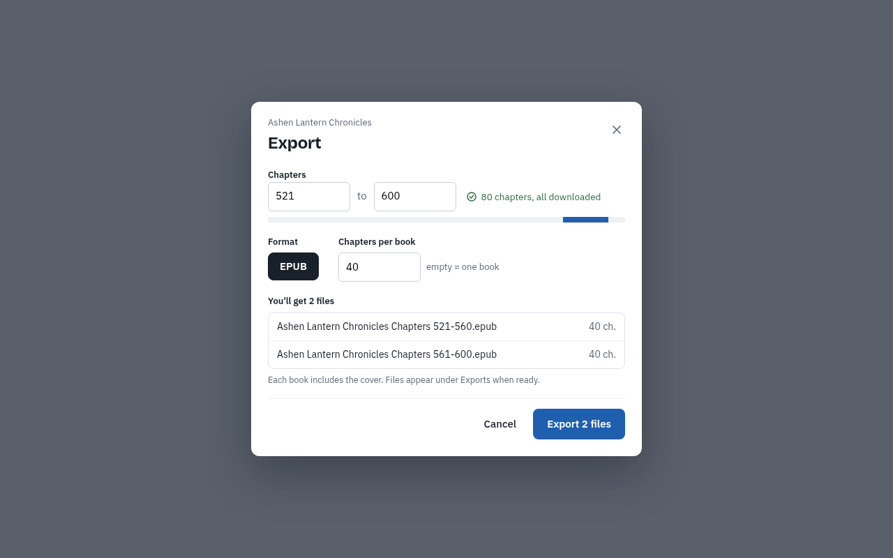

**Export sheet, phone, chapters missing**: the missing chapters are downloaded
first and the export waits for them.

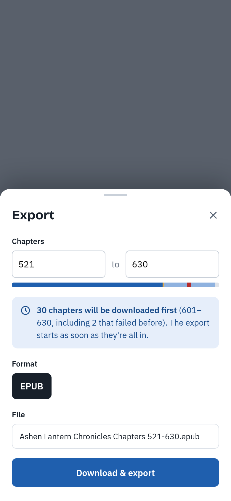

**Dark mode**: generated from the light sketches with one dark palette (library,
desktop chapters, export dialog, phone normal and select mode).

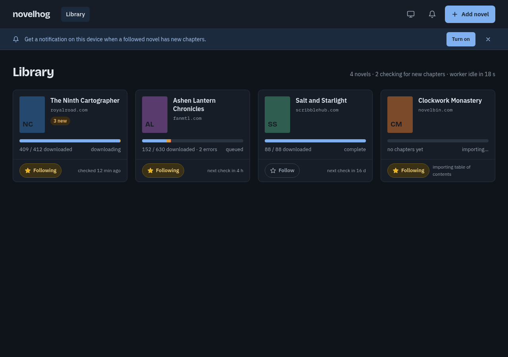

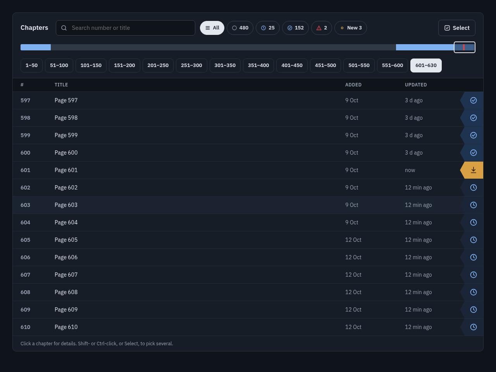

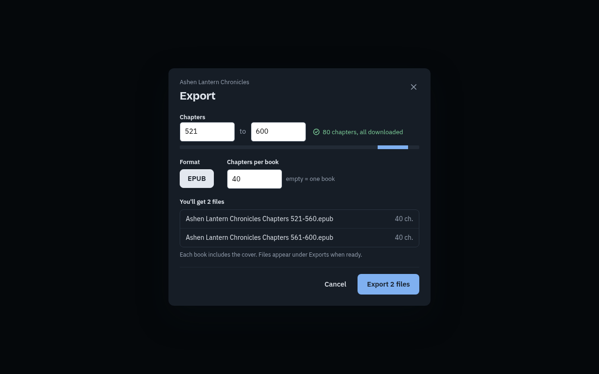

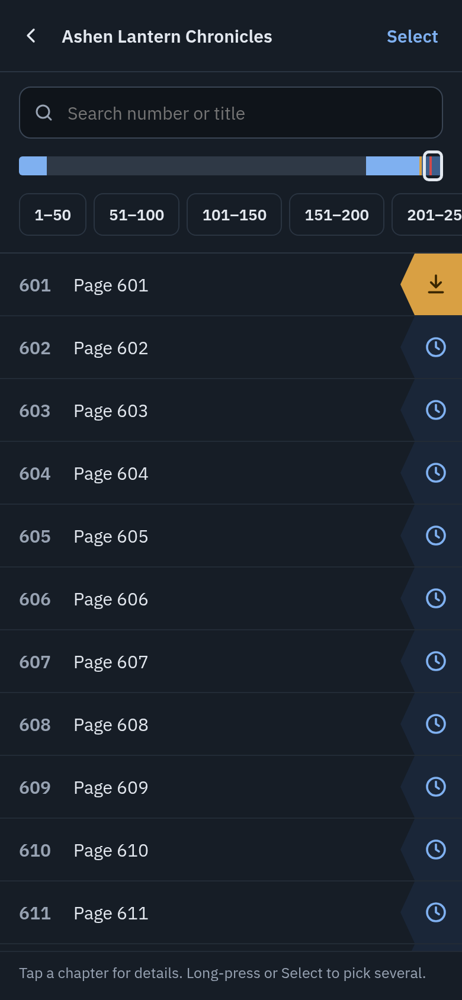
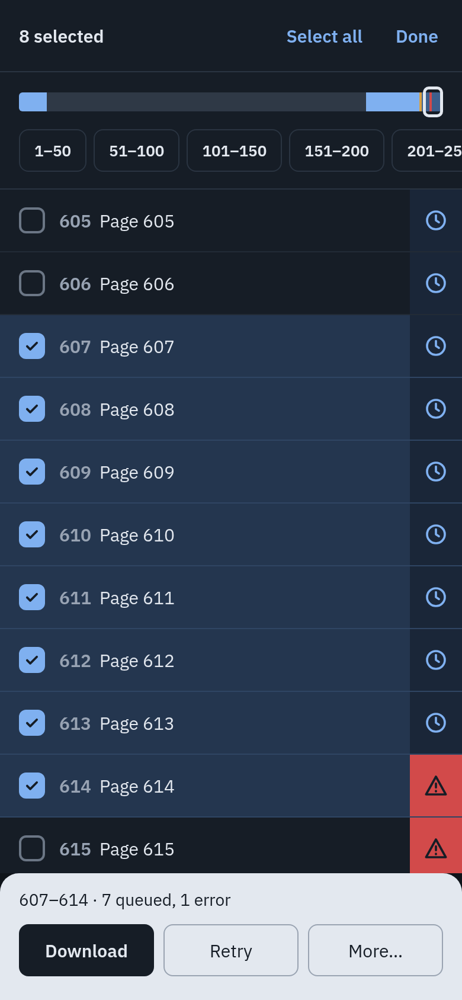

## 11. Error handling

- `domain` and `repo` raise domain exceptions; only `api` maps them to HTTP.
- The worker never dies on a single chapter or refresh: the chapter goes to
  `error` with a short message (`<ExceptionType>: <summary>`); a failed refresh is
  logged and backed off; tracebacks go to logs.
- The scraper's own retry settings apply to upstream requests.
- Push failures are logged and not retried; `404`/`410` deletes the subscription.
- Logging: structured JSON to stdout (`structlog`) with `novel_id`, `chapter_id`,
  `worker_id`, `host` bound where relevant.

## 12. Future work (not part of v1)

- **Worker wake-up.** A `Waker` interface (`wait(timeout) -> bool` in the worker,
  `notify()` in the API). First implementation: UDP datagram to every address the
  worker service name resolves to, with the timed sleep kept as fallback; the
  worker always re-checks the database. With Postgres: `LISTEN/NOTIFY`.
- **Postgres** for multi-host clustering, behind the `repo` layer.
- **S3 static backend** (`S3StaticStorage`), setting `Content-Type` and
  `Content-Disposition` per object.
- **Image table**: move inline images of chapters with `has_images` into a
  content-addressed table.
- **Telegram notifications.** A `TelegramChannel` registered in the worker's
  channel registry (`address = {chat_id}`), plus a separate `novelhog-telegram`
  bot service that uses `novelhog.repo` to register targets on `/start`, remove
  them on `/stop`, and answer simple commands (library, new chapters). No change
  to the outbox or the worker loop.
- **Delete novel** (`DELETE /novels/{id}`); the schema already cascades.
- In-browser reader, FTS5 search, manual cover upload, offline PWA caching,
  splitting pages into real chapters.

## 13. Testing

- **Unit:** `ids`; `html_to_markdown` (allowlist, escaping, empty paragraphs,
  `ul`/`ol` with `start`, nested lists, multi-paragraph items, `dl` → bold term +
  paragraph, empty items and lists dropped, round trip through `markdown-it-py`
  yields the same list structure,
  images, failure placeholder); `image_fetcher` (magic bytes, SVG rejection, size
  cap); `images` (downscale only above the limit, aspect ratio kept, animated
  untouched, `0` disables, small images byte-identical; WebP → PNG with alpha /
  JPEG without, animated → first frame); `find_cover_url` (each heuristic,
  relative URLs); `exporter` (order, cover, image extraction, no WebP in EPUB
  output, stored originals unchanged); chapter state rules; selector validation; refresh interval
  rule (reset, doubling, cap, jitter bounds).
- **Integration (real temporary SQLite):** lease and claim with two competing
  workers; recovery of expired leases; SIGTERM requeue; dequeue during a claimed
  batch; refresh scheduling and priority over downloads; initial import vs later
  release (`released_at`, auto-queue for followed only); `new_pages` vs
  `seen_at`; SSE replay from `Last-Event-ID` and `resync`; pruning keeps the
  newest change per entity; `Chapter.error` comes from the newest change only
  while the state is `error` and survives pruning.
- **Notifications (fake channel):** exactly one `release` outbox row per sync
  with new chapters of a followed novel, written in the same transaction; none
  for no new chapters, initial import or unfollowed novels; one `export_ready`
  row for an export with `waited = 1`, none with `waited = 0`; the dispatcher
  delivers each row to every target once, marks it sent, skips unknown channels,
  deletes targets on `Gone`, logs `Failed`; two dispatchers never deliver the
  same row; stale claims are released; `messages.render` wording per kind;
  `WebPushChannel` maps `404`/`410` to `Gone`.
- **VAPID:** `ensure_keys` creates the pair once, is a no-op when it exists, and
  two concurrent callers end with one pair; `/settings` exposes only the public
  key.
- **Hosts and novels:** `publish_hosts` replaces the table from the decode guide;
  `POST /novels` rejects unknown hosts and duplicate `toc_url`; the initial import
  sets the title only when none is set and records `import_error` on failure; a
  later successful sync clears it; `PATCH {title}` survives syncs.
- **Process boundaries:** the API package imports neither `scraper_adapter`,
  `exporter`, `images` nor `notifications.channels` (import-linter contract);
  `repo` imports nothing beyond the standard library, `ids` and `domain`.
- **Exports (real temporary SQLite):** `POST` queues `not_requested` and `error`
  chapters of the range and creates a `waiting` export with the right `waited`;
  an identical waiting export is returned instead of a duplicate; the worker
  builds only when the whole range is `downloaded`; `waiting → building →
  ready` sets storage key, size and `ready_at`; a build exception gives `failed`
  with a message; `blocked` lists errors and dequeued chapters and the export
  continues after they are re-queued and downloaded; `DELETE` removes a waiting
  export, leaves its chapters queued and answers `409` once building; expired
  `building` claims return to `waiting`; every state change emits an `export`
  change.
- **API:** `httpx` against the app with a real temporary database and no
  scraper, network or worker; every route,
  success and each error code, including `503 push_disabled`.
- **Regression (offline HTML fixtures in the repo):** fanmtl `&gt;` pagination;
  chapter files located without relying on `main.json`; no scripts and no empty
  paragraphs in output.
- **Frontend:** Vitest + Testing Library for normal mode (row click/tap opens
  details; Select, long-press and Shift/Ctrl-click enter select mode with the
  right selection), select mode (tap toggles, long-press and Shift-click select
  a range, Select all covers search/filter results, header checkbox none/some/
  all, Done/Escape/back and finishing a bulk action leave the mode and clear the
  selection, selection survives SSE updates), table rendering (no error text in
  rows; status tab colour and icon per state; chevron only in normal mode;
  Added shows date only from `released_at`, "—" for initial import), chapter
  details (dialog on desktop, sheet on phone, error box only in `error` state,
  copy button, previous/next, state-dependent primary action sends the right
  PATCH), overview bar (runs and proportions from chapter states, frame position,
  tap jumps to the containing range, dimming under search/filter, live update
  from a `chapter` event), range chips (default to newest, hidden while
  searching), search by number and title, state filters across all ranges, SSE
  cache updates,
  the notifications toggle states, and the theme switcher (stored choice applied,
  System follows `prefers-color-scheme` changes, storage unavailable falls back
  to System); one Playwright smoke test of the main flow against a fake backend.
- **Container smoke test** (`docker compose up` in CI, no worker network access):
  Caddy serves the SPA with fallback to `index.html`, `/sw.js` with `no-cache`,
  a file under `/static/exports/` with `Content-Disposition: attachment` and
  `application/epub+zip`, proxies `/api/v1/settings`, and streams
  `/api/v1/events` without buffering; the container exits when either process
  dies.
- No live-site tests in CI. `scripts/smoke_live.sh <url>` exists for manual
  checks.

## 14. Styleguide (to be written to `STYLEGUIDE.md` as the plan's first step)

- **Python:** 3.14, `uv`; `ruff format` + `ruff check`; `mypy --strict`;
  `pytest`. `snake_case`; tests named `test_<unit>__<behaviour>`, e.g.
  `test_claim_batch__skips_leased_novel`. No bare `except:`.
- **TypeScript:** strict mode; `eslint` + `prettier`; components
  `PascalCase.tsx`, hooks `useX.ts`, tests colocated as `*.test.tsx`.
- **Layout:**

  ```
  src/novelhog/{api,worker,domain,repo,scraper_adapter,storage,exporter,notifications,
                html_to_markdown,image_fetcher,images,chapter_store,vapid.py,ids.py,
                config.py,cli.py}
  migrations/
  web/src/{routes,components,api,hooks}   web/public/{sw.js,manifest.webmanifest}
  tests/{unit,integration,api,fixtures}
  docker/{Dockerfile,Caddyfile}   compose.yaml   STYLEGUIDE.md   docs/superpowers/specs/
  ```
