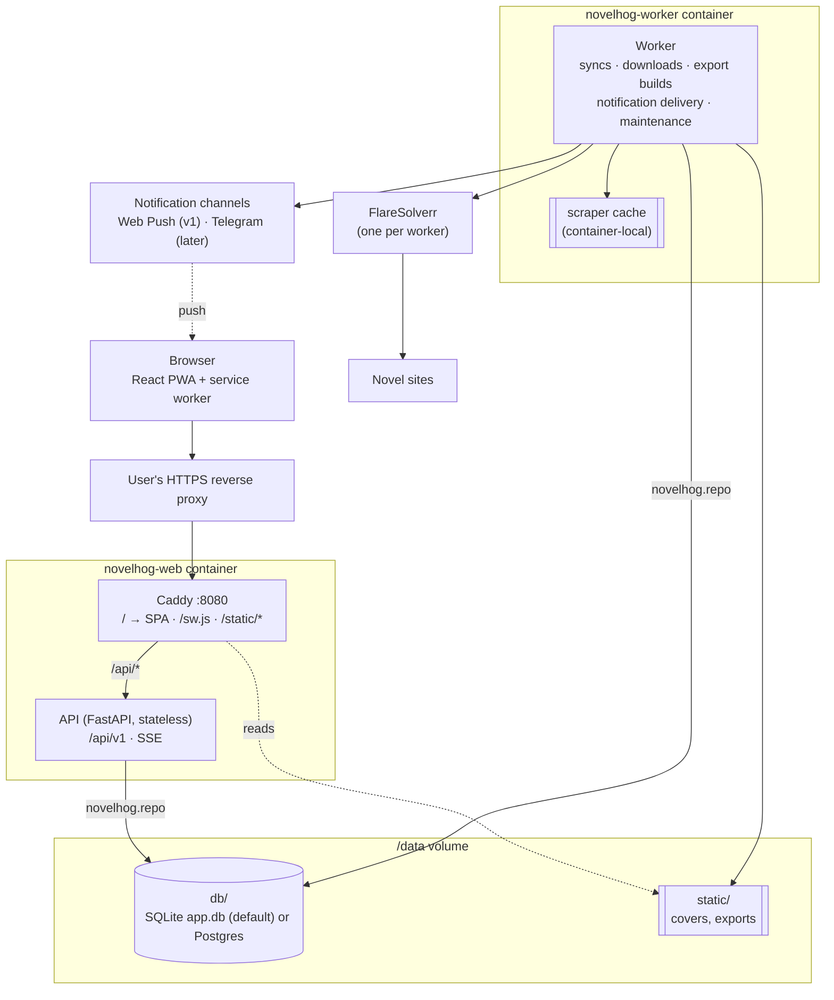
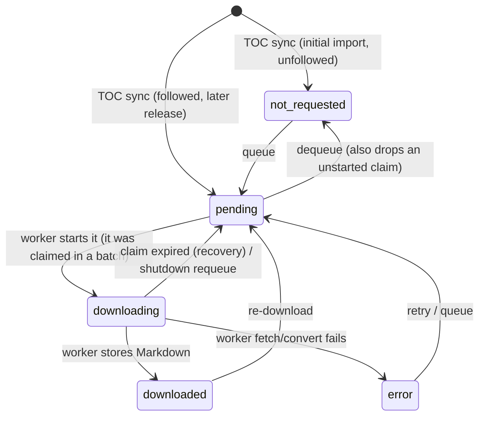
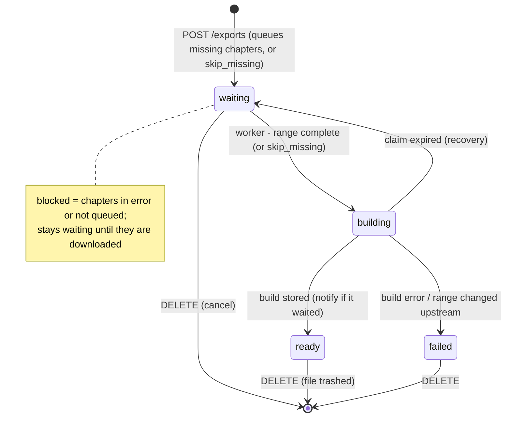
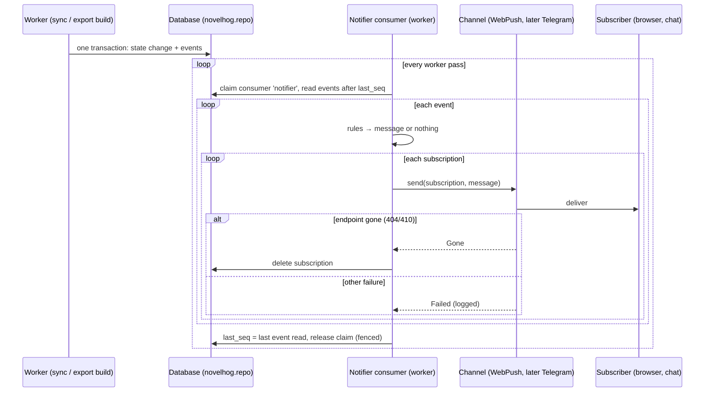

# novelhog — Design Spec

- **Date:** 2026-10-18 (revised 2026-10-19 after adversarial review)
- **Status:** Approved in brainstorming; revised after the adversarial spec and plan reviews
- **Repo:** `~/dev/novel-shelf` (directory name is incidental; the project is `novelhog`)

## 1. Purpose

novelhog is a self-hosted web UI around
[`web-novel-scraper`](https://github.com/ImagineBrkr/web-novel-scraper). It lets
one person keep a library of web novels, have new chapters discovered and
downloaded in the background, get push notifications for new releases, and export
chapter ranges to EPUB for phones and e-readers.

### Success criteria

1. Add a novel from any URL whose host `web-novel-scraper` supports; title and
   cover are detected and the TOC is imported in the background.
2. Queue a single chapter, a list or a range; downloads continue with the browser
   closed and progress is visible live from any device.
3. Every novel's TOC is re-checked automatically, more often for active novels
   and down to monthly for dormant ones.
4. For followed novels, new chapters download automatically (ahead of bulk
   downloads) and a push notification arrives even when no novelhog tab is open.
5. Export a downloaded range to an EPUB with a cover, without ads or empty
   paragraphs, and download it from any device.
6. `docker compose up` (which brings the worker's own FlareSolverr), behind the
   user's own HTTPS reverse proxy, is the whole deployment.

### In scope (v1)

- Library, add novel from a URL (details filled in by the first import),
  automatic and manual TOC sync with adaptive interval, delete novel.
- Follow switch: auto-download of new chapters + Web Push notifications.
- Chapter queueing (single, list, range), dequeue, retry, re-download, live
  progress.
- "New" badges for chapters released since the novel page was last opened.
- EPUB export (optionally skipping missing chapters), download and deletion;
  cover detection and display.
- Installable PWA (required for push on iOS).

### Out of scope (v1)

- In-browser reader, full-text search, metadata editing other than renaming a
  novel (`PATCH {title}`).
- Authentication (no auth; the reverse proxy can add it). The API still defends
  against DNS rebinding and cross-site requests (§5.9).
- TLS termination (done by the user's reverse proxy).
- Manual cover upload.
- Splitting site "pages" into the novel's real chapters (titles are shown as the
  site provides them, e.g. fanmtl's "Page N").
- S3 static backend (interface exists; only the local backend ships).
- Worker wake-up ("poke"), see §12.

## 2. Architecture



Responsibilities are split by concern, not by load:

| Component | Responsibility |
|---|---|
| `novelhog-web` (container) | Everything that faces people, and nothing about novel sites. Runs two processes: **Caddy** (the only exposed port) and the **API**. |
| Caddy (in `novelhog-web`) | Serves the built SPA at `/` (SPA fallback to `index.html` for every path except `/api/*` and `/static/*`), `sw.js` and `manifest.webmanifest` at the root, and local static files from `/data/static` at `/static`; reverse-proxies `/api/*` to the API on `127.0.0.1:8000` with response buffering off (SSE). Owns cache and download headers (§8.3). |
| API (in `novelhog-web`) | FastAPI app, `/api/v1` only: REST, SSE stream, settings (including generating the VAPID key pair into the database), Web Push subscription registration. Stateless: no local files of its own, no background jobs; every instance is interchangeable. Never serves files and never talks to novel sites, FlareSolverr or the scraper. Uses a synchronous SQLAlchemy engine with plain `def` endpoints (FastAPI's threadpool); the SSE generator runs its database polls in the threadpool too. |
| `worker` | Everything about novels. Separate container from the same image. The only user of the scraper and FlareSolverr. Uses the scraper's `Novel` API with a **container-local** working directory that is only a cache (never shared between containers, rebuildable from the database at any time). Publishes supported hosts, runs TOC syncs (initial import included), downloads chapters, builds exports, delivers notifications through channels, deletes trashed static files, prunes the event log and runs database maintenance. |
| SPA | React app + service worker, built to static files baked into the image at `/srv/web` and served by Caddy (single origin, no CORS). |
| `novelhog.repo` | The database interface: a standalone package built on SQLAlchemy Core (no FastAPI, scraper or image imports) used by `api`, `worker` and future services such as a Telegram bot. |
| Database (SQLite by default, Postgres supported) | Single source of truth: novels, chapters, chapter content (Markdown), exports, hosts, settings, subscriptions, the event log, its clock and its consumers, the static-file trash. Accessed only through `novelhog.repo`. |
| Static storage | Covers and export files behind `StaticStorage`; v1 backend is local disk under `/data/static`. |

### Deployment

- `compose.yaml` with services `novelhog-migrate`, `novelhog-web` and
  `novelhog-worker`, one image, different commands (`novelhog db migrate`,
  `novelhog web`, `novelhog worker`).
- `novelhog-migrate` is a one-shot service (`restart: "no"`) that applies
  pending migrations and exits. `novelhog-web` and `novelhog-worker` declare
  `depends_on: {novelhog-migrate: {condition: service_completed_successfully}}`,
  so every `docker compose up` migrates exactly once before anything starts.
- `novelhog web` starts the API (uvicorn on `127.0.0.1:8000`) and Caddy
  (`:$NOVELHOG_HTTP_PORT`, default `8080`, config in `docker/Caddyfile`) under
  `tini`; if either process exits, the other is stopped and the container exits
  so Docker restarts it.
- Volume layout: `/data/db` is mounted read-write into all three services (SQLite
  needs to create `app.db-wal` and `app.db-shm` next to the database);
  `/data/static` is read-write for `novelhog-worker` and read-only for
  `novelhog-web`. With Postgres, `/data/db` is unused.
- **Every worker is paired 1:1 with its own FlareSolverr.** `compose.yaml` ships
  one pair: `novelhog-worker` and a `flaresolverr` service on a private network
  that only the two of them join, with `NOVELHOG_FLARESOLVERR_URL` pointing at
  it. More workers means more pairs (each worker with its own FlareSolverr and
  URL, e.g. a second pair in an override file); workers are never scaled with
  `--scale`, which would break the pairing. The worker does not `depends_on`
  FlareSolverr: while it is unreachable, work is put back as an infrastructure
  error (§6.1). `compose.test.yaml` leaves FlareSolverr out for tests.
- `novelhog-worker` has `stop_grace_period: 2m`, so a chapter in progress can
  finish on `docker compose down`.
- `novelhog-web` publishes one port (default `8080`) for the user's HTTPS
  reverse proxy.
- The API process needs only FastAPI, the repository layer and `py-vapid` for key
  generation; the scraper, FlareSolverr access, Pillow, `ebooklib` and `pywebpush` are used
  only by the worker. One image still serves both for simplicity; the
  import-linter contract (§13) keeps the boundary.
- Both `NOVELHOG_PUBLIC_URL` and `NOVELHOG_VAPID_SUBJECT` are set on both
  services: the API reports whether the `webpush` channel is enabled and uses the
  public host for its host check (§5.9), the worker builds links and VAPID
  claims.
- The user's reverse proxy must terminate HTTPS (required for service workers and
  push), must pass the original `Host` header, and must not buffer
  `/api/v1/events`. The README includes Caddy and nginx snippets and backup
  instructions (§11.1). Cache headers come from the built-in Caddy.
- Scaling: `novelhog-web` (stateless) can be scaled on one host with SQLite, and
  so can worker/FlareSolverr pairs (claims, fencing and the event clock make
  concurrent workers safe). Several workers may fetch from the same site at the
  same time; per-site limits are future work. Multi-host clustering needs
  Postgres and shared static storage (§12).

## 3. Identifiers

- Format: two-letter uppercase type prefix + 12 random characters from
  `[a-z0-9]`, generated with `secrets`.
  - `NV` novel, `CH` chapter, `EX` export, `SB` subscription.
    Example: `CHk3x9q2m7b4wz`.
- 36¹² ≈ 4.7·10¹⁸ (~62 bits). Primary keys are unique; an insert that collides is
  retried with a fresh ID.
- IDs carry no ordering. Every listing orders by an explicit column
  (`created_at`, `position`).
- An ID with the wrong prefix or format in a path or body is treated as unknown →
  `404`.
- A chapter's **identity** is its normalised URL within its novel (§4 "URL
  normalisation"); its ID is stable for as long as that URL stays in the
  database. A chapter's **position** is its current 1-based place in the TOC and
  may change on every sync.

## 4. Database schema

The database is accessed through **SQLAlchemy Core 2.x** (no ORM) inside
`novelhog.repo`, so the same code runs on **SQLite ≥ 3.45** (default) and
**PostgreSQL ≥ 16**. The database is chosen by `NOVELHOG_DATABASE_URL` (§9).

- The schema is defined once as SQLAlchemy `Table` objects in
  `novelhog/repo/schema.py`; that module is the contract. The DDL below is the
  logical schema, written in its SQLite form; `schema.py` reproduces every
  table, column, default, foreign key, unique constraint, check and index,
  applying the portability mapping after the DDL.
- Migrations are **Alembic** revisions in the package at
  `src/novelhog/repo/migrations/` (so an installed wheel finds them); the Alembic
  configuration is built in code with an absolute `script_location`, no
  `alembic.ini` is needed at run time. Each revision must run on both SQLite
  (batch mode) and Postgres.
- **SQLite migrations run with foreign keys off.** `migrations/env.py` executes
  `PRAGMA foreign_keys = OFF` on the connection before the migration transaction
  starts (it is a no-op inside a transaction), runs the revisions, runs
  `PRAGMA foreign_key_check` and fails the migration if it reports any row, and
  only then re-enables foreign keys. A batch-mode table rebuild therefore never
  deletes or rejects child rows.
- **No `ON DELETE CASCADE`.** Every foreign key is plain. Deleting a novel or an
  export deletes its child rows explicitly in the repository, in one
  transaction (§5.3, §5.5).
- **Only `novelhog db migrate` applies migrations** (`alembic upgrade head`,
  exit 0 on success). In Compose it runs as the one-shot `novelhog-migrate`
  service (§2 Deployment); locally it is run by hand.
- **The API and the worker never migrate.** At startup each compares the
  database's revision with the code's head revision and refuses to start if
  they differ, logging "Database schema is at <current>, this build needs
  <head>; run `novelhog db migrate`" and exiting non-zero. This avoids several
  processes migrating at once and silent schema changes under running
  instances.
- `novelhog db status` prints the current and head revisions and exits 0 when
  they match, 1 otherwise; the startup check uses the same function.
- `novelhog api --migrate` is a development shortcut (migrate, then serve); it
  is never used in Compose.
- SQLite connections use WAL, `foreign_keys = ON` and `busy_timeout = 15000`.
  The `PRAGMA` statements and `BEGIN IMMEDIATE` in `repo/db.py`'s connection
  events are the only raw SQL in the code base.
- A write that still finds the database locked after the busy timeout raises
  `repo.Busy`; the API maps it to `503 database_busy` with `Retry-After: 2`, the
  worker treats it like any other loop error (§6.1).

```sql
CREATE TABLE novels (
    id                TEXT PRIMARY KEY
                      CHECK (length(id) = 14 AND substr(id, 1, 2) = 'NV'
                             AND substr(id, 3) NOT GLOB '*[^a-z0-9]*'),
    title             TEXT,                      -- display only; NULL until detected or set
    host              TEXT NOT NULL REFERENCES hosts (host),
    toc_url           TEXT NOT NULL UNIQUE,      -- normalised (§4 URL normalisation)
    language          TEXT,                      -- BCP 47 from the TOC page's <html lang>, if any
    import_error      TEXT,                      -- set if the initial import failed
    cover_key         TEXT,                      -- static storage key; NULL = no cover
    followed          INTEGER NOT NULL DEFAULT 1 CHECK (followed IN (0, 1)),
    refresh_interval  INTEGER NOT NULL CHECK (refresh_interval > 0),  -- seconds, current
    next_refresh_at   TEXT NOT NULL,
    sync_requested    INTEGER NOT NULL DEFAULT 0 CHECK (sync_requested IN (0, 1)),
    last_refreshed_at TEXT,                      -- NULL = initial import not done yet
    seen_at           TEXT,                      -- last time the novel page was opened
    claimed_by        TEXT,                      -- worker id holding the sync claim
    claimed_until     TEXT,
    created_at        TEXT NOT NULL,
    updated_at        TEXT NOT NULL,
    CHECK ((claimed_by IS NULL) = (claimed_until IS NULL))
) STRICT;

CREATE INDEX novels_due_refresh ON novels (next_refresh_at);

CREATE TABLE chapters (
    id            TEXT PRIMARY KEY
                  CHECK (length(id) = 14 AND substr(id, 1, 2) = 'CH'
                         AND substr(id, 3) NOT GLOB '*[^a-z0-9]*'),
    novel_id      TEXT NOT NULL REFERENCES novels (id),
    url           TEXT NOT NULL,                          -- normalised; the chapter's identity
    position      INTEGER CHECK (position >= 1),          -- current 1-based TOC place; NULL = removed
    removed_at    TEXT,                                   -- set when the URL left the TOC
    title         TEXT,                                   -- set after download
    state         TEXT NOT NULL DEFAULT 'not_requested'
                  CHECK (state IN ('not_requested', 'pending', 'downloading',
                                   'downloaded', 'error')),
    priority      INTEGER NOT NULL DEFAULT 0 CHECK (priority IN (0, 1)), -- 1 = auto-queued release
    has_images    INTEGER NOT NULL DEFAULT 0 CHECK (has_images IN (0, 1)),
    released_at   TEXT,                                   -- NULL = part of initial import
    queued_at     TEXT,                                   -- kept through 'downloading'
    claimed_by    TEXT,                                   -- worker id holding the download claim
    claimed_until TEXT,
    updated_at    TEXT NOT NULL,
    UNIQUE (novel_id, url),
    CHECK ((position IS NULL) = (removed_at IS NOT NULL)),
    CHECK ((state IN ('pending', 'downloading')) = (queued_at IS NOT NULL)),
    CHECK ((claimed_by IS NULL) = (claimed_until IS NULL)),
    CHECK (claimed_by IS NULL OR state IN ('pending', 'downloading')),
    CHECK (state <> 'downloading' OR claimed_by IS NOT NULL)
) STRICT;

CREATE INDEX chapters_queue    ON chapters (priority DESC, queued_at, position)
    WHERE state = 'pending';
CREATE INDEX chapters_order    ON chapters (novel_id, position);
CREATE INDEX chapters_state    ON chapters (novel_id, state);
CREATE INDEX chapters_released ON chapters (novel_id, released_at)
    WHERE released_at IS NOT NULL;

CREATE TABLE chapter_contents (
    chapter_id TEXT PRIMARY KEY REFERENCES chapters (id),
    markdown   TEXT NOT NULL,                    -- images inline as data: URIs
    fetched_at TEXT NOT NULL
) STRICT;

CREATE TABLE exports (
    id               TEXT PRIMARY KEY
                     CHECK (length(id) = 14 AND substr(id, 1, 2) = 'EX'
                            AND substr(id, 3) NOT GLOB '*[^a-z0-9]*'),
    novel_id         TEXT NOT NULL REFERENCES novels (id),
    first_chapter_id TEXT NOT NULL REFERENCES chapters (id),   -- range = positions between
    last_chapter_id  TEXT NOT NULL REFERENCES chapters (id),   -- these two chapters, inclusive
    skip_missing     INTEGER NOT NULL DEFAULT 0 CHECK (skip_missing IN (0, 1)),
    mime             TEXT NOT NULL,              -- e.g. 'application/epub+zip'
    filename         TEXT NOT NULL,              -- sanitised download name (§8.3)
    state            TEXT NOT NULL DEFAULT 'waiting'
                     CHECK (state IN ('waiting', 'building', 'ready', 'failed')),
    error            TEXT,                       -- build failure message, 'failed' only
    storage_key      TEXT UNIQUE,                -- set when ready
    size_bytes       INTEGER CHECK (size_bytes >= 0), -- set when ready
    waited           INTEGER NOT NULL DEFAULT 0 CHECK (waited IN (0, 1)), -- range was incomplete at request time
    claimed_by       TEXT,                       -- worker id while building
    claimed_until    TEXT,
    created_at       TEXT NOT NULL,
    ready_at         TEXT,
    CHECK ((state = 'ready') = (storage_key IS NOT NULL AND size_bytes IS NOT NULL)),
    CHECK ((state = 'failed') = (error IS NOT NULL)),
    CHECK ((claimed_by IS NULL) = (claimed_until IS NULL)),
    CHECK ((state = 'building') = (claimed_by IS NOT NULL))
) STRICT;

CREATE INDEX exports_by_novel ON exports (novel_id, created_at);
CREATE INDEX exports_waiting  ON exports (created_at) WHERE state = 'waiting';
CREATE UNIQUE INDEX exports_active ON exports
    (novel_id, first_chapter_id, last_chapter_id, mime, skip_missing)
    WHERE state IN ('waiting', 'building');

CREATE TABLE hosts (                             -- published by the worker from the scraper
    host       TEXT PRIMARY KEY,                 -- e.g. 'fanmtl.com' (no 'www.')
    supported  INTEGER NOT NULL CHECK (supported IN (0, 1)), -- 0 = dropped by the installed scraper
    updated_at TEXT NOT NULL
) STRICT;

CREATE TABLE settings (                          -- small key/value store
    key        TEXT PRIMARY KEY,                 -- e.g. 'vapid'
    value      TEXT NOT NULL CHECK (json_valid(value)),
    updated_at TEXT NOT NULL
) STRICT;

CREATE TABLE subscriptions (                     -- where notifications are delivered, any channel
    id          TEXT PRIMARY KEY
                CHECK (length(id) = 14 AND substr(id, 1, 2) = 'SB'
                       AND substr(id, 3) NOT GLOB '*[^a-z0-9]*'),
    channel     TEXT NOT NULL,                   -- 'webpush' (v1); 'telegram', … later
    address     TEXT NOT NULL CHECK (json_valid(address)), -- channel-specific
    address_key TEXT NOT NULL,                   -- channel-specific identity, e.g. push endpoint
    label       TEXT,                            -- e.g. user agent, chat name
    created_at  TEXT NOT NULL,
    UNIQUE (channel, address_key)
) STRICT;

CREATE TABLE event_clock (                       -- exactly one row; serialises event writers
    id  INTEGER PRIMARY KEY CHECK (id = 1),
    seq INTEGER NOT NULL                         -- last seq handed out
) STRICT;                                        -- seeded with (1, 0) by the first migration

CREATE TABLE events (                            -- the event log; every reader keeps a cursor
    seq       INTEGER PRIMARY KEY,               -- from event_clock; SSE event id
    novel_id  TEXT NOT NULL,                     -- for ?novel_id filtering (no FK: outlives deletes)
    entity_id TEXT NOT NULL                      -- NV…/CH…/EX…; prefix = event type
              CHECK (substr(entity_id, 1, 2) IN ('NV', 'CH', 'EX')),
    payload   TEXT NOT NULL CHECK (json_valid(payload)),
    at        TEXT NOT NULL
) STRICT;

CREATE INDEX events_by_novel  ON events (novel_id, seq);
CREATE INDEX events_by_entity ON events (entity_id, seq);

CREATE TABLE consumers (                         -- durable readers of the event log
    name          TEXT PRIMARY KEY,              -- 'notifier' (v1); 'telegram', … later
    last_seq      INTEGER NOT NULL,              -- last event fully processed
    claimed_by    TEXT,                          -- process currently reading
    claimed_until TEXT,
    updated_at    TEXT NOT NULL,
    CHECK ((claimed_by IS NULL) = (claimed_until IS NULL))
) STRICT;

CREATE TABLE storage_trash (                     -- static files to delete (worker empties it)
    key TEXT PRIMARY KEY,
    at  TEXT NOT NULL
) STRICT;
```

**Portability mapping** (SQLite DDL above → `schema.py`):

| SQLite form | Portable form in `schema.py` |
|---|---|
| `STRICT` tables | dropped; column types enforced by SQLAlchemy types and the application |
| ID `CHECK (… GLOB …)` | `CHECK (length(id) = 14 AND substr(id, 1, 2) = '<prefix>')`; full format checked by `ids.is_valid` |
| `TEXT` timestamps | `repo.types.UTCDateTime`, a `TypeDecorator`: rejects naive datetimes, converts to UTC, stores fixed-width `YYYY-MM-DDTHH:MM:SS.ffffffZ` text on SQLite (so string comparison is time order) and `timestamptz` on Postgres, and always returns aware UTC datetimes |
| timestamp arithmetic | none in SQL: values such as `claimed_until = now + ttl` are computed in Python and bound as parameters |
| `TEXT … CHECK (json_valid(…))` | `JSON().with_variant(JSONB, "postgresql")` |
| `INTEGER … CHECK (x IN (0, 1))` | `Boolean` |
| `events.seq`, `event_clock.seq`, `consumers.last_seq` | `BigInteger().with_variant(Integer, "sqlite")`; `events.seq` is **not** autoincrement (assigned from `event_clock`) |
| partial indexes (`WHERE …`) | `Index(…, sqlite_where=…, postgresql_where=…)` |
| `"end"`, `"position"` and other reserved words | `position` is quoted automatically by SQLAlchemy; no other reserved words |

Alembic's `env.py` sets `compare_type=True` and an `include_object` hook so that
"autogenerate against `schema.metadata` reports no differences" is meaningful
for these types and partial indexes.

**URL normalisation** (`domain.urls.normalize_url`, used by the API for
`toc_url` and by the worker for chapter URLs): lower-case scheme and host; strip
a leading `www.` (the scraper does the same when matching hosts); drop the
fragment, the default port, user info and a trailing slash on a non-root path;
keep the query. Only `http` and `https` on their default ports are accepted for
`toc_url`. The host of a normalised URL is the key into `hosts`.

**Claims** use optimistic compare-and-set updates, identical on both
databases; there is no `SELECT … FOR UPDATE`.

Every claimable table (`novels`, `chapters`, `exports`, `consumers`) has the
same two columns, set and cleared together:

| Column | Meaning |
|---|---|
| `claimed_by` | worker or process ID owning the row; `NULL` = free |
| `claimed_until` | when the claim lapses; renewing pushes it forward |

A row is **available** when `claimed_by IS NULL OR claimed_until < :now`, and
**owned by me** when `claimed_by = :me AND claimed_until >= :now`.
Eligibility (what kind of row may be claimed: due novels, pending chapters,
complete waiting exports, a named consumer) is a separate, table-specific
condition. Every claim goes through `repo/claims.py`, which issues one
statement of this shape (`:until` = now + TTL, computed in Python):

```
UPDATE <table>
SET claimed_by = :me, claimed_until = :until [, …]
WHERE <key> IN (SELECT <key> FROM <table>
                WHERE <eligible> AND (claimed_by IS NULL OR claimed_until < :now)
                ORDER BY <priority> LIMIT :n)
  AND (claimed_by IS NULL OR claimed_until < :now)
RETURNING <columns>
```

- The outer `WHERE` repeats the "free or expired" condition. SQLite executes
  write statements one at a time; Postgres (`READ COMMITTED`) re-evaluates the
  outer `WHERE` against the newest row version after a concurrent update. Either
  way a row is claimed by exactly one worker, and a losing worker's statement
  matches nothing.
- `RETURNING` tells the caller which rows it now owns; the caller re-sorts them
  by `<priority>` (RETURNING order is not guaranteed).
- A claim that returns fewer rows than asked while eligible rows remain is
  retried up to 3 times. The worker never sleeps after a claim that lost a race.
- **Fencing.** Every write that finishes or changes claimed work (chapter
  started, downloaded or failed; sync result; export ready or failed; consumer
  advanced; renewal; release) includes the "owned by me" condition. If it
  matches no row, the claim was lost (expired and recovered, or the row was
  dequeued or deleted): the write changes nothing, the caller discards its
  result and logs it. A late worker therefore never overwrites a newer owner's
  work.
- **Heartbeat.** While a worker holds claims during network-bound work (TOC
  pages, a chapter and its images, an export build, push sends), a heartbeat
  renews them every `CLAIM_TTL / 3`. A renewal that matches no row marks the
  claim as lost; the work stops at its next checkpoint and its result is
  discarded.
- Expiry compares against the claiming process's clock; hosts are assumed to be
  NTP-synchronised, which is safe with `CLAIM_TTL` measured in minutes.
- Ownership lives only in these columns; no database lock is held while work is
  done, so a slow download never blocks another worker.
- On SQLite, write transactions start with `BEGIN IMMEDIATE` so a transaction
  that reads before it writes waits for the write lock instead of failing with
  "database is locked". This is a connection setting, not part of claiming.
- **Recovery** finds rows with `claimed_by IS NOT NULL AND claimed_until < :now`
  and applies the table-specific reset: chapter `downloading` → `pending`
  (keeping `queued_at`, so it keeps its place in line); chapter `pending` → just
  freed; export `building` → `waiting`; novel and consumer → just freed (a freed
  novel gets a novel event so `syncing` turns off).

### Event log

- **Event rows are state snapshots.** Every state-changing write appends rows to
  `events` in the same transaction; each payload is the entity's API object as
  `GET` would return it right after the change (built by the typed payload
  models in `domain.payloads`, the single source for REST and SSE), plus
  optional facts about what just happened (a novel's `released`, §6.2; a
  deleted entity's `deleted: true`).
- **Which writes append which events:**

  | Write | Events |
  |---|---|
  | any change to chapters of a novel (queue, dequeue, claim start, download, error, requeue, recovery, sync insert/move/remove) | one `CH` per changed chapter, then **one `NV`** for the novel (its counters changed), then one `EX` for every `waiting` export of the novel whose range contains a changed chapter (its `progress`/`blocked` changed) |
  | a novel's own fields (follow, seen, title, sync request, sync claim taken or released, sync result) | one `NV` |
  | export created, state change | one `EX` |
  | novel deleted | one `NV` with `{id, deleted: true}` |
  | export deleted | one `EX` with `{id, novel_id, deleted: true}` |

  Claiming a download batch changes nothing visible (the chapters stay
  `pending`) and writes no events; starting a chapter (`pending` →
  `downloading`) does.
- **Commit order = seq order.** `events.append` first increments the single
  `event_clock` row (`UPDATE event_clock SET seq = seq + 1 RETURNING seq`) and
  uses the result as the event's `seq`. The row lock is held until the
  transaction commits, so on Postgres every other event-writing transaction
  waits at that point; on SQLite writers are serialised anyway. Therefore a
  reader that has seen seq `n` will never later find a newly committed event
  with a seq below `n`, and a transaction computes its snapshots (counters,
  progress) only after taking the clock, so they include every earlier
  committed change. Transactions that append events keep all network work
  outside, so the serialisation costs milliseconds.
- Readers: the SSE stream (stateless, per connection, from `Last-Event-ID`) and
  durable consumers with a row in `consumers`. The latest seq is
  `events.latest_seq()` (the clock value).
- **Pruning** (worker, at most hourly): let `boundary` be the smallest `seq`
  whose `at` is within the last 24 h (or the clock + 1 if there is none), capped
  at the slowest consumer's `last_seq + 1`. Delete events with `seq < boundary`,
  **except the newest row of each `entity_id`** (so every live novel, chapter and
  export keeps its latest state). A consumer more than 7 days behind is first
  moved forward to the 7-day boundary; the skipped seq range and the number of
  `release` notifications in it are logged as a warning, so a dead consumer
  cannot grow the log forever. Events of deleted entities are pruned like any
  others; after 24 h only their `deleted` row remains.
- **Chapter errors** are not stored on `chapters` (they live in event payloads):
  a chapter that fails gets `state = 'error'` and a `CH` event whose payload has
  `error` and `error_at`. Every later `CH` snapshot of a chapter that is still
  in `error` copies `error` and `error_at` from the previous snapshot, so the
  newest event always carries the current message and pruning never loses it.
  `Chapter.error` in the API is read from the chapter's newest `CH` event and is
  `null` unless the state is `error`. Re-queuing writes a snapshot without them.
- The VAPID key pair lives in `settings` under `vapid`: `public_key` is the
  URL-safe base64 (no padding) of the 65-byte uncompressed P-256 point,
  `private_key` the URL-safe base64 (no padding) of the 32-byte private scalar.
  The API creates it on startup when it is missing, with an insert that is a
  no-op if another instance won the race, and never regenerates it. The worker
  reads it to deliver Web Push.
- The database is the only persistence for novels and chapters. The worker's
  scraper working directory (§6.7) is a cache that can be deleted at any time.

### Derived values (not stored)

All chapter counters count only chapters with a `position` (removed chapters
keep their rows and content but are not part of the novel any more).

| Value | Definition |
|---|---|
| `total_pages` | count of chapters with a position |
| `downloaded_pages` | count with `state = 'downloaded'` |
| `pending_pages` | count with `state IN ('pending', 'downloading')` |
| `error_pages` | count with `state = 'error'` |
| `new_pages` | count with `released_at IS NOT NULL AND (seen_at IS NULL OR released_at > seen_at)` |
| `syncing` | the novel is claimed by a worker (a sync is running) |
| `importing` | `last_refreshed_at IS NULL AND import_error IS NULL` |
| `cover_url`, `Export.url` | `domain.urls.static_url(STATIC_BASE_URL, key)`: the base plus each key segment percent-encoded |
| `Export.chapter_from`, `chapter_to` | current positions of `first_chapter_id` and `last_chapter_id` (`null` if that chapter was removed upstream) |

## 5. API

Base path `/api/v1`. JSON in/out. OpenAPI generated by FastAPI. All timestamps
on the wire are RFC 3339 UTC with milliseconds and a `Z` suffix
(`2026-10-19T07:41:10.123Z`), in REST and SSE alike.

### 5.1 Routes

```
GET    /api/v1/settings
GET    /api/v1/hosts
GET    /api/v1/novels
POST   /api/v1/novels
GET    /api/v1/novels/{novel_id}
PATCH  /api/v1/novels/{novel_id}
DELETE /api/v1/novels/{novel_id}
POST   /api/v1/novels/{novel_id}/sync
GET    /api/v1/novels/{novel_id}/chapters
PATCH  /api/v1/novels/{novel_id}/chapters
GET    /api/v1/novels/{novel_id}/exports
POST   /api/v1/novels/{novel_id}/exports
DELETE /api/v1/novels/{novel_id}/exports/{export_id}
POST   /api/v1/webpush/subscriptions
GET    /api/v1/subscriptions
DELETE /api/v1/subscriptions/{subscription_id}
GET    /api/v1/events
```

Static files (covers, EPUBs) are not API routes; they are addressed by URLs built
from `STATIC_BASE_URL` (§8.3).

### 5.2 Objects

**Host**: `{host: string}`, a host the installed scraper supports (`supported`
rows of the `hosts` table).

**Novel**

```
id                 string          NV…
title              string | null   null until detected or set by the user
host               string
toc_url            string          normalised
import_error       string | null   initial import failed; cleared by a later successful sync
importing          bool            initial import not finished and not failed
cover_url          string | null
followed           bool
syncing            bool            a worker is running a sync now
refresh_interval   int             seconds, current adaptive interval
next_refresh_at    string
last_refreshed_at  string | null
total_pages        int
downloaded_pages   int
pending_pages      int
error_pages        int
new_pages          int
created_at         string
updated_at         string
```

**Chapter**

```
id           string   CH…
position     int      current 1-based place in the TOC ("number" in the UI)
url          string
title        string | null
state        "not_requested" | "pending" | "downloading" | "downloaded" | "error"
error        string | null    only in "error" state (newest event)
error_at     string | null    only in "error" state
has_images   bool
released_at  string | null
queued_at    string | null    only in "pending" and "downloading"
updated_at   string
```

Chapter events add `novel_id`. Removed chapters (no position) are not returned
by the API in v1.

**Export**

```
id           string   EX…
novel_id     string
filename     string
chapter_from int | null       current position of the first chapter
chapter_to   int | null       current position of the last chapter
skip_missing bool
format       "epub"           v1; later "pdf", "fb2", …
mime         string           e.g. "application/epub+zip"
state        "waiting" | "building" | "ready" | "failed"
progress     {downloaded: int, total: int}      chapters of the range downloaded
blocked      {errors: int[], not_queued: int[]} positions holding a waiting export back
error        string | null    only in "failed"
waited       bool             the range was incomplete when the export was requested
size_bytes   int | null       set when ready
url          string | null    set when ready
created_at   string
ready_at     string | null
```

`progress` and `blocked` are computed from the chapters of the range; `blocked`
is empty unless the export is `waiting` and `skip_missing` is false.

**Chapter selector** (`chapters` field): `int[] | {start: int, end: int}` of
positions. The range is inclusive. A list must be non-empty; duplicates are
ignored; every position must be in `1..total_pages`. A range requires
`start ≤ end`, both in bounds, no extra keys.

**Error body**: `{"error": {"code": string, "message": string, "details"?: object}}`.
Codes are `snake_case`.

### 5.3 Novels

| Route | Request | Response | Errors |
|---|---|---|---|
| `GET /hosts` | — | `Host[]` (supported only) | — |
| `GET /novels` | — | `Novel[]` by `created_at` desc | — |
| `POST /novels` | `{toc_url, followed?: bool = true}` | `201 Novel` immediately: `title = null`, no chapters, `importing = true` | `409 novel_exists` (same normalised `toc_url`; `details.novel_id`), `422 invalid_url`, `422 unsupported_host` (`details.hosts`), `503 hosts_not_published` |
| `GET /novels/{id}` | — | `Novel` | `404` |
| `PATCH /novels/{id}` | `{followed?: bool, seen?: true, title?: string}` | `Novel` | `404`, `422 invalid_title` |
| `DELETE /novels/{id}` | — | `204` | `404` |
| `POST /novels/{id}/sync` | — | `202 Novel` | `404` |

- `POST /novels` only writes the database: it normalises the URL (§4), checks
  its host against the supported rows of `hosts` (an empty table means the
  worker has not started yet: `503 hosts_not_published`), then inserts the
  novel with `refresh_interval = REFRESH_MIN_INTERVAL` and
  `next_refresh_at = now`. The worker's initial import fills in title, cover and
  chapters; a failure sets `import_error`.
- `PATCH {title}` renames the novel (display only, non-empty after trimming,
  XML-invalid characters removed). A later sync never overwrites a title that is
  already set.
- `POST /sync` sets `next_refresh_at = now` and `sync_requested = 1`; a sync
  that is already running then schedules the next one immediately instead of
  after the interval (§6.2). The result arrives over SSE.
- `PATCH {seen: true}` sets `seen_at = now` (resets `new_pages`). The UI sends it
  when the novel page is opened.
- `PATCH {followed}` only changes the flag; it does not change the schedule.
- `DELETE /novels/{id}` deletes, in one transaction: the novel's chapter
  contents, exports, chapters and the novel row; it adds the cover key and every
  ready export's storage key to `storage_trash`; it appends one `NV` event with
  `{id, deleted: true}`. A worker that still holds a claim on the novel or its
  chapters finds its fenced writes match nothing and discards its results.

### 5.4 Chapters

`GET /novels/{id}/chapters?offset=0&limit=1000&state=<state>` →
`{items: Chapter[], total: int}` ordered by `position`; `limit` is at most 5000.
The UI loads every page of a novel (§10).

`PATCH /novels/{id}/chapters`

```
request:  {state: <ChapterState>, chapters: <selector>}
response: {updated: int[], skipped: [{position: int, state: <current state>}]}
```

| From | To | Effect |
|---|---|---|
| `not_requested`, `error` | `pending` | sets `queued_at`, `priority = 0` |
| `downloaded` | `pending` | re-download: same; the stored content stays until the new one replaces it |
| `pending` (claimed or not) | `not_requested` | clears `queued_at` and any claim (a batch that claimed but has not started it skips it) |

- Chapters in any other state (in particular `downloading`) are listed in
  `skipped`.
- `state` is validated in two steps: a string that is not a chapter state →
  `422 validation_error`; `downloading`, `downloaded` or `error` →
  `422 invalid_target_state`.
- Events per §4 "Event log".

Chapter states (solid: API, via `PATCH` or `POST /exports`; worker transitions
labelled):



A chapter claimed in a batch but not started yet stays `pending`; its claim only
reserves it for that worker. If a sync removes a chapter from the TOC it keeps
its state and content but loses its position (§6.2); a removed chapter that was
still `pending` is dequeued, since it can no longer be shown or cancelled.

### 5.5 Exports

| Route | Request | Response | Errors |
|---|---|---|---|
| `GET /novels/{id}/exports` | — | `Export[]` by `created_at` desc | `404` |
| `POST /novels/{id}/exports` | `{chapters: {start, end}, format?: "epub", skip_missing?: bool = false}` | `201 Export`; an identical export (same range, format and `skip_missing`) that is still `waiting` or `building` is returned instead with `200` | `404`, `422 invalid_selector` (list selector, bounds), `422 unsupported_format`, `422 nothing_to_export` (`skip_missing` with no downloaded chapter in the range) |
| `DELETE /novels/{id}/exports/{export_id}` | — | `204` | `404`, `409 export_building` |

- One export is one file. Several books are several exports with their own
  ranges; there is no chapters-per-book option.
- The range is stored as the chapters at its two ends (`first_chapter_id`,
  `last_chapter_id`); it always means "every chapter whose current position lies
  between theirs". A chapter inserted upstream inside the range joins it.
- `POST` without `skip_missing` is asynchronous. In one transaction it moves
  every chapter of the range that is `not_requested` or `error` to `pending`
  (same rules and events as `PATCH /chapters`) and creates the export in
  `waiting`, with `waited = 1` if any chapter of the range was not yet
  `downloaded`. The worker builds it once every chapter of the range is
  `downloaded` (§6.5). If the range was already complete, that happens on the
  worker's next pass.
- `POST` with `skip_missing = true` queues nothing; the export is built on the
  worker's next pass from the chapters that are downloaded at that moment
  (`waited = 0`).
- A `waiting` export never fails because of chapters. If chapters of the range
  are in `error` or were dequeued (`not_requested`), it stays `waiting` and
  reports them in `blocked`; re-queuing them lets it continue.
- If a sync removes one of the range's end chapters upstream, the export's
  `chapter_from`/`chapter_to` becomes `null`; a `waiting` export in that state
  fails at build time with "Range changed upstream" and the user creates a new
  one.
- `DELETE` removes an export in any state except `building`: the row is
  deleted, a ready export's file key goes to `storage_trash`, and one `EX`
  event with `{id, novel_id, deleted: true}` is appended. It never dequeues
  chapters the export queued.
- Two concurrent identical `POST`s are resolved by the `exports_active` unique
  index: the loser returns the winner's export with `200`.
- `format` defaults to `"epub"`, the only format in v1. Formats live in a
  registry in `domain.exports` mapping `format → (mime, extension, accepted image
  types)`, and the `exporter` maps each format to its builder; `Export.format`
  is derived from the stored `mime`, so adding PDF or FB2 later needs no schema
  change.



### 5.6 Settings and subscriptions

`GET /api/v1/settings` returns the server settings the UI needs at startup:

```
notifications: {
  channels: {
    webpush: { enabled: bool, vapid_public_key: string | null }   URL-safe base64, 65-byte point
    // later, e.g.: telegram: { enabled: bool, bot_username: string }
  }
}
static_base_url        string
refresh_min_interval   int              seconds
refresh_max_interval   int              seconds
```

The UI loads it once, hides the notifications bell when
`notifications.channels.webpush.enabled` is false, and uses `vapid_public_key`
for `PushManager.subscribe`. The key is read from the `settings` table.

**Subscription** (any channel):
`{id: "SB…", channel: string, label: string | null, created_at: string}`; the
channel-specific address (push endpoint and keys, chat ID…) is never returned.

| Route | Request | Response | Errors |
|---|---|---|---|
| `POST /webpush/subscriptions` | `{endpoint, keys: {p256dh, auth}}` | `201 Subscription`; an existing `endpoint` is replaced and keeps its `id` (`200`) | `422 validation_error`, `422 invalid_endpoint`, `503 channel_disabled` |
| `GET /subscriptions` | — | `Subscription[]` by `created_at` | — |
| `DELETE /subscriptions/{id}` | — | `204` | `404` |

- Storage is channel-neutral (`subscriptions`). Only **enrolment** is
  channel-specific, because each channel proves ownership differently: the
  browser creates a Web Push subscription itself, while a Telegram chat would be
  enrolled by its bot service writing through `novelhog.repo`. There is no
  generic "create subscription" route.
- A Web Push endpoint must be `https` on a known push service host:
  `fcm.googleapis.com`, `updates.push.services.mozilla.com`,
  `web.push.apple.com`, `*.push.apple.com`, `*.notify.windows.com`; anything
  else → `422 invalid_endpoint`. `p256dh` and `auth` must be URL-safe base64.
- A Web Push subscription is stored with `channel = 'webpush'`,
  `address = {endpoint, keys}`, `address_key = endpoint`, `label = User-Agent`.
- "Turn off on this device" deletes the device's own subscription through the generic
  route; the UI keeps its subscription ID in `localStorage` and falls back to looking
  it up by re-subscribing (same endpoint → same ID).

### 5.7 Events (SSE)

`GET /api/v1/events?novel_id=<id>` (filter optional).

| Event | Source (`entity_id` prefix) | Data |
|---|---|---|
| `novel` | `NV` | `Novel`, plus `released: int[]` (positions) on the event written by a sync; `{id, deleted: true}` after a delete |
| `chapter` | `CH` | `Chapter` plus `novel_id` |
| `export` | `EX` | `Export`; `{id, novel_id, deleted: true}` after a delete |
| `ready` | not stored | `{}`; `id:` = the latest seq at connect time |
| `resync` | not stored | `{}`: client must refetch over REST |

- The SSE event name is derived from the `entity_id` prefix; `events` stores no kind.
- New chapters found by a sync arrive as `chapter` events with `released_at`
  set; the UI updates "new" badges from them. There is no separate release event.
- `id:` of every stored event is `events.seq`. The browser's `EventSource` keeps
  the last one and sends it as `Last-Event-ID` on reconnect, so the server keeps
  no per-client state and SSE has no row in `consumers`.
- **Without `Last-Event-ID`** the stream starts with one `ready` event whose
  `id:` is the latest seq, then streams events after it. The client loads (or
  reloads) its REST data only after `ready`, so nothing committed in between is
  lost (events may overlap the REST data; applying a snapshot twice is
  harmless).
- **With `Last-Event-ID`** the API replays later events, at most 5000; if there
  are more, or the row with that seq no longer exists (pruned), or it is older
  than 24 h, or the ID is not a number or is above the latest seq, it sends one
  `resync` (with `id:` = latest seq) instead of replaying.
- The API polls `events` about once per second (in the threadpool) and pushes new
  rows. A comment line is sent every 15 s as keepalive.

### 5.8 Status codes

`404 not_found` unknown or malformed ID; `409 novel_exists`, `409 export_building`;
`422` validation (`validation_error` for FastAPI's own errors, reshaped into the
error body; domain codes such as `invalid_url`, `unsupported_host`,
`invalid_title`, `invalid_selector`, `invalid_target_state`,
`unsupported_format`, `nothing_to_export`, `invalid_endpoint`); `403
host_not_allowed`, `403 cross_origin` (§5.9); `503 channel_disabled`, `503
hosts_not_published`, `503 database_busy` (with `Retry-After`); `500
internal_error` unexpected, generic message, traceback only in logs. The API
never calls external services, so it has no `502`.

### 5.9 Request origin checks

There is no login, so the API protects itself against other web pages the user
visits:

- **Host check (DNS rebinding).** Every request's `Host` (without port) must be
  an IP literal, `localhost`, the host of `NOVELHOG_PUBLIC_URL`, or listed in
  `NOVELHOG_ALLOWED_HOSTS`; otherwise `403 host_not_allowed`. A malicious page
  that rebinds its own domain to the server's address therefore gets nothing.
- **Origin check (CSRF).** For `POST`, `PATCH` and `DELETE`, an `Origin` header,
  when present, must have the same host and port as the request's `Host`;
  otherwise `403 cross_origin`. Browsers always send `Origin` on cross-site
  requests with these methods.

## 6. Worker

### 6.1 Loop

```
on start: require_current(); publish_hosts(); recover()
loop until stop requested:
    recover()                                        # expired claims only
    dispatch_notifications()                         # event log → channels (§6.6)
    empty_trash()                                    # delete trashed static files
    if novel = claim_due_refresh():                  # due, available; oldest next_refresh_at first
        refresh(novel)                               # releases the novel claim itself (§6.2)
        continue
    if export = claim_ready_export():                # waiting, buildable, oldest created_at first
        build(export)                                # §6.5
        continue
    if batch = claim_batch(BATCH_SIZE):              # pending, available; priority, queued_at, position
        download(batch)                              # §6.4
        continue
    maintenance()                                    # at most hourly: prune events; SQLite optimize + checkpoint
    stop.wait(IDLE_SLEEP)
```

- Each claim step is one compare-and-set `UPDATE … RETURNING` through
  `repo/claims.py` (§4), in its own transaction.
- All waits (`IDLE_SLEEP`, `REQUEST_DELAY`, backoff) are `stop.wait(timeout)` on
  a `threading.Event` that SIGTERM/SIGINT set, so a stop is noticed within
  milliseconds even while idle.
- `publish_hosts()` upserts every host of the installed scraper's decode guide
  with `supported = 1` and sets `supported = 0` on the others (one transaction).
  Hosts are never deleted, because novels reference them. Syncs of a novel whose
  host is no longer supported fail with "Host no longer supported by the
  scraper" (a site error, §6.2).
- `recover()` applies the reset rules from §4 to every claimable table.
- `empty_trash()` deletes up to 100 keys from `storage_trash` through
  `StaticStorage.delete` (a missing file is fine) and removes their rows.
- `maintenance()`: pruning (§4); on SQLite also `PRAGMA optimize` and
  `PRAGMA wal_checkpoint(TRUNCATE)`.
- SIGTERM/SIGINT: the current chapter (or sync, build, dispatch) finishes; the
  remaining chapters of the batch are released (they stay `pending` and keep
  their `queued_at`); the process exits 0. Compose gives it 2 minutes.
- Errors in the loop itself (database busy, unexpected exceptions) are logged,
  then back off 5 s, 10 s, 20 s, … capped at `IDLE_SLEEP`.
- **Infrastructure errors** (FlareSolverr unreachable, connection refused, DNS
  failure; raised by the adapter as `InfrastructureError`) are not the site's
  fault: the affected work is put back unchanged (a sync keeps its interval and
  is retried at `now + REFRESH_MIN_INTERVAL`; chapters go back to `pending` with
  their `queued_at`), and the worker backs off as above.
- Priority: refreshes, then export builds, then downloads.

### 6.2 Refresh (TOC sync)

```
refresh(novel):                                       # novel claimed by me; heartbeat running
    initial = novel.last_refreshed_at is null
    try:
        toc = adapter.sync_toc(novel)                 # {title, language, cover_url, urls: [url in TOC order]}
        if not initial and known >= 20 and len(toc.urls) < known / 2:
            raise SiteError("TOC shrank from <known> to <len>")
    except InfrastructureError:
        finish_sync(failed, interval unchanged, next_refresh_at = now + MIN); backoff; return
    except Exception as e:                            # site error
        log
        finish_sync(failed, import_error = '<Type>: <summary>' if initial,
                    interval = min(interval * 2, MAX), next_refresh_at = now + interval ± 10 %)
        return
    cover_key = store_cover(toc.cover_url) if novel.cover_key is null   # outside the transaction; failure logged
    finish_sync(succeeded, toc, cover_key)

finish_sync(...):                                     # ONE fenced transaction; nothing if the claim was lost
    succeeded:
        diff toc.urls against the novel's chapter rows by normalised url:
            new url       → insert at its position; released_at = null if initial else now;
                            state = pending (queued_at = now, priority = 1) if followed and not initial,
                            else not_requested
            known url     → position = its index (+1); a removed chapter that came back gets removed_at = null
            missing url   → position = null, removed_at = now (state and content kept, except that a
                            pending chapter is dequeued; logged as a warning)
        title = toc.title if novel.title is null; language = toc.language; cover_key if found
        import_error = null; last_refreshed_at = now
        interval = MIN if (new chapters and not initial) else min(interval * 2, MAX)
    always:
        next_refresh_at = now if sync_requested else (now + interval ± 10 % jitter, or as given above)
        sync_requested = 0
        release the novel claim
        events (§4): CH per inserted / moved / removed chapter, then one NV whose payload
            has released = [positions of new chapters] ([] on the initial import and on failure),
            then EX for affected waiting exports
```

- The diff is computed inside the final transaction against the rows as they are
  then, never against a snapshot taken before the network work.
- The initial import is the first sync after `POST /novels`: it fills in title,
  language, cover and chapters. If it fails, `import_error` is set and shown on
  the card; the novel keeps its backoff schedule and a manual sync retries.
- Initial import never sets `released_at`, never auto-queues, never notifies.
- With `MIN = 6 h`, `MAX = 30 d` the interval walks 6 h → 12 h → 1 d → 2 d → 4 d
  → 8 d → 16 d → 30 d while nothing is found, and resets to 6 h on any release.
- A failed sync (site error) backs off the same way, so a dead site settles at
  monthly; a manual sync forces an immediate retry. Infrastructure errors never
  change the interval.
- A sync that loses more than half of at least 20 known chapters is treated as a
  site error (a truncated TOC from a challenge or error page), so it neither
  removes chapters nor later re-announces them as new releases.

### 6.3 Novel and chapter claims

- **Novel claim: syncs only.** A worker claims the novel for a TOC sync; the
  sync's final transaction releases it, so two workers never sync the same novel
  at once. Chapter downloads never claim the novel; a sync and downloads of the
  same novel can run at the same time.
- **Chapter claims: downloads.** A worker claims a batch of up to `BATCH_SIZE`
  pending chapters directly across all novels, ordered by `priority` (auto-queued
  releases first), then `queued_at`, then `position`. Claimed chapters stay
  `pending`; each turns `downloading` only when the worker starts it (a fenced
  write that fails if the chapter was dequeued or the claim was lost). A
  finished chapter clears its own claim; the heartbeat renews the rest.
- **Politeness** comes from `REQUEST_DELAY` between chapters, and from the
  host's own `request_time_between_requests` in the scraper's host config when
  that is larger.
- The API never uses the scraper and never claims anything.

### 6.4 Per-chapter pipeline

```
download(batch):                                       # chapters pending, claimed by me; heartbeat running
    for chapter in batch:
        if stop requested or claim lost: release the rest; return
        if not start(chapter): continue                # pending+owned → downloading (fenced); else skipped
        try:
            fetched = adapter.fetch_chapter(novel, chapter.url)     # {title, body_html}
            conversion = html_to_markdown.convert(fetched.body_html, image_fetcher.fetch)
            complete(chapter, markdown, title or "Chapter <position>", has_images)   # fenced; upserts content
        except InfrastructureError: requeue(chapter); release the rest; backoff; return
        except Exception as e: fail(chapter, '<Type>: <summary>')  # fenced
        stop.wait(delay)
```

- `complete` stores the content (an upsert into `chapter_contents`) and sets
  `downloaded`, `title`, `has_images`, clears `queued_at`, `priority` and the
  claim, all in one fenced transaction. If the claim was lost the content is not
  stored.
- `fail` sets `error`, clears `queued_at`, `priority` and the claim, and appends
  the `CH` event carrying `error` and `error_at`.

### 6.5 Export builds

```
claim_ready_export():
    the oldest 'waiting', available export whose range is buildable:
        skip_missing, or every chapter with a position between the ends is 'downloaded';
    set state = 'building' and claim it; append an EX event

build(export):                                        # heartbeat running
    if an end chapter has no position: fail(export, "Range changed upstream"); return
    chapters = downloaded chapters with a position between the ends, in position order
    cover = storage.get(novel.cover_key) if any
    write the book to a temporary file (§8.5)
    key = exports/<novel_id>/<export_id>/<filename>
    storage.put_file(key, temp file, mime, download_name = filename)
    finish(export, key, size)                         # fenced → ready; if the claim was lost: trash the key
except: fail(export, '<Type>: <summary>') (fenced; traceback logged)
```

- Builds read only the database, the cover and static storage; they take no
  novel claim and can run while chapters of the same novel download.
- A `failed` export is final; the UI offers "Try again", which creates a new
  export for the same range.
- Exports whose range was already complete at request time (`waited = 0`) do
  not notify; the user is still on the page.

### 6.6 Notification delivery

Notifications are derived from the event log; nothing extra is written when the
event happens. The worker's `notifier` consumer reads `events` after its cursor,
turns the relevant ones into messages and delivers them through channels. A
crash before the cursor moves causes at most one batch to be delivered again
(at-least-once); a channel outage never rolls back novel work.

**Rules** (`notifications.rules`, pure functions
`(event, novel) → NotificationMessage | None`; the dispatcher looks up the
novel; events of deleted novels never match):

| Rule | Matches | Message |
|---|---|---|
| `release` | `NV` event whose payload has a non-empty `released` and `followed = true` | "<N> new chapters (<first>–<last>)" |
| `export_ready` | `EX` event with `state = 'ready'` and `waited = true` | "<filename> is ready" |

`followed` is taken from the event payload, i.e. as it was when the sync ran.



```
dispatch_notifications():
    last_seq = claim consumers['notifier'] if available; otherwise return
        # a missing row is created with last_seq = the current clock: history is never replayed
    events = events with seq > last_seq, ordered, at most 100
    for each event:
        message = rules.match(event, novel of the event)   # None for most events
        if message:
            for each subscription:
                channel = channels[subscription.channel]   # unknown channel: skip, log
                result = channel.send(subscription, message)   # heartbeat renews the claim
                Gone   → delete the subscription
                Failed → log (no retry)
    advance: last_seq = seq of the last event read, release the claim   (one fenced transaction)
```

- Only one process advances a consumer at a time; other workers skip the step.
- Every subscription receives every notification in v1 (one person, no per-subscription
  filters).
- If push is not configured (no `NOVELHOG_PUBLIC_URL` / `VAPID_SUBJECT`), the
  `webpush` channel is not registered; the cursor still advances.
- `WebPushChannel` sends with `ttl = 86400` (kept by the push service for a day
  while the device is offline), `Urgency: normal`, `Topic: <novel_id>` (a newer
  message for the same novel replaces an undelivered one) and a 10 s timeout,
  through the outbound guard (§6.8).
- Future services (e.g. a Telegram bot) add their own row to `consumers` and
  read the same log at their own pace.

### 6.7 Scraper adapter

- The adapter is the only importer of `web_novel_scraper` (pinned `==2.13.1`)
  and uses its **`Novel` API**: `Novel.new` / `Novel.load` with the novel ID as
  the scraper's title (the scraper requires a title and uses it as the directory
  name; novelhog's real title is detected separately), the normalised `toc_url`
  and the host. The scraper's working directory is
  `NOVELHOG_SCRAPER_DIR` (default `/var/lib/novelhog/scraper`, inside the worker
  container, not on `/data`). It is a cache: if a novel's directory is missing it
  is recreated from the database; nothing in it is ever read as the source of
  truth.
- Request configuration comes from the scraper's own `ScraperConfig` for the
  host (per-host timeouts, cookies such as scribblehub's full-TOC cookie, forced
  FlareSolverr, `request_time_between_requests`), with `NOVELHOG_FLARESOLVERR_URL`
  overriding the FlareSolverr address. The adapter enforces at least 1 retry
  (the scraper crashes with 0).
- `sync_toc(novel) → TocResult{title, language, cover_url, urls}`:
  `Novel.sync_toc()` (which applies the decoder's TOC rules, URL processors,
  pagination and descending-order flags), then reads the first TOC page's HTML
  from the cache directory for `find_title`, `<html lang>` and `find_cover_url`.
  URLs are normalised; duplicates keep their first position.
- **TOC loop guard.** The adapter wraps the scraper's page requests with a
  per-operation budget: more than `NOVELHOG_MAX_TOC_PAGES` (default 1000)
  pages, or a page URL requested twice, raises `TocLoopError` (a site error).
- `fetch_chapter(novel, url) → FetchedChapter{title, body_html}`:
  `Novel.scrap_chapter` with the scraper behaviour `title_in_content = NO`
  (the scraper otherwise prepends an `<h4>` title or crashes when the title is
  missing). For most hosts `body_html` is the list of `<p>` fragments the host's
  content selector matched; lists and images outside those are lost (documented
  limitation). The chapter's cached HTML file is deleted afterwards.
- `find_title(toc_html)`: `og:title`, then `<title>` with a trailing site suffix
  (" - Site", " | Site") removed, then the first `<h1>`; `null` if none. An
  override may register a host-specific rule first.
- `find_cover_url(toc_html, toc_url, title)`: `og:image` / `twitter:image` meta;
  schema.org `image`; common selectors (`.cover img`, `.book img`,
  `.novel-cover img`, `figure img`); the first `` whose `alt` equals the
  novel title. An override may register a host-specific rule ahead of these.
  Relative URLs are resolved against the TOC URL.
- Errors: FlareSolverr unreachable, connection refused or DNS failure →
  `InfrastructureError`; anything else from the scraper (HTTP status, decode
  failure, empty TOC, missing content) → `SiteError` with a short message.
- **Accepted limitations (v1):**
  - The scraper's request helper discards FlareSolverr's cookies and user
    agent, so images are fetched without them; an image host behind Cloudflare
    gives `[image unavailable]`.
  - The scraper names FlareSolverr sessions with one random letter and opens a
    browser session per chapter. Because every worker has its own FlareSolverr
    (§2), session names never collide.

### 6.8 Outbound HTTP guard

Every request the worker makes itself (chapter images, covers, Web Push) goes
through `novelhog.net`, a `requests` session that:

- resolves the host and refuses loopback, private (RFC 1918), link-local,
  unique-local (`fc00::/7`), multicast and unspecified addresses, unless
  `NOVELHOG_ALLOW_PRIVATE_FETCH=true`;
- re-checks every redirect (at most 5) the same way;
- uses a 10 s connect and 30 s read timeout;
- refuses schemes other than `http` and `https`.

A refused request is a failed fetch (`[image unavailable]`, no cover, push
`Failed`). Requests made by FlareSolverr on the scraper's behalf only reach hosts
in the scraper's decode guide.

## 7. Modules

Package `novelhog`, under `src/novelhog/`.

| Module | Responsibility |
|---|---|
| `ids` | `new_id(prefix) -> str`, `is_valid(id, prefix) -> bool` |
| `config` | Reads `NOVELHOG_*` env vars into a typed settings object |
| `domain` | Pure rules shared by everything: errors (`NotFound`, `Conflict`, `ValidationFailed`), chapter state rules and selector validation, refresh interval rule, export formats and file names (§8.3), URL normalisation and static URL building (`domain.urls`), XML-invalid character stripping (`domain.text`), payload models for REST and SSE (`domain.payloads`), `Host` and `Subscription` types |
| `repo` | The database interface on SQLAlchemy Core: `schema.py` (tables), `types.py` (`UTCDateTime`), `db.py` (engine, transactions, migrate, revisions), `claims.py` (compare-and-set claim, renew, release, recover, fencing), `migrations/`, novels, chapters, chapter contents, work claiming, exports, event log and clock, consumers, subscriptions, settings, hosts, storage trash. The only package that talks to the database. Importable on its own (depends only on the standard library, `sqlalchemy`, `alembic`, `ids` and `domain`), so the API, the worker and future services (e.g. a Telegram bot) share it. It never logs; it returns results and raises domain errors |
| `scraper_adapter` | The only importer of `web_novel_scraper` (§6.7): `supported_hosts()`, `sync_toc(novel)`, `fetch_chapter(novel, url)`, `find_title`, `find_cover_url`, error classification, TOC loop guard. Used only by the worker |
| `scraper_adapter.overrides` | One module per host with fixes for scraper defects, registered when the adapter is imported. v1: `fanmtl_com` (2.13.1's next-page rule only matches `>`, the site now writes `&gt;`) |
| `net` | Outbound HTTP guard (§6.8) |
| `html_to_markdown` | Chapter body → Markdown (§8.1) |
| `image_fetcher` | Image download through `net`; validation (§8.2) |
| `chapter_store` | Worker-side read access to stored chapter Markdown (`get(chapter_id)`), over `repo` |
| `storage` | `StaticStorage`: `put(key, data, mime, download_name=None)`, `put_file(key, path, mime, download_name=None)`, `get(key) -> bytes \| None`, `delete(key)`, `url(key) -> str`. v1: `LocalStaticStorage`; `cover_key(novel_id, data, ext)` |
| `exporter` | Builders per format. EPUB: `ebooklib` (§8.5); Markdown → XHTML with `markdown-it-py` (raw HTML disabled); cover; inline images extracted to EPUB items and converted per §8.4 |
| `images` | Pillow helpers: `sniff`, `downscale(data, mime, max_dimension)`, `convert_for(data, mime, accepted) -> (data, mime)`, pixel-count guard |
| `notifications.rules` | `match(event, novel) -> NotificationMessage(title, body, url, icon) \| None` (§6.6, §8.6) |
| `notifications.channels` | `NotificationChannel` protocol: `name: str`, `send(subscription, message) -> Delivered \| Gone \| Failed(reason)`. Registry `name → channel`. v1: `WebPushChannel` (`pywebpush`, VAPID keys from `settings`; `404`/`410` → `Gone`). Later: `TelegramChannel` |
| `notifications.dispatcher` | `dispatch()`: the `notifier` consumer (§6.6) |
| `vapid` | `ensure_keys(repo)`, `load(repo)`: the VAPID key pair in `settings` (§4) |
| `api` | FastAPI app under `/api/v1`: routers, SSE, error handlers, host and origin checks. Serves no files. Uses only `repo`, `domain`, `ids`, `vapid`, `config` |
| `worker` | Loop, host publishing, refresh, downloads, export builds, notification dispatch, trash, maintenance, signal handling, recovery, heartbeat |
| `cli` | `novelhog db migrate`, `novelhog db status`, `novelhog web` (API + Caddy), `novelhog api [--migrate]` (API only, for development), `novelhog worker` |

### Site support

- Supported hosts are exactly those in the installed scraper's decode guide (21 at
  2.13.1). novelhog keeps no host list of its own.
- No module outside `scraper_adapter.overrides` names a specific site.

## 8. Content rules

### 8.1 HTML → Markdown

- Allowed tags: `p`, `br`, `em`/`i`, `strong`/`b`, `img`, and the list tags
  `ul`, `ol`, `li`, `dl`, `dt`, `dd`. Other tags are dropped, keeping their text.
  (For most hosts the input is a sequence of `<p>` fragments, §6.7.)
- Lists:
  - `ul` → `- ` items; `ol` → `1. ` items, keeping a `start` attribute as the
    first number.
  - Nested lists are indented by 4 spaces per level (CommonMark nesting).
  - A `li` containing several paragraphs keeps them as indented continuation
    paragraphs of that item.
  - Definition lists have no CommonMark form: each `dt` becomes a bold paragraph
    and each `dd` a paragraph after it.
  - Empty `li`/`dd` are dropped; a list left with no items is dropped.
  - Text inside items is escaped like any other text, so a literal leading `-`
    or `1.` inside an item never starts a new list.
- `script`, `style`, `noscript`, `iframe` and their contents are removed entirely.
- All text is escaped so Markdown metacharacters stay literal: backslash,
  asterisk, underscore, hash, greater-than, square brackets, backtick, pipe,
  tilde, and a leading `-`, `+` or `<digits>.` at the start of a line.
- Characters that are invalid in XML 1.0 (U+0000–U+0008, U+000B, U+000C,
  U+000E–U+001F, lone surrogates, U+FFFE, U+FFFF) are removed
  (`domain.text.strip_xml_invalid`, also applied to chapter and novel titles).
- Paragraphs are separated by one blank line; empty paragraphs are dropped.
- In-text headings such as "Chapter 29 …" remain plain paragraphs.
- `img` → `` via `image_fetcher`; failure → the
  literal text `[image unavailable]` plus a warning; the chapter still succeeds.
  `has_images` is true if at least one image was embedded.

### 8.2 Images (chapter images and covers)

- Fetched through the outbound guard (§6.8) with a browser user agent; no
  FlareSolverr cookies (§6.7).
- Type detected from magic bytes; allowed: PNG, JPEG, GIF, WebP. SVG and anything
  else are rejected.
- Size cap `NOVELHOG_MAX_IMAGE_BYTES` (default 2 MiB), checked while streaming
  the download.
- **Pixel cap:** an image whose header declares more than
  `NOVELHOG_MAX_IMAGE_PIXELS` (default 40 000 000) pixels is rejected before it
  is decoded (decompression-bomb guard); Pillow's own limit is set to the same
  value.
- **Originals are kept**: images are stored in the format they were served in; no
  format conversion at ingest.
- **Oversized images are downscaled** at ingest, in their original format, when
  either side exceeds `NOVELHOG_IMAGE_MAX_DIMENSION` (default 1600 px; `0`
  disables). Aspect ratio is preserved; animated GIF/WebP are left untouched;
  JPEG is re-encoded at quality 90; images within the limit are stored byte for
  byte as downloaded.
- Chapter images are inlined in Markdown; covers go to static storage. The UI
  shows covers as stored (all four types render in current browsers).
- Image processing uses Pillow.

### 8.3 Static storage keys and file names

- Covers: `covers/<novel_id>/<sha256[:16]>.<ext>` (content-addressed, cached as
  immutable).
- Exports: `exports/<novel_id>/<export_id>/<filename>`; the last path segment is
  the download filename.
- **File names** (`domain.exports.export_filename(title, from, to, ext)`):
  `<title part> Chapters <from>-<to>.<ext>`.
  - The title part is the novel title (or `Untitled`), NFC-normalised, with XML-
    invalid characters removed, each of `/ \ : * ? " < > |` and control
    characters replaced by `_`, runs of whitespace collapsed to one space,
    leading dots and surrounding spaces stripped, and cut to at most 150 UTF-8
    bytes without splitting a character. An empty result becomes `Untitled`.
  - The suffix is always complete, so the whole name stays below 255 bytes.
  - Emoji and non-Latin letters are kept.
- URLs: `domain.urls.static_url(base, key)` joins `STATIC_BASE_URL` and the key
  with each path segment percent-encoded (`#`, `%`, `?`, spaces, non-ASCII), so
  titles such as "Re:Zero #2" produce working links. Both `repo` (for
  `cover_url`, `Export.url`) and `LocalStaticStorage.url` use it.
- `LocalStaticStorage` writes under `/data/static` (worker only), atomically
  (temporary file in the same directory, then rename). Caddy in `novelhog-web`
  serves it read-only at `/static`:
  - `/static/covers/*`: `Cache-Control: public, max-age=31536000, immutable`.
  - `/static/exports/*`: `Content-Disposition: attachment`, and an explicit
    `Content-Type` per extension (`.epub` → `application/epub+zip`), since
    Caddy's default type table may not know it.
  - A missing file under `/static/*` or an unknown `/api/*` path is a `404`,
    never the SPA's `index.html`.
  - `/sw.js` and `index.html`: `Cache-Control: no-cache`; other SPA assets are
    hashed by Vite and cached as immutable; `manifest.webmanifest` is served at
    the root.

### 8.4 Export image compatibility

Every export format declares the image types it accepts. The exporter converts
any other image to an accepted type at export time; stored originals are never
modified, so each export starts from the best available source.

| Format | Accepted | Conversion of anything else |
|---|---|---|
| EPUB | JPEG, PNG, GIF | WebP with alpha → PNG; other WebP → JPEG (quality 90); animated WebP → first frame |
| FB2 (future) | JPEG, PNG | as EPUB; GIF → PNG (first frame) |

The cover goes through the same conversion.

### 8.5 EPUB

- EPUB 3, built with `ebooklib`: one XHTML document per chapter in `position`
  order, plus a navigation document.
- Each chapter document is headed by the stored chapter title (or
  "Chapter <position>").
- The cover, when present, is the book cover.
- Inline `data:` images become EPUB image items, converted per §8.4.
- Metadata: title, identifier (`urn:novelhog:<export_id>`), `dc:language` (the
  novel's `language`, else `en`), modification date.
- Every text that goes into XML (titles, metadata) has XML-invalid characters
  removed, and every document is well-formed XML.

### 8.6 Notification messages

`rules.match` turns a matching event into a channel-neutral
`NotificationMessage`; each channel decides how to present it.

| Kind | title | body | url |
|---|---|---|---|
| `release` | novel title (or host) | "<N> new chapters (<first>–<last>)" | `<PUBLIC_URL>/novels/<id>` |
| `export_ready` | novel title (or host) | "<filename> is ready" | `<PUBLIC_URL>/novels/<id>#exports` |

`icon` is the novel's absolute cover URL (`STATIC_BASE_URL`-relative URLs are
prefixed with `PUBLIC_URL`), or `<PUBLIC_URL>/icons/192.png`. Web Push sends the
message as the JSON payload; the service worker shows it and opens/focuses `url`
on click.

## 9. Configuration

| Variable | Default | Meaning |
|---|---|---|
| `NOVELHOG_DATA_DIR` | `/data` | Holds `db/` (default SQLite location) and `static/` |
| `NOVELHOG_DATABASE_URL` | `sqlite:////data/db/app.db` | SQLAlchemy URL; `postgresql+psycopg://…` for Postgres |
| `NOVELHOG_PUBLIC_URL` | — (required for push) | External HTTPS URL, used in push links, the VAPID claim and the host check |
| `NOVELHOG_VAPID_SUBJECT` | — (required for push) | `mailto:` contact for the VAPID claim |
| `NOVELHOG_ALLOWED_HOSTS` | — | Extra comma-separated host names the API accepts (§5.9) |
| `NOVELHOG_FLARESOLVERR_URL` | `http://flaresolverr:8191` | |
| `NOVELHOG_SCRAPER_DIR` | `/var/lib/novelhog/scraper` | Worker-local scraper cache (§6.7) |
| `NOVELHOG_STATIC_BACKEND` | `local` | Only `local` in v1 |
| `NOVELHOG_STATIC_BASE_URL` | `/static` | May be an absolute URL (separate domain/CDN) |
| `NOVELHOG_REFRESH_MIN_INTERVAL` | `21600` (6 h) | |
| `NOVELHOG_REFRESH_MAX_INTERVAL` | `2592000` (30 d) | |
| `NOVELHOG_BATCH_SIZE` | `10` | Chapters claimed per batch |
| `NOVELHOG_CLAIM_TTL` | `300` s | Lifetime of every claim before renewal; the heartbeat renews every third of it |
| `NOVELHOG_IDLE_SLEEP` | `30` s | Worker wait when there is no work |
| `NOVELHOG_REQUEST_DELAY` | `1` s | Minimum pause between chapter fetches |
| `NOVELHOG_MAX_TOC_PAGES` | `1000` | TOC page budget per sync (§6.7) |
| `NOVELHOG_MAX_IMAGE_BYTES` | `2097152` | Download size cap per image |
| `NOVELHOG_MAX_IMAGE_PIXELS` | `40000000` | Decoded size cap per image |
| `NOVELHOG_IMAGE_MAX_DIMENSION` | `1600` | Longest side in px before downscaling; `0` disables |
| `NOVELHOG_ALLOW_PRIVATE_FETCH` | `false` | Let the worker fetch images/push from private addresses (§6.8) |
| `NOVELHOG_WORKER_ID` | `<hostname>:<pid>` | |
| `NOVELHOG_HTTP_PORT` | `8080` | Caddy's listen port in `novelhog-web`; the API always listens on `127.0.0.1:8000` |

If push variables are missing, `GET /settings` reports
`notifications.channels.webpush = {enabled: false, vapid_public_key: null}`,
`POST /webpush/subscriptions` returns `503 channel_disabled`, and the UI hides the
notifications bell; everything else works.

## 10. UI

React 19 + TypeScript + Vite; TanStack Query; React Router; Tailwind CSS with a
few local components; API types generated with `openapi-typescript`. One app-wide
`EventSource` patches the query cache from SSE events. Service worker (`sw.js`)
handles `push` and `notificationclick` only (no offline caching in v1). A web app
manifest makes the app installable.

**Data loading and live updates:**

- The app opens its `EventSource` first and loads REST data only after the
  `ready` event (or again after `resync`), so no change between the two is lost
  (§5.7).
- A novel's chapters are one cached list per novel (`['chapters', novelId]`),
  loaded by paging `GET /chapters` until `total` is reached. Range chips,
  search, filters and the overview bar all work on that list.
- Incoming events are applied in batches once per animation frame, so a bulk
  change of thousands of chapters re-renders once.
- `novel`, `chapter` and `export` snapshots replace the cached object; an unknown
  ID is inserted; `deleted: true` removes it (a deleted novel's page shows "This
  novel was deleted" with a link to the library).

### Screens

1. **Library (`/`)**: cards with cover (placeholder if none), title, host, a
   stacked bar of downloaded / pending / error over total, a "N new" badge, the
   follow toggle, and a syncing/downloading indicator (`syncing` or
   `pending_pages > 0`). "Add novel" button. Empty state with explanation.
2. **Add novel (dialog)**: one step: table-of-contents URL, follow toggle (on by
   default), **Add**. The host check is a database lookup, so `422
   unsupported_host` (with the supported-host list) and `409 novel_exists` (with
   a link to the existing novel) appear immediately. On success the dialog
   closes and the new card shows the URL's host and "Importing…" while
   `importing` is true; the first `novel` event after the import fills in title
   and cover (a novel whose title could not be detected keeps showing its host).
   `503 hosts_not_published` shows "The worker has not started yet; try again in
   a minute". If the import fails, the card shows
   "Import failed: <message>" with **Retry** (`POST /sync`). The title can be
   edited later on the novel page (`PATCH {title}`).
3. **Novel (`/novels/:id`)**: sends `PATCH {seen: true}` on open.
   - Header: cover, title, host, TOC link, follow toggle, Sync button,
     "checked 2 h ago · next in 4 h", counters, and a "More" menu with
     **Delete novel…** (confirmation dialog naming the novel and its downloaded
     chapter count; on `204` the app goes back to the library).
   - The `#` shown for a chapter is its current position.
   - **Overview bar** (both layouts): a full-width strip of the whole novel, one
     segment per run of consecutive chapters in the same state, widths
     proportional to run length (minimum 2 px). Colours: downloaded solid blue,
     pending light blue, downloading amber, error red, not requested grey. Tick
     labels at the start, end and two evenly spaced points. A dark frame marks
     the chapters currently shown below. Tapping or clicking the bar jumps to
     the range containing that chapter (the frame snaps to ranges; no
     fine-grained drag). It updates live from SSE events. While a search or
     filter is active, non-matching segments are dimmed. It has a text
     alternative summarising the runs.
   - **Search and filters** (both layouts): a search field matching chapter
     number or title, and filter chips per state (each with its status icon and
     count) plus "New". While search or a filter is active, results from all
     ranges are shown, grouped under range headings.
   - **Range chips** (both layouts): ranges of 50 chapters ("1–50" … "601–630"),
     each with a mini bar of downloaded / pending / error. Default: the range
     holding the highest position. Hidden while search or a filter is active. On
     desktop they wrap onto several rows; on phones (< 720 px) they scroll
     sideways.
   - **Chapter table** of the chosen range (both layouts). Error messages are
     never shown in the table; an error is visible only as the red status tab.
     - Desktop (≥ 720 px) columns: `#` · title (with "new" dot) · **Added** ·
       **Updated** · status tab. Added shows the date only, from
       `released_at`; chapters from the initial import show "—" with the
       tooltip "Part of the initial import". Updated is relative ("12 min ago")
       from `updated_at`.
     - Phone (< 720 px) rows: number · title (with "new" dot) · status tab. No
       Added/Updated columns.
     - **Status tab**: a full-row-height block at the end of each row, about
       44–52 px wide, holding the status icon (display only; text label for
       screen readers). Calm states use soft tints, attention states full
       colour; icon colours keep at least 3:1 contrast in both themes:

       | State | Tab | Icon |
       |---|---|---|
       | not requested | pale grey | grey empty circle |
       | pending | pale blue | blue clock |
       | downloading | amber | dark down arrow |
       | downloaded | pale blue | blue check in a circle |
       | error | red | white warning triangle |

       In normal mode the tab's leading edge is a chevron point facing into the
       row (mirrored for right-to-left); in select mode it is a plain
       rectangle.
   - **Normal mode** (default):
     - Clicking or tapping a row opens chapter details. Rows are links named
       "<title>, <status>, open details".
     - The toolbar has a **Select** button. Long-press (phone) or
       Shift-/Ctrl-/Cmd-click (desktop) on a row enters select mode with that
       row (or range) selected.
     - No action bar.
   - **Select mode**:
     - A drawn rounded-square checkbox slides in at the start of every row
       (visual only, hidden from assistive tech; reduced motion: no slide).
       Selected rows show a filled checkbox with a check mark and a tinted
       background distinct from the downloaded tint.
     - Clicking or tapping anywhere on a row toggles it; long-press (phone) or
       Shift-click (desktop) selects from the last selected row to that one;
       Ctrl/Cmd-click toggles one.
     - Rows form a multi-select list (`aria-multiselectable`, `aria-selected`
       per row); entering the mode is announced ("Select mode, N selected").
     - Header shows "N selected", **Select all** (all visible rows, including
       search/filter results) and **Done**. Desktop also has a header checkbox
       (a real button with none / some / all states).
     - Action bar: "N selected · from–to · summary" with Download, Cancel
       queued, Retry errors and Export EPUB… (phone: Download, Retry, More…).
     - Leaving: Done, Escape, the back gesture, or completing any bulk action
       (toast "Queued N · skipped M", then back to normal mode, selection
       cleared).
     - Selection survives live SSE updates of the selected chapters.
   - **Chapter details**: opened from a row in normal mode; a modal dialog on
     desktop and a bottom sheet on phones, with the same content:
     - Heading: "Chapter N of M" and the chapter title; previous/next buttons to
       step through chapters without closing; close (also Escape / swipe down).
     - Error box (only in `error` state): when it failed (relative, from the
       newest event) and the full error message in monospace with a copy
       button.
     - Fields: status (icon + name), source URL (link), added (date only, from
       `released_at`, or "—"), queued (`queued_at`, when pending), last change
       (`updated_at`), images (yes / no / not downloaded yet).
     - Actions: "Open on site" plus one state-dependent primary action:
       Download (`not_requested`), Cancel (`pending`), Retry download
       (`error`), Download again (`downloaded`, secondary style), none for
       `downloading`. Actions use the same `PATCH /chapters` call with a
       one-item list.
   - **Export dialog** (Export EPUB… in the action bar; dialog on desktop, bottom
     sheet on phones): one export, one file.
     - From/To inputs prefilled from the selection's first and last chapter,
       with a small bar showing the range's chapter states.
     - Format (EPUB only in v1) and the expected file name (a client-side
       preview of §8.3; the export's own `filename` is authoritative).
     - If every chapter is downloaded: "110 chapters, all downloaded" and the
       button **Export**.
     - Otherwise a calm note "30 chapters will be downloaded first (601–630)"
       and the button **Download & export**; chapters in `error` are counted
       there too and re-queued.
     - A **Skip missing chapters** checkbox (only shown when chapters are
       missing): "Export the 80 downloaded chapters now; 30 are left out", button
       **Export now** (`skip_missing: true`). With nothing downloaded it is
       disabled.
     - Closing after submit shows a toast ("Export queued" or "Exporting…");
       progress continues in the exports panel.
   - **Exports panel**: one row per export, newest first: filename, range,
     state and actions.

     | State | Row shows | Actions |
     |---|---|---|
     | `waiting` | progress bar "84 / 110 downloaded" | Cancel |
     | `waiting`, blocked | "Blocked by 2 errors" / "3 chapters not queued" | Retry / Queue them, Cancel |
     | `building` | spinner "Building…" | — |
     | `ready` | size and date | Download, Delete |
     | `failed` | error message | Try again (new export, same range), Delete |

     The panel has the anchor `id="exports"` (notification links point to it).

   - Dequeuing chapters (select mode → Cancel queued) that a waiting export
     needs shows a confirmation naming the export.
- **Follow toggle**: a pill button with a star icon (`aria-pressed`). Following:
  solid gold star, label "Following". Not following: grey outline star, label
  "Follow". Used on library cards, the novel header and the add dialog.
- **Device notifications** (only when `/settings` reports
  `notifications.channels.webpush.enabled`):
  - Header: a small icon-only bell button (`aria-label` "Notifications on this
    device: on/off"); outline when this device is not subscribed, filled when it
    is. Clicking it subscribes or unsubscribes this device.
  - Banner below the header, shown only while this device is not subscribed and
    the banner has not been dismissed: "Get a notification on this device when a
    followed novel has new chapters." with **Turn on** and a dismiss (×) button.
    Dismissal is stored in `localStorage` (`novelhog.pushBannerDismissed`); if
    storage is unavailable the banner simply shows again next load. Subscribing
    hides it.
  - **Blocked variant**: when `Notification.permission` is `denied`, the banner
    turns amber with a struck-through bell and reads "Notifications are blocked
    for this site. Allow them in your browser's site settings, then reload the
    page." It has no Turn on button (the browser will not prompt again), only
    dismiss, stored separately as `novelhog.pushBlockedBannerDismissed` so a
    later block shows it again. The header bell is shown struck through and
    disabled with the tooltip "Blocked in browser settings".
  - On load the app asks `pushManager.getSubscription()` whether this device is
    subscribed.
  - Subscribing requests permission, calls `PushManager.subscribe` with
    `vapid_public_key`, then `POST /webpush/subscriptions` and keeps the returned
    subscription ID; unsubscribing calls `unsubscribe()` and
    `DELETE /subscriptions/{id}`. If `subscribe` fails with `InvalidStateError`
    (the server's key changed, e.g. after restoring an old database), the app
    unsubscribes the old browser subscription and subscribes again. Over plain HTTP the bell is disabled with a
    tooltip that HTTPS is required and the banner is not shown; on iOS outside an
    installed PWA the banner explains "Add to Home Screen" instead of Turn on.
- Works at phone width; on narrow screens the action bar becomes a bottom sheet.
- **Theme switcher**: an icon-only button in the header, immediately left of the
  notifications bell (`aria-haspopup="menu"`, `aria-label` "Theme: <choice>").
  Its icon shows the current choice: monitor (System), sun (Light), moon (Dark).
  It opens a three-item menu (`menuitemradio`, check mark on the current one).
  - System follows `prefers-color-scheme` and reacts to OS changes live; Light
    and Dark set `data-theme="light"|"dark"` on `<html>`.
  - The choice is stored per device in `localStorage` (`novelhog.theme`, default
    `system`); if storage is unavailable the app uses System.
  - A small inline script in `index.html` applies the stored theme before first
    paint, so a reload never flashes the wrong theme.
  - All colours are design tokens defined for both themes.
- Visual design is done during implementation with the `frontend-design` skill.

### Sketches

Static captures of the approved sketches, as a visual guide for implementers.
Novel titles, chapter states and numbers are made-up sample data. Where a
sketch and the text above differ, the text wins.

**Library**: cards, header theme switcher and bell, push banner (device not
subscribed).


**Add novel dialog**: one step; the host check is a database lookup and the
details arrive with the first import.


**Notification banner**: default, iOS not installed, permission blocked, phone
width, header bell states, theme menu.


**Chapters, desktop, normal mode**: search, state filters, overview bar with
frame, range chips, table with chevron status tabs; clicking a row opens
details.


**Chapters, desktop, select mode**: drawn checkboxes, header checkbox in the
"some" state, plain status tabs, action bar.


**Chapter details, desktop dialog**


**Chapters, phone**: normal mode and select mode.


**Chapter details, phone bottom sheet**


**Export dialog, desktop**: all chapters downloaded; one file.


**Export sheet, phone, chapters missing**: the missing chapters are downloaded
first and the export waits for them.


**Dark mode**: generated from the light sketches with one dark palette (library,
desktop chapters, export dialog, phone normal and select mode).


## 11. Error handling

- `domain` and `repo` raise domain exceptions; only `api` maps them to HTTP.
  `repo` never logs.
- The worker never dies on a single chapter or refresh: the chapter goes to
  `error` with a short message (`<ExceptionType>: <summary>`); a failed refresh is
  logged and backed off; tracebacks go to logs. Infrastructure errors put the
  work back unchanged and back the worker off (§6.1).
- The scraper's own per-host retry settings apply to upstream requests (at least
  one retry, §6.7).
- Push failures are logged and not retried; `404`/`410` deletes the subscription.
- A worker that loses a claim discards its result and logs it (§4 Fencing).
- Logging: structured JSON to stdout (`structlog`) with `service`, `novel_id`,
  `chapter_id`, `worker_id`, `host` bound where relevant. `log.setup` accepts
  `api`, `worker` and `cli`.

### 11.1 Operations

- **Backups.** SQLite: `sqlite3 /data/db/app.db ".backup /backup/app.db"` (or
  `VACUUM INTO`) while running; never copy the file while the WAL is live.
  Postgres: `pg_dump`. Static files: copy `/data/static`. Restoring an older
  database restores its VAPID keys and subscriptions; browsers whose
  subscription no longer matches re-subscribe (§10).
- **Upgrades.** Pull the new image and `docker compose up -d`; the
  `novelhog-migrate` service migrates first.
- **Disk growth.** Chapter Markdown is roughly the size of the site text (about
  10–30 KB per chapter without images; inline images add their own size). The
  event log keeps 24 h plus one row per live entity. The worker checkpoints the
  WAL and runs `PRAGMA optimize` hourly; deleting novels and exports frees rows
  and (through the trash) files. `VACUUM` is a manual operation documented in the
  README.
- **Scraper cache.** `NOVELHOG_SCRAPER_DIR` can be deleted at any time; it is
  rebuilt on demand.

## 12. Future work (not part of v1)

- **Worker wake-up.** A `Waker` interface (`wait(timeout) -> bool` in the worker,
  `notify()` in the API). First implementation: UDP datagram to every address the
  worker service name resolves to, with the timed wait kept as fallback; the
  worker always re-checks the database. With Postgres: `LISTEN/NOTIFY`.
- **Multi-host clustering** on Postgres. The claim, fencing and event-clock
  design already supports it, and every worker brings its own FlareSolverr;
  still needed: shared static storage (S3), and per-site download limits across
  workers (e.g. claimable host slots).
- **FlareSolverr cookies for images** (own FlareSolverr client or an upstream
  scraper change), so images behind Cloudflare can be fetched.
- **S3 static backend** (`S3StaticStorage`), setting `Content-Type` and
  `Content-Disposition` per object.
- **Image table**: move inline images of chapters with `has_images` into a
  content-addressed table.
- **Telegram notifications.** A `TelegramChannel` registered in the worker's
  channel registry (`address = {chat_id}`), plus a separate `novelhog-telegram`
  bot service that uses `novelhog.repo` to register subscriptions on `/start`, remove
  them on `/stop`, and answer simple commands (library, new chapters). It may
  also read the event log with its own `consumers` row. No change to the event
  log or the worker loop.
- **Removed chapters in the UI** (list chapters that left the TOC, export or
  purge them).
- **Wider content selectors** per host (whole content container instead of `p`
  fragments) so lists and images outside paragraphs survive.
- In-browser reader, FTS5 search, manual cover upload, offline PWA caching,
  splitting pages into real chapters.

## 13. Testing

- **Unit:** `ids`; `domain` (chapter state rules incl. re-download, selector
  validation, refresh interval rule, export file names incl. RF-1 cases, URL
  normalisation, `static_url` encoding, XML-invalid stripping, payload models
  and the wire datetime format); `html_to_markdown` (allowlist, escaping, empty
  paragraphs, `ul`/`ol` with `start`, nested lists, multi-paragraph items, `dl` →
  bold term + paragraph, empty items and lists dropped, round trip through
  `markdown-it-py` yields the same list structure, images, failure placeholder,
  XML-invalid characters removed); `image_fetcher` (magic bytes, SVG rejection,
  size cap while streaming, pixel cap); `net` (private, loopback, link-local and
  ULA addresses refused, redirects re-checked, opt-out flag); `images`
  (downscale only above the limit, aspect ratio kept, animated untouched, `0`
  disables, small images byte-identical; WebP → PNG with alpha / JPEG without,
  animated → first frame); `find_title`, `find_cover_url` (each heuristic,
  relative URLs); `exporter` (order, cover, image extraction, no WebP in EPUB
  output, stored originals unchanged, well-formed XML with hostile titles,
  `dc:language`);
  notification rules.
- **Integration (real temporary database; SQLite by default, Postgres via
  `NOVELHOG_TEST_DATABASE_URL`):** claims with competing workers; fencing (a
  write by a worker whose claim expired and was taken over changes nothing, for
  every claimable table); heartbeat renewal; recovery of expired claims on every
  table; release on stop; dequeue of a claimed-but-unstarted chapter; refresh
  scheduling and priority over downloads; initial import vs later release
  (`released_at`, auto-queue for followed only, `priority`); TOC changes by URL
  (insert in the middle, delete, reorder, a removed chapter coming back, a
  truncated TOC treated as a failure); `sync_requested` during a running sync;
  infrastructure errors leave intervals unchanged; `new_pages` vs `seen_at`;
  delete novel (all rows gone, files trashed, workers' late writes discarded);
  SSE `ready`, replay from `Last-Event-ID`, replay cap and `resync`; pruning keeps
  the newest event per entity; `Chapter.error` is carried forward and survives
  pruning; counters and export progress in events match `GET` after every write.
- **Event ordering (Postgres and SQLite):** two connections append events and
  commit in the opposite order; a reader polling `seq > cursor` never skips an
  event.
- **Notifications (fake channel):** a sync with new chapters of a followed novel
  writes exactly one novel event with non-empty `released`; the initial import
  writes `released = []`; `rules.match` returns a `release` message only for
  non-empty `released` with `followed = true`, an `export_ready` message only for
  a ready export with `waited = true`, and nothing for every other event or a
  deleted novel; the dispatcher delivers each matching event to every
  subscription once, skips unknown channels, deletes subscriptions on `Gone`,
  logs `Failed`, and advances `last_seq` only after the batch; a new notifier
  starts at the current clock; only one process holds the `notifier` claim at a
  time and a stale claim is taken over; a crash before advancing re-delivers at
  most one batch; `WebPushChannel` maps `404`/`410` to `Gone` and sends with
  TTL, urgency, topic and timeout.
- **Event log:** every state-changing write appends its events in the same
  transaction (per the table in §4); pruning keeps the newest event per entity,
  never deletes events after the slowest consumer's `last_seq`, and moves a
  consumer more than 7 days behind forward with a warning.
- **Subscriptions API:** `POST /webpush/subscriptions` creates a `webpush`
  subscription, rejects endpoints that are not known push services, and returns
  the same ID for the same endpoint; `GET /subscriptions` lists all channels
  without addresses; `DELETE /subscriptions/{id}` removes any channel's
  subscription.
- **VAPID:** `ensure_keys` creates the pair once (65-byte public point, 32-byte
  private scalar), is a no-op when it exists, and two concurrent callers end
  with one pair; `/settings` exposes only the public key; the worker can sign a
  push with the stored pair.
- **Hosts and novels:** `publish_hosts` upserts the decode guide's hosts and marks
  dropped ones unsupported without deleting them (also when novels reference
  them); `POST /novels` normalises the URL, rejects unknown hosts and duplicate
  normalised `toc_url`s, and answers `503` before hosts are published; the
  initial import sets the title only when none is set and records
  `import_error` on failure; a later successful sync clears it; `PATCH {title}`
  survives syncs.
- **Process boundaries:** the API package imports neither `scraper_adapter`,
  `exporter`, `images`, `image_fetcher`, `html_to_markdown`, `net`,
  `notifications.channels` nor their third-party libraries (import-linter);
  `repo` imports nothing beyond the standard library, `sqlalchemy`, `alembic`,
  `ids` and `domain`.
- **Exports (real temporary database):** `POST` queues `not_requested` and `error`
  chapters of the range and creates a `waiting` export with the right `waited`;
  `skip_missing` queues nothing and builds from what is downloaded; an identical
  waiting export is returned instead of a duplicate, also under concurrent
  `POST`s; the worker builds only when the range is buildable; `waiting →
  building → ready` sets storage key, size and `ready_at`; a build exception gives
  `failed` with a message; a range whose end chapter was removed upstream fails
  with "Range changed upstream"; a chapter inserted upstream inside the range
  joins it; `blocked` lists errors and dequeued chapters and the export continues
  after they are re-queued and downloaded; `DELETE` removes waiting, ready and
  failed exports (ready files trashed), leaves chapters queued and answers `409`
  while building; expired `building` claims return to `waiting`.
- **Database portability:** every repository, integration and API test takes its
  database from `NOVELHOG_TEST_DATABASE_URL` (default: a temporary SQLite file).
  CI runs the suite twice, on SQLite and on PostgreSQL 16 (service container);
  `scripts/test_pg.sh` does the same locally with Docker. Timestamps round-trip
  as aware UTC (also a non-UTC input); claim tests check on both databases that
  concurrent workers never claim the same row, that a worker losing a race
  retries and gets the next candidate, and that an expired claim is taken over.
- **Migrations:** `novelhog db migrate` on an empty database produces the same
  schema as `schema.py` (Alembic autogenerate reports no differences) on both
  databases, from any working directory; running it again changes nothing; a
  batch-mode revision that rebuilds `novels` on a populated SQLite database keeps
  every chapter; `novelhog db status` exits 0 only at head; the API and the
  worker refuse to start on a database that is behind (or ahead of) the build,
  with the message above; in the container smoke test the web and worker
  services start only after `novelhog-migrate` completes.
- **API:** `httpx` against the app with a real temporary database and no
  scraper, network or worker, with the app's startup (lifespan) running; every
  route, success and each error code, including the `403` host and origin
  checks, `503 channel_disabled`, `503 hosts_not_published` and
  `503 database_busy`. The SSE tests run the app under uvicorn on a free port and
  read the stream over TCP.
- **Worker process:** `novelhog worker` started as a subprocess against a
  temporary database exits 0 within 2 s of SIGTERM while idle.
- **Scraper adapter (offline):** a fake FlareSolverr speaking its `/v1` JSON API
  serves fixture pages; fanmtl `&gt;` pagination; a descending-order host; a
  relative next-page link; a self-referential last page stops at the loop guard;
  FlareSolverr unreachable raises `InfrastructureError`; empty content raises
  `SiteError`; `title_in_content` never duplicates the title; no scripts and no
  empty paragraphs in output.
- **Download claims (real database, both engines):** two workers claiming
  batches never get the same chapter; batches follow `priority`, `queued_at`,
  then position; expired chapter claims are requeued with their `queued_at`; a
  sync and a download batch of the same novel run concurrently.
- **Frontend:** Vitest + Testing Library for normal mode (row click/tap opens
  details; Select, long-press and Shift/Ctrl-click enter select mode with the
  right selection), select mode (tap toggles, long-press and Shift-click select
  a range, Select all covers search/filter results, header checkbox none/some/
  all, Done/Escape/back and finishing a bulk action leave the mode and clear the
  selection, selection survives SSE updates), table rendering (no error text in
  rows; status tab colour and icon per state; chevron only in normal mode;
  Added shows date only from `released_at`, "—" for initial import), chapter
  details (dialog on desktop, sheet on phone, error box only in `error` state,
  copy button, previous/next, state-dependent primary action sends the right
  PATCH), overview bar (runs and proportions from chapter states, frame position,
  tap jumps to the containing range, dimming under search/filter, live update
  from a `chapter` event, a 2500-chapter novel loaded across pages), range chips
  (default to the highest position, hidden while searching), search by number
  and title, state filters across all ranges, SSE cache updates (`ready` before
  REST, inserts, deletes, batching per frame), delete novel, export dialog with
  and without skipping, the notifications toggle states, and the theme switcher
  (stored choice applied, System follows `prefers-color-scheme` changes, storage
  unavailable falls back to System); one Playwright smoke test of the main flow
  against a fake backend (the real API on a temporary database serving the built
  SPA and `/static`, plus a worker with a fake scraper adapter).
- **Container smoke test** (`docker compose -f compose.yaml -f compose.test.yaml
  up` in CI, no FlareSolverr): Caddy serves the SPA with fallback to
  `index.html` (but `404` for missing `/static/*` and unknown `/api/*`),
  `/sw.js` and `index.html` with `no-cache`, a file under `/static/exports/`
  (written by `docker compose exec novelhog-worker`) with
  `Content-Disposition: attachment` and `application/epub+zip`, proxies
  `/api/v1/settings`, accepts a write through the API (shared WAL database), and
  streams `/api/v1/events` without buffering; `novelhog db migrate` works from
  `/`; the web container exits when either process dies.
- **CI** (`.github/workflows/ci.yml`): Python gates on SQLite, the Python suite
  on PostgreSQL 16, the web checks, and the container smoke test.
- No live-site tests in CI. `scripts/smoke_live.sh <url>` exists for manual
  checks.

## 14. Styleguide (to be written to `STYLEGUIDE.md` as the plan's first step)

- **Python:** 3.14, `uv`; `ruff format` + `ruff check`; `mypy --strict`;
  `pytest`. `snake_case`; tests named `test_<unit>__<behaviour>`, e.g.
  `test_claim_batch__skips_claimed_novel`. No bare `except:`. Error codes are
  `snake_case`; wire timestamps RFC 3339 UTC with milliseconds and `Z`; `repo`
  never logs.
- **TypeScript:** strict mode; `eslint` + `prettier`; components
  `PascalCase.tsx`, hooks `useX.ts`, tests colocated as `*.test.tsx` (or
  `*.test.ts` for files without JSX); query keys `['novels']`, `['novel', id]`,
  `['chapters', novelId]`, `['exports', novelId]`, `['settings']`.
- **Tests:** every test directory has an `__init__.py` (module names repeat
  across `unit`, `integration` and `api`).
- **Layout:**

  ```
  src/novelhog/{api,worker,domain,repo,scraper_adapter,exporter,notifications,
                storage.py,html_to_markdown.py,image_fetcher.py,images.py,net.py,
                chapter_store.py,vapid.py,ids.py,config.py,log.py,cli.py}
  src/novelhog/repo/migrations/   (Alembic: env.py, versions/)
  web/src/{routes,components,api,hooks,theme}   web/public/{sw.js,manifest.webmanifest,icons}
  tests/{unit,integration,api,container,fixtures}
  tools/             (repository tooling, e.g. import-linter contract types)
  docker/{Dockerfile,Caddyfile}   compose.yaml   compose.test.yaml   STYLEGUIDE.md
  docs/superpowers/specs/
  ```
